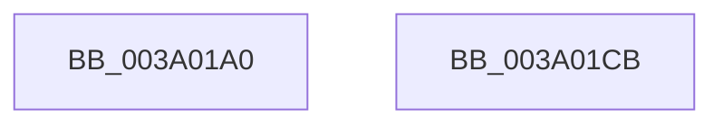

# ExCancelTimer

- RVA: `0x003A01A0`–`0x003A01CC` (길이 `44` bytes)
- VA: `0x00000001403A01A0`
- 실행 섹션: `.text`
- PDB 이름 있음: `예`; PDB Function 태그: `아니요`
- unwind 정보 RVA: `0x0005CAAC`
- 디코드: `14`개 명령, `44/44` bytes 표시
- 미해석 바이트: `0` (있으면 어셈블리에 `.byte`로 보존)

> 이 문서는 커널 이미지의 기계어와 PDB 기호를 분석해 생성했습니다. 4번과 5번은 함수 원형과 자료형을 바이너리 사용 방식에서 추정한 C 해석이며 원본 소스 복구 결과는 아닙니다.

## 1. Dependencies

- 직접 호출 지점: **2**; 고유 호출 대상: **2**
- 직접 호출자로 확인된 함수: **4**
- RIP 상대 이미지 참조: **0**

### Outgoing calls
- `0x003A01B0` → [ExpCheckForFreedEnhancedTimer](ExpCheckForFreedEnhancedTimer_function_003A0148.md) (function, `0x003A0148`)
- `0x003A01BB` → [KeCancelTimer2](KeCancelTimer2_function_003A01E0.md) (function, `0x003A01E0`)

### Direct callers
- [EtwpUpdatePeriodicCaptureState](../../page/7B/EtwpUpdatePeriodicCaptureState_function_007BCC4C.md) at `0x007BCD84`
- [PnpWatchdogTimerPause](../../page/95/PnpWatchdogTimerPause_function_00955B6C.md) at `0x00955B9C`
- [WdtpCancelTimer](../../page/95/WdtpCancelTimer_function_00955C70.md) at `0x00955CB0`
- [EtwpStopLoggerInstance](../../page/9B/EtwpStopLoggerInstance_function_009BEB94.md) at `0x009BEEEA`

### Static image references
- 디코드된 RIP-relative 메모리 참조가 없습니다.

## 2. Other-region calls and transfers

- 다른 실행 섹션으로 향하는 call: **0**
- 별도 외부 분기/꼬리 이동을 확인하지 못했습니다.

## 3. Assembly (complete function range)

```asm
003A01A0  48 89 5C 24 08                  mov qword ptr [rsp + 8], rbx
003A01A5  57                              push rdi
003A01A6  48 83 EC 20                     sub rsp, 0x20
003A01AA  48 8B DA                        mov rbx, rdx
003A01AD  48 8B F9                        mov rdi, rcx
003A01B0  E8 93 FF FF FF                  call 0x1403a0148
003A01B5  48 8B D3                        mov rdx, rbx
003A01B8  48 8B CF                        mov rcx, rdi
003A01BB  E8 20 00 00 00                  call 0x1403a01e0
003A01C0  48 8B 5C 24 30                  mov rbx, qword ptr [rsp + 0x30]
003A01C5  48 83 C4 20                     add rsp, 0x20
003A01C9  5F                              pop rdi
003A01CA  C3                              ret
003A01CB  CC                              int3
```

## 4. C-style interpretation (structured pseudocode)

```c
__int64 __fastcall ExCancelTimer(__int64 a1, __int64 a2)
{
    __int64 result;
    __int64 v_rsp;
    unsigned __int64 v_stack_p8;

    v_stack_p8 = v_rbx;
    v_rsp = (v_rsp) - (32);
    result = ExpCheckForFreedEnhancedTimer(a1, a2, a3, a4);
    result = KeCancelTimer2(a1, a2, a3, a4);
    v_rsp = (v_rsp) + (32);
    return result;
}
```

## 5. (Beta) C Style

```c
int64_t ExCancelTimer(int64_t Arg1, int64_t Arg2)
{
    int64_t result;
    int64_t local_rsp;
    uint64_t v_stack_p8;

    v_stack_p8 = local_rbx;
    local_rsp = (local_rsp) - (32);
    result = ExpCheckForFreedEnhancedTimer(Arg1, Arg2, a3, a4);
    result = KeCancelTimer2(Arg1, Arg2, a3, a4);
    local_rsp = (local_rsp) + (32);
    return result;
}
```

## 6. Execution-region graph

[열기: 2D/3D 그래프와 함수 탐색 컨트롤 패널](../../../control-panel.html?section=text&rva=0x003A01A0&view=graph)

- 2D 그래프는 위에서 아래로 흐르고, 3D 그래프는 빈 공간을 드래그해 회전합니다. Shift+드래그는 이동, 휠은 확대·축소, 함수 노드 선택은 대상 보고서 이동입니다.

### Static fallback


