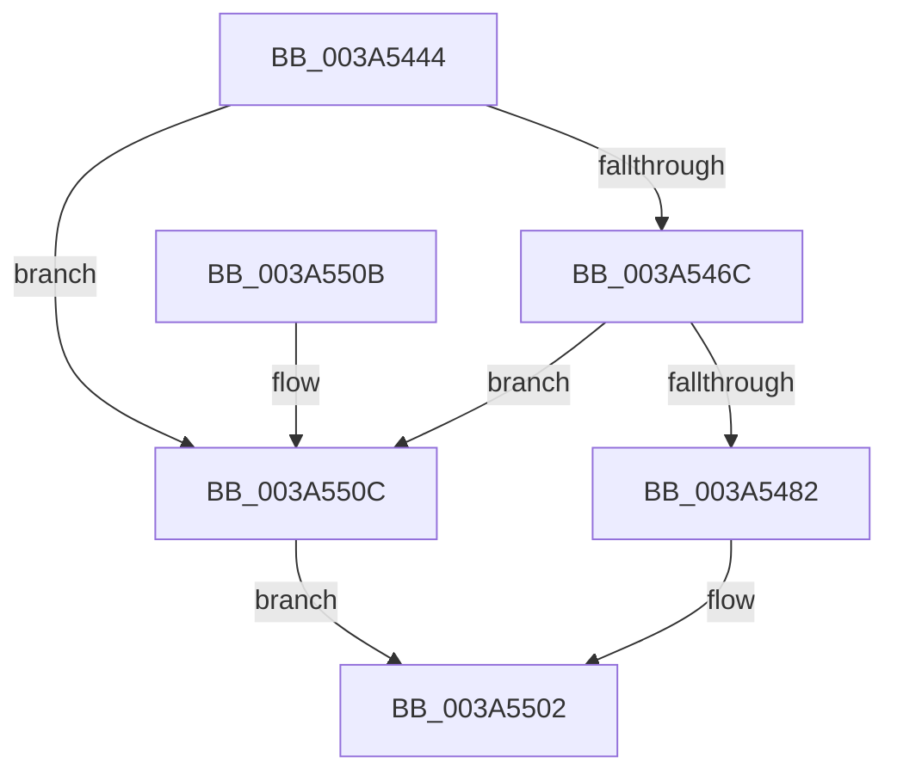

# ExCpuSetResourceManagerAccessCheck

- RVA: `0x003A5444`–`0x003A5510` (길이 `204` bytes)
- VA: `0x00000001403A5444`
- 실행 섹션: `.text`
- PDB 이름 있음: `예`; PDB Function 태그: `아니요`
- unwind 정보 RVA: `0x00089A64`
- 디코드: `44`개 명령, `204/204` bytes 표시
- 미해석 바이트: `0` (있으면 어셈블리에 `.byte`로 보존)

> 이 문서는 커널 이미지의 기계어와 PDB 기호를 분석해 생성했습니다. 4번과 5번은 함수 원형과 자료형을 바이너리 사용 방식에서 추정한 C 해석이며 원본 소스 복구 결과는 아닙니다.

## 1. Dependencies

- 직접 호출 지점: **4**; 고유 호출 대상: **4**
- 직접 호출자로 확인된 함수: **4**
- RIP 상대 이미지 참조: **3**

### Outgoing calls
- `0x003A5475` → [SeSinglePrivilegeCheck](../../page/87/SeSinglePrivilegeCheck_function_00871E20.md) (function, `0x00871E20`)
- `0x003A5497` → [SeCaptureSubjectContextEx](../../page/8C/SeCaptureSubjectContextEx_function_008C4C90.md) (function, `0x008C4C90`)
- `0x003A54EC` → [SeAccessCheckWithHint](SeAccessCheckWithHint_function_003A6C30.md) (function, `0x003A6C30`)
- `0x003A54F6` → [SeReleaseSubjectContext](../../page/86/SeReleaseSubjectContext_function_0086B710.md) (function, `0x0086B710`)

### Direct callers
- [ExpQuerySystemInformation](../../page/A5/ExpQuerySystemInformation_function_00A57858.md) at `0x00A5A640`
- [NtAcquireProcessActivityReference](../../page/A8/NtAcquireProcessActivityReference_function_00A8EFF0.md) at `0x00A8F03A`
- [NtSetInformationProcess](../../page/AE/NtSetInformationProcess_function_00AE5370.md) at `0x00AE8F35`
- [NtSetInformationProcess](../../page/AE/NtSetInformationProcess_function_00AE5370.md) at `0x00AE8FAD`
- [NtSetSystemInformation](../../page/AF/NtSetSystemInformation_function_00AF4A60.md) at `0x00AF60E0`
- [NtSetSystemInformation](../../page/AF/NtSetSystemInformation_function_00AF4A60.md) at `0x00AF6188`
- [NtSetSystemInformation](../../page/AF/NtSetSystemInformation_function_00AF4A60.md) at `0x00AF6573`

### Static image references
- `0x003A546E` → RVA `0x00FD9AE8` (`PAGEDATA`; read)
- `0x003A54BE` → RVA `0x00B4DAE0` (`ExpCpuSetSecurityDescriptor`; read)
- `0x003A54C9` → RVA `0x00B4B090` (`ExpRestrictedGenericMapping`; read)

## 2. Other-region calls and transfers

- 다른 실행 섹션으로 향하는 call: **3**
  - `0x003A5475` → [SeSinglePrivilegeCheck](../../page/87/SeSinglePrivilegeCheck_function_00871E20.md) (`.text` → `PAGE`)
  - `0x003A5497` → [SeCaptureSubjectContextEx](../../page/8C/SeCaptureSubjectContextEx_function_008C4C90.md) (`.text` → `PAGE`)
  - `0x003A54F6` → [SeReleaseSubjectContext](../../page/86/SeReleaseSubjectContext_function_0086B710.md) (`.text` → `PAGE`)
- 별도 외부 분기/꼬리 이동을 확인하지 못했습니다.

## 3. Assembly (complete function range)

```asm
003A5444  48 8B C4                        mov rax, rsp
003A5447  53                              push rbx
003A5448  48 81 EC 80 00 00 00            sub rsp, 0x80
003A544F  83 60 10 00                     and dword ptr [rax + 0x10], 0
003A5453  0F 57 C0                        xorps xmm0, xmm0
003A5456  83 60 08 00                     and dword ptr [rax + 8], 0
003A545A  8A D9                           mov bl, cl
003A545C  0F 11 40 D8                     movups xmmword ptr [rax - 0x28], xmm0
003A5460  0F 11 40 E8                     movups xmmword ptr [rax - 0x18], xmm0
003A5464  84 C9                           test cl, cl
003A5466  0F 84 A0 00 00 00               je 0x1403a550c
003A546C  8A D1                           mov dl, cl
003A546E  48 8B 0D 73 46 C3 00            mov rcx, qword ptr [rip + 0xc34673]
003A5475  E8 A6 C9 4C 00                  call 0x140871e20
003A547A  84 C0                           test al, al
003A547C  0F 85 8A 00 00 00               jne 0x1403a550c
003A5482  65 48 8B 0C 25 88 01 00 00      mov rcx, qword ptr gs:[0x188]
003A548B  4C 8D 44 24 60                  lea r8, [rsp + 0x60]
003A5490  48 8B 91 B8 00 00 00            mov rdx, qword ptr [rcx + 0xb8]
003A5497  E8 F4 F7 51 00                  call 0x1408c4c90
003A549C  48 8D 84 24 90 00 00 00         lea rax, [rsp + 0x90]
003A54A4  45 33 C9                        xor r9d, r9d
003A54A7  48 89 44 24 50                  mov qword ptr [rsp + 0x50], rax
003A54AC  4C 8D 44 24 60                  lea r8, [rsp + 0x60]
003A54B1  48 8D 84 24 98 00 00 00         lea rax, [rsp + 0x98]
003A54B9  48 89 44 24 48                  mov qword ptr [rsp + 0x48], rax
003A54BE  48 8D 0D 1B 86 7A 00            lea rcx, [rip + 0x7a861b]
003A54C5  88 5C 24 40                     mov byte ptr [rsp + 0x40], bl
003A54C9  48 8D 05 C0 5B 7A 00            lea rax, [rip + 0x7a5bc0]
003A54D0  48 89 44 24 38                  mov qword ptr [rsp + 0x38], rax
003A54D5  41 8D 51 07                     lea edx, [r9 + 7]
003A54D9  48 83 64 24 30 00               and qword ptr [rsp + 0x30], 0
003A54DF  83 64 24 28 00                  and dword ptr [rsp + 0x28], 0
003A54E4  C7 44 24 20 01 00 00 00         mov dword ptr [rsp + 0x20], 1
003A54EC  E8 3F 17 00 00                  call 0x1403a6c30
003A54F1  48 8D 4C 24 60                  lea rcx, [rsp + 0x60]
003A54F6  E8 15 62 4C 00                  call 0x14086b710
003A54FB  8B 84 24 90 00 00 00            mov eax, dword ptr [rsp + 0x90]
003A5502  48 81 C4 80 00 00 00            add rsp, 0x80
003A5509  5B                              pop rbx
003A550A  C3                              ret
003A550B  CC                              int3
003A550C  33 C0                           xor eax, eax
003A550E  EB F2                           jmp 0x1403a5502
```

## 4. C-style interpretation (structured pseudocode)

```c
__int64 __fastcall ExCpuSetResourceManagerAccessCheck(unsigned __int8 a1, __int64 a2, __int64 a3, int a4)
{
    __int64 result;
    __int64 v_rsp;
    unsigned __int64 v_stack_m28;
    unsigned __int64 v_stack_m38;
    unsigned __int64 v_stack_m40;
    unsigned __int8 v_stack_m48;
    unsigned __int64 v_stack_m50;
    unsigned __int64 v_stack_m58;
    unsigned int v_stack_m60;
    unsigned int v_stack_m68;
    unsigned __int64 v_stack_p10;
    unsigned __int64 v_stack_p8;

    v_rsp = (v_rsp) - (128);
    *(unsigned __int64 *)(v_rsp - 40) = v_xmm0;
    *(unsigned __int64 *)(v_rsp - 24) = v_xmm0;
    if (a1 == 0) goto loc_003A550C;
    result = SeSinglePrivilegeCheck(*(unsigned __int64 *)(v_rip + 12797555), a1, a3, a4);
    if ((unsigned __int8)(result) != 0) goto loc_003A550C;
    result = SeCaptureSubjectContextEx(*(unsigned __int64 *)(gs_base + (0 + 392)), *(unsigned __int64 *)(*(unsigned __int64 *)(gs_base + (0 + 392)) + 184), v_stack_m28, a4);
    a4 = 0;
    v_stack_m38 = v_stack_p8;
    v_stack_m40 = v_stack_p10;
    v_stack_m48 = a1;
    v_stack_m50 = v_rip + 8018880;
    v_stack_m68 = 1;
    result = SeAccessCheckWithHint(v_rip + 8029723, a4 + 7, v_stack_m28, a4);
    result = SeReleaseSubjectContext(v_stack_m28, a4 + 7, v_stack_m28, a4);
loc_003A5502:
    v_rsp = (v_rsp) + (128);
    return (unsigned int)(v_stack_p8);
loc_003A550C:
    result = 0;
    goto loc_003A5502;
}
```

## 5. (Beta) C Style

```c
int64_t ExCpuSetResourceManagerAccessCheck(uint8_t Arg1, int64_t Arg2, int64_t Arg3, int32_t Arg4)
{
    int64_t result;
    int64_t local_rsp;
    uint64_t v_stack_m28;
    uint64_t v_stack_m38;
    uint64_t v_stack_m40;
    uint8_t v_stack_m48;
    uint64_t v_stack_m50;
    uint64_t v_stack_m58;
    uint32_t v_stack_m60;
    uint32_t v_stack_m68;
    uint64_t v_stack_p10;
    uint64_t v_stack_p8;

    local_rsp = (local_rsp) - (128);
    *(uint64_t *)(local_rsp - 0x28) = v_xmm0;
    *(uint64_t *)(local_rsp - 0x18) = v_xmm0;
    if (Arg1 == 0) goto loc_003A550C;
    result = SeSinglePrivilegeCheck(*(uint64_t *)(v_rip + 0xC34673), Arg1, Arg3, Arg4);
    if ((uint8_t)(result) != 0) goto loc_003A550C;
    result = SeCaptureSubjectContextEx(*(uint64_t *)(gs_base + (0 + 0x188)), *(uint64_t *)(*(uint64_t *)(gs_base + (0 + 0x188)) + 0xB8), v_stack_m28, Arg4);
    Arg4 = 0;
    v_stack_m38 = v_stack_p8;
    v_stack_m40 = v_stack_p10;
    v_stack_m48 = Arg1;
    v_stack_m50 = v_rip + 8018880;
    v_stack_m68 = 1;
    result = SeAccessCheckWithHint(v_rip + 8029723, Arg4 + 7, v_stack_m28, Arg4);
    result = SeReleaseSubjectContext(v_stack_m28, Arg4 + 7, v_stack_m28, Arg4);
loc_003A5502:
    local_rsp = (local_rsp) + (128);
    return (uint32_t)(v_stack_p8);
loc_003A550C:
    result = 0;
    goto loc_003A5502;
}
```

## 6. Execution-region graph

[열기: 2D/3D 그래프와 함수 탐색 컨트롤 패널](../../../control-panel.html?section=text&rva=0x003A5444&view=graph)

- 2D 그래프는 위에서 아래로 흐르고, 3D 그래프는 빈 공간을 드래그해 회전합니다. Shift+드래그는 이동, 휠은 확대·축소, 함수 노드 선택은 대상 보고서 이동입니다.

### Static fallback


