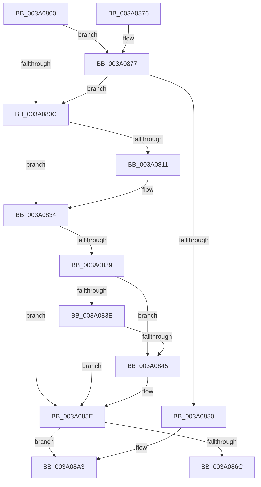

# ExSetTimer

- RVA: `0x003A0800`–`0x003A08CD` (길이 `205` bytes)
- VA: `0x00000001403A0800`
- 실행 섹션: `.text`
- PDB 이름 있음: `예`; PDB Function 태그: `아니요`
- unwind 정보 RVA: `0x00081E20`
- 디코드: `51`개 명령, `205/205` bytes 표시
- 미해석 바이트: `0` (있으면 어셈블리에 `.byte`로 보존)

> 이 문서는 커널 이미지의 기계어와 PDB 기호를 분석해 생성했습니다. 4번과 5번은 함수 원형과 자료형을 바이너리 사용 방식에서 추정한 C 해석이며 원본 소스 복구 결과는 아닙니다.

## 1. Dependencies

- 직접 호출 지점: **5**; 고유 호출 대상: **2**
- 직접 호출자로 확인된 함수: **8**
- RIP 상대 이미지 참조: **1**

### Outgoing calls
- `0x003A082E` → [KeBugCheckEx](../4F/KeBugCheckEx_function_004FD660.md) (function, `0x004FD660`)
- `0x003A0858` → [KeBugCheckEx](../4F/KeBugCheckEx_function_004FD660.md) (function, `0x004FD660`)
- `0x003A086C` → [KeSetTimer2](KeSetTimer2_function_003A08E0.md) (function, `0x003A08E0`)
- `0x003A089D` → [KeBugCheckEx](../4F/KeBugCheckEx_function_004FD660.md) (function, `0x004FD660`)
- `0x003A08C7` → [KeBugCheckEx](../4F/KeBugCheckEx_function_004FD660.md) (function, `0x004FD660`)

### Direct callers
- [CmFcpManagerArmFeatureUsageProviderFlushTimer](../4F/CmFcpManagerArmFeatureUsageProviderFlushTimer_function_004FC838.md) at `0x004FC875`
- [CmFcpManagerArmFeatureUsageProviderPublishTimer](../66/CmFcpManagerArmFeatureUsageProviderPublishTimer_function_0066B280.md) at `0x0066B2BD`
- [CmFcpManagerArmFeatureUsageRetryTimer](../66/CmFcpManagerArmFeatureUsageRetryTimer_function_0066B2DC.md) at `0x0066B31F`
- [HalpRegisterPmuNotification](../../page/70/HalpRegisterPmuNotification_function_0070C38C.md) at `0x0070C540`
- [EtwpUpdatePeriodicCaptureState](../../page/7B/EtwpUpdatePeriodicCaptureState_function_007BCC4C.md) at `0x007BCE4E`
- [SendCaptureStateNotificationsWorker](../../page/7B/SendCaptureStateNotificationsWorker_function_007BCF30.md) at `0x007BD26B`
- [WdipTimeoutCheckRoutine](../../page/A5/WdipTimeoutCheckRoutine_function_00A5B910.md) at `0x00A5B9FC`
- [sub_00BF16D0](../../init/BF/Unknown_function_00BF16D0.md) at `0x00BF7D2E`

### Static image references
- `0x003A085E` → RVA `0x00FC6AF6` (`ALMOSTRO`; read)

## 2. Other-region calls and transfers

- 다른 실행 섹션으로 향하는 call: **0**
- 별도 외부 분기/꼬리 이동을 확인하지 못했습니다.

## 3. Assembly (complete function range)

```asm
003A0800  48 83 EC 48                     sub rsp, 0x48
003A0804  45 33 D2                        xor r10d, r10d
003A0807  48 85 D2                        test rdx, rdx
003A080A  7F 6B                           jg 0x1403a0877
003A080C  4D 85 C0                        test r8, r8
003A080F  79 23                           jns 0x1403a0834
003A0811  BA 09 00 00 00                  mov edx, 9
003A0816  4C 89 44 24 30                  mov qword ptr [rsp + 0x30], r8
003A081B  4C 8D 4C 24 30                  lea r9, [rsp + 0x30]
003A0820  4C 89 54 24 20                  mov qword ptr [rsp + 0x20], r10
003A0825  B9 C7 00 00 00                  mov ecx, 0xc7
003A082A  44 8D 42 FB                     lea r8d, [rdx - 5]
003A082E  E8 2D CE 15 00                  call 0x1404fd660
003A0833  CC                              int3
003A0834  4D 85 C9                        test r9, r9
003A0837  74 25                           je 0x1403a085e
003A0839  45 39 11                        cmp dword ptr [r9], r10d
003A083C  75 07                           jne 0x1403a0845
003A083E  49 83 79 08 FF                  cmp qword ptr [r9 + 8], -1
003A0843  7D 19                           jge 0x1403a085e
003A0845  BA 09 00 00 00                  mov edx, 9
003A084A  4C 89 54 24 20                  mov qword ptr [rsp + 0x20], r10
003A084F  B9 C7 00 00 00                  mov ecx, 0xc7
003A0854  44 8D 42 F8                     lea r8d, [rdx - 8]
003A0858  E8 03 CE 15 00                  call 0x1404fd660
003A085D  CC                              int3
003A085E  8A 05 92 62 C2 00               mov al, byte ptr [rip + 0xc26292]
003A0864  38 81 98 00 00 00               cmp byte ptr [rcx + 0x98], al
003A086A  75 37                           jne 0x1403a08a3
003A086C  E8 6F 00 00 00                  call 0x1403a08e0
003A0871  48 83 C4 48                     add rsp, 0x48
003A0875  C3                              ret
003A0876  CC                              int3
003A0877  F6 81 81 00 00 00 04            test byte ptr [rcx + 0x81], 4
003A087E  74 8C                           je 0x1403a080c
003A0880  48 89 54 24 58                  mov qword ptr [rsp + 0x58], rdx
003A0885  4C 8D 4C 24 58                  lea r9, [rsp + 0x58]
003A088A  BA 09 00 00 00                  mov edx, 9
003A088F  4C 89 54 24 20                  mov qword ptr [rsp + 0x20], r10
003A0894  B9 C7 00 00 00                  mov ecx, 0xc7
003A0899  44 8D 42 F9                     lea r8d, [rdx - 7]
003A089D  E8 BE CD 15 00                  call 0x1404fd660
003A08A2  CC                              int3
003A08A3  65 48 8B 04 25 88 01 00 00      mov rax, qword ptr gs:[0x188]
003A08AC  48 8B D1                        mov rdx, rcx
003A08AF  41 B8 01 00 00 00               mov r8d, 1
003A08B5  4C 89 54 24 20                  mov qword ptr [rsp + 0x20], r10
003A08BA  B9 C6 00 00 00                  mov ecx, 0xc6
003A08BF  4C 0F BE 88 32 02 00 00         movsx r9, byte ptr [rax + 0x232]
003A08C7  E8 94 CD 15 00                  call 0x1404fd660
003A08CC  CC                              int3
```

## 4. C-style interpretation (structured pseudocode)

```c
__int64 __fastcall ExSetTimer(__int64 a1, __int64 a2, __int64 a3)
{
    __int64 result;
    __int64 v_r10;
    __int64 v_rsp;
    unsigned __int64 v_stack_m18;
    unsigned __int64 v_stack_m28;
    unsigned __int64 v_stack_p20;
    unsigned __int64 v_stack_p58;

    v_rsp = (v_rsp) - (72);
    v_r10 = 0;
    if (condition_is_greater) goto loc_003A0877;
loc_003A080C:
    if (sign_flag) {
        a2 = 9;
        v_stack_m18 = a3;
        a4 = v_stack_m18;
        v_stack_m28 = 0;
        a1 = 199;
        a3 = a2 - 5;
        result = KeBugCheckEx(a1, a2, a3, a4);
    }
    if (a4 == 0) goto loc_003A085E;
    if ((*(unsigned int *)(a4)) != 0) goto loc_003A0845;
    if ((*(unsigned __int64 *)(a4 + 8)) < -1) {
        a2 = 9;
        v_stack_m28 = 0;
        a1 = 199;
        a3 = a2 - 8;
        result = KeBugCheckEx(a1, a2, a3, a4);
    }
    if ((*(unsigned __int8 *)(a1 + 152)) != ((unsigned __int8)(*(unsigned __int8 *)(v_rip + 12739218)))) goto loc_003A08A3;
    result = KeSetTimer2(a1, a2, a3, a4);
    v_rsp = (v_rsp) + (72);
    return result;
loc_003A0877:
    if (((*(unsigned __int8 *)(a1 + 129)) & (4)) == 0) goto loc_003A080C;
    v_stack_p58 = a2;
    v_stack_p20 = 0;
    result = KeBugCheckEx(199, 9, 9 - 7, v_stack_p58);
loc_003A08A3:
    v_stack_p20 = 0;
    result = KeBugCheckEx(198, 199, 1, (__int8)(*(unsigned __int8 *)(*(unsigned __int64 *)(gs_base + (0 + 392)) + 562)));
    return result;
}
```

## 5. (Beta) C Style

```c
int64_t ExSetTimer(void *Arg1, int64_t Arg2, int64_t Arg3)
{
    uint8_t *arg1 = (uint8_t *)Arg1;

    int64_t result;
    int64_t local_r10;
    int64_t local_rsp;
    uint64_t v_stack_m18;
    uint64_t v_stack_m28;
    uint64_t v_stack_p20;
    uint64_t v_stack_p58;

    local_rsp = (local_rsp) - (72);
    local_r10 = 0;
    if (condition_is_greater) goto loc_003A0877;
loc_003A080C:
    if (sign_flag) {
        Arg2 = 9;
        v_stack_m18 = Arg3;
        a4 = v_stack_m18;
        v_stack_m28 = 0;
        Arg1 = 199;
        Arg3 = Arg2 - 5;
        result = KeBugCheckEx(Arg1, Arg2, Arg3, a4);
    }
    if (a4 == 0) goto loc_003A085E;
    if ((*(uint32_t *)(a4)) != 0) goto loc_003A0845;
    if ((*(uint64_t *)(a4 + 0x8)) < -1) {
        Arg2 = 9;
        v_stack_m28 = 0;
        Arg1 = 199;
        Arg3 = Arg2 - 8;
        result = KeBugCheckEx(Arg1, Arg2, Arg3, a4);
    }
    if ((*(uint8_t *)(arg1 + 0x98)) != ((uint8_t)(*(uint8_t *)(v_rip + 0xC26292)))) goto loc_003A08A3;
    result = KeSetTimer2(Arg1, Arg2, Arg3, a4);
    local_rsp = (local_rsp) + (72);
    return result;
loc_003A0877:
    if (((*(uint8_t *)(arg1 + 0x81)) & (4)) == 0) goto loc_003A080C;
    v_stack_p58 = Arg2;
    v_stack_p20 = 0;
    result = KeBugCheckEx(199, 9, 9 - 7, v_stack_p58);
loc_003A08A3:
    v_stack_p20 = 0;
    result = KeBugCheckEx(198, 199, 1, (int8_t)(*(uint8_t *)(*(uint64_t *)(gs_base + (0 + 0x188)) + 0x232)));
    return result;
}
```

### 관측된 메모리 오프셋

구조체 형식이 확인되지 않은 접근은 인자 기준의 오프셋으로만 기록했습니다.

| 기준 인자 | 오프셋 표현 | 폭 (bit) | 접근 |
|---|---:|---:|---|
| `Arg1` | `+ 0x81` | `8` | `R` |

## 6. Execution-region graph

[열기: 2D/3D 그래프와 함수 탐색 컨트롤 패널](../../../control-panel.html?section=text&rva=0x003A0800&view=graph)

- 2D 그래프는 위에서 아래로 흐르고, 3D 그래프는 빈 공간을 드래그해 회전합니다. Shift+드래그는 이동, 휠은 확대·축소, 함수 노드 선택은 대상 보고서 이동입니다.

### Static fallback


