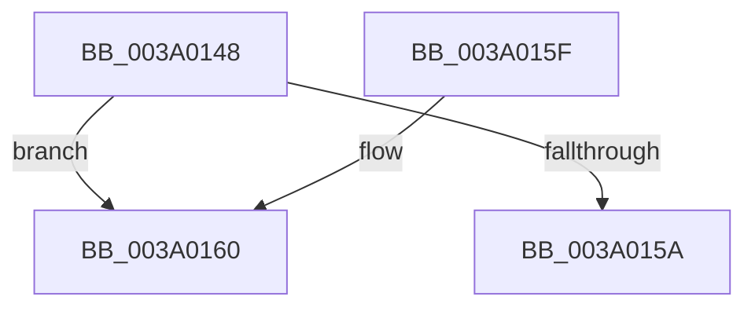

# ExpCheckForFreedEnhancedTimer

- RVA: `0x003A0148`–`0x003A018B` (길이 `67` bytes)
- VA: `0x00000001403A0148`
- 실행 섹션: `.text`
- PDB 이름 있음: `예`; PDB Function 태그: `아니요`
- unwind 정보 RVA: `0x00081DA8`
- 디코드: `15`개 명령, `67/67` bytes 표시
- 미해석 바이트: `0` (있으면 어셈블리에 `.byte`로 보존)

> 이 문서는 커널 이미지의 기계어와 PDB 기호를 분석해 생성했습니다. 4번과 5번은 함수 원형과 자료형을 바이너리 사용 방식에서 추정한 C 해석이며 원본 소스 복구 결과는 아닙니다.

## 1. Dependencies

- 직접 호출 지점: **1**; 고유 호출 대상: **1**
- 직접 호출자로 확인된 함수: **5**
- RIP 상대 이미지 참조: **1**

### Outgoing calls
- `0x003A0185` → [KeBugCheckEx](../4F/KeBugCheckEx_function_004FD660.md) (function, `0x004FD660`)

### Direct callers
- [RtlpHpEnvCompactionSchedule](../32/RtlpHpEnvCompactionSchedule_function_003264A0.md) at `0x00326559`
- [WdtpArmTimer](../39/WdtpArmTimer_function_0039F230.md) at `0x0039F263`
- [ExDeleteTimer](../39/ExDeleteTimer_function_0039F2E0.md) at `0x0039F300`
- [ExCancelTimer](ExCancelTimer_function_003A01A0.md) at `0x003A01B0`
- [EnableFlushTimer](../45/EnableFlushTimer_function_0045B5B8.md) at `0x0045B628`

### Static image references
- `0x003A014C` → RVA `0x00FC6AF6` (`ALMOSTRO`; read)

## 2. Other-region calls and transfers

- 다른 실행 섹션으로 향하는 call: **0**
- 별도 외부 분기/꼬리 이동을 확인하지 못했습니다.

## 3. Assembly (complete function range)

```asm
003A0148  48 83 EC 38                     sub rsp, 0x38
003A014C  8A 05 A4 69 C2 00               mov al, byte ptr [rip + 0xc269a4]
003A0152  38 81 98 00 00 00               cmp byte ptr [rcx + 0x98], al
003A0158  75 06                           jne 0x1403a0160
003A015A  48 83 C4 38                     add rsp, 0x38
003A015E  C3                              ret
003A015F  CC                              int3
003A0160  65 48 8B 04 25 88 01 00 00      mov rax, qword ptr gs:[0x188]
003A0169  48 8B D1                        mov rdx, rcx
003A016C  48 83 64 24 20 00               and qword ptr [rsp + 0x20], 0
003A0172  41 B8 01 00 00 00               mov r8d, 1
003A0178  B9 C6 00 00 00                  mov ecx, 0xc6
003A017D  4C 0F BE 88 32 02 00 00         movsx r9, byte ptr [rax + 0x232]
003A0185  E8 D6 D4 15 00                  call 0x1404fd660
003A018A  CC                              int3
```

## 4. C-style interpretation (structured pseudocode)

```c
__int64 __fastcall ExpCheckForFreedEnhancedTimer(__int64 a1)
{
    __int64 result;
    __int64 v_rsp;
    unsigned __int64 v_stack_p20;

    v_rsp = (v_rsp) - (56);
    if ((*(unsigned __int8 *)(a1 + 152)) != ((unsigned __int8)(*(unsigned __int8 *)(v_rip + 12741028)))) goto loc_003A0160;
    v_rsp = (v_rsp) + (56);
    return *(unsigned __int8 *)(v_rip + 12741028);
loc_003A0160:
    result = KeBugCheckEx(198, a1, 1, (__int8)(*(unsigned __int8 *)(*(unsigned __int64 *)(gs_base + (0 + 392)) + 562)));
    return result;
}
```

## 5. (Beta) C Style

```c
int64_t ExpCheckForFreedEnhancedTimer(void *Arg1)
{
    uint8_t *arg1 = (uint8_t *)Arg1;

    int64_t result;
    int64_t local_rsp;
    uint64_t v_stack_p20;

    local_rsp = (local_rsp) - (56);
    if ((*(uint8_t *)(arg1 + 0x98)) != ((uint8_t)(*(uint8_t *)(v_rip + 0xC269A4)))) goto loc_003A0160;
    local_rsp = (local_rsp) + (56);
    return *(uint8_t *)(v_rip + 0xC269A4);
loc_003A0160:
    result = KeBugCheckEx(198, Arg1, 1, (int8_t)(*(uint8_t *)(*(uint64_t *)(gs_base + (0 + 0x188)) + 0x232)));
    return result;
}
```

### 관측된 메모리 오프셋

구조체 형식이 확인되지 않은 접근은 인자 기준의 오프셋으로만 기록했습니다.

| 기준 인자 | 오프셋 표현 | 폭 (bit) | 접근 |
|---|---:|---:|---|
| `Arg1` | `+ 0x98` | `8` | `R` |

## 6. Execution-region graph

[열기: 2D/3D 그래프와 함수 탐색 컨트롤 패널](../../../control-panel.html?section=text&rva=0x003A0148&view=graph)

- 2D 그래프는 위에서 아래로 흐르고, 3D 그래프는 빈 공간을 드래그해 회전합니다. Shift+드래그는 이동, 휠은 확대·축소, 함수 노드 선택은 대상 보고서 이동입니다.

### Static fallback


