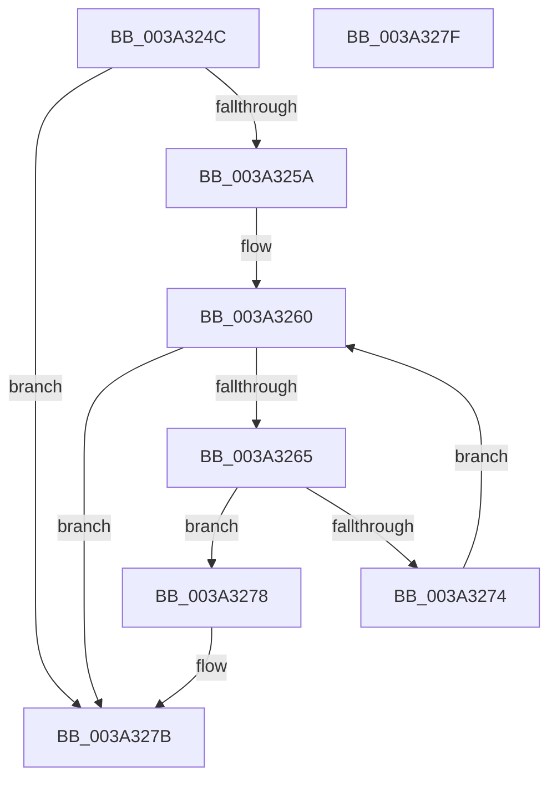

# ExpExTimerAttributesAreValid

- RVA: `0x003A324C`–`0x003A3280` (길이 `52` bytes)
- VA: `0x00000001403A324C`
- 실행 섹션: `.text`
- PDB 이름 있음: `예`; PDB Function 태그: `아니요`
- unwind 정보 RVA: `0x000DB714`
- 디코드: `19`개 명령, `52/52` bytes 표시
- 미해석 바이트: `0` (있으면 어셈블리에 `.byte`로 보존)

> 이 문서는 커널 이미지의 기계어와 PDB 기호를 분석해 생성했습니다. 4번과 5번은 함수 원형과 자료형을 바이너리 사용 방식에서 추정한 C 해석이며 원본 소스 복구 결과는 아닙니다.

## 1. Dependencies

- 직접 호출 지점: **0**; 고유 호출 대상: **0**
- 직접 호출자로 확인된 함수: **2**
- RIP 상대 이미지 참조: **1**

### Outgoing calls
- 직접 디코드된 call 명령이 없습니다.

### Direct callers
- [ExAllocateTimerInternal2](ExAllocateTimerInternal2_function_003A3110.md) at `0x003A3137`
- [NtCreateTimer2](../../page/A2/NtCreateTimer2_function_00A2C660.md) at `0x00A2C68E`

### Static image references
- `0x003A3267` → RVA `0x000394A0` (`.rdata`; read)

## 2. Other-region calls and transfers

- 다른 실행 섹션으로 향하는 call: **0**
- 별도 외부 분기/꼬리 이동을 확인하지 못했습니다.

## 3. Assembly (complete function range)

```asm
003A324C  8B C1                           mov eax, ecx
003A324E  45 33 C0                        xor r8d, r8d
003A3251  25 0E 00 00 80                  and eax, 0x8000000e
003A3256  3B C1                           cmp eax, ecx
003A3258  75 21                           jne 0x1403a327b
003A325A  83 E1 0E                        and ecx, 0xe
003A325D  41 8B D0                        mov edx, r8d
003A3260  83 FA 06                        cmp edx, 6
003A3263  73 16                           jae 0x1403a327b
003A3265  8B C2                           mov eax, edx
003A3267  4C 8D 0D 32 62 C9 FF            lea r9, [rip - 0x369dce]
003A326E  41 3B 0C 81                     cmp ecx, dword ptr [r9 + rax*4]
003A3272  74 04                           je 0x1403a3278
003A3274  FF C2                           inc edx
003A3276  EB E8                           jmp 0x1403a3260
003A3278  41 B0 01                        mov r8b, 1
003A327B  41 8A C0                        mov al, r8b
003A327E  C3                              ret
003A327F  CC                              int3
```

## 4. C-style interpretation (structured pseudocode)

```c
__int64 __fastcall ExpExTimerAttributesAreValid(int a1, __int64 a2, int a3)
{
    __int64 result;

    a3 = 0;
    result = (unsigned int)(((unsigned int)(a1)) & (0x8000000EULL));
    if (((unsigned int)(result)) != a1) goto loc_003A327B;
    a1 = (unsigned int)((a1) & (14));
loc_003A3260:
    if (0 >= 6) goto loc_003A327B;
    if (a1 == (*(unsigned int *)(v_rip - 3579342 + 0 * 4))) goto loc_003A3278;
    a2 = (unsigned int)((0) + 1);
    goto loc_003A3260;
loc_003A3278:
loc_003A327B:
    return 1;
}
```

## 5. (Beta) C Style

```c
int64_t ExpExTimerAttributesAreValid(int32_t Arg1, int64_t Arg2, int32_t Arg3)
{
    int64_t result;

    Arg3 = 0;
    result = (uint32_t)(((uint32_t)(Arg1)) & (0x8000000EULL));
    if (((uint32_t)(result)) != Arg1) goto loc_003A327B;
    Arg1 = (uint32_t)((Arg1) & (14));
loc_003A3260:
    if (0 >= 6) goto loc_003A327B;
    if (Arg1 == (*(uint32_t *)(v_rip - 0x369DCE + 0x0 * 4))) goto loc_003A3278;
    Arg2 = (uint32_t)((0) + 1);
    goto loc_003A3260;
loc_003A3278:
loc_003A327B:
    return 1;
}
```

## 6. Execution-region graph

[열기: 2D/3D 그래프와 함수 탐색 컨트롤 패널](../../../control-panel.html?section=text&rva=0x003A324C&view=graph)

- 2D 그래프는 위에서 아래로 흐르고, 3D 그래프는 빈 공간을 드래그해 회전합니다. Shift+드래그는 이동, 휠은 확대·축소, 함수 노드 선택은 대상 보고서 이동입니다.

### Static fallback


