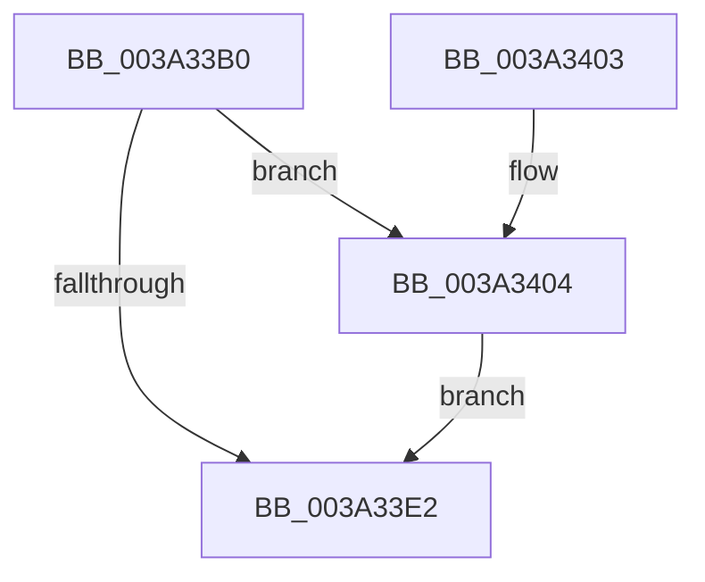

# ExpFinalizeTimerDeletion

- RVA: `0x003A33B0`–`0x003A3424` (길이 `116` bytes)
- VA: `0x00000001403A33B0`
- 실행 섹션: `.text`
- PDB 이름 있음: `예`; PDB Function 태그: `아니요`
- unwind 정보 RVA: `0x00069370`
- 디코드: `32`개 명령, `116/116` bytes 표시
- 미해석 바이트: `0` (있으면 어셈블리에 `.byte`로 보존)

> 이 문서는 커널 이미지의 기계어와 PDB 기호를 분석해 생성했습니다. 4번과 5번은 함수 원형과 자료형을 바이너리 사용 방식에서 추정한 C 해석이며 원본 소스 복구 결과는 아닙니다.

## 1. Dependencies

- 직접 호출 지점: **2**; 고유 호출 대상: **2**
- 직접 호출자로 확인된 함수: **1**
- RIP 상대 이미지 참조: **3**

### Outgoing calls
- `0x003A33F8` → [ExFreePoolWithTag](../../poolcode/B8/ExFreePoolWithTag_function_00B82870.md) (function, `0x00B82870`)
- `0x003A341D` → [guard_dispatch_icall](../6B/guard_dispatch_icall_function_006BAAD0.md) (function, `0x006BAAD0`)

### Direct callers
- [KiFinalizeTimer2Disablement](KiFinalizeTimer2Disablement_function_003A2198.md) at `0x003A2286`

### Static image references
- `0x003A33B6` → RVA `0x00FC6F78` (`ALMOSTRO`; read)
- `0x003A33C0` → RVA `0x00FC7250` (`ALMOSTRO`; read)
- `0x003A33E2` → RVA `0x00FC6AF6` (`ALMOSTRO`; read)

## 2. Other-region calls and transfers

- 다른 실행 섹션으로 향하는 call: **1**
  - `0x003A33F8` → [ExFreePoolWithTag](../../poolcode/B8/ExFreePoolWithTag_function_00B82870.md) (`.text` → `POOLCODE`)
- 별도 외부 분기/꼬리 이동을 확인하지 못했습니다.

## 3. Assembly (complete function range)

```asm
003A33B0  40 53                           push rbx
003A33B2  48 83 EC 20                     sub rsp, 0x20
003A33B6  4C 8B 05 BB 3B C2 00            mov r8, qword ptr [rip + 0xc23bbb]
003A33BD  48 8B D9                        mov rbx, rcx
003A33C0  4C 8B 0D 89 3E C2 00            mov r9, qword ptr [rip + 0xc23e89]
003A33C7  49 8B C0                        mov rax, r8
003A33CA  48 33 81 88 00 00 00            xor rax, qword ptr [rcx + 0x88]
003A33D1  41 8B C8                        mov ecx, r8d
003A33D4  48 D3 C0                        rol rax, cl
003A33D7  48 33 C3                        xor rax, rbx
003A33DA  48 0F C8                        bswap rax
003A33DD  49 33 C1                        xor rax, r9
003A33E0  75 22                           jne 0x1403a3404
003A33E2  8A 05 0E 37 C2 00               mov al, byte ptr [rip + 0xc2370e]
003A33E8  BA 45 78 54 6D                  mov edx, 0x6d547845
003A33ED  F6 D0                           not al
003A33EF  48 8B CB                        mov rcx, rbx
003A33F2  88 83 98 00 00 00               mov byte ptr [rbx + 0x98], al
003A33F8  E8 73 F4 7D 00                  call 0x140b82870
003A33FD  48 83 C4 20                     add rsp, 0x20
003A3401  5B                              pop rbx
003A3402  C3                              ret
003A3403  CC                              int3
003A3404  49 8B D0                        mov rdx, r8
003A3407  48 33 93 90 00 00 00            xor rdx, qword ptr [rbx + 0x90]
003A340E  48 D3 C2                        rol rdx, cl
003A3411  48 33 D3                        xor rdx, rbx
003A3414  48 0F CA                        bswap rdx
003A3417  49 33 D1                        xor rdx, r9
003A341A  48 8B CA                        mov rcx, rdx
003A341D  E8 AE 76 31 00                  call 0x1406baad0
003A3422  EB BE                           jmp 0x1403a33e2
```

## 4. C-style interpretation (structured pseudocode)

```c
__int64 __fastcall ExpFinalizeTimerDeletion(__int64 a1)
{
    __int64 result;
    __int64 v_rsp;

    v_rsp = (v_rsp) - (32);
    result = (*(unsigned __int64 *)(v_rip + 12729275)) ^ (*(unsigned __int64 *)(a1 + 136));
    result = (result) ^ (a1);
    result = (result) ^ (*(unsigned __int64 *)(v_rip + 12729993));
    if (condition_is_not_equal) goto loc_003A3404;
loc_003A33E2:
    result = (unsigned __int8)(~(*(unsigned __int8 *)(v_rip + 12728078)));
    *(unsigned __int8 *)(a1 + 152) = (unsigned __int8)(result);
    result = ExFreePoolWithTag(a1, (unsigned int)(0x6D547845ULL), *(unsigned __int64 *)(v_rip + 12729275), *(unsigned __int64 *)(v_rip + 12729993));
    v_rsp = (v_rsp) + (32);
    return result;
loc_003A3404:
    a2 = (*(unsigned __int64 *)(v_rip + 12729275)) ^ (*(unsigned __int64 *)(a1 + 144));
    a2 = (a2) ^ (a1);
    a2 = (a2) ^ (*(unsigned __int64 *)(v_rip + 12729993));
    result = guard_dispatch_icall(a2, a2, *(unsigned __int64 *)(v_rip + 12729275), *(unsigned __int64 *)(v_rip + 12729993));
    goto loc_003A33E2;
}
```

## 5. (Beta) C Style

```c
int64_t ExpFinalizeTimerDeletion(void *Arg1)
{
    uint8_t *arg1 = (uint8_t *)Arg1;

    int64_t result;
    int64_t local_rsp;

    local_rsp = (local_rsp) - (32);
    result = (*(uint64_t *)(v_rip + 0xC23BBB)) ^ (*(uint64_t *)(arg1 + 0x88));
    result = (result) ^ (Arg1);
    result = (result) ^ (*(uint64_t *)(v_rip + 0xC23E89));
    if (condition_is_not_equal) goto loc_003A3404;
loc_003A33E2:
    result = (uint8_t)(~(*(uint8_t *)(v_rip + 0xC2370E)));
    *(uint8_t *)(arg1 + 0x98) = (uint8_t)(result);
    result = ExFreePoolWithTag(Arg1, (uint32_t)(0x6D547845ULL), *(uint64_t *)(v_rip + 0xC23BBB), *(uint64_t *)(v_rip + 0xC23E89));
    local_rsp = (local_rsp) + (32);
    return result;
loc_003A3404:
    a2 = (*(uint64_t *)(v_rip + 0xC23BBB)) ^ (*(uint64_t *)(arg1 + 0x90));
    a2 = (a2) ^ (Arg1);
    a2 = (a2) ^ (*(uint64_t *)(v_rip + 0xC23E89));
    result = guard_dispatch_icall(a2, a2, *(uint64_t *)(v_rip + 0xC23BBB), *(uint64_t *)(v_rip + 0xC23E89));
    goto loc_003A33E2;
}
```

### 관측된 메모리 오프셋

구조체 형식이 확인되지 않은 접근은 인자 기준의 오프셋으로만 기록했습니다.

| 기준 인자 | 오프셋 표현 | 폭 (bit) | 접근 |
|---|---:|---:|---|
| `Arg1` | `+ 0x88` | `64` | `R` |
| `Arg1` | `+ 0x90` | `64` | `R` |
| `Arg1` | `+ 0x98` | `8` | `W` |

## 6. Execution-region graph

[열기: 2D/3D 그래프와 함수 탐색 컨트롤 패널](../../../control-panel.html?section=text&rva=0x003A33B0&view=graph)

- 2D 그래프는 위에서 아래로 흐르고, 3D 그래프는 빈 공간을 드래그해 회전합니다. Shift+드래그는 이동, 휠은 확대·축소, 함수 노드 선택은 대상 보고서 이동입니다.

### Static fallback


