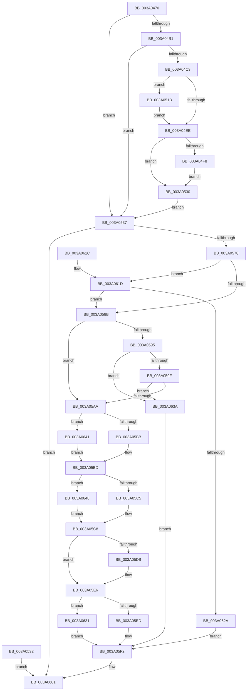

# ExpSetTimer2

- RVA: `0x003A0470`–`0x003A0650` (길이 `480` bytes)
- VA: `0x00000001403A0470`
- 실행 섹션: `.text`
- PDB 이름 있음: `예`; PDB Function 태그: `아니요`
- unwind 정보 RVA: `0x00081DE4`
- 디코드: `116`개 명령, `480/480` bytes 표시
- 미해석 바이트: `0` (있으면 어셈블리에 `.byte`로 보존)

> 이 문서는 커널 이미지의 기계어와 PDB 기호를 분석해 생성했습니다. 4번과 5번은 함수 원형과 자료형을 바이너리 사용 방식에서 추정한 C 해석이며 원본 소스 복구 결과는 아닙니다.

## 1. Dependencies

- 직접 호출 지점: **6**; 고유 호출 대상: **6**
- 직접 호출자로 확인된 함수: **3**
- RIP 상대 이미지 참조: **2**

### Outgoing calls
- `0x003A050A` → [RtlCopyVolatileMemory](../6B/RtlCopyVolatileMemory_function_006BC9D0.md) (function, `0x006BC9D0`)
- `0x003A056B` → [ObReferenceObjectByHandle](../../page/86/ObReferenceObjectByHandle_function_00868DB0.md) (function, `0x00868DB0`)
- `0x003A05ED` → [KeSetTimer2](KeSetTimer2_function_003A08E0.md) (function, `0x003A08E0`)
- `0x003A05FA` → [ObfDereferenceObjectWithTag](../2F/ObfDereferenceObjectWithTag_function_002F78E0.md) (function, `0x002F78E0`)
- `0x003A0609` → [_security_check_cookie](../6A/_security_check_cookie_function_006AC640.md) (function, `0x006AC640`)
- `0x003A0633` → [KeCancelTimer2](KeCancelTimer2_function_003A01E0.md) (function, `0x003A01E0`)

### Direct callers
- [NtCancelTimer2](../39/NtCancelTimer2_function_0039F210.md) at `0x0039F21C`
- [NtSetTimer2](NtSetTimer2_function_003A0440.md) at `0x003A0449`
- [NtSetIRTimer](../4A/NtSetIRTimer_function_004AA7E0.md) at `0x004AA7EA`

### Static image references
- `0x003A0480` → RVA `0x00E0A740` (`.data`; read)
- `0x003A0548` → RVA `0x00FC6F20` (`ALMOSTRO`; read)

## 2. Other-region calls and transfers

- 다른 실행 섹션으로 향하는 call: **1**
  - `0x003A056B` → [ObReferenceObjectByHandle](../../page/86/ObReferenceObjectByHandle_function_00868DB0.md) (`.text` → `PAGE`)
- 별도 외부 분기/꼬리 이동을 확인하지 못했습니다.

## 3. Assembly (complete function range)

```asm
003A0470  4C 8B DC                        mov r11, rsp
003A0473  49 89 5B 18                     mov qword ptr [r11 + 0x18], rbx
003A0477  49 89 53 10                     mov qword ptr [r11 + 0x10], rdx
003A047B  57                              push rdi
003A047C  48 83 EC 70                     sub rsp, 0x70
003A0480  48 8B 05 B9 A2 A6 00            mov rax, qword ptr [rip + 0xa6a2b9]
003A0487  48 33 C4                        xor rax, rsp
003A048A  48 89 44 24 60                  mov qword ptr [rsp + 0x60], rax
003A048F  48 8B D9                        mov rbx, rcx
003A0492  4D 89 4B B8                     mov qword ptr [r11 - 0x48], r9
003A0496  33 FF                           xor edi, edi
003A0498  49 89 7B C0                     mov qword ptr [r11 - 0x40], rdi
003A049C  0F 57 C0                        xorps xmm0, xmm0
003A049F  0F 11 44 24 50                  movups xmmword ptr [rsp + 0x50], xmm0
003A04A4  49 89 7B C8                     mov qword ptr [r11 - 0x38], rdi
003A04A8  48 85 D2                        test rdx, rdx
003A04AB  0F 84 86 00 00 00               je 0x1403a0537
003A04B1  65 48 8B 04 25 88 01 00 00      mov rax, qword ptr gs:[0x188]
003A04BA  40 38 B8 32 02 00 00            cmp byte ptr [rax + 0x232], dil
003A04C1  74 74                           je 0x1403a0537
003A04C3  48 BA 00 00 FF FF FF 7F 00 00   movabs rdx, 0x7fffffff0000
003A04CD  48 8B CA                        mov rcx, rdx
003A04D0  49 39 53 10                     cmp qword ptr [r11 + 0x10], rdx
003A04D4  49 0F 42 4B 10                  cmovb rcx, qword ptr [r11 + 0x10]
003A04D9  90                              nop
003A04DA  48 8B 01                        mov rax, qword ptr [rcx]
003A04DD  49 89 43 C0                     mov qword ptr [r11 - 0x40], rax
003A04E1  49 8D 43 C0                     lea rax, [r11 - 0x40]
003A04E5  49 89 43 10                     mov qword ptr [r11 + 0x10], rax
003A04E9  4D 85 C0                        test r8, r8
003A04EC  75 2D                           jne 0x1403a051b
003A04EE  48 8B 44 24 30                  mov rax, qword ptr [rsp + 0x30]
003A04F3  48 85 C0                        test rax, rax
003A04F6  74 38                           je 0x1403a0530
003A04F8  48 3B C2                        cmp rax, rdx
003A04FB  49 0F 42 D1                     cmovb rdx, r9
003A04FF  41 B8 10 00 00 00               mov r8d, 0x10
003A0505  48 8D 4C 24 50                  lea rcx, [rsp + 0x50]
003A050A  E8 C1 C4 31 00                  call 0x1406bc9d0
003A050F  48 8D 44 24 50                  lea rax, [rsp + 0x50]
003A0514  48 89 44 24 30                  mov qword ptr [rsp + 0x30], rax
003A0519  EB 15                           jmp 0x1403a0530
003A051B  48 8B C2                        mov rax, rdx
003A051E  4C 3B C2                        cmp r8, rdx
003A0521  49 0F 42 C0                     cmovb rax, r8
003A0525  90                              nop
003A0526  48 8B 00                        mov rax, qword ptr [rax]
003A0529  48 89 44 24 40                  mov qword ptr [rsp + 0x40], rax
003A052E  EB BE                           jmp 0x1403a04ee
003A0530  EB 05                           jmp 0x1403a0537
003A0532  E9 CA 00 00 00                  jmp 0x1403a0601
003A0537  65 48 8B 04 25 88 01 00 00      mov rax, qword ptr gs:[0x188]
003A0540  44 0F B6 88 32 02 00 00         movzx r9d, byte ptr [rax + 0x232]
003A0548  4C 8B 05 D1 69 C2 00            mov r8, qword ptr [rip + 0xc269d1]
003A054F  48 89 7C 24 48                  mov qword ptr [rsp + 0x48], rdi
003A0554  48 89 7C 24 28                  mov qword ptr [rsp + 0x28], rdi
003A0559  48 8D 44 24 48                  lea rax, [rsp + 0x48]
003A055E  48 89 44 24 20                  mov qword ptr [rsp + 0x20], rax
003A0563  BA 02 00 00 00                  mov edx, 2
003A0568  48 8B CB                        mov rcx, rbx
003A056B  E8 40 88 4C 00                  call 0x140868db0
003A0570  85 C0                           test eax, eax
003A0572  0F 88 89 00 00 00               js 0x1403a0601
003A0578  4C 8B 44 24 40                  mov r8, qword ptr [rsp + 0x40]
003A057D  48 8B 5C 24 48                  mov rbx, qword ptr [rsp + 0x48]
003A0582  4D 85 C0                        test r8, r8
003A0585  0F 85 92 00 00 00               jne 0x1403a061d
003A058B  4C 8B 4C 24 30                  mov r9, qword ptr [rsp + 0x30]
003A0590  4D 85 C9                        test r9, r9
003A0593  74 15                           je 0x1403a05aa
003A0595  41 83 39 00                     cmp dword ptr [r9], 0
003A0599  0F 85 9B 00 00 00               jne 0x1403a063a
003A059F  49 83 79 08 FF                  cmp qword ptr [r9 + 8], -1
003A05A4  0F 8C 90 00 00 00               jl 0x1403a063a
003A05AA  48 8B 84 24 88 00 00 00         mov rax, qword ptr [rsp + 0x88]
003A05B2  48 85 C0                        test rax, rax
003A05B5  0F 84 86 00 00 00               je 0x1403a0641
003A05BB  B1 01                           mov cl, 1
003A05BD  84 C9                           test cl, cl
003A05BF  0F 84 83 00 00 00               je 0x1403a0648
003A05C5  48 8B 10                        mov rdx, qword ptr [rax]
003A05C8  48 89 93 90 00 00 00            mov qword ptr [rbx + 0x90], rdx
003A05CF  48 89 BB 98 00 00 00            mov qword ptr [rbx + 0x98], rdi
003A05D6  4D 85 C9                        test r9, r9
003A05D9  74 0B                           je 0x1403a05e6
003A05DB  49 8B 41 08                     mov rax, qword ptr [r9 + 8]
003A05DF  48 89 83 98 00 00 00            mov qword ptr [rbx + 0x98], rax
003A05E6  84 C9                           test cl, cl
003A05E8  48 8B CB                        mov rcx, rbx
003A05EB  74 44                           je 0x1403a0631
003A05ED  E8 EE 02 00 00                  call 0x1403a08e0
003A05F2  BA 44 66 6C 74                  mov edx, 0x746c6644
003A05F7  48 8B CB                        mov rcx, rbx
003A05FA  E8 E1 72 F5 FF                  call 0x1402f78e0
003A05FF  8B C7                           mov eax, edi
003A0601  48 8B 4C 24 60                  mov rcx, qword ptr [rsp + 0x60]
003A0606  48 33 CC                        xor rcx, rsp
003A0609  E8 32 C0 30 00                  call 0x1406ac640
003A060E  48 8B 9C 24 90 00 00 00         mov rbx, qword ptr [rsp + 0x90]
003A0616  48 83 C4 70                     add rsp, 0x70
003A061A  5F                              pop rdi
003A061B  C3                              ret
003A061C  CC                              int3
003A061D  F6 83 81 00 00 00 02            test byte ptr [rbx + 0x81], 2
003A0624  0F 84 61 FF FF FF               je 0x1403a058b
003A062A  BF 0D 00 00 C0                  mov edi, 0xc000000d
003A062F  EB C1                           jmp 0x1403a05f2
003A0631  33 D2                           xor edx, edx
003A0633  E8 A8 FB FF FF                  call 0x1403a01e0
003A0638  EB B8                           jmp 0x1403a05f2
003A063A  BF F1 00 00 C0                  mov edi, 0xc00000f1
003A063F  EB B1                           jmp 0x1403a05f2
003A0641  32 C9                           xor cl, cl
003A0643  E9 75 FF FF FF                  jmp 0x1403a05bd
003A0648  48 8B D7                        mov rdx, rdi
003A064B  E9 78 FF FF FF                  jmp 0x1403a05c8
```

## 4. C-style interpretation (structured pseudocode)

```c
__int64 __fastcall ExpSetTimer2(__int64 a1, __int64 a2, __int64 a3, __int64 a4)
{
    __int64 result;
    __int64 v_rdi;
    __int64 v_rsp;
    unsigned __int64 v_stack_m18;
    unsigned __int64 v_stack_m28;
    unsigned __int64 v_stack_m30;
    unsigned __int64 v_stack_m38;
    unsigned __int64 v_stack_m48;
    unsigned __int64 v_stack_m50;
    unsigned __int64 v_stack_m58;
    unsigned __int64 v_stack_p10;
    unsigned __int64 v_stack_p18;

    *(unsigned __int64 *)(v_rsp + 24) = v_rbx;
    *(unsigned __int64 *)(v_rsp + 16) = a2;
    v_rsp = (v_rsp) - (112);
    result = (*(unsigned __int64 *)(v_rip + 10920633)) ^ (v_rsp);
    v_stack_m18 = result;
    *(unsigned __int64 *)(v_rsp - 72) = a4;
    v_rdi = 0;
    *(unsigned __int64 *)(v_rsp - 64) = 0;
    v_stack_m28 = v_xmm0;
    *(unsigned __int64 *)(v_rsp - 56) = 0;
    if (a2 == 0) goto loc_003A0537;
    if ((*(unsigned __int8 *)(*(unsigned __int64 *)(gs_base + (0 + 392)) + 562)) == 0) goto loc_003A0537;
    if ((*(unsigned __int64 *)(v_rsp + 16)) < a2) { a2 = *(unsigned __int64 *)(v_rsp + 16); }
    *(unsigned __int64 *)(v_rsp - 64) = *(unsigned __int64 *)(a2);
    *(unsigned __int64 *)(v_rsp + 16) = v_rsp - 64;
    if (a3 != 0) goto loc_003A051B;
loc_003A04EE:
    if (v_stack_m48 == 0) goto loc_003A0530;
    if (v_stack_m48 < a2) { a2 = a4; }
    result = RtlCopyVolatileMemory(v_stack_m28, a2, 16, a4);
    v_stack_m48 = v_stack_m28;
    goto loc_003A0530;
loc_003A051B:
    if (16 < a2) { a2 = 16; }
    v_stack_m38 = *(unsigned __int64 *)(a2);
    goto loc_003A04EE;
loc_003A0530:
    goto loc_003A0537;
loc_003A0537:
    v_stack_m30 = 0;
    v_stack_m50 = 0;
    v_stack_m58 = v_stack_m30;
    result = ObReferenceObjectByHandle(a1, 2, *(unsigned __int64 *)(v_rip + 12741073), *(unsigned __int8 *)(*(unsigned __int64 *)(gs_base + (0 + 392)) + 562));
    if (sign_flag) goto loc_003A0601;
    if (v_stack_m38 != 0) goto loc_003A061D;
loc_003A058B:
    if (v_stack_m48 == 0) goto loc_003A05AA;
    if ((*(unsigned int *)(v_stack_m48)) != 0) goto loc_003A063A;
    if ((*(unsigned __int64 *)(v_stack_m48 + 8)) < -1) goto loc_003A063A;
loc_003A05AA:
    if (v_stack_p10 == 0) goto loc_003A0641;
loc_003A05BD:
    if (1 == 0) goto loc_003A0648;
loc_003A05C8:
    *(unsigned __int64 *)(v_stack_m30 + 144) = *(unsigned __int64 *)(v_stack_p10);
    *(unsigned __int64 *)(v_stack_m30 + 152) = 0;
    result = v_stack_p10;
    if (v_stack_m48 != 0) {
        result = *(unsigned __int64 *)(v_stack_m48 + 8);
        *(unsigned __int64 *)(v_stack_m30 + 152) = result;
    }
    if (1 == 0) goto loc_003A0631;
    result = KeSetTimer2(v_stack_m30, *(unsigned __int64 *)(v_stack_p10), v_stack_m38, v_stack_m48);
loc_003A05F2:
    result = ObfDereferenceObjectWithTag(v_stack_m30, (unsigned int)(0x746C6644ULL), v_stack_m38, v_stack_m48);
loc_003A0601:
    a1 = (v_stack_m18) ^ (v_rsp);
    result = _security_check_cookie(a1, (unsigned int)(0x746C6644ULL), v_stack_m38, v_stack_m48);
    v_rsp = (v_rsp) + (112);
    return result;
loc_003A061D:
    if (((*(unsigned __int8 *)(v_stack_p18 + 129)) & (2)) == 0) goto loc_003A058B;
    goto loc_003A05F2;
loc_003A0631:
    a2 = 0;
    result = KeCancelTimer2(a1, a2, v_stack_m38, v_stack_m48);
    goto loc_003A05F2;
loc_003A063A:
    goto loc_003A05F2;
loc_003A0641:
    a1 = 0;
    goto loc_003A05BD;
loc_003A0648:
    goto loc_003A05C8;
}
```

## 5. (Beta) C Style

```c
int64_t ExpSetTimer2(int64_t Arg1, int64_t Arg2, int64_t Arg3, int64_t Arg4)
{
    int64_t result;
    int64_t local_rdi;
    int64_t local_rsp;
    uint64_t v_stack_m18;
    uint64_t v_stack_m28;
    uint64_t v_stack_m30;
    uint64_t v_stack_m38;
    uint64_t v_stack_m48;
    uint64_t v_stack_m50;
    uint64_t v_stack_m58;
    uint64_t v_stack_p10;
    uint64_t v_stack_p18;

    *(uint64_t *)(local_rsp + 0x18) = local_rbx;
    *(uint64_t *)(local_rsp + 0x10) = Arg2;
    local_rsp = (local_rsp) - (112);
    result = (*(uint64_t *)(v_rip + 0xA6A2B9)) ^ (local_rsp);
    v_stack_m18 = result;
    *(uint64_t *)(local_rsp - 0x48) = Arg4;
    local_rdi = 0;
    *(uint64_t *)(local_rsp - 0x40) = 0;
    v_stack_m28 = v_xmm0;
    *(uint64_t *)(local_rsp - 0x38) = 0;
    if (Arg2 == 0) goto loc_003A0537;
    if ((*(uint8_t *)(*(uint64_t *)(gs_base + (0 + 0x188)) + 0x232)) == 0) goto loc_003A0537;
    if ((*(uint64_t *)(local_rsp + 0x10)) < Arg2) { Arg2 = *(uint64_t *)(local_rsp + 0x10); }
    *(uint64_t *)(local_rsp - 0x40) = *(uint64_t *)(Arg2);
    *(uint64_t *)(local_rsp + 0x10) = local_rsp - 64;
    if (Arg3 != 0) goto loc_003A051B;
loc_003A04EE:
    if (v_stack_m48 == 0) goto loc_003A0530;
    if (v_stack_m48 < Arg2) { Arg2 = Arg4; }
    result = RtlCopyVolatileMemory(v_stack_m28, Arg2, 16, Arg4);
    v_stack_m48 = v_stack_m28;
    goto loc_003A0530;
loc_003A051B:
    if (16 < Arg2) { Arg2 = 16; }
    v_stack_m38 = *(uint64_t *)(Arg2);
    goto loc_003A04EE;
loc_003A0530:
    goto loc_003A0537;
loc_003A0537:
    v_stack_m30 = 0;
    v_stack_m50 = 0;
    v_stack_m58 = v_stack_m30;
    result = ObReferenceObjectByHandle(Arg1, 2, *(uint64_t *)(v_rip + 0xC269D1), *(uint8_t *)(*(uint64_t *)(gs_base + (0 + 0x188)) + 0x232));
    if (sign_flag) goto loc_003A0601;
    if (v_stack_m38 != 0) goto loc_003A061D;
loc_003A058B:
    if (v_stack_m48 == 0) goto loc_003A05AA;
    if ((*(uint32_t *)(v_stack_m48)) != 0) goto loc_003A063A;
    if ((*(uint64_t *)(v_stack_m48 + 0x8)) < -1) goto loc_003A063A;
loc_003A05AA:
    if (v_stack_p10 == 0) goto loc_003A0641;
loc_003A05BD:
    if (1 == 0) goto loc_003A0648;
loc_003A05C8:
    *(uint64_t *)(v_stack_m30 + 0x90) = *(uint64_t *)(v_stack_p10);
    *(uint64_t *)(v_stack_m30 + 0x98) = 0;
    result = v_stack_p10;
    if (v_stack_m48 != 0) {
        result = *(uint64_t *)(v_stack_m48 + 0x8);
        *(uint64_t *)(v_stack_m30 + 0x98) = result;
    }
    if (1 == 0) goto loc_003A0631;
    result = KeSetTimer2(v_stack_m30, *(uint64_t *)(v_stack_p10), v_stack_m38, v_stack_m48);
loc_003A05F2:
    result = ObfDereferenceObjectWithTag(v_stack_m30, (uint32_t)(0x746C6644ULL), v_stack_m38, v_stack_m48);
loc_003A0601:
    Arg1 = (v_stack_m18) ^ (local_rsp);
    result = _security_check_cookie(Arg1, (uint32_t)(0x746C6644ULL), v_stack_m38, v_stack_m48);
    local_rsp = (local_rsp) + (112);
    return result;
loc_003A061D:
    if (((*(uint8_t *)(v_stack_p18 + 0x81)) & (2)) == 0) goto loc_003A058B;
    goto loc_003A05F2;
loc_003A0631:
    Arg2 = 0;
    result = KeCancelTimer2(Arg1, Arg2, v_stack_m38, v_stack_m48);
    goto loc_003A05F2;
loc_003A063A:
    goto loc_003A05F2;
loc_003A0641:
    Arg1 = 0;
    goto loc_003A05BD;
loc_003A0648:
    goto loc_003A05C8;
}
```

## 6. Execution-region graph

[열기: 2D/3D 그래프와 함수 탐색 컨트롤 패널](../../../control-panel.html?section=text&rva=0x003A0470&view=graph)

- 2D 그래프는 위에서 아래로 흐르고, 3D 그래프는 빈 공간을 드래그해 회전합니다. Shift+드래그는 이동, 휠은 확대·축소, 함수 노드 선택은 대상 보고서 이동입니다.

### Static fallback


