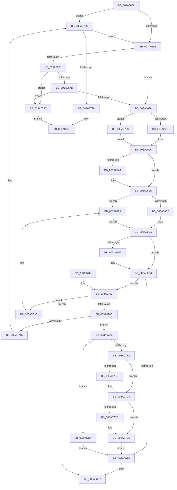

# ExpSetTimerObject2

- RVA: `0x003A0658`–`0x003A07EE` (길이 `406` bytes)
- VA: `0x00000001403A0658`
- 실행 섹션: `.text`
- PDB 이름 있음: `예`; PDB Function 태그: `아니요`
- unwind 정보 RVA: `0x00081E10`
- 디코드: `105`개 명령, `406/406` bytes 표시
- 미해석 바이트: `0` (있으면 어셈블리에 `.byte`로 보존)

> 이 문서는 커널 이미지의 기계어와 PDB 기호를 분석해 생성했습니다. 4번과 5번은 함수 원형과 자료형을 바이너리 사용 방식에서 추정한 C 해석이며 원본 소스 복구 결과는 아닙니다.

## 1. Dependencies

- 직접 호출 지점: **12**; 고유 호출 대상: **11**
- 직접 호출자로 확인된 함수: **3**
- RIP 상대 이미지 참조: **3**

### Outgoing calls
- `0x003A06C0` → [KeSetTimer2](KeSetTimer2_function_003A08E0.md) (function, `0x003A08E0`)
- `0x003A06E1` → [ObpPushStackInfo](../21/ObpPushStackInfo_function_002109E4.md) (function, `0x002109E4`)
- `0x003A0726` → [KeBugCheckEx](../4F/KeBugCheckEx_function_004FD660.md) (function, `0x004FD660`)
- `0x003A0743` → [ObfDereferenceObjectWithTag](../2F/ObfDereferenceObjectWithTag_function_002F78E0.md) (function, `0x002F78E0`)
- `0x003A0784` → [KeBugCheckEx](../4F/KeBugCheckEx_function_004FD660.md) (function, `0x004FD660`)
- `0x003A078C` → [KeCancelTimer2](KeCancelTimer2_function_003A01E0.md) (function, `0x003A01E0`)
- `0x003A07A6` → [KeAreAllApcsDisabled](../2F/KeAreAllApcsDisabled_function_002F7AC0.md) (function, `0x002F7AC0`)
- `0x003A07B2` → [OBJECT_HEADER_TO_HANDLE_REVOCATION_INFO](OBJECT_HEADER_TO_HANDLE_REVOCATION_INFO_function_003A1840.md) (function, `0x003A1840`)
- `0x003A07BF` → [ObpHandleRevocationBlockRemoveObject](../../page/9D/ObpHandleRevocationBlockRemoveObject_function_009D7E30.md) (function, `0x009D7E30`)
- `0x003A07D0` → [ObpDeregisterObject](../../page/9D/ObpDeregisterObject_function_009D7F78.md) (function, `0x009D7F78`)
- `0x003A07DA` → [ObpRemoveObjectRoutine](../../page/86/ObpRemoveObjectRoutine_function_00864A60.md) (function, `0x00864A60`)
- `0x003A07E4` → [ObpDeferObjectDeletion](ObpDeferObjectDeletion_function_003A2394.md) (function, `0x003A2394`)

### Direct callers
- [NtSetTimer](../23/NtSetTimer_function_00231190.md) at `0x00231384`
- [NtSetTimerEx](../23/NtSetTimerEx_function_00231480.md) at `0x00231699`
- [sub_006D7372](../6D/Unknown_function_006D7372.md) at `0x006D737A`

### Static image references
- `0x003A06C5` → RVA `0x00FC5010` (`ALMOSTRO`; read)
- `0x003A076F` → RVA `0x00FC6E4C` (`ALMOSTRO`; read)
- `0x003A0779` → RVA `0x00FC7800` (`ALMOSTRO`; read)

## 2. Other-region calls and transfers

- 다른 실행 섹션으로 향하는 call: **3**
  - `0x003A07BF` → [ObpHandleRevocationBlockRemoveObject](../../page/9D/ObpHandleRevocationBlockRemoveObject_function_009D7E30.md) (`.text` → `PAGE`)
  - `0x003A07D0` → [ObpDeregisterObject](../../page/9D/ObpDeregisterObject_function_009D7F78.md) (`.text` → `PAGE`)
  - `0x003A07DA` → [ObpRemoveObjectRoutine](../../page/86/ObpRemoveObjectRoutine_function_00864A60.md) (`.text` → `PAGE`)
- 별도 외부 분기/꼬리 이동을 확인하지 못했습니다.

## 3. Assembly (complete function range)

```asm
003A0658  48 89 5C 24 08                  mov qword ptr [rsp + 8], rbx
003A065D  57                              push rdi
003A065E  48 83 EC 30                     sub rsp, 0x30
003A0662  48 8B F9                        mov rdi, rcx
003A0665  4D 85 C0                        test r8, r8
003A0668  0F 85 BE 00 00 00               jne 0x1403a072c
003A066E  4D 85 C9                        test r9, r9
003A0671  74 15                           je 0x1403a0688
003A0673  41 83 39 00                     cmp dword ptr [r9], 0
003A0677  0F 85 19 01 00 00               jne 0x1403a0796
003A067D  49 83 79 08 FF                  cmp qword ptr [r9 + 8], -1
003A0682  0F 8C 0E 01 00 00               jl 0x1403a0796
003A0688  48 85 D2                        test rdx, rdx
003A068B  0F 84 0C 01 00 00               je 0x1403a079d
003A0691  48 8B 12                        mov rdx, qword ptr [rdx]
003A0694  B1 01                           mov cl, 1
003A0696  48 89 97 90 00 00 00            mov qword ptr [rdi + 0x90], rdx
003A069D  48 83 A7 98 00 00 00 00         and qword ptr [rdi + 0x98], 0
003A06A5  4D 85 C9                        test r9, r9
003A06A8  74 0B                           je 0x1403a06b5
003A06AA  49 8B 41 08                     mov rax, qword ptr [r9 + 8]
003A06AE  48 89 87 98 00 00 00            mov qword ptr [rdi + 0x98], rax
003A06B5  84 C9                           test cl, cl
003A06B7  48 8B CF                        mov rcx, rdi
003A06BA  0F 84 CA 00 00 00               je 0x1403a078a
003A06C0  E8 1B 02 00 00                  call 0x1403a08e0
003A06C5  83 3D 44 49 C2 00 00            cmp dword ptr [rip + 0xc24944], 0
003A06CC  48 8D 5F D0                     lea rbx, [rdi - 0x30]
003A06D0  74 14                           je 0x1403a06e6
003A06D2  33 D2                           xor edx, edx
003A06D4  41 B9 44 66 6C 74               mov r9d, 0x746c6644
003A06DA  48 8B CB                        mov rcx, rbx
003A06DD  44 8D 42 01                     lea r8d, [rdx + 1]
003A06E1  E8 FE 02 E7 FF                  call 0x1402109e4
003A06E6  48 83 C8 FF                     or rax, 0xffffffffffffffff
003A06EA  F0 48 0F C1 03                  lock xadd qword ptr [rbx], rax
003A06EF  48 83 E8 01                     sub rax, 1
003A06F3  7E 0E                           jle 0x1403a0703
003A06F5  33 C0                           xor eax, eax
003A06F7  48 8B 5C 24 40                  mov rbx, qword ptr [rsp + 0x40]
003A06FC  48 83 C4 30                     add rsp, 0x30
003A0700  5F                              pop rdi
003A0701  C3                              ret
003A0702  CC                              int3
003A0703  48 8B 4B 08                     mov rcx, qword ptr [rbx + 8]
003A0707  48 85 C9                        test rcx, rcx
003A070A  75 40                           jne 0x1403a074c
003A070C  48 85 C0                        test rax, rax
003A070F  0F 89 91 00 00 00               jns 0x1403a07a6
003A0715  33 D2                           xor edx, edx
003A0717  48 89 44 24 20                  mov qword ptr [rsp + 0x20], rax
003A071C  44 8D 49 02                     lea r9d, [rcx + 2]
003A0720  4C 8B C7                        mov r8, rdi
003A0723  8D 4A 18                        lea ecx, [rdx + 0x18]
003A0726  E8 35 CF 15 00                  call 0x1404fd660
003A072B  CC                              int3
003A072C  F6 81 81 00 00 00 02            test byte ptr [rcx + 0x81], 2
003A0733  0F 84 35 FF FF FF               je 0x1403a066e
003A0739  BB 0D 00 00 C0                  mov ebx, 0xc000000d
003A073E  BA 44 66 6C 74                  mov edx, 0x746c6644
003A0743  E8 98 71 F5 FF                  call 0x1402f78e0
003A0748  8B C3                           mov eax, ebx
003A074A  EB AB                           jmp 0x1403a06f7
003A074C  41 B9 01 00 00 00               mov r9d, 1
003A0752  48 89 4C 24 20                  mov qword ptr [rsp + 0x20], rcx
003A0757  48 8B C3                        mov rax, rbx
003A075A  4C 8B C7                        mov r8, rdi
003A075D  48 C1 E8 08                     shr rax, 8
003A0761  0F B6 D0                        movzx edx, al
003A0764  0F B6 43 18                     movzx eax, byte ptr [rbx + 0x18]
003A0768  41 8D 49 17                     lea ecx, [r9 + 0x17]
003A076C  48 33 D0                        xor rdx, rax
003A076F  0F B6 05 D6 66 C2 00            movzx eax, byte ptr [rip + 0xc266d6]
003A0776  48 33 D0                        xor rdx, rax
003A0779  48 8D 05 80 70 C2 00            lea rax, [rip + 0xc27080]
003A0780  48 8B 14 D0                     mov rdx, qword ptr [rax + rdx*8]
003A0784  E8 D7 CE 15 00                  call 0x1404fd660
003A0789  CC                              int3
003A078A  33 D2                           xor edx, edx
003A078C  E8 4F FA FF FF                  call 0x1403a01e0
003A0791  E9 2F FF FF FF                  jmp 0x1403a06c5
003A0796  BB F1 00 00 C0                  mov ebx, 0xc00000f1
003A079B  EB A1                           jmp 0x1403a073e
003A079D  32 C9                           xor cl, cl
003A079F  33 D2                           xor edx, edx
003A07A1  E9 F0 FE FF FF                  jmp 0x1403a0696
003A07A6  E8 15 73 F5 FF                  call 0x1402f7ac0
003A07AB  48 8B CB                        mov rcx, rbx
003A07AE  84 C0                           test al, al
003A07B0  75 32                           jne 0x1403a07e4
003A07B2  E8 89 10 00 00                  call 0x1403a1840
003A07B7  48 85 C0                        test rax, rax
003A07BA  74 08                           je 0x1403a07c4
003A07BC  48 8B C8                        mov rcx, rax
003A07BF  E8 6C 76 63 00                  call 0x1409d7e30
003A07C4  83 3D 45 48 C2 00 00            cmp dword ptr [rip + 0xc24845], 0
003A07CB  74 08                           je 0x1403a07d5
003A07CD  48 8B CB                        mov rcx, rbx
003A07D0  E8 A3 77 63 00                  call 0x1409d7f78
003A07D5  33 D2                           xor edx, edx
003A07D7  48 8B CB                        mov rcx, rbx
003A07DA  E8 81 42 4C 00                  call 0x140864a60
003A07DF  E9 11 FF FF FF                  jmp 0x1403a06f5
003A07E4  E8 AB 1B 00 00                  call 0x1403a2394
003A07E9  E9 07 FF FF FF                  jmp 0x1403a06f5
```

## 4. C-style interpretation (structured pseudocode)

```c
__int64 __fastcall ExpSetTimerObject2(__int64 a1, __int64 a2, __int64 a3, __int64 a4)
{
    __int64 result;
    __int64 v_rsp;
    unsigned __int64 v_stack_p20;
    unsigned __int64 v_stack_p8;

    v_stack_p8 = v_rbx;
    v_rsp = (v_rsp) - (48);
    if (a3 != 0) goto loc_003A072C;
loc_003A066E:
    if (a4 == 0) goto loc_003A0688;
    if ((*(unsigned int *)(a4)) != 0) goto loc_003A0796;
    if ((*(unsigned __int64 *)(a4 + 8)) < -1) goto loc_003A0796;
loc_003A0688:
    if (a2 == 0) goto loc_003A079D;
loc_003A0696:
    *(unsigned __int64 *)(a1 + 144) = *(unsigned __int64 *)(a2);
    if (a4 != 0) {
        result = *(unsigned __int64 *)(a4 + 8);
        *(unsigned __int64 *)(a1 + 152) = result;
    }
    if (1 == 0) goto loc_003A078A;
    result = KeSetTimer2(a1, *(unsigned __int64 *)(a2), a3, a4);
loc_003A06C5:
    if ((*(unsigned int *)(v_rip + 12732740)) != 0) {
        a2 = 0;
        a4 = 0x746C6644ULL;
        a1 = a1 - 48;
        a3 = a2 + 1;
        result = ObpPushStackInfo(a1, a2, a3, a4);
    }
    result = (result) | (-1);
    result = (result) - (1);
    if (condition_is_less_or_equal) goto loc_003A0703;
loc_003A06F5:
    result = 0;
loc_003A06F7:
    v_rsp = (v_rsp) + (48);
    return result;
loc_003A0703:
    if (*(unsigned __int64 *)(v_stack_p8 + 8) != 0) goto loc_003A074C;
    if (!sign_flag) goto loc_003A07A6;
    a2 = 0;
    v_stack_p20 = 0;
    result = KeBugCheckEx(a2 + 24, a2, a1, *(unsigned __int64 *)(v_stack_p8 + 8) + 2);
loc_003A072C:
    if (((*(unsigned __int8 *)(a2 + 24 + 129)) & (2)) == 0) goto loc_003A066E;
loc_003A073E:
    result = ObfDereferenceObjectWithTag(a2 + 24, (unsigned int)(0x746C6644ULL), a1, *(unsigned __int64 *)(v_stack_p8 + 8) + 2);
    goto loc_003A06F7;
loc_003A074C:
    v_stack_p20 = a2 + 24;
    result = ((unsigned int)(0xC000000DULL)) >> (8);
    a2 = ((unsigned __int8)(result)) ^ (*(unsigned __int8 *)((unsigned int)(0xC000000DULL) + 24));
    a2 = (a2) ^ (*(unsigned __int8 *)(v_rip + 12740310));
    result = KeBugCheckEx(1 + 23, *(unsigned __int64 *)(v_rip + 12742784 + a2 * 8), a1, 1);
loc_003A078A:
    a2 = 0;
    result = KeCancelTimer2(1 + 23, a2, a1, 1);
    goto loc_003A06C5;
loc_003A0796:
    goto loc_003A073E;
loc_003A079D:
    a1 = 0;
    a2 = 0;
    goto loc_003A0696;
loc_003A07A6:
    result = KeAreAllApcsDisabled(a1, a2, a1, 1);
    if ((unsigned __int8)(result) != 0) goto loc_003A07E4;
    result = OBJECT_HEADER_TO_HANDLE_REVOCATION_INFO((unsigned int)(0xC00000F1ULL), a2, a1, 1);
    if (result != 0) {
        a1 = result;
        result = ObpHandleRevocationBlockRemoveObject(a1, a2, a1, 1);
    }
    if ((*(unsigned int *)(v_rip + 12732485)) != 0) {
        a1 = (unsigned int)(0xC00000F1ULL);
        result = ObpDeregisterObject(a1, a2, a1, 1);
    }
    a2 = 0;
    result = ObpRemoveObjectRoutine((unsigned int)(0xC00000F1ULL), a2, a1, 1);
    goto loc_003A06F5;
loc_003A07E4:
    result = ObpDeferObjectDeletion((unsigned int)(0xC00000F1ULL), a2, a1, 1);
    goto loc_003A06F5;
}
```

## 5. (Beta) C Style

```c
int64_t ExpSetTimerObject2(void *Arg1, int64_t Arg2, int64_t Arg3, int64_t Arg4)
{
    uint8_t *arg1 = (uint8_t *)Arg1;

    int64_t result;
    int64_t local_rsp;
    uint64_t v_stack_p20;
    uint64_t v_stack_p8;

    v_stack_p8 = local_rbx;
    local_rsp = (local_rsp) - (48);
    if (Arg3 != 0) goto loc_003A072C;
loc_003A066E:
    if (Arg4 == 0) goto loc_003A0688;
    if ((*(uint32_t *)(Arg4)) != 0) goto loc_003A0796;
    if ((*(uint64_t *)(Arg4 + 0x8)) < -1) goto loc_003A0796;
loc_003A0688:
    if (Arg2 == 0) goto loc_003A079D;
loc_003A0696:
    *(uint64_t *)(arg1 + 0x90) = *(uint64_t *)(Arg2);
    if (Arg4 != 0) {
        result = *(uint64_t *)(Arg4 + 0x8);
        *(uint64_t *)(arg1 + 0x98) = result;
    }
    if (1 == 0) goto loc_003A078A;
    result = KeSetTimer2(Arg1, *(uint64_t *)(Arg2), Arg3, Arg4);
loc_003A06C5:
    if ((*(uint32_t *)(v_rip + 0xC24944)) != 0) {
        Arg2 = 0;
        Arg4 = 0x746C6644ULL;
        Arg1 = Arg1 - 48;
        Arg3 = Arg2 + 1;
        result = ObpPushStackInfo(Arg1, Arg2, Arg3, Arg4);
    }
    result = (result) | (-1);
    result = (result) - (1);
    if (condition_is_less_or_equal) goto loc_003A0703;
loc_003A06F5:
    result = 0;
loc_003A06F7:
    local_rsp = (local_rsp) + (48);
    return result;
loc_003A0703:
    if (*(uint64_t *)(v_stack_p8 + 0x8) != 0) goto loc_003A074C;
    if (!sign_flag) goto loc_003A07A6;
    Arg2 = 0;
    v_stack_p20 = 0;
    result = KeBugCheckEx(Arg2 + 24, Arg2, Arg1, *(uint64_t *)(v_stack_p8 + 0x8) + 2);
loc_003A072C:
    if (((*(uint8_t *)(Arg2 + 0x18 + 0x81)) & (2)) == 0) goto loc_003A066E;
loc_003A073E:
    result = ObfDereferenceObjectWithTag(Arg2 + 24, (uint32_t)(0x746C6644ULL), Arg1, *(uint64_t *)(v_stack_p8 + 0x8) + 2);
    goto loc_003A06F7;
loc_003A074C:
    v_stack_p20 = Arg2 + 24;
    result = ((uint32_t)(0xC000000DULL)) >> (8);
    Arg2 = ((uint8_t)(result)) ^ (*(uint8_t *)((uint32_t)(0xC000000DULL) + 0x18));
    Arg2 = (Arg2) ^ (*(uint8_t *)(v_rip + 0xC266D6));
    result = KeBugCheckEx(1 + 23, *(uint64_t *)(v_rip + 0xC27080 + Arg2 * 8), Arg1, 1);
loc_003A078A:
    Arg2 = 0;
    result = KeCancelTimer2(1 + 23, Arg2, Arg1, 1);
    goto loc_003A06C5;
loc_003A0796:
    goto loc_003A073E;
loc_003A079D:
    Arg1 = 0;
    Arg2 = 0;
    goto loc_003A0696;
loc_003A07A6:
    result = KeAreAllApcsDisabled(Arg1, Arg2, Arg1, 1);
    if ((uint8_t)(result) != 0) goto loc_003A07E4;
    result = OBJECT_HEADER_TO_HANDLE_REVOCATION_INFO((uint32_t)(0xC00000F1ULL), Arg2, Arg1, 1);
    if (result != 0) {
        Arg1 = result;
        result = ObpHandleRevocationBlockRemoveObject(Arg1, Arg2, Arg1, 1);
    }
    if ((*(uint32_t *)(v_rip + 0xC24845)) != 0) {
        Arg1 = (uint32_t)(0xC00000F1ULL);
        result = ObpDeregisterObject(Arg1, Arg2, Arg1, 1);
    }
    Arg2 = 0;
    result = ObpRemoveObjectRoutine((uint32_t)(0xC00000F1ULL), Arg2, Arg1, 1);
    goto loc_003A06F5;
loc_003A07E4:
    result = ObpDeferObjectDeletion((uint32_t)(0xC00000F1ULL), Arg2, Arg1, 1);
    goto loc_003A06F5;
}
```

### 관측된 메모리 오프셋

구조체 형식이 확인되지 않은 접근은 인자 기준의 오프셋으로만 기록했습니다.

| 기준 인자 | 오프셋 표현 | 폭 (bit) | 접근 |
|---|---:|---:|---|
| `Arg1` | `- 0x30` | `64` | `R` |
| `Arg1` | `+ 0x0` | `64` | `R/W` |
| `Arg1` | `+ 0x8` | `64` | `R` |
| `Arg1` | `+ 0x18` | `8` | `R` |
| `Arg1` | `+ 0x90` | `64` | `W` |
| `Arg1` | `+ 0x98` | `64` | `R/W` |
| `Arg1` | `+ 0x98` | `64` | `W` |

## 6. Execution-region graph

[열기: 2D/3D 그래프와 함수 탐색 컨트롤 패널](../../../control-panel.html?section=text&rva=0x003A0658&view=graph)

- 2D 그래프는 위에서 아래로 흐르고, 3D 그래프는 빈 공간을 드래그해 회전합니다. Shift+드래그는 이동, 휠은 확대·축소, 함수 노드 선택은 대상 보고서 이동입니다.

### Static fallback


