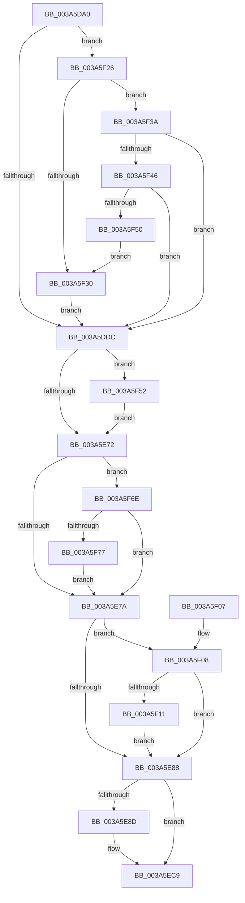

# IopCreateSecurityCheck

- RVA: `0x003A5DA0`–`0x003A5F80` (길이 `480` bytes)
- VA: `0x00000001403A5DA0`
- 실행 섹션: `.text`
- PDB 이름 있음: `예`; PDB Function 태그: `아니요`
- unwind 정보 RVA: `0x00089AD8`
- 디코드: `113`개 명령, `480/480` bytes 표시
- 미해석 바이트: `0` (있으면 어셈블리에 `.byte`로 보존)

> 이 문서는 커널 이미지의 기계어와 PDB 기호를 분석해 생성했습니다. 4번과 5번은 함수 원형과 자료형을 바이너리 사용 방식에서 추정한 C 해석이며 원본 소스 복구 결과는 아닙니다.

## 1. Dependencies

- 직접 호출 지점: **9**; 고유 호출 대상: **9**
- 직접 호출자로 확인된 함수: **1**
- RIP 상대 이미지 참조: **3**

### Outgoing calls
- `0x003A5DF6` → [ExAcquireResourceSharedLite](../21/ExAcquireResourceSharedLite_function_00211BC0.md) (function, `0x00211BC0`)
- `0x003A5DFF` → [SeLockSubjectContext](../../page/8C/SeLockSubjectContext_function_008C64C0.md) (function, `0x008C64C0`)
- `0x003A5E59` → [SeAccessCheck](SeAccessCheck_function_003A6BC0.md) (function, `0x003A6BC0`)
- `0x003A5EC4` → [SeOpenObjectAuditAlarm](../../page/86/SeOpenObjectAuditAlarm_function_0086FFA0.md) (function, `0x0086FFA0`)
- `0x003A5ECD` → [SeUnlockSubjectContext](../../page/8C/SeUnlockSubjectContext_function_008C6520.md) (function, `0x008C6520`)
- `0x003A5ED9` → [ExReleaseResourceLite](../25/ExReleaseResourceLite_function_0025FA10.md) (function, `0x0025FA10`)
- `0x003A5EE1` → [KeLeaveCriticalRegionThread](../25/KeLeaveCriticalRegionThread_function_0025EFF0.md) (function, `0x0025EFF0`)
- `0x003A5F55` → [SeAppendPrivileges](../../page/9D/SeAppendPrivileges_function_009D7980.md) (function, `0x009D7980`)
- `0x003A5F64` → [ExFreePoolWithTag](../../poolcode/B8/ExFreePoolWithTag_function_00B82870.md) (function, `0x00B82870`)

### Direct callers
- [IopParseDevice](../../page/89/IopParseDevice_function_0089E510.md) at `0x0089F881`
- [IopParseDevice](../../page/89/IopParseDevice_function_0089E510.md) at `0x0089FDF5`
- [IopParseDevice](../../page/89/IopParseDevice_function_0089E510.md) at `0x008A0543`

### Static image references
- `0x003A5DE4` → RVA `0x00F8D2A0` (`.data`; read)
- `0x003A5E04` → RVA `0x00FC6AE0` (`ALMOSTRO`; read)
- `0x003A5F3A` → RVA `0x00E0A9CC` (`.data`; read)

## 2. Other-region calls and transfers

- 다른 실행 섹션으로 향하는 call: **5**
  - `0x003A5DFF` → [SeLockSubjectContext](../../page/8C/SeLockSubjectContext_function_008C64C0.md) (`.text` → `PAGE`)
  - `0x003A5EC4` → [SeOpenObjectAuditAlarm](../../page/86/SeOpenObjectAuditAlarm_function_0086FFA0.md) (`.text` → `PAGE`)
  - `0x003A5ECD` → [SeUnlockSubjectContext](../../page/8C/SeUnlockSubjectContext_function_008C6520.md) (`.text` → `PAGE`)
  - `0x003A5F55` → [SeAppendPrivileges](../../page/9D/SeAppendPrivileges_function_009D7980.md) (`.text` → `PAGE`)
  - `0x003A5F64` → [ExFreePoolWithTag](../../poolcode/B8/ExFreePoolWithTag_function_00B82870.md) (`.text` → `POOLCODE`)
- 별도 외부 분기/꼬리 이동을 확인하지 못했습니다.

## 3. Assembly (complete function range)

```asm
003A5DA0  48 8B C4                        mov rax, rsp
003A5DA3  48 89 58 08                     mov qword ptr [rax + 8], rbx
003A5DA7  48 89 68 10                     mov qword ptr [rax + 0x10], rbp
003A5DAB  48 89 70 18                     mov qword ptr [rax + 0x18], rsi
003A5DAF  57                              push rdi
003A5DB0  41 54                           push r12
003A5DB2  41 55                           push r13
003A5DB4  41 56                           push r14
003A5DB6  41 57                           push r15
003A5DB8  48 83 EC 50                     sub rsp, 0x50
003A5DBC  83 60 20 00                     and dword ptr [rax + 0x20], 0
003A5DC0  33 DB                           xor ebx, ebx
003A5DC2  83 BC 24 A0 00 00 00 01         cmp dword ptr [rsp + 0xa0], 1
003A5DCA  45 8B E1                        mov r12d, r9d
003A5DCD  49 8B F8                        mov rdi, r8
003A5DD0  4C 8B FA                        mov r15, rdx
003A5DD3  4C 8B F1                        mov r14, rcx
003A5DD6  0F 85 4A 01 00 00               jne 0x1403a5f26
003A5DDC  4C 8B AC 24 C8 00 00 00         mov r13, qword ptr [rsp + 0xc8]
003A5DE4  48 8D 0D B5 74 BE 00            lea rcx, [rip + 0xbe74b5]
003A5DEB  B2 01                           mov dl, 1
003A5DED  66 41 FF 8D E4 01 00 00         dec word ptr [r13 + 0x1e4]
003A5DF5  90                              nop
003A5DF6  E8 C5 BD E6 FF                  call 0x140211bc0
003A5DFB  48 8D 4F 20                     lea rcx, [rdi + 0x20]
003A5DFF  E8 BC 06 52 00                  call 0x1408c64c0
003A5E04  48 8B 05 D5 0C C2 00            mov rax, qword ptr [rip + 0xc20cd5]
003A5E0B  48 8D 8C 24 98 00 00 00         lea rcx, [rsp + 0x98]
003A5E13  48 8B B4 24 B0 00 00 00         mov rsi, qword ptr [rsp + 0xb0]
003A5E1B  48 8D 57 20                     lea rdx, [rdi + 0x20]
003A5E1F  48 89 4C 24 48                  mov qword ptr [rsp + 0x48], rcx
003A5E24  48 83 C0 4C                     add rax, 0x4c
003A5E28  49 8B 8E 10 01 00 00            mov rcx, qword ptr [r14 + 0x110]
003A5E2F  44 8B CB                        mov r9d, ebx
003A5E32  48 89 74 24 40                  mov qword ptr [rsp + 0x40], rsi
003A5E37  45 0B CC                        or r9d, r12d
003A5E3A  C6 44 24 38 01                  mov byte ptr [rsp + 0x38], 1
003A5E3F  41 B0 01                        mov r8b, 1
003A5E42  48 89 44 24 30                  mov qword ptr [rsp + 0x30], rax
003A5E47  48 8D 84 24 A8 00 00 00         lea rax, [rsp + 0xa8]
003A5E4F  48 89 44 24 28                  mov qword ptr [rsp + 0x28], rax
003A5E54  83 64 24 20 00                  and dword ptr [rsp + 0x20], 0
003A5E59  E8 62 0D 00 00                  call 0x1403a6bc0
003A5E5E  48 8B 94 24 A8 00 00 00         mov rdx, qword ptr [rsp + 0xa8]
003A5E66  40 8A E8                        mov bpl, al
003A5E69  48 85 D2                        test rdx, rdx
003A5E6C  0F 85 E0 00 00 00               jne 0x1403a5f52
003A5E72  85 DB                           test ebx, ebx
003A5E74  0F 85 F4 00 00 00               jne 0x1403a5f6e
003A5E7A  80 BC 24 D0 00 00 00 00         cmp byte ptr [rsp + 0xd0], 0
003A5E82  0F 85 80 00 00 00               jne 0x1403a5f08
003A5E88  4D 85 FF                        test r15, r15
003A5E8B  74 3C                           je 0x1403a5ec9
003A5E8D  4D 8B 8E 10 01 00 00            mov r9, qword ptr [r14 + 0x110]
003A5E94  48 8D 47 0A                     lea rax, [rdi + 0xa]
003A5E98  4C 8B 84 24 B8 00 00 00         mov r8, qword ptr [rsp + 0xb8]
003A5EA0  49 8B D7                        mov rdx, r15
003A5EA3  48 8B 8C 24 C0 00 00 00         mov rcx, qword ptr [rsp + 0xc0]
003A5EAB  48 89 44 24 40                  mov qword ptr [rsp + 0x40], rax
003A5EB0  C6 44 24 38 01                  mov byte ptr [rsp + 0x38], 1
003A5EB5  40 88 6C 24 30                  mov byte ptr [rsp + 0x30], bpl
003A5EBA  C6 44 24 28 00                  mov byte ptr [rsp + 0x28], 0
003A5EBF  48 89 7C 24 20                  mov qword ptr [rsp + 0x20], rdi
003A5EC4  E8 D7 A0 4C 00                  call 0x14086ffa0
003A5EC9  48 8D 4F 20                     lea rcx, [rdi + 0x20]
003A5ECD  E8 4E 06 52 00                  call 0x1408c6520
003A5ED2  48 8D 0D C7 73 BE 00            lea rcx, [rip + 0xbe73c7]
003A5ED9  E8 32 9B EB FF                  call 0x14025fa10
003A5EDE  49 8B CD                        mov rcx, r13
003A5EE1  E8 0A 91 EB FF                  call 0x14025eff0
003A5EE6  4C 8D 5C 24 50                  lea r11, [rsp + 0x50]
003A5EEB  40 8A C5                        mov al, bpl
003A5EEE  49 8B 5B 30                     mov rbx, qword ptr [r11 + 0x30]
003A5EF2  49 8B 6B 38                     mov rbp, qword ptr [r11 + 0x38]
003A5EF6  49 8B 73 40                     mov rsi, qword ptr [r11 + 0x40]
003A5EFA  49 8B E3                        mov rsp, r11
003A5EFD  41 5F                           pop r15
003A5EFF  41 5E                           pop r14
003A5F01  41 5D                           pop r13
003A5F03  41 5C                           pop r12
003A5F05  5F                              pop rdi
003A5F06  C3                              ret
003A5F07  CC                              int3
003A5F08  40 84 ED                        test bpl, bpl
003A5F0B  0F 84 77 FF FF FF               je 0x1403a5e88
003A5F11  8B 06                           mov eax, dword ptr [rsi]
003A5F13  09 47 14                        or dword ptr [rdi + 0x14], eax
003A5F16  8B 06                           mov eax, dword ptr [rsi]
003A5F18  0F BA E8 19                     bts eax, 0x19
003A5F1C  F7 D0                           not eax
003A5F1E  21 47 10                        and dword ptr [rdi + 0x10], eax
003A5F21  E9 62 FF FF FF                  jmp 0x1403a5e88
003A5F26  8B 41 34                        mov eax, dword ptr [rcx + 0x34]
003A5F29  A9 01 00 04 00                  test eax, 0x40001
003A5F2E  74 0A                           je 0x1403a5f3a
003A5F30  BB 02 00 00 00                  mov ebx, 2
003A5F35  E9 A2 FE FF FF                  jmp 0x1403a5ddc
003A5F3A  39 1D 8C 4A A6 00               cmp dword ptr [rip + 0xa64a8c], ebx
003A5F40  0F 84 96 FE FF FF               je 0x1403a5ddc
003A5F46  0F BA E0 14                     bt eax, 0x14
003A5F4A  0F 83 8C FE FF FF               jae 0x1403a5ddc
003A5F50  EB DE                           jmp 0x1403a5f30
003A5F52  48 8B CF                        mov rcx, rdi
003A5F55  E8 26 1A 63 00                  call 0x1409d7980
003A5F5A  48 8B 8C 24 A8 00 00 00         mov rcx, qword ptr [rsp + 0xa8]
003A5F62  33 D2                           xor edx, edx
003A5F64  E8 07 C9 7D 00                  call 0x140b82870
003A5F69  E9 04 FF FF FF                  jmp 0x1403a5e72
003A5F6E  41 85 DC                        test r12d, ebx
003A5F71  0F 85 03 FF FF FF               jne 0x1403a5e7a
003A5F77  F7 D3                           not ebx
003A5F79  21 1E                           and dword ptr [rsi], ebx
003A5F7B  E9 FA FE FF FF                  jmp 0x1403a5e7a
```

## 4. C-style interpretation (structured pseudocode)

```c
__int64 __fastcall IopCreateSecurityCheck(__int64 a1, __int64 a2, __int64 a3, int a4, unsigned int a5, __int64 a6, __int64 a7, __int64 a8, __int64 a9, __int64 a10, unsigned __int8 a11)
{
    __int64 result;
    __int64 v_rbx;
    __int64 v_rsp;
    unsigned __int64 v_stack_m28;
    unsigned __int64 v_stack_m30;
    unsigned __int64 v_stack_m38;
    unsigned __int8 v_stack_m40;
    unsigned __int64 v_stack_m48;
    unsigned __int64 v_stack_m50;
    unsigned int v_stack_m58;
    unsigned __int64 v_stack_p20;

    *(unsigned __int64 *)(v_rsp + 8) = v_rbx;
    *(unsigned __int64 *)(v_rsp + 16) = v_rbp;
    *(unsigned __int64 *)(v_rsp + 24) = v_rsi;
    v_rsp = (v_rsp) - (80);
    v_rbx = 0;
    if (a5 != 1) goto loc_003A5F26;
loc_003A5DDC:
    result = ExAcquireResourceSharedLite(v_rip + 12481717, 1, a3, a4);
    result = SeLockSubjectContext(a3 + 32, 1, a3, a4);
    v_stack_m30 = v_stack_p20;
    result = (*(unsigned __int64 *)(v_rip + 12717269)) + (76);
    v_stack_m38 = a7;
    a4 = (unsigned int)((0) | ((unsigned int)((unsigned int)(a4))));
    v_stack_m40 = 1;
    v_stack_m48 = result;
    v_stack_m50 = a6;
    result = SeAccessCheck(*(unsigned __int64 *)(a1 + 272), a3 + 32, 1, a4);
    if (a6 != 0) goto loc_003A5F52;
loc_003A5E72:
    if (0 != 0) goto loc_003A5F6E;
loc_003A5E7A:
    if (a11 != 0) goto loc_003A5F08;
loc_003A5E88:
    if (a2 != 0) {
        a4 = *(unsigned __int64 *)(a1 + 272);
        result = a3 + 10;
        a3 = a8;
        a2 = a2;
        a1 = a9;
        v_stack_m38 = result;
        v_stack_m40 = 1;
        v_stack_m48 = (unsigned __int8)((unsigned __int8)(result));
        v_stack_m50 = 0;
        v_stack_m58 = a3;
        result = SeOpenObjectAuditAlarm(a1, a2, a3, a4);
    }
    result = SeUnlockSubjectContext(a3 + 32, a2, a3, a4);
    result = ExReleaseResourceLite(v_rip + 12481479, a2, a3, a4);
    result = KeLeaveCriticalRegionThread(a10, a2, a3, a4);
    return (unsigned __int8)((unsigned __int8)(result));
loc_003A5F08:
    if ((unsigned __int8)(*(unsigned __int64 *)(v_stack_m28 + 56)) == 0) goto loc_003A5E88;
    result = (unsigned int)(~((unsigned int)(*(unsigned int *)(*(unsigned __int64 *)(v_stack_m28 + 64)))));
    goto loc_003A5E88;
loc_003A5F26:
    if ((((unsigned int)((unsigned int)(*(unsigned int *)(a10 + 52)))) & (0x40001ULL)) == 0) goto loc_003A5F3A;
loc_003A5F30:
    goto loc_003A5DDC;
loc_003A5F3A:
    if ((*(unsigned int *)(v_rip + 10898060)) == 2) goto loc_003A5DDC;
    if ((*(unsigned int *)(v_rip + 10898060)) >= 2) goto loc_003A5DDC;
    goto loc_003A5F30;
loc_003A5F52:
    result = SeAppendPrivileges(a3, a2, a3, a4);
    a2 = 0;
    result = ExFreePoolWithTag(a6, a2, a3, a4);
    goto loc_003A5E72;
loc_003A5F6E:
    if ((((unsigned int)((unsigned int)(a4))) & (2)) != 0) goto loc_003A5E7A;
    v_rbx = (unsigned int)(~(2));
    goto loc_003A5E7A;
}
```

## 5. (Beta) C Style

```c
int64_t IopCreateSecurityCheck(void *Arg1, int64_t Arg2, void *Arg3, int32_t Arg4, uint32_t Arg5, int64_t Arg6, void *Arg7, int64_t Arg8, int64_t Arg9, void *Arg10, uint8_t Arg11)
{
    uint8_t *arg1 = (uint8_t *)Arg1;
    uint8_t *arg3 = (uint8_t *)Arg3;
    uint8_t *arg7 = (uint8_t *)Arg7;
    uint8_t *arg10 = (uint8_t *)Arg10;

    int64_t result;
    int64_t local_rbx;
    int64_t local_rsp;
    uint64_t v_stack_m28;
    uint64_t v_stack_m30;
    uint64_t v_stack_m38;
    uint8_t v_stack_m40;
    uint64_t v_stack_m48;
    uint64_t v_stack_m50;
    uint32_t v_stack_m58;
    uint64_t v_stack_p20;

    *(uint64_t *)(local_rsp + 0x8) = local_rbx;
    *(uint64_t *)(local_rsp + 0x10) = local_rbp;
    *(uint64_t *)(local_rsp + 0x18) = local_rsi;
    local_rsp = (local_rsp) - (80);
    local_rbx = 0;
    if (Arg5 != 1) goto loc_003A5F26;
loc_003A5DDC:
    result = ExAcquireResourceSharedLite(v_rip + 12481717, 1, Arg3, Arg4);
    result = SeLockSubjectContext(Arg3 + 32, 1, Arg3, Arg4);
    v_stack_m30 = v_stack_p20;
    result = (*(uint64_t *)(v_rip + 0xC20CD5)) + (76);
    v_stack_m38 = Arg7;
    Arg4 = (uint32_t)((0) | ((uint32_t)((uint32_t)(Arg4))));
    v_stack_m40 = 1;
    v_stack_m48 = result;
    v_stack_m50 = Arg6;
    result = SeAccessCheck(*(uint64_t *)(arg1 + 0x110), Arg3 + 32, 1, Arg4);
    if (Arg6 != 0) goto loc_003A5F52;
loc_003A5E72:
    if (0 != 0) goto loc_003A5F6E;
loc_003A5E7A:
    if (Arg11 != 0) goto loc_003A5F08;
loc_003A5E88:
    if (Arg2 != 0) {
        Arg4 = *(uint64_t *)(arg1 + 0x110);
        result = Arg3 + 10;
        Arg3 = Arg8;
        Arg2 = Arg2;
        Arg1 = Arg9;
        v_stack_m38 = result;
        v_stack_m40 = 1;
        v_stack_m48 = (uint8_t)((uint8_t)(result));
        v_stack_m50 = 0;
        v_stack_m58 = Arg3;
        result = SeOpenObjectAuditAlarm(Arg1, Arg2, Arg3, Arg4);
    }
    result = SeUnlockSubjectContext(Arg3 + 32, Arg2, Arg3, Arg4);
    result = ExReleaseResourceLite(v_rip + 12481479, Arg2, Arg3, Arg4);
    result = KeLeaveCriticalRegionThread(Arg10, Arg2, Arg3, Arg4);
    return (uint8_t)((uint8_t)(result));
loc_003A5F08:
    if ((uint8_t)(*(uint64_t *)(v_stack_m28 + 0x38)) == 0) goto loc_003A5E88;
    result = (uint32_t)(~((uint32_t)(*(uint32_t *)(*(uint64_t *)(v_stack_m28 + 0x40)))));
    goto loc_003A5E88;
loc_003A5F26:
    if ((((uint32_t)((uint32_t)(*(uint32_t *)(arg10 + 0x34)))) & (0x40001ULL)) == 0) goto loc_003A5F3A;
loc_003A5F30:
    goto loc_003A5DDC;
loc_003A5F3A:
    if ((*(uint32_t *)(v_rip + 0xA64A8C)) == 2) goto loc_003A5DDC;
    if ((*(uint32_t *)(v_rip + 0xA64A8C)) >= 2) goto loc_003A5DDC;
    goto loc_003A5F30;
loc_003A5F52:
    result = SeAppendPrivileges(Arg3, Arg2, Arg3, Arg4);
    Arg2 = 0;
    result = ExFreePoolWithTag(Arg6, Arg2, Arg3, Arg4);
    goto loc_003A5E72;
loc_003A5F6E:
    if ((((uint32_t)((uint32_t)(Arg4))) & (2)) != 0) goto loc_003A5E7A;
    local_rbx = (uint32_t)(~(2));
    goto loc_003A5E7A;
}
```

### 관측된 메모리 오프셋

구조체 형식이 확인되지 않은 접근은 인자 기준의 오프셋으로만 기록했습니다.

| 기준 인자 | 오프셋 표현 | 폭 (bit) | 접근 |
|---|---:|---:|---|
| `Arg1` | `+ 0x34` | `32` | `R` |
| `Arg1` | `+ 0x110` | `64` | `R` |
| `Arg3` | `+ 0xA` | `64` | `R` |
| `Arg3` | `+ 0x10` | `32` | `R/W` |
| `Arg3` | `+ 0x14` | `32` | `R/W` |
| `Arg3` | `+ 0x20` | `64` | `R` |
| `Arg7` | `+ 0x0` | `32` | `R` |
| `Arg7` | `+ 0x0` | `32` | `R/W` |
| `Arg10` | `+ 0x1E4` | `16` | `R/W` |

## 6. Execution-region graph

[열기: 2D/3D 그래프와 함수 탐색 컨트롤 패널](../../../control-panel.html?section=text&rva=0x003A5DA0&view=graph)

- 2D 그래프는 위에서 아래로 흐르고, 3D 그래프는 빈 공간을 드래그해 회전합니다. Shift+드래그는 이동, 휠은 확대·축소, 함수 노드 선택은 대상 보고서 이동입니다.

### Static fallback


