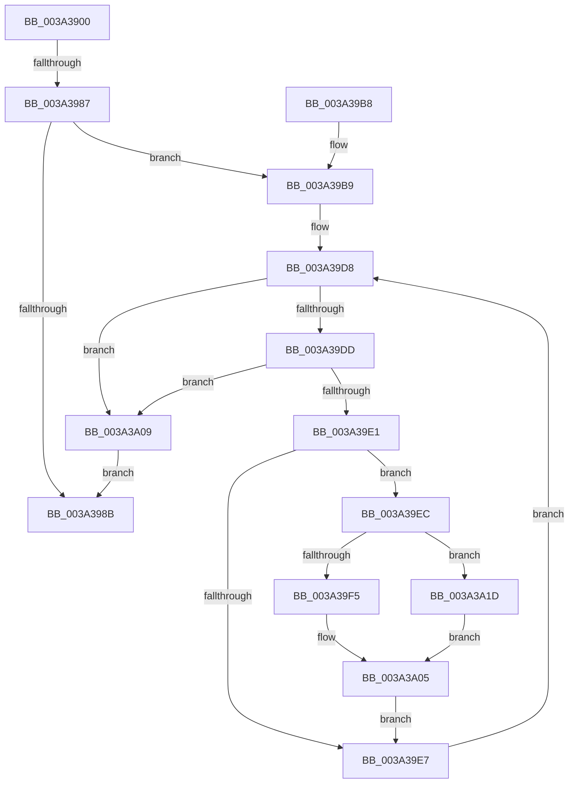

# IopTimerDispatch

- RVA: `0x003A3900`–`0x003A3A81` (길이 `385` bytes)
- VA: `0x00000001403A3900`
- 실행 섹션: `.text`
- PDB 이름 있음: `예`; PDB Function 태그: `예`
- unwind 정보 RVA: `0x00082274`
- 디코드: `92`개 명령, `385/385` bytes 표시
- 미해석 바이트: `0` (있으면 어셈블리에 `.byte`로 보존)

> 이 문서는 커널 이미지의 기계어와 PDB 기호를 분석해 생성했습니다. 4번과 5번은 함수 원형과 자료형을 바이너리 사용 방식에서 추정한 C 해석이며 원본 소스 복구 결과는 아닙니다.

## 1. Dependencies

- 직접 호출 지점: **8**; 고유 호출 대상: **7**
- 직접 호출자로 확인된 함수: **0**
- RIP 상대 이미지 참조: **4**

### Outgoing calls
- `0x003A396C` → [memset](../6C/memset_function_006C6C40.md) (function, `0x006C6C40`)
- `0x003A3996` → [_security_check_cookie](../6A/_security_check_cookie_function_006AC640.md) (function, `0x006AC640`)
- `0x003A39C0` → [KeAcquireSpinLockRaiseToDpc](../20/KeAcquireSpinLockRaiseToDpc_function_00208470.md) (function, `0x00208470`)
- `0x003A3A00` → [guard_dispatch_icall](../6B/guard_dispatch_icall_function_006BAAD0.md) (function, `0x006BAAD0`)
- `0x003A3A13` → [KeReleaseSpinLock](../39/KeReleaseSpinLock_function_00392BA0.md) (function, `0x00392BA0`)
- `0x003A3A3D` → [EtwGetKernelTraceTimestamp](../39/EtwGetKernelTraceTimestamp_function_0039FC50.md) (function, `0x0039FC50`)
- `0x003A3A4D` → [guard_dispatch_icall](../6B/guard_dispatch_icall_function_006BAAD0.md) (function, `0x006BAAD0`)
- `0x003A3A7A` → [EtwTraceTimedEvent](EtwTraceTimedEvent_function_003A3430.md) (function, `0x003A3430`)

### Direct callers
- 이 함수 시작 RVA로 연결되는 직접 call은 확인되지 않았습니다. 간접 호출은 완전히 역산할 수 없습니다.

### Static image references
- `0x003A391A` → RVA `0x00E0A740` (`.data`; read)
- `0x003A3948` → RVA `0x00FC6B08` (`ALMOSTRO`; read)
- `0x003A39B9` → RVA `0x00FCF140` (`CACHEALI`; read)
- `0x003A39CA` → RVA `0x00F8D510` (`.data`; read)

## 2. Other-region calls and transfers

- 다른 실행 섹션으로 향하는 call: **0**
- call이 아닌 외부 분기/꼬리 이동: **1**
  - `0x003A3981` → [sub_006E6430](../6E/Unknown_function_006E6430.md) (`tail-transfer`)

## 3. Assembly (complete function range)

```asm
003A3900  48 89 5C 24 18                  mov qword ptr [rsp + 0x18], rbx
003A3905  48 89 74 24 20                  mov qword ptr [rsp + 0x20], rsi
003A390A  57                              push rdi
003A390B  41 54                           push r12
003A390D  41 55                           push r13
003A390F  41 56                           push r14
003A3911  41 57                           push r15
003A3913  48 81 EC C0 01 00 00            sub rsp, 0x1c0
003A391A  48 8B 05 1F 6E A6 00            mov rax, qword ptr [rip + 0xa66e1f]
003A3921  48 33 C4                        xor rax, rsp
003A3924  48 89 84 24 B8 01 00 00         mov qword ptr [rsp + 0x1b8], rax
003A392C  48 89 A4 24 90 01 00 00         mov qword ptr [rsp + 0x190], rsp
003A3934  4D 8B E1                        mov r12, r9
003A3937  4D 8B F8                        mov r15, r8
003A393A  48 8B DA                        mov rbx, rdx
003A393D  48 8B F1                        mov rsi, rcx
003A3940  48 89 94 24 20 01 00 00         mov qword ptr [rsp + 0x120], rdx
003A3948  4C 8B 35 B9 31 C2 00            mov r14, qword ptr [rip + 0xc231b9]
003A394F  41 81 E6 00 00 80 00            and r14d, 0x800000
003A3956  44 89 B4 24 84 00 00 00         mov dword ptr [rsp + 0x84], r14d
003A395E  33 D2                           xor edx, edx
003A3960  44 8D 42 5A                     lea r8d, [rdx + 0x5a]
003A3964  48 8D 8C 24 30 01 00 00         lea rcx, [rsp + 0x130]
003A396C  E8 CF 32 32 00                  call 0x1406c6c40
003A3971  48 8B C3                        mov rax, rbx
003A3974  48 C1 F8 2F                     sar rax, 0x2f
003A3978  48 FF C0                        inc rax
003A397B  33 FF                           xor edi, edi
003A397D  48 83 F8 01                     cmp rax, 1
003A3981  0F 87 A9 2A 34 00               ja 0x1406e6430
003A3987  39 3B                           cmp dword ptr [rbx], edi
003A3989  75 2E                           jne 0x1403a39b9
003A398B  48 8B 8C 24 B8 01 00 00         mov rcx, qword ptr [rsp + 0x1b8]
003A3993  48 33 CC                        xor rcx, rsp
003A3996  E8 A5 8C 30 00                  call 0x1406ac640
003A399B  4C 8D 9C 24 C0 01 00 00         lea r11, [rsp + 0x1c0]
003A39A3  49 8B 5B 40                     mov rbx, qword ptr [r11 + 0x40]
003A39A7  49 8B 73 48                     mov rsi, qword ptr [r11 + 0x48]
003A39AB  49 8B E3                        mov rsp, r11
003A39AE  41 5F                           pop r15
003A39B0  41 5E                           pop r14
003A39B2  41 5D                           pop r13
003A39B4  41 5C                           pop r12
003A39B6  5F                              pop rdi
003A39B7  C3                              ret
003A39B8  CC                              int3
003A39B9  48 8D 0D 80 B7 C2 00            lea rcx, [rip + 0xc2b780]
003A39C0  E8 AB 4A E6 FF                  call 0x140208470
003A39C5  44 8A E0                        mov r12b, al
003A39C8  8B 33                           mov esi, dword ptr [rbx]
003A39CA  48 8B 1D 3F 9B BE 00            mov rbx, qword ptr [rip + 0xbe9b3f]
003A39D1  4C 8D 2D 38 9B BE 00            lea r13, [rip + 0xbe9b38]
003A39D8  49 3B DD                        cmp rbx, r13
003A39DB  74 2C                           je 0x1403a3a09
003A39DD  85 F6                           test esi, esi
003A39DF  74 28                           je 0x1403a3a09
003A39E1  66 39 7B FA                     cmp word ptr [rbx - 6], di
003A39E5  75 05                           jne 0x1403a39ec
003A39E7  48 8B 1B                        mov rbx, qword ptr [rbx]
003A39EA  EB EC                           jmp 0x1403a39d8
003A39EC  4C 8D 7B 10                     lea r15, [rbx + 0x10]
003A39F0  45 85 F6                        test r14d, r14d
003A39F3  75 28                           jne 0x1403a3a1d
003A39F5  49 8B 07                        mov rax, qword ptr [r15]
003A39F8  48 8B 53 18                     mov rdx, qword ptr [rbx + 0x18]
003A39FC  48 8B 4B 20                     mov rcx, qword ptr [rbx + 0x20]
003A3A00  E8 CB 70 31 00                  call 0x1406baad0
003A3A05  FF CE                           dec esi
003A3A07  EB DE                           jmp 0x1403a39e7
003A3A09  41 8A D4                        mov dl, r12b
003A3A0C  48 8D 0D 2D B7 C2 00            lea rcx, [rip + 0xc2b72d]
003A3A13  E8 88 F1 FE FF                  call 0x140392ba0
003A3A18  E9 6E FF FF FF                  jmp 0x1403a398b
003A3A1D  0F 57 C0                        xorps xmm0, xmm0
003A3A20  0F 11 84 24 98 01 00 00         movups xmmword ptr [rsp + 0x198], xmm0
003A3A28  0F 11 84 24 A8 01 00 00         movups xmmword ptr [rsp + 0x1a8], xmm0
003A3A30  BA 00 00 80 40                  mov edx, 0x40800000
003A3A35  48 8D 8C 24 98 01 00 00         lea rcx, [rsp + 0x198]
003A3A3D  E8 0E C2 FF FF                  call 0x14039fc50
003A3A42  49 8B 07                        mov rax, qword ptr [r15]
003A3A45  48 8B 53 18                     mov rdx, qword ptr [rbx + 0x18]
003A3A49  48 8B 4B 20                     mov rcx, qword ptr [rbx + 0x20]
003A3A4D  E8 7E 70 31 00                  call 0x1406baad0
003A3A52  B9 46 0F 00 00                  mov ecx, 0xf46
003A3A57  48 8D 84 24 98 01 00 00         lea rax, [rsp + 0x198]
003A3A5F  48 89 44 24 28                  mov qword ptr [rsp + 0x28], rax
003A3A64  C7 44 24 20 02 0A 50 00         mov dword ptr [rsp + 0x20], 0x500a02
003A3A6C  41 B9 08 00 00 00               mov r9d, 8
003A3A72  4D 8B C7                        mov r8, r15
003A3A75  BA 00 00 80 40                  mov edx, 0x40800000
003A3A7A  E8 B1 F9 FF FF                  call 0x1403a3430
003A3A7F  EB 84                           jmp 0x1403a3a05
```

## 4. C-style interpretation (structured pseudocode)

```c
__int64 __fastcall IopTimerDispatch(__int64 a1, __int64 a2, __int64 a3, __int64 a4)
{
    __int64 result;
    __int64 v_r14;
    __int64 v_rdi;
    __int64 v_rsi;
    __int64 v_rsp;
    unsigned int v_stack_m164;
    unsigned __int64 v_stack_m18;
    unsigned __int64 v_stack_m198;
    unsigned int v_stack_m1A0;
    unsigned __int64 v_stack_m28;
    unsigned __int64 v_stack_m30;
    unsigned __int64 v_stack_m58;
    unsigned __int64 v_stack_mB8;
    unsigned __int64 v_stack_mC8;
    unsigned __int64 v_stack_p18;
    unsigned __int64 v_stack_p20;

    v_stack_p18 = v_rbx;
    v_stack_p20 = v_rsi;
    v_rsp = (v_rsp) - (448);
    result = (*(unsigned __int64 *)(v_rip + 10907167)) ^ (v_rsp);
    v_stack_m30 = result;
    v_stack_m58 = v_rsp;
    v_stack_mC8 = a2;
    v_r14 = (unsigned int)((*(unsigned __int64 *)(v_rip + 12726713)) & (0x800000ULL));
    v_stack_m164 = (unsigned int)(v_r14);
    a2 = 0;
    result = memset(v_stack_mB8, a2, a2 + 90, a4);
    result = (0) >> (47);
    result = (result) + 1;
    v_rdi = 0;
    if ((*(unsigned int *)(a2)) != 0) goto loc_003A39B9;
loc_003A398B:
    a1 = (v_stack_m30) ^ (v_rsp);
    result = _security_check_cookie(a1, a2, a2 + 90, a4);
    return result;
loc_003A39B9:
    result = KeAcquireSpinLockRaiseToDpc(v_rip + 12760960, a2, a2 + 90, a4);
loc_003A39D8:
    if ((*(unsigned __int64 *)(v_rip + 12491583)) == (v_rip + 12491576)) goto loc_003A3A09;
    if ((unsigned int)((unsigned int)(*(unsigned int *)(*(unsigned __int64 *)(v_stack_m28 + 64)))) == 0) goto loc_003A3A09;
    if ((*(unsigned __int16 *)(*(unsigned __int64 *)(v_rip + 12491583) - 6)) != 0) goto loc_003A39EC;
loc_003A39E7:
    goto loc_003A39D8;
loc_003A39EC:
    if ((unsigned int)(v_r14) != 0) goto loc_003A3A1D;
    result = guard_dispatch_icall(*(unsigned __int64 *)(*(unsigned __int64 *)(*(unsigned __int64 *)(v_rip + 12491583)) + 32), *(unsigned __int64 *)(*(unsigned __int64 *)(*(unsigned __int64 *)(v_rip + 12491583)) + 24), a2 + 90, a4);
loc_003A3A05:
    v_rsi = (unsigned int)(((unsigned int)(*(unsigned int *)(*(unsigned __int64 *)(v_stack_m28 + 64)))) - 1);
    goto loc_003A39E7;
loc_003A3A09:
    result = KeReleaseSpinLock(v_rip + 12760877, (unsigned __int8)((unsigned __int8)(result)), a2 + 90, a4);
    goto loc_003A398B;
loc_003A3A1D:
    v_stack_m28 = v_xmm0;
    v_stack_m18 = v_xmm0;
    result = EtwGetKernelTraceTimestamp(v_stack_m28, (unsigned int)(0x40800000ULL), a2 + 90, a4);
    result = guard_dispatch_icall(*(unsigned __int64 *)(*(unsigned __int64 *)(*(unsigned __int64 *)(v_rip + 12491583)) + 32), *(unsigned __int64 *)(*(unsigned __int64 *)(*(unsigned __int64 *)(v_rip + 12491583)) + 24), a2 + 90, a4);
    v_stack_m198 = v_stack_m28;
    v_stack_m1A0 = 0x500A02ULL;
    result = EtwTraceTimedEvent((unsigned int)(0xF46ULL), (unsigned int)(0x40800000ULL), *(unsigned __int64 *)(*(unsigned __int64 *)(v_rip + 12491583)) + 16, 8);
    goto loc_003A3A05;
}
```

## 5. (Beta) C Style

```c
int64_t IopTimerDispatch(int64_t Arg1, void *Arg2, int64_t Arg3, int64_t Arg4)
{
    uint8_t *arg2 = (uint8_t *)Arg2;

    int64_t result;
    int64_t local_r14;
    int64_t local_rdi;
    int64_t local_rsi;
    int64_t local_rsp;
    uint32_t v_stack_m164;
    uint64_t v_stack_m18;
    uint64_t v_stack_m198;
    uint32_t v_stack_m1A0;
    uint64_t v_stack_m28;
    uint64_t v_stack_m30;
    uint64_t v_stack_m58;
    uint64_t v_stack_mB8;
    uint64_t v_stack_mC8;
    uint64_t v_stack_p18;
    uint64_t v_stack_p20;

    v_stack_p18 = local_rbx;
    v_stack_p20 = local_rsi;
    local_rsp = (local_rsp) - (448);
    result = (*(uint64_t *)(v_rip + 0xA66E1F)) ^ (local_rsp);
    v_stack_m30 = result;
    v_stack_m58 = local_rsp;
    v_stack_mC8 = Arg2;
    local_r14 = (uint32_t)((*(uint64_t *)(v_rip + 0xC231B9)) & (0x800000ULL));
    v_stack_m164 = (uint32_t)(local_r14);
    Arg2 = 0;
    result = memset(v_stack_mB8, Arg2, Arg2 + 90, Arg4);
    result = (0) >> (47);
    result = (result) + 1;
    local_rdi = 0;
    if ((*(uint32_t *)(arg2)) != 0) goto loc_003A39B9;
loc_003A398B:
    Arg1 = (v_stack_m30) ^ (local_rsp);
    result = _security_check_cookie(Arg1, Arg2, Arg2 + 90, Arg4);
    return result;
loc_003A39B9:
    result = KeAcquireSpinLockRaiseToDpc(v_rip + 12760960, Arg2, Arg2 + 90, Arg4);
loc_003A39D8:
    if ((*(uint64_t *)(v_rip + 0xBE9B3F)) == (v_rip + 12491576)) goto loc_003A3A09;
    if ((uint32_t)((uint32_t)(*(uint32_t *)(*(uint64_t *)(v_stack_m28 + 0x40)))) == 0) goto loc_003A3A09;
    if ((*(uint16_t *)(*(uint64_t *)(v_rip + 0xBE9B3F) - 0x6)) != 0) goto loc_003A39EC;
loc_003A39E7:
    goto loc_003A39D8;
loc_003A39EC:
    if ((uint32_t)(local_r14) != 0) goto loc_003A3A1D;
    result = guard_dispatch_icall(*(uint64_t *)(*(uint64_t *)(*(uint64_t *)(v_rip + 0xBE9B3F)) + 0x20), *(uint64_t *)(*(uint64_t *)(*(uint64_t *)(v_rip + 0xBE9B3F)) + 0x18), Arg2 + 90, Arg4);
loc_003A3A05:
    local_rsi = (uint32_t)(((uint32_t)(*(uint32_t *)(*(uint64_t *)(v_stack_m28 + 0x40)))) - 1);
    goto loc_003A39E7;
loc_003A3A09:
    result = KeReleaseSpinLock(v_rip + 12760877, (uint8_t)((uint8_t)(result)), Arg2 + 90, Arg4);
    goto loc_003A398B;
loc_003A3A1D:
    v_stack_m28 = v_xmm0;
    v_stack_m18 = v_xmm0;
    result = EtwGetKernelTraceTimestamp(v_stack_m28, (uint32_t)(0x40800000ULL), Arg2 + 90, Arg4);
    result = guard_dispatch_icall(*(uint64_t *)(*(uint64_t *)(*(uint64_t *)(v_rip + 0xBE9B3F)) + 0x20), *(uint64_t *)(*(uint64_t *)(*(uint64_t *)(v_rip + 0xBE9B3F)) + 0x18), Arg2 + 90, Arg4);
    v_stack_m198 = v_stack_m28;
    v_stack_m1A0 = 0x500A02ULL;
    result = EtwTraceTimedEvent((uint32_t)(0xF46ULL), (uint32_t)(0x40800000ULL), *(uint64_t *)(*(uint64_t *)(v_rip + 0xBE9B3F)) + 16, 8);
    goto loc_003A3A05;
}
```

### 관측된 메모리 오프셋

구조체 형식이 확인되지 않은 접근은 인자 기준의 오프셋으로만 기록했습니다.

| 기준 인자 | 오프셋 표현 | 폭 (bit) | 접근 |
|---|---:|---:|---|
| `Arg2` | `+ 0x0` | `32` | `R` |

## 6. Execution-region graph

[열기: 2D/3D 그래프와 함수 탐색 컨트롤 패널](../../../control-panel.html?section=text&rva=0x003A3900&view=graph)

- 2D 그래프는 위에서 아래로 흐르고, 3D 그래프는 빈 공간을 드래그해 회전합니다. Shift+드래그는 이동, 휠은 확대·축소, 함수 노드 선택은 대상 보고서 이동입니다.

### Static fallback


