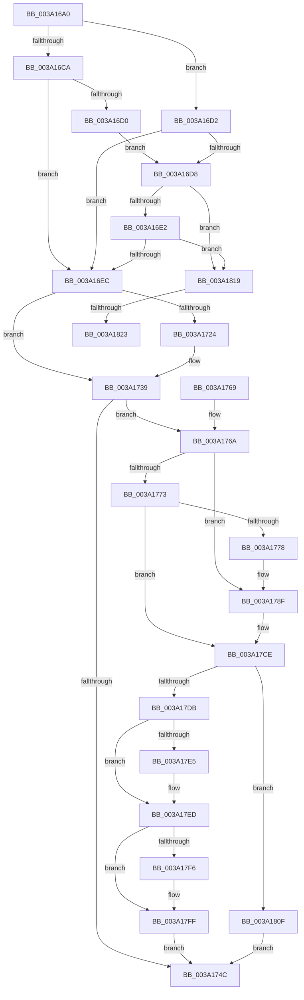

# IopUnloadSafeCompletion

- RVA: `0x003A16A0`–`0x003A1838` (길이 `408` bytes)
- VA: `0x00000001403A16A0`
- 실행 섹션: `.text`
- PDB 이름 있음: `예`; PDB Function 태그: `예`
- unwind 정보 RVA: `0x00081ECC`
- 디코드: `106`개 명령, `408/408` bytes 표시
- 미해석 바이트: `0` (있으면 어셈블리에 `.byte`로 보존)

> 이 문서는 커널 이미지의 기계어와 PDB 기호를 분석해 생성했습니다. 4번과 5번은 함수 원형과 자료형을 바이너리 사용 방식에서 추정한 C 해석이며 원본 소스 복구 결과는 아닙니다.

## 1. Dependencies

- 직접 호출 지점: **12**; 고유 호출 대상: **11**
- 직접 호출자로 확인된 함수: **0**
- RIP 상대 이미지 참조: **3**

### Outgoing calls
- `0x003A16F7` → [ObfReferenceObjectWithTag](../21/ObfReferenceObjectWithTag_function_00210710.md) (function, `0x00210710`)
- `0x003A170A` → [guard_dispatch_icall](../6B/guard_dispatch_icall_function_006BAAD0.md) (function, `0x006BAAD0`)
- `0x003A1716` → [ExFreePoolWithTag](../../poolcode/B8/ExFreePoolWithTag_function_00B82870.md) (function, `0x00B82870`)
- `0x003A1734` → [ObpPushStackInfo](../21/ObpPushStackInfo_function_002109E4.md) (function, `0x002109E4`)
- `0x003A1789` → [KeBugCheckEx](../4F/KeBugCheckEx_function_004FD660.md) (function, `0x004FD660`)
- `0x003A17C8` → [KeBugCheckEx](../4F/KeBugCheckEx_function_004FD660.md) (function, `0x004FD660`)
- `0x003A17CE` → [KeAreAllApcsDisabled](../2F/KeAreAllApcsDisabled_function_002F7AC0.md) (function, `0x002F7AC0`)
- `0x003A17DB` → [OBJECT_HEADER_TO_HANDLE_REVOCATION_INFO](OBJECT_HEADER_TO_HANDLE_REVOCATION_INFO_function_003A1840.md) (function, `0x003A1840`)
- `0x003A17E8` → [ObpHandleRevocationBlockRemoveObject](../../page/9D/ObpHandleRevocationBlockRemoveObject_function_009D7E30.md) (function, `0x009D7E30`)
- `0x003A17FA` → [ObpDeregisterObject](../../page/9D/ObpDeregisterObject_function_009D7F78.md) (function, `0x009D7F78`)
- `0x003A1805` → [ObpRemoveObjectRoutine](../../page/86/ObpRemoveObjectRoutine_function_00864A60.md) (function, `0x00864A60`)
- `0x003A180F` → [ObpDeferObjectDeletion](ObpDeferObjectDeletion_function_003A2394.md) (function, `0x003A2394`)

### Direct callers
- 이 함수 시작 RVA로 연결되는 직접 call은 확인되지 않았습니다. 간접 호출은 완전히 역산할 수 없습니다.

### Static image references
- `0x003A171B` → RVA `0x00FC5010` (`ALMOSTRO`; read)
- `0x003A17B3` → RVA `0x00FC6E4C` (`ALMOSTRO`; read)
- `0x003A17BD` → RVA `0x00FC7800` (`ALMOSTRO`; read)

## 2. Other-region calls and transfers

- 다른 실행 섹션으로 향하는 call: **4**
  - `0x003A1716` → [ExFreePoolWithTag](../../poolcode/B8/ExFreePoolWithTag_function_00B82870.md) (`.text` → `POOLCODE`)
  - `0x003A17E8` → [ObpHandleRevocationBlockRemoveObject](../../page/9D/ObpHandleRevocationBlockRemoveObject_function_009D7E30.md) (`.text` → `PAGE`)
  - `0x003A17FA` → [ObpDeregisterObject](../../page/9D/ObpDeregisterObject_function_009D7F78.md) (`.text` → `PAGE`)
  - `0x003A1805` → [ObpRemoveObjectRoutine](../../page/86/ObpRemoveObjectRoutine_function_00864A60.md) (`.text` → `PAGE`)
- call이 아닌 외부 분기/꼬리 이동: **2**
  - `0x003A181D` → [sub_006E634E](../6E/Unknown_function_006E634E.md) (`tail-transfer`)
  - `0x003A1833` → [sub_006E634E](../6E/Unknown_function_006E634E.md) (`tail-transfer`)

## 3. Assembly (complete function range)

```asm
003A16A0  48 89 5C 24 08                  mov qword ptr [rsp + 8], rbx
003A16A5  48 89 6C 24 10                  mov qword ptr [rsp + 0x10], rbp
003A16AA  48 89 74 24 18                  mov qword ptr [rsp + 0x18], rsi
003A16AF  48 89 7C 24 20                  mov qword ptr [rsp + 0x20], rdi
003A16B4  41 56                           push r14
003A16B6  48 83 EC 30                     sub rsp, 0x30
003A16BA  33 F6                           xor esi, esi
003A16BC  49 8B D8                        mov rbx, r8
003A16BF  48 8B FA                        mov rdi, rdx
003A16C2  4C 8B F1                        mov r14, rcx
003A16C5  39 72 30                        cmp dword ptr [rdx + 0x30], esi
003A16C8  7D 08                           jge 0x1403a16d2
003A16CA  41 38 70 18                     cmp byte ptr [r8 + 0x18], sil
003A16CE  75 1C                           jne 0x1403a16ec
003A16D0  EB 06                           jmp 0x1403a16d8
003A16D2  41 38 70 19                     cmp byte ptr [r8 + 0x19], sil
003A16D6  75 14                           jne 0x1403a16ec
003A16D8  40 38 72 44                     cmp byte ptr [rdx + 0x44], sil
003A16DC  0F 84 37 01 00 00               je 0x1403a1819
003A16E2  41 38 70 1A                     cmp byte ptr [r8 + 0x1a], sil
003A16E6  0F 84 2D 01 00 00               je 0x1403a1819
003A16EC  49 8B 28                        mov rbp, qword ptr [r8]
003A16EF  BA 49 6F 43 70                  mov edx, 0x70436f49
003A16F4  48 8B CD                        mov rcx, rbp
003A16F7  E8 14 F0 E6 FF                  call 0x140210710
003A16FC  48 8B 43 10                     mov rax, qword ptr [rbx + 0x10]
003A1700  48 8B D7                        mov rdx, rdi
003A1703  4C 8B 43 08                     mov r8, qword ptr [rbx + 8]
003A1707  49 8B CE                        mov rcx, r14
003A170A  E8 C1 93 31 00                  call 0x1406baad0
003A170F  33 D2                           xor edx, edx
003A1711  48 8B CB                        mov rcx, rbx
003A1714  8B F0                           mov esi, eax
003A1716  E8 55 11 7E 00                  call 0x140b82870
003A171B  83 3D EE 38 C2 00 00            cmp dword ptr [rip + 0xc238ee], 0
003A1722  74 15                           je 0x1403a1739
003A1724  33 D2                           xor edx, edx
003A1726  48 8D 4D D0                     lea rcx, [rbp - 0x30]
003A172A  41 B9 49 6F 43 70               mov r9d, 0x70436f49
003A1730  44 8D 42 01                     lea r8d, [rdx + 1]
003A1734  E8 AB F2 E6 FF                  call 0x1402109e4
003A1739  48 C7 C0 FF FF FF FF            mov rax, 0xffffffffffffffff
003A1740  F0 48 0F C1 45 D0               lock xadd qword ptr [rbp - 0x30], rax
003A1746  48 83 E8 01                     sub rax, 1
003A174A  7E 1E                           jle 0x1403a176a
003A174C  48 8B 5C 24 40                  mov rbx, qword ptr [rsp + 0x40]
003A1751  8B C6                           mov eax, esi
003A1753  48 8B 74 24 50                  mov rsi, qword ptr [rsp + 0x50]
003A1758  48 8B 6C 24 48                  mov rbp, qword ptr [rsp + 0x48]
003A175D  48 8B 7C 24 58                  mov rdi, qword ptr [rsp + 0x58]
003A1762  48 83 C4 30                     add rsp, 0x30
003A1766  41 5E                           pop r14
003A1768  C3                              ret
003A1769  CC                              int3
003A176A  48 8B 4D D8                     mov rcx, qword ptr [rbp - 0x28]
003A176E  48 85 C9                        test rcx, rcx
003A1771  75 1C                           jne 0x1403a178f
003A1773  48 85 C0                        test rax, rax
003A1776  79 56                           jns 0x1403a17ce
003A1778  33 D2                           xor edx, edx
003A177A  48 89 44 24 20                  mov qword ptr [rsp + 0x20], rax
003A177F  44 8D 49 02                     lea r9d, [rcx + 2]
003A1783  4C 8B C5                        mov r8, rbp
003A1786  8D 4A 18                        lea ecx, [rdx + 0x18]
003A1789  E8 D2 BE 15 00                  call 0x1404fd660
003A178E  CC                              int3
003A178F  41 B9 01 00 00 00               mov r9d, 1
003A1795  48 89 4C 24 20                  mov qword ptr [rsp + 0x20], rcx
003A179A  48 8D 45 D0                     lea rax, [rbp - 0x30]
003A179E  4C 8B C5                        mov r8, rbp
003A17A1  48 C1 E8 08                     shr rax, 8
003A17A5  0F B6 D0                        movzx edx, al
003A17A8  0F B6 45 E8                     movzx eax, byte ptr [rbp - 0x18]
003A17AC  41 8D 49 17                     lea ecx, [r9 + 0x17]
003A17B0  48 33 D0                        xor rdx, rax
003A17B3  0F B6 05 92 56 C2 00            movzx eax, byte ptr [rip + 0xc25692]
003A17BA  48 33 D0                        xor rdx, rax
003A17BD  48 8D 05 3C 60 C2 00            lea rax, [rip + 0xc2603c]
003A17C4  48 8B 14 D0                     mov rdx, qword ptr [rax + rdx*8]
003A17C8  E8 93 BE 15 00                  call 0x1404fd660
003A17CD  CC                              int3
003A17CE  E8 ED 62 F5 FF                  call 0x1402f7ac0
003A17D3  48 8D 4D D0                     lea rcx, [rbp - 0x30]
003A17D7  84 C0                           test al, al
003A17D9  75 34                           jne 0x1403a180f
003A17DB  E8 60 00 00 00                  call 0x1403a1840
003A17E0  48 85 C0                        test rax, rax
003A17E3  74 08                           je 0x1403a17ed
003A17E5  48 8B C8                        mov rcx, rax
003A17E8  E8 43 66 63 00                  call 0x1409d7e30
003A17ED  83 3D 1C 38 C2 00 00            cmp dword ptr [rip + 0xc2381c], 0
003A17F4  74 09                           je 0x1403a17ff
003A17F6  48 8D 4D D0                     lea rcx, [rbp - 0x30]
003A17FA  E8 79 67 63 00                  call 0x1409d7f78
003A17FF  33 D2                           xor edx, edx
003A1801  48 8D 4D D0                     lea rcx, [rbp - 0x30]
003A1805  E8 56 32 4C 00                  call 0x140864a60
003A180A  E9 3D FF FF FF                  jmp 0x1403a174c
003A180F  E8 80 0B 00 00                  call 0x1403a2394
003A1814  E9 33 FF FF FF                  jmp 0x1403a174c
003A1819  40 38 72 41                     cmp byte ptr [rdx + 0x41], sil
003A181D  0F 84 2B 4B 34 00               je 0x1406e634e
003A1823  48 8B 82 B8 00 00 00            mov rax, qword ptr [rdx + 0xb8]
003A182A  BE 03 01 00 00                  mov esi, 0x103
003A182F  80 48 03 01                     or byte ptr [rax + 3], 1
003A1833  E9 16 4B 34 00                  jmp 0x1406e634e
```

## 4. C-style interpretation (structured pseudocode)

```c
__int64 __fastcall IopUnloadSafeCompletion(__int64 a1, __int64 a2, __int64 a3)
{
    __int64 result;
    __int64 v_rsi;
    __int64 v_rsp;
    unsigned __int64 v_stack_p10;
    unsigned __int64 v_stack_p18;
    unsigned __int64 v_stack_p20;
    unsigned __int64 v_stack_p8;

    v_stack_p8 = v_rbx;
    v_stack_p10 = v_rbp;
    v_stack_p18 = v_rsi;
    v_stack_p20 = v_rdi;
    v_rsp = (v_rsp) - (48);
    v_rsi = 0;
    if ((*(unsigned int *)(a2 + 48)) >= 0) goto loc_003A16D2;
    if ((*(unsigned __int8 *)(a3 + 24)) != 0) goto loc_003A16EC;
    goto loc_003A16D8;
loc_003A16D2:
    if ((*(unsigned __int8 *)(a3 + 25)) != 0) goto loc_003A16EC;
loc_003A16D8:
    if ((*(unsigned __int8 *)(a2 + 68)) == 0) goto loc_003A1819;
    if ((*(unsigned __int8 *)(a3 + 26)) == 0) goto loc_003A1819;
loc_003A16EC:
    result = ObfReferenceObjectWithTag(*(unsigned __int64 *)(a3), (unsigned int)(0x70436F49ULL), a3, a4);
    result = guard_dispatch_icall(a1, a2, *(unsigned __int64 *)(a3 + 8), a4);
    a2 = 0;
    result = ExFreePoolWithTag(a3, a2, *(unsigned __int64 *)(a3 + 8), a4);
    if ((*(unsigned int *)(v_rip + 12728558)) != 0) {
        a2 = 0;
        a1 = *(unsigned __int64 *)(a3) - 48;
        a4 = 0x70436F49ULL;
        a3 = a2 + 1;
        result = ObpPushStackInfo(a1, a2, a3, a4);
    }
    result = (-1) - (1);
    if (condition_is_less_or_equal) goto loc_003A176A;
loc_003A174C:
    v_rsp = (v_rsp) + (48);
    return (unsigned int)((unsigned int)((unsigned int)((unsigned int)(result))));
loc_003A176A:
    if (*(unsigned __int64 *)(v_stack_p10 - 40) != 0) goto loc_003A178F;
    if (!sign_flag) goto loc_003A17CE;
    a2 = 0;
    v_stack_p20 = (unsigned int)((unsigned int)((unsigned int)((unsigned int)(result))));
    result = KeBugCheckEx(a2 + 24, a2, v_stack_p10, *(unsigned __int64 *)(v_stack_p10 - 40) + 2);
loc_003A178F:
    v_stack_p20 = a2 + 24;
    result = (v_stack_p10 - 48) >> (8);
    a2 = ((unsigned __int8)(result)) ^ (*(unsigned __int8 *)(v_stack_p10 - 24));
    a2 = (a2) ^ (*(unsigned __int8 *)(v_rip + 12736146));
    result = KeBugCheckEx(1 + 23, *(unsigned __int64 *)(v_rip + 12738620 + a2 * 8), v_stack_p10, 1);
loc_003A17CE:
    result = KeAreAllApcsDisabled(1 + 23, *(unsigned __int64 *)(v_rip + 12738620 + a2 * 8), v_stack_p10, 1);
    if ((unsigned __int8)(result) != 0) goto loc_003A180F;
    result = OBJECT_HEADER_TO_HANDLE_REVOCATION_INFO(v_stack_p10 - 48, *(unsigned __int64 *)(v_rip + 12738620 + a2 * 8), v_stack_p10, 1);
    if (result != 0) {
        a1 = result;
        result = ObpHandleRevocationBlockRemoveObject(a1, *(unsigned __int64 *)(v_rip + 12738620 + a2 * 8), v_stack_p10, 1);
    }
    if ((*(unsigned int *)(v_rip + 12728348)) != 0) {
        a1 = v_stack_p10 - 48;
        result = ObpDeregisterObject(a1, *(unsigned __int64 *)(v_rip + 12738620 + a2 * 8), v_stack_p10, 1);
    }
    a2 = 0;
    result = ObpRemoveObjectRoutine(v_stack_p10 - 48, a2, v_stack_p10, 1);
    goto loc_003A174C;
loc_003A180F:
    result = ObpDeferObjectDeletion(v_stack_p10 - 48, a2, v_stack_p10, 1);
    goto loc_003A174C;
loc_003A1819:
}
```

## 5. (Beta) C Style

```c
int64_t IopUnloadSafeCompletion(int64_t Arg1, void *Arg2, void *Arg3)
{
    uint8_t *arg2 = (uint8_t *)Arg2;
    uint8_t *arg3 = (uint8_t *)Arg3;

    int64_t result;
    int64_t local_rsi;
    int64_t local_rsp;
    uint64_t v_stack_p10;
    uint64_t v_stack_p18;
    uint64_t v_stack_p20;
    uint64_t v_stack_p8;

    v_stack_p8 = local_rbx;
    v_stack_p10 = local_rbp;
    v_stack_p18 = local_rsi;
    v_stack_p20 = local_rdi;
    local_rsp = (local_rsp) - (48);
    local_rsi = 0;
    if ((*(uint32_t *)(arg2 + 0x30)) >= 0) goto loc_003A16D2;
    if ((*(uint8_t *)(arg3 + 0x18)) != 0) goto loc_003A16EC;
    goto loc_003A16D8;
loc_003A16D2:
    if ((*(uint8_t *)(arg3 + 0x19)) != 0) goto loc_003A16EC;
loc_003A16D8:
    if ((*(uint8_t *)(arg2 + 0x44)) == 0) goto loc_003A1819;
    if ((*(uint8_t *)(arg3 + 0x1A)) == 0) goto loc_003A1819;
loc_003A16EC:
    result = ObfReferenceObjectWithTag(*(uint64_t *)(arg3), (uint32_t)(0x70436F49ULL), Arg3, a4);
    result = guard_dispatch_icall(Arg1, Arg2, *(uint64_t *)(arg3 + 0x8), a4);
    Arg2 = 0;
    result = ExFreePoolWithTag(Arg3, Arg2, *(uint64_t *)(arg3 + 0x8), a4);
    if ((*(uint32_t *)(v_rip + 0xC238EE)) != 0) {
        Arg2 = 0;
        Arg1 = *(uint64_t *)(arg3) - 48;
        a4 = 0x70436F49ULL;
        Arg3 = Arg2 + 1;
        result = ObpPushStackInfo(Arg1, Arg2, Arg3, a4);
    }
    result = (-1) - (1);
    if (condition_is_less_or_equal) goto loc_003A176A;
loc_003A174C:
    local_rsp = (local_rsp) + (48);
    return (uint32_t)((uint32_t)((uint32_t)((uint32_t)(result))));
loc_003A176A:
    if (*(uint64_t *)(v_stack_p10 - 0x28) != 0) goto loc_003A178F;
    if (!sign_flag) goto loc_003A17CE;
    Arg2 = 0;
    v_stack_p20 = (uint32_t)((uint32_t)((uint32_t)((uint32_t)(result))));
    result = KeBugCheckEx(Arg2 + 24, Arg2, v_stack_p10, *(uint64_t *)(v_stack_p10 - 0x28) + 2);
loc_003A178F:
    v_stack_p20 = Arg2 + 24;
    result = (v_stack_p10 - 48) >> (8);
    Arg2 = ((uint8_t)(result)) ^ (*(uint8_t *)(v_stack_p10 - 0x18));
    Arg2 = (Arg2) ^ (*(uint8_t *)(v_rip + 0xC25692));
    result = KeBugCheckEx(1 + 23, *(uint64_t *)(v_rip + 0xC2603C + arg2 * 8), v_stack_p10, 1);
loc_003A17CE:
    result = KeAreAllApcsDisabled(1 + 23, *(uint64_t *)(v_rip + 0xC2603C + arg2 * 8), v_stack_p10, 1);
    if ((uint8_t)(result) != 0) goto loc_003A180F;
    result = OBJECT_HEADER_TO_HANDLE_REVOCATION_INFO(v_stack_p10 - 48, *(uint64_t *)(v_rip + 0xC2603C + arg2 * 8), v_stack_p10, 1);
    if (result != 0) {
        Arg1 = result;
        result = ObpHandleRevocationBlockRemoveObject(Arg1, *(uint64_t *)(v_rip + 0xC2603C + arg2 * 8), v_stack_p10, 1);
    }
    if ((*(uint32_t *)(v_rip + 0xC2381C)) != 0) {
        Arg1 = v_stack_p10 - 48;
        result = ObpDeregisterObject(Arg1, *(uint64_t *)(v_rip + 0xC2603C + arg2 * 8), v_stack_p10, 1);
    }
    Arg2 = 0;
    result = ObpRemoveObjectRoutine(v_stack_p10 - 48, Arg2, v_stack_p10, 1);
    goto loc_003A174C;
loc_003A180F:
    result = ObpDeferObjectDeletion(v_stack_p10 - 48, Arg2, v_stack_p10, 1);
    goto loc_003A174C;
loc_003A1819:
}
```

### 관측된 메모리 오프셋

구조체 형식이 확인되지 않은 접근은 인자 기준의 오프셋으로만 기록했습니다.

| 기준 인자 | 오프셋 표현 | 폭 (bit) | 접근 |
|---|---:|---:|---|
| `Arg2` | `+ 0x30` | `32` | `R` |
| `Arg2` | `+ 0x41` | `8` | `R` |
| `Arg2` | `+ 0x44` | `8` | `R` |
| `Arg2` | `+ 0xB8` | `64` | `R` |
| `Arg3` | `+ 0x0` | `64` | `R` |
| `Arg3` | `+ 0x8` | `64` | `R` |
| `Arg3` | `+ 0x10` | `64` | `R` |
| `Arg3` | `+ 0x18` | `8` | `R` |
| `Arg3` | `+ 0x19` | `8` | `R` |
| `Arg3` | `+ 0x1A` | `8` | `R` |

## 6. Execution-region graph

[열기: 2D/3D 그래프와 함수 탐색 컨트롤 패널](../../../control-panel.html?section=text&rva=0x003A16A0&view=graph)

- 2D 그래프는 위에서 아래로 흐르고, 3D 그래프는 빈 공간을 드래그해 회전합니다. Shift+드래그는 이동, 휠은 확대·축소, 함수 노드 선택은 대상 보고서 이동입니다.

### Static fallback


