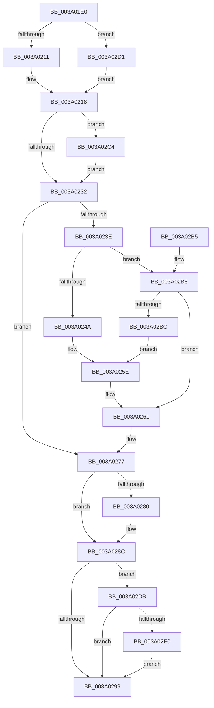

# KeCancelTimer2

- RVA: `0x003A01E0`–`0x003A0307` (길이 `295` bytes)
- VA: `0x00000001403A01E0`
- 실행 섹션: `.text`
- PDB 이름 있음: `예`; PDB Function 태그: `아니요`
- unwind 정보 RVA: `0x00081DB4`
- 디코드: `79`개 명령, `295/295` bytes 표시
- 미해석 바이트: `0` (있으면 어셈블리에 `.byte`로 보존)

> 이 문서는 커널 이미지의 기계어와 PDB 기호를 분석해 생성했습니다. 4번과 5번은 함수 원형과 자료형을 바이너리 사용 방식에서 추정한 C 해석이며 원본 소스 복구 결과는 아닙니다.

## 1. Dependencies

- 직접 호출 지점: **8**; 고유 호출 대상: **8**
- 직접 호출자로 확인된 함수: **24**
- RIP 상대 이미지 참조: **5**

### Outgoing calls
- `0x003A0235` → [KiAcquireTimer2LockUnlessDisabled](KiAcquireTimer2LockUnlessDisabled_function_003A10D8.md) (function, `0x003A10D8`)
- `0x003A0241` → [KiAcquireTimer2CollectionLockIfInserted](KiAcquireTimer2CollectionLockIfInserted_function_003A1150.md) (function, `0x003A1150`)
- `0x003A024D` → [KiRemoveTimer2](KiRemoveTimer2_function_003A1D60.md) (function, `0x003A1D60`)
- `0x003A0259` → [KxReleaseSpinLock](../20/KxReleaseSpinLock_function_00206670.md) (function, `0x00206670`)
- `0x003A0272` → [KiUpdateTimer2Flags](KiUpdateTimer2Flags_function_003A2100.md) (function, `0x003A2100`)
- `0x003A0287` → [KiLowerIrqlProcessIrqlFlags](../4F/KiLowerIrqlProcessIrqlFlags_function_004F5698.md) (function, `0x004F5698`)
- `0x003A02C7` → [KiRaiseIrqlProcessIrqlFlags](../4F/KiRaiseIrqlProcessIrqlFlags_function_004F56FC.md) (function, `0x004F56FC`)
- `0x003A0300` → [KiTraceCancelTimer2](KiTraceCancelTimer2_function_003A378C.md) (function, `0x003A378C`)

### Direct callers
- [ExpShutdownWorkerFactory](../2A/ExpShutdownWorkerFactory_function_002A4F70.md) at `0x002A5063`
- [ExCancelTimer](ExCancelTimer_function_003A01A0.md) at `0x003A01BB`
- [ExpSetTimer2](ExpSetTimer2_function_003A0470.md) at `0x003A0633`
- [ExpSetTimerObject2](ExpSetTimerObject2_function_003A0658.md) at `0x003A078C`
- [PopIdleCancelAoAcDozeS4Timer](../4B/PopIdleCancelAoAcDozeS4Timer_function_004BC9C4.md) at `0x004BCA1D`
- [PopCheckPowerSourceAfterRtcWakeCancel](../4D/PopCheckPowerSourceAfterRtcWakeCancel_function_004D7150.md) at `0x004D7185`
- [PopThermalEventTransitionEnableDeepSleep](../4F/PopThermalEventTransitionEnableDeepSleep_function_004FB584.md) at `0x004FB5A9`
- [KiForceParkDutyCycleDpcCallback](../5C/KiForceParkDutyCycleDpcCallback_function_005C97D0.md) at `0x005C984D`
- [KiForceParkDutyCycleDpcCallback](../5C/KiForceParkDutyCycleDpcCallback_function_005C97D0.md) at `0x005C985B`
- [PopDirectedDripsStartDisengageTimer](../5D/PopDirectedDripsStartDisengageTimer_function_005D1230.md) at `0x005D1277`
- [PopThermalUpdateTelemetryClientCount](../5D/PopThermalUpdateTelemetryClientCount_function_005D58C4.md) at `0x005D592D`
- [PopPowerAggregatorDozeTimerDisarm](../../page/6F/PopPowerAggregatorDozeTimerDisarm_function_006FE548.md) at `0x006FE58A`
- [PopPowerRequestDebounceTimerWorker](../../page/75/PopPowerRequestDebounceTimerWorker_function_00754A40.md) at `0x00754AA5`
- [PopNetDisarmRefreshTimer](../../page/76/PopNetDisarmRefreshTimer_function_00768AD8.md) at `0x00768AE5`
- [PopNetResiliencyPhaseStateChanged](../../page/76/PopNetResiliencyPhaseStateChanged_function_00768DD8.md) at `0x00768E5B`
- [PopDripsWatchdogStopTimer](../../page/76/PopDripsWatchdogStopTimer_function_0076C808.md) at `0x0076C813`
- [PopAdaptiveStandbyCheckHibernateBudgetAction](../../page/76/PopAdaptiveStandbyCheckHibernateBudgetAction_function_0076CB54.md) at `0x0076CC7D`
- [PopAdaptiveStandbySessionStop](../../page/76/PopAdaptiveStandbySessionStop_function_0076EC94.md) at `0x0076ED5D`
- [ExStartStopWorkQueueProvider](../../page/7C/ExStartStopWorkQueueProvider_function_007CF59C.md) at `0x007CF74B`
- [ExpPartitionDestroy](../../page/7C/ExpPartitionDestroy_function_007CF9B8.md) at `0x007CFA50`
- [PpmCheckReInit](../../page/A8/PpmCheckReInit_function_00A84DD8.md) at `0x00A84F48`
- [EtwpCoverageFlushPending](../../page/AB/EtwpCoverageFlushPending_function_00AB6700.md) at `0x00AB685B`
- [PopPowerRequestExecutionRequiredSettingCallback](../../page/AC/PopPowerRequestExecutionRequiredSettingCallback_function_00AC4EB0.md) at `0x00AC4F0D`
- [sub_00B39B90](../../page/B3/Unknown_function_00B39B90.md) at `0x00B39BA0`
- [sub_00B3C582](../../page/B3/Unknown_function_00B3C582.md) at `0x00B3C5AF`

### Static image references
- `0x003A01FE` → RVA `0x00FC6B08` (`ALMOSTRO`; read)
- `0x003A0225` → RVA `0x00FC6D20` (`ALMOSTRO`; read)
- `0x003A0252` → RVA `0x00FCF600` (`CACHEALI`; read)
- `0x003A02E0` → RVA `0x00FC6F78` (`ALMOSTRO`; read)
- `0x003A02F6` → RVA `0x00FC7250` (`ALMOSTRO`; read)

## 2. Other-region calls and transfers

- 다른 실행 섹션으로 향하는 call: **0**
- 별도 외부 분기/꼬리 이동을 확인하지 못했습니다.

## 3. Assembly (complete function range)

```asm
003A01E0  48 89 5C 24 08                  mov qword ptr [rsp + 8], rbx
003A01E5  48 89 6C 24 10                  mov qword ptr [rsp + 0x10], rbp
003A01EA  48 89 74 24 18                  mov qword ptr [rsp + 0x18], rsi
003A01EF  57                              push rdi
003A01F0  41 56                           push r14
003A01F2  41 57                           push r15
003A01F4  48 83 EC 20                     sub rsp, 0x20
003A01F8  40 32 F6                        xor sil, sil
003A01FB  45 33 FF                        xor r15d, r15d
003A01FE  F7 05 00 69 C2 00 00 00 02 00   test dword ptr [rip + 0xc26900], 0x20000
003A0208  48 8B F9                        mov rdi, rcx
003A020B  0F 84 C0 00 00 00               je 0x1403a02d1
003A0211  48 8B 59 60                     mov rbx, qword ptr [rcx + 0x60]
003A0215  41 B6 01                        mov r14b, 1
003A0218  44 0F 20 C5                     mov rbp, cr8
003A021C  BA 02 00 00 00                  mov edx, 2
003A0221  44 0F 22 C2                     mov cr8, rdx
003A0225  44 39 3D F4 6A C2 00            cmp dword ptr [rip + 0xc26af4], r15d
003A022C  0F 85 92 00 00 00               jne 0x1403a02c4
003A0232  48 8B CF                        mov rcx, rdi
003A0235  E8 9E 0E 00 00                  call 0x1403a10d8
003A023A  84 C0                           test al, al
003A023C  75 39                           jne 0x1403a0277
003A023E  48 8B CF                        mov rcx, rdi
003A0241  E8 0A 0F 00 00                  call 0x1403a1150
003A0246  84 C0                           test al, al
003A0248  74 6C                           je 0x1403a02b6
003A024A  48 8B CF                        mov rcx, rdi
003A024D  E8 0E 1B 00 00                  call 0x1403a1d60
003A0252  48 8D 0D A7 F3 C2 00            lea rcx, [rip + 0xc2f3a7]
003A0259  E8 12 64 E6 FF                  call 0x140206670
003A025E  40 B6 01                        mov sil, 1
003A0261  44 0F B6 C6                     movzx r8d, sil
003A0265  41 8B D7                        mov edx, r15d
003A0268  41 83 F0 01                     xor r8d, 1
003A026C  48 8B CF                        mov rcx, rdi
003A026F  45 03 C0                        add r8d, r8d
003A0272  E8 89 1E 00 00                  call 0x1403a2100
003A0277  83 3D A2 6A C2 00 00            cmp dword ptr [rip + 0xc26aa2], 0
003A027E  74 0C                           je 0x1403a028c
003A0280  44 0F 20 C1                     mov rcx, cr8
003A0284  40 8A D5                        mov dl, bpl
003A0287  E8 0C 54 15 00                  call 0x1404f5698
003A028C  40 0F B6 C5                     movzx eax, bpl
003A0290  44 0F 22 C0                     mov cr8, rax
003A0294  45 84 F6                        test r14b, r14b
003A0297  75 42                           jne 0x1403a02db
003A0299  48 8B 5C 24 40                  mov rbx, qword ptr [rsp + 0x40]
003A029E  40 8A C6                        mov al, sil
003A02A1  48 8B 74 24 50                  mov rsi, qword ptr [rsp + 0x50]
003A02A6  48 8B 6C 24 48                  mov rbp, qword ptr [rsp + 0x48]
003A02AB  48 83 C4 20                     add rsp, 0x20
003A02AF  41 5F                           pop r15
003A02B1  41 5E                           pop r14
003A02B3  5F                              pop rdi
003A02B4  C3                              ret
003A02B5  CC                              int3
003A02B6  F6 47 01 0A                     test byte ptr [rdi + 1], 0xa
003A02BA  74 A5                           je 0x1403a0261
003A02BC  41 BF 04 00 00 00               mov r15d, 4
003A02C2  EB 9A                           jmp 0x1403a025e
003A02C4  40 8A CD                        mov cl, bpl
003A02C7  E8 30 54 15 00                  call 0x1404f56fc
003A02CC  E9 61 FF FF FF                  jmp 0x1403a0232
003A02D1  45 32 F6                        xor r14b, r14b
003A02D4  33 DB                           xor ebx, ebx
003A02D6  E9 3D FF FF FF                  jmp 0x1403a0218
003A02DB  40 84 F6                        test sil, sil
003A02DE  74 B9                           je 0x1403a0299
003A02E0  48 8B 0D 91 6C C2 00            mov rcx, qword ptr [rip + 0xc26c91]
003A02E7  48 33 D9                        xor rbx, rcx
003A02EA  48 D3 C3                        rol rbx, cl
003A02ED  48 8B CF                        mov rcx, rdi
003A02F0  48 33 DF                        xor rbx, rdi
003A02F3  48 0F CB                        bswap rbx
003A02F6  48 33 1D 53 6F C2 00            xor rbx, qword ptr [rip + 0xc26f53]
003A02FD  48 8B D3                        mov rdx, rbx
003A0300  E8 87 34 00 00                  call 0x1403a378c
003A0305  EB 92                           jmp 0x1403a0299
```

## 4. C-style interpretation (structured pseudocode)

```c
__int64 __fastcall KeCancelTimer2(__int64 a1)
{
    __int64 result;
    __int64 v_r14;
    __int64 v_r15;
    __int64 v_rbx;
    __int64 v_rsi;
    __int64 v_rsp;
    unsigned __int64 v_stack_p10;
    unsigned __int64 v_stack_p18;
    unsigned __int64 v_stack_p8;

    v_stack_p8 = v_rbx;
    v_stack_p10 = v_rbp;
    v_stack_p18 = v_rsi;
    v_rsp = (v_rsp) - (32);
    v_rsi = 0;
    v_r15 = 0;
    if (((*(unsigned int *)(v_rip + 12740864)) & (0x20000ULL)) == 0) goto loc_003A02D1;
loc_003A0218:
    if ((*(unsigned int *)(v_rip + 12741364)) != 0) goto loc_003A02C4;
loc_003A0232:
    result = KiAcquireTimer2LockUnlessDisabled(a1, 2, a3, a4);
    if ((unsigned __int8)(result) != 0) goto loc_003A0277;
    result = KiAcquireTimer2CollectionLockIfInserted(a1, 2, a3, a4);
    if ((unsigned __int8)(result) == 0) goto loc_003A02B6;
    result = KiRemoveTimer2(a1, 2, a3, a4);
    result = KxReleaseSpinLock(v_rip + 12776359, 2, a3, a4);
loc_003A025E:
loc_003A0261:
    a3 = (unsigned int)((1) ^ (1));
    a3 = (unsigned int)((a3) + ((unsigned int)(a3)));
    result = KiUpdateTimer2Flags(a1, 0, a3, a4);
loc_003A0277:
    if ((*(unsigned int *)(v_rip + 12741282)) != 0) {
        a1 = 2;
        a2 = (unsigned __int8)(v_cr8);
        result = KiLowerIrqlProcessIrqlFlags(a1, a2, a3, a4);
    }
    if (1 != 0) goto loc_003A02DB;
loc_003A0299:
    v_rsp = (v_rsp) + (32);
    return 1;
loc_003A02B6:
    if (((*(unsigned __int8 *)(a1 + 1)) & (10)) == 0) goto loc_003A0261;
    goto loc_003A025E;
loc_003A02C4:
    result = KiRaiseIrqlProcessIrqlFlags((unsigned __int8)(v_stack_p10), a2, a3, a4);
    goto loc_003A0232;
loc_003A02D1:
    v_r14 = 0;
    v_rbx = 0;
    goto loc_003A0218;
loc_003A02DB:
    if ((unsigned __int8)(v_stack_p18) == 0) goto loc_003A0299;
    v_rbx = (v_rbx) ^ (*(unsigned __int64 *)(v_rip + 12741777));
    v_rbx = (v_rbx) ^ (a1);
    v_rbx = (v_rbx) ^ (*(unsigned __int64 *)(v_rip + 12742483));
    result = KiTraceCancelTimer2(a1, v_rbx, a3, a4);
    goto loc_003A0299;
}
```

## 5. (Beta) C Style

```c
int64_t KeCancelTimer2(void *Arg1)
{
    uint8_t *arg1 = (uint8_t *)Arg1;

    int64_t result;
    int64_t local_r14;
    int64_t local_r15;
    int64_t local_rbx;
    int64_t local_rsi;
    int64_t local_rsp;
    uint64_t v_stack_p10;
    uint64_t v_stack_p18;
    uint64_t v_stack_p8;

    v_stack_p8 = local_rbx;
    v_stack_p10 = local_rbp;
    v_stack_p18 = local_rsi;
    local_rsp = (local_rsp) - (32);
    local_rsi = 0;
    local_r15 = 0;
    if (((*(uint32_t *)(v_rip + 0xC26900)) & (0x20000ULL)) == 0) goto loc_003A02D1;
loc_003A0218:
    if ((*(uint32_t *)(v_rip + 0xC26AF4)) != 0) goto loc_003A02C4;
loc_003A0232:
    result = KiAcquireTimer2LockUnlessDisabled(Arg1, 2, a3, a4);
    if ((uint8_t)(result) != 0) goto loc_003A0277;
    result = KiAcquireTimer2CollectionLockIfInserted(Arg1, 2, a3, a4);
    if ((uint8_t)(result) == 0) goto loc_003A02B6;
    result = KiRemoveTimer2(Arg1, 2, a3, a4);
    result = KxReleaseSpinLock(v_rip + 12776359, 2, a3, a4);
loc_003A025E:
loc_003A0261:
    a3 = (uint32_t)((1) ^ (1));
    a3 = (uint32_t)((a3) + ((uint32_t)(a3)));
    result = KiUpdateTimer2Flags(Arg1, 0, a3, a4);
loc_003A0277:
    if ((*(uint32_t *)(v_rip + 0xC26AA2)) != 0) {
        Arg1 = 2;
        a2 = (uint8_t)(v_cr8);
        result = KiLowerIrqlProcessIrqlFlags(Arg1, a2, a3, a4);
    }
    if (1 != 0) goto loc_003A02DB;
loc_003A0299:
    local_rsp = (local_rsp) + (32);
    return 1;
loc_003A02B6:
    if (((*(uint8_t *)(arg1 + 0x1)) & (10)) == 0) goto loc_003A0261;
    goto loc_003A025E;
loc_003A02C4:
    result = KiRaiseIrqlProcessIrqlFlags((uint8_t)(v_stack_p10), a2, a3, a4);
    goto loc_003A0232;
loc_003A02D1:
    local_r14 = 0;
    local_rbx = 0;
    goto loc_003A0218;
loc_003A02DB:
    if ((uint8_t)(v_stack_p18) == 0) goto loc_003A0299;
    local_rbx = (local_rbx) ^ (*(uint64_t *)(v_rip + 0xC26C91));
    local_rbx = (local_rbx) ^ (Arg1);
    local_rbx = (local_rbx) ^ (*(uint64_t *)(v_rip + 0xC26F53));
    result = KiTraceCancelTimer2(Arg1, local_rbx, a3, a4);
    goto loc_003A0299;
}
```

### 관측된 메모리 오프셋

구조체 형식이 확인되지 않은 접근은 인자 기준의 오프셋으로만 기록했습니다.

| 기준 인자 | 오프셋 표현 | 폭 (bit) | 접근 |
|---|---:|---:|---|
| `Arg1` | `+ 0x1` | `8` | `R` |
| `Arg1` | `+ 0x60` | `64` | `R` |

## 6. Execution-region graph

[열기: 2D/3D 그래프와 함수 탐색 컨트롤 패널](../../../control-panel.html?section=text&rva=0x003A01E0&view=graph)

- 2D 그래프는 위에서 아래로 흐르고, 3D 그래프는 빈 공간을 드래그해 회전합니다. Shift+드래그는 이동, 휠은 확대·축소, 함수 노드 선택은 대상 보고서 이동입니다.

### Static fallback


