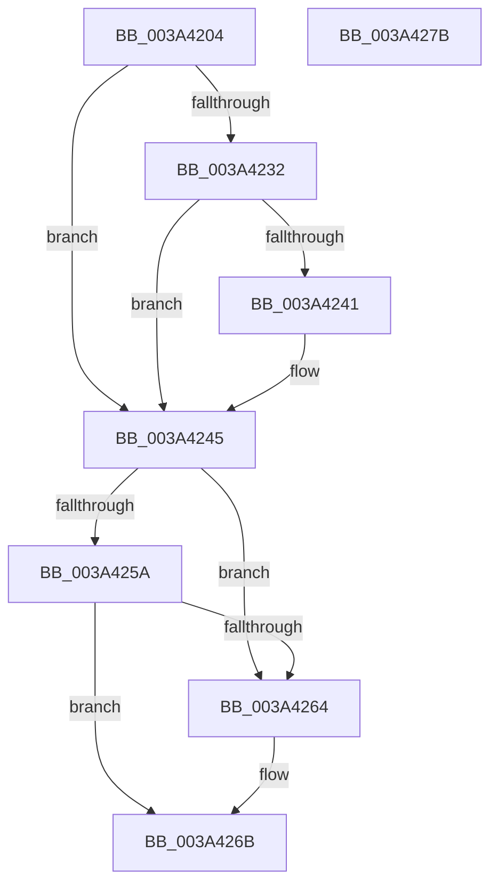

# KeInitializeIRTimer

- RVA: `0x003A4204`–`0x003A427C` (길이 `120` bytes)
- VA: `0x00000001403A4204`
- 실행 섹션: `.text`
- PDB 이름 있음: `예`; PDB Function 태그: `아니요`
- unwind 정보 RVA: `0x00060BC4`
- 디코드: `34`개 명령, `120/120` bytes 표시
- 미해석 바이트: `0` (있으면 어셈블리에 `.byte`로 보존)

> 이 문서는 커널 이미지의 기계어와 PDB 기호를 분석해 생성했습니다. 4번과 5번은 함수 원형과 자료형을 바이너리 사용 방식에서 추정한 C 해석이며 원본 소스 복구 결과는 아닙니다.

## 1. Dependencies

- 직접 호출 지점: **1**; 고유 호출 대상: **1**
- 직접 호출자로 확인된 함수: **7**
- RIP 상대 이미지 참조: **2**

### Outgoing calls
- `0x003A4245` → [KiInitializeTimer2](KiInitializeTimer2_function_003A3288.md) (function, `0x003A3288`)

### Direct callers
- [ExAllocateTimerInternal2](ExAllocateTimerInternal2_function_003A3110.md) at `0x003A3239`
- [PopInitializeIRTimer](../5C/PopInitializeIRTimer_function_005CE5D0.md) at `0x005CE609`
- [PopPowerButtonWorkCallback](../5D/PopPowerButtonWorkCallback_function_005D9A70.md) at `0x005D9BDE`
- [PopThermalZoneAdd](../../page/75/PopThermalZoneAdd_function_0075F980.md) at `0x0075F9C6`
- [PopIdleInitAoAcDozeS4Timer](../../page/76/PopIdleInitAoAcDozeS4Timer_function_0076886C.md) at `0x0076889F`
- [NtCreateTimer2](../../page/A2/NtCreateTimer2_function_00A2C660.md) at `0x00A2C80D`
- [PopPowerAggregatorInitialize](../../init/C7/PopPowerAggregatorInitialize_function_00C77B94.md) at `0x00C77CA3`

### Static image references
- `0x003A4216` → RVA `0x00E093C0` (`.data`; read)
- `0x003A4229` → RVA `0x00EFAB79` (`.data`; read)

## 2. Other-region calls and transfers

- 다른 실행 섹션으로 향하는 call: **0**
- 별도 외부 분기/꼬리 이동을 확인하지 못했습니다.

## 3. Assembly (complete function range)

```asm
003A4204  48 89 5C 24 08                  mov qword ptr [rsp + 8], rbx
003A4209  48 89 74 24 10                  mov qword ptr [rsp + 0x10], rsi
003A420E  57                              push rdi
003A420F  48 83 EC 20                     sub rsp, 0x20
003A4213  49 8B D9                        mov rbx, r9
003A4216  48 8D 35 A3 51 A6 00            lea rsi, [rip + 0xa651a3]
003A421D  44 8B 4C 24 50                  mov r9d, dword ptr [rsp + 0x50]
003A4222  48 8B F9                        mov rdi, rcx
003A4225  41 83 C9 02                     or r9d, 2
003A4229  80 3D 49 69 B5 00 00            cmp byte ptr [rip + 0xb56949], 0
003A4230  74 13                           je 0x1403a4245
003A4232  0F B7 03                        movzx eax, word ptr [rbx]
003A4235  4C 8D 14 40                     lea r10, [rax + rax*2]
003A4239  42 83 7C D6 14 01               cmp dword ptr [rsi + r10*8 + 0x14], 1
003A423F  75 04                           jne 0x1403a4245
003A4241  41 83 C9 20                     or r9d, 0x20
003A4245  E8 3E F0 FF FF                  call 0x1403a3288
003A424A  0F B6 03                        movzx eax, byte ptr [rbx]
003A424D  88 47 02                        mov byte ptr [rdi + 2], al
003A4250  8A 53 02                        mov dl, byte ptr [rbx + 2]
003A4253  88 57 03                        mov byte ptr [rdi + 3], dl
003A4256  3C 14                           cmp al, 0x14
003A4258  73 0A                           jae 0x1403a4264
003A425A  48 8D 0C 40                     lea rcx, [rax + rax*2]
003A425E  3A 54 CE 10                     cmp dl, byte ptr [rsi + rcx*8 + 0x10]
003A4262  72 07                           jb 0x1403a426b
003A4264  B9 05 00 00 00                  mov ecx, 5
003A4269  CD 29                           int 0x29
003A426B  48 8B 5C 24 30                  mov rbx, qword ptr [rsp + 0x30]
003A4270  48 8B 74 24 38                  mov rsi, qword ptr [rsp + 0x38]
003A4275  48 83 C4 20                     add rsp, 0x20
003A4279  5F                              pop rdi
003A427A  C3                              ret
003A427B  CC                              int3
```

## 4. C-style interpretation (structured pseudocode)

```c
__int64 __fastcall KeInitializeIRTimer(__int64 a1, __int64 a2, __int64 a3, __int64 a4, unsigned int a5)
{
    __int64 result;
    __int64 v_rsp;
    unsigned __int64 v_stack_p10;
    unsigned __int64 v_stack_p8;

    v_stack_p8 = v_rbx;
    v_stack_p10 = v_rsi;
    v_rsp = (v_rsp) - (32);
    a4 = (unsigned int)(((unsigned int)(a5)) | (2));
    if ((*(unsigned __int8 *)(v_rip + 11888969)) == 0) goto loc_003A4245;
    if ((*(unsigned int *)(v_rip + 10899875 + *(unsigned __int16 *)(a4) + *(unsigned __int16 *)(a4) * 2 * 8 + 20)) == 1) {
        a4 = (unsigned int)((a4) | (32));
    }
    result = KiInitializeTimer2(a1, a2, a3, a4);
    *(unsigned __int8 *)(a1 + 2) = (unsigned __int8)(*(unsigned __int8 *)(a4));
    *(unsigned __int8 *)(a1 + 3) = (unsigned __int8)(*(unsigned __int8 *)(a4 + 2));
    if (((unsigned __int8)(*(unsigned __int8 *)(a4))) >= 20) goto loc_003A4264;
    if (((unsigned __int8)(*(unsigned __int8 *)(a4 + 2))) >= (*(unsigned __int8 *)(v_rip + 10899875 + *(unsigned __int8 *)(a4) + *(unsigned __int8 *)(a4) * 2 * 8 + 16))) {
        a1 = 5;
    }
    v_rsp = (v_rsp) + (32);
    return *(unsigned __int8 *)(a4);
}
```

## 5. (Beta) C Style

```c
int64_t KeInitializeIRTimer(void *IRTimer, int64_t Arg2, int64_t Arg3, void *Arg4, uint32_t Arg5)
{
    uint8_t *iRTimer = (uint8_t *)IRTimer;
    uint8_t *arg4 = (uint8_t *)Arg4;

    int64_t result;
    int64_t local_rsp;
    uint64_t v_stack_p10;
    uint64_t v_stack_p8;

    v_stack_p8 = local_rbx;
    v_stack_p10 = local_rsi;
    local_rsp = (local_rsp) - (32);
    Arg4 = (uint32_t)(((uint32_t)(Arg5)) | (2));
    if ((*(uint8_t *)(v_rip + 0xB56949)) == 0) goto loc_003A4245;
    if ((*(uint32_t *)(v_rip + 0xA651A3 + *(uint16_t *)(arg4) + *(uint16_t *)(arg4) * 2 * 8 + 0x14)) == 1) {
        Arg4 = (uint32_t)((Arg4) | (32));
    }
    result = KiInitializeTimer2(IRTimer, Arg2, Arg3, Arg4);
    *(uint8_t *)(iRTimer + 0x2) = (uint8_t)(*(uint8_t *)(arg4));
    *(uint8_t *)(iRTimer + 0x3) = (uint8_t)(*(uint8_t *)(arg4 + 0x2));
    if (((uint8_t)(*(uint8_t *)(arg4))) >= 20) goto loc_003A4264;
    if (((uint8_t)(*(uint8_t *)(arg4 + 0x2))) >= (*(uint8_t *)(v_rip + 0xA651A3 + *(uint8_t *)(arg4) + *(uint8_t *)(arg4) * 2 * 8 + 0x10))) {
        IRTimer = 5;
    }
    local_rsp = (local_rsp) + (32);
    return *(uint8_t *)(arg4);
}
```

### 관측된 메모리 오프셋

구조체 형식이 확인되지 않은 접근은 인자 기준의 오프셋으로만 기록했습니다.

| 기준 인자 | 오프셋 표현 | 폭 (bit) | 접근 |
|---|---:|---:|---|
| `IRTimer` | `+ 0x2` | `8` | `W` |
| `IRTimer` | `+ 0x3` | `8` | `W` |
| `Arg4` | `+ 0x0` | `8` | `R` |
| `Arg4` | `+ 0x0` | `16` | `R` |
| `Arg4` | `+ 0x2` | `8` | `R` |

## 6. Execution-region graph

[열기: 2D/3D 그래프와 함수 탐색 컨트롤 패널](../../../control-panel.html?section=text&rva=0x003A4204&view=graph)

- 2D 그래프는 위에서 아래로 흐르고, 3D 그래프는 빈 공간을 드래그해 회전합니다. Shift+드래그는 이동, 휠은 확대·축소, 함수 노드 선택은 대상 보고서 이동입니다.

### Static fallback


