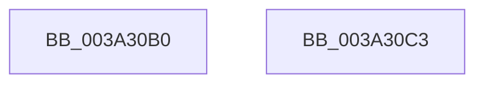

# KeInitializeTimer2

- RVA: `0x003A30B0`–`0x003A30C4` (길이 `20` bytes)
- VA: `0x00000001403A30B0`
- 실행 섹션: `.text`
- PDB 이름 있음: `예`; PDB Function 태그: `아니요`
- unwind 정보 RVA: `0x0005C788`
- 디코드: `6`개 명령, `20/20` bytes 표시
- 미해석 바이트: `0` (있으면 어셈블리에 `.byte`로 보존)

> 이 문서는 커널 이미지의 기계어와 PDB 기호를 분석해 생성했습니다. 4번과 5번은 함수 원형과 자료형을 바이너리 사용 방식에서 추정한 C 해석이며 원본 소스 복구 결과는 아닙니다.

## 1. Dependencies

- 직접 호출 지점: **1**; 고유 호출 대상: **1**
- 직접 호출자로 확인된 함수: **9**
- RIP 상대 이미지 참조: **0**

### Outgoing calls
- `0x003A30B9` → [KiInitializeTimer2](KiInitializeTimer2_function_003A3288.md) (function, `0x003A3288`)

### Direct callers
- [EtwpCoverageEnsureContext](../../page/70/EtwpCoverageEnsureContext_function_007028E4.md) at `0x00702A63`
- [EtwpCoverageEnsureContext](../../page/70/EtwpCoverageEnsureContext_function_007028E4.md) at `0x00702A7C`
- [PopInitializeTimer](../../page/75/PopInitializeTimer_function_00754078.md) at `0x0075408E`
- [PopDirectedDripsInitializeDisengageTimer](../../page/75/PopDirectedDripsInitializeDisengageTimer_function_007578A8.md) at `0x007578D3`
- [PopThermalZoneAdd](../../page/75/PopThermalZoneAdd_function_0075F980.md) at `0x0075F9AA`
- [ExpWorkQueueInitializeHealthMetricsMonitor](../../page/7D/ExpWorkQueueInitializeHealthMetricsMonitor_function_007D00F4.md) at `0x007D011E`
- [ExpWorkQueueManagerInitialize](../../page/7D/ExpWorkQueueManagerInitialize_function_007D01D4.md) at `0x007D024C`
- [NtCreateWorkerFactory](../../page/9A/NtCreateWorkerFactory_function_009A7E10.md) at `0x009A80CD`
- [NtCreateTimer2](../../page/A2/NtCreateTimer2_function_00A2C660.md) at `0x00A2C76A`
- [KiCompleteKernelInit](../../pagelk/B6/KiCompleteKernelInit_function_00B66090.md) at `0x00B6615C`

### Static image references
- 디코드된 RIP-relative 메모리 참조가 없습니다.

## 2. Other-region calls and transfers

- 다른 실행 섹션으로 향하는 call: **0**
- 별도 외부 분기/꼬리 이동을 확인하지 못했습니다.

## 3. Assembly (complete function range)

```asm
003A30B0  48 83 EC 28                     sub rsp, 0x28
003A30B4  66 83 61 02 00                  and word ptr [rcx + 2], 0
003A30B9  E8 CA 01 00 00                  call 0x1403a3288
003A30BE  48 83 C4 28                     add rsp, 0x28
003A30C2  C3                              ret
003A30C3  CC                              int3
```

## 4. C-style interpretation (structured pseudocode)

```c
__int64 __fastcall KeInitializeTimer2(__int64 a1)
{
    __int64 result;
    __int64 v_rsp;

    v_rsp = (v_rsp) - (40);
    result = KiInitializeTimer2(a1, a2, a3, a4);
    v_rsp = (v_rsp) + (40);
    return result;
}
```

## 5. (Beta) C Style

```c
int64_t KeInitializeTimer2(void *Timer2)
{
    uint8_t *timer2 = (uint8_t *)Timer2;

    int64_t result;
    int64_t local_rsp;

    local_rsp = (local_rsp) - (40);
    result = KiInitializeTimer2(Timer2, a2, a3, a4);
    local_rsp = (local_rsp) + (40);
    return result;
}
```

### 관측된 메모리 오프셋

구조체 형식이 확인되지 않은 접근은 인자 기준의 오프셋으로만 기록했습니다.

| 기준 인자 | 오프셋 표현 | 폭 (bit) | 접근 |
|---|---:|---:|---|
| `Timer2` | `+ 0x2` | `16` | `R/W` |

## 6. Execution-region graph

[열기: 2D/3D 그래프와 함수 탐색 컨트롤 패널](../../../control-panel.html?section=text&rva=0x003A30B0&view=graph)

- 2D 그래프는 위에서 아래로 흐르고, 3D 그래프는 빈 공간을 드래그해 회전합니다. Shift+드래그는 이동, 휠은 확대·축소, 함수 노드 선택은 대상 보고서 이동입니다.

### Static fallback


