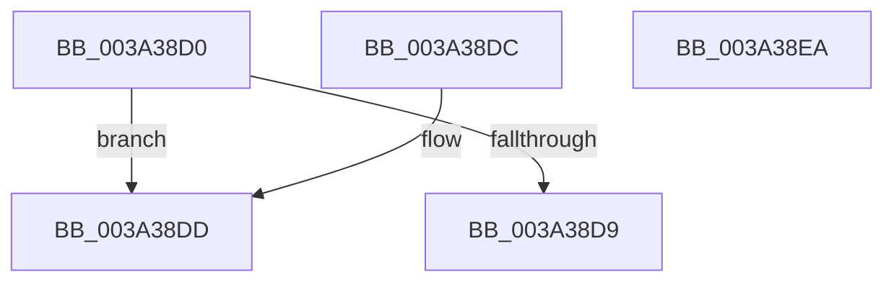

# KeIsForceIdleEngaged

- RVA: `0x003A38D0`–`0x003A38EB` (길이 `27` bytes)
- VA: `0x00000001403A38D0`
- 실행 섹션: `.text`
- PDB 이름 있음: `예`; PDB Function 태그: `아니요`
- unwind 정보 RVA: `0x000DB714`
- 디코드: `10`개 명령, `27/27` bytes 표시
- 미해석 바이트: `0` (있으면 어셈블리에 `.byte`로 보존)

> 이 문서는 커널 이미지의 기계어와 PDB 기호를 분석해 생성했습니다. 4번과 5번은 함수 원형과 자료형을 바이너리 사용 방식에서 추정한 C 해석이며 원본 소스 복구 결과는 아닙니다.

## 1. Dependencies

- 직접 호출 지점: **0**; 고유 호출 대상: **0**
- 직접 호출자로 확인된 함수: **4**
- RIP 상대 이미지 참조: **2**

### Outgoing calls
- 직접 디코드된 call 명령이 없습니다.

### Direct callers
- [sub_00208EAD](../20/Unknown_function_00208EAD.md) at `0x00208EDC`
- [sub_003A385F](Unknown_function_003A385F.md) at `0x003A3886`
- [KiResetForceIdle](KiResetForceIdle_function_003A4160.md) at `0x003A4180`
- [KePrepareClockTimerForPlatformIdle](../5B/KePrepareClockTimerForPlatformIdle_function_005BA820.md) at `0x005BA904`
- [KePrepareClockTimerForPlatformIdle](../5B/KePrepareClockTimerForPlatformIdle_function_005BA820.md) at `0x005BAC01`

### Static image references
- `0x003A38D0` → RVA `0x00FC6FF0` (`ALMOSTRO`; read)
- `0x003A38DD` → RVA `0x00F233CC` (`.data`; read)

## 2. Other-region calls and transfers

- 다른 실행 섹션으로 향하는 call: **0**
- 별도 외부 분기/꼬리 이동을 확인하지 못했습니다.

## 3. Assembly (complete function range)

```asm
003A38D0  83 3D 19 37 C2 00 00            cmp dword ptr [rip + 0xc23719], 0
003A38D7  74 04                           je 0x1403a38dd
003A38D9  32 C0                           xor al, al
003A38DB  C3                              ret
003A38DC  CC                              int3
003A38DD  8B 05 E9 FA B7 00               mov eax, dword ptr [rip + 0xb7fae9]
003A38E3  83 F8 04                        cmp eax, 4
003A38E6  0F 94 C0                        sete al
003A38E9  C3                              ret
003A38EA  CC                              int3
```

## 4. C-style interpretation (structured pseudocode)

```c
__int64 __fastcall KeIsForceIdleEngaged(void)
{
    __int64 result;

    if ((*(unsigned int *)(v_rip + 12728089)) == 0) goto loc_003A38DD;
    result = 0;
    return result;
loc_003A38DD:
    result = (((unsigned int)((unsigned int)(*(unsigned int *)(v_rip + 12057321)))) == 4) ? 1 : 0;
    return result;
}
```

## 5. (Beta) C Style

```c
void KeIsForceIdleEngaged(void)
{
    int64_t result;

    if ((*(uint32_t *)(v_rip + 0xC23719)) == 0) goto loc_003A38DD;
    result = 0;
    return result;
loc_003A38DD:
    result = (((uint32_t)((uint32_t)(*(uint32_t *)(v_rip + 0xB7FAE9)))) == 4) ? 1 : 0;
    return result;
}
```

## 6. Execution-region graph

[열기: 2D/3D 그래프와 함수 탐색 컨트롤 패널](../../../control-panel.html?section=text&rva=0x003A38D0&view=graph)

- 2D 그래프는 위에서 아래로 흐르고, 3D 그래프는 빈 공간을 드래그해 회전합니다. Shift+드래그는 이동, 휠은 확대·축소, 함수 노드 선택은 대상 보고서 이동입니다.

### Static fallback


