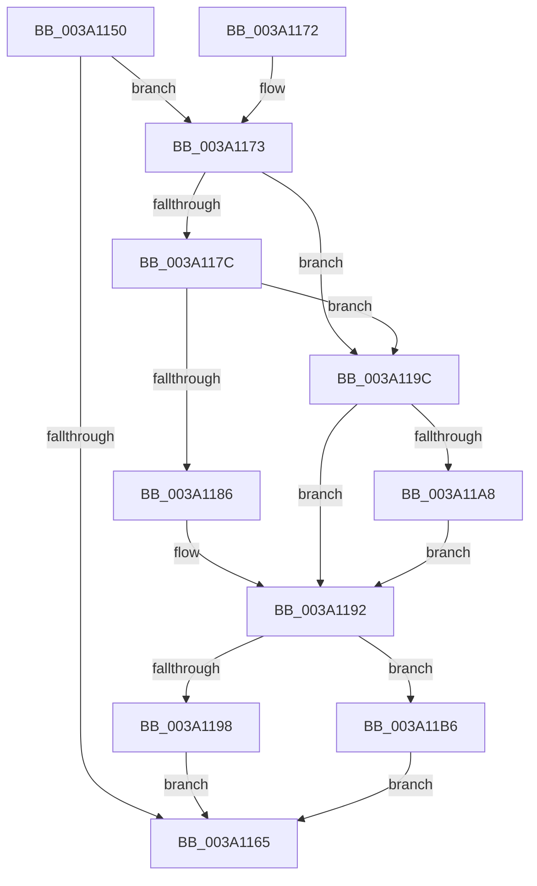

# KiAcquireTimer2CollectionLockIfInserted

- RVA: `0x003A1150`–`0x003A11C4` (길이 `116` bytes)
- VA: `0x00000001403A1150`
- 실행 섹션: `.text`
- PDB 이름 있음: `예`; PDB Function 태그: `아니요`
- unwind 정보 RVA: `0x00081E58`
- 디코드: `32`개 명령, `116/116` bytes 표시
- 미해석 바이트: `0` (있으면 어셈블리에 `.byte`로 보존)

> 이 문서는 커널 이미지의 기계어와 PDB 기호를 분석해 생성했습니다. 4번과 5번은 함수 원형과 자료형을 바이너리 사용 방식에서 추정한 C 해석이며 원본 소스 복구 결과는 아닙니다.

## 1. Dependencies

- 직접 호출 지점: **3**; 고유 호출 대상: **3**
- 직접 호출자로 확인된 함수: **3**
- RIP 상대 이미지 참조: **4**

### Outgoing calls
- `0x003A118D` → [KiAcquireSpinLockInstrumented](../20/KiAcquireSpinLockInstrumented_function_002084F0.md) (function, `0x002084F0`)
- `0x003A11AF` → [KxWaitForSpinLockAndAcquire](../20/KxWaitForSpinLockAndAcquire_function_002085C0.md) (function, `0x002085C0`)
- `0x003A11BD` → [KxReleaseSpinLock](../20/KxReleaseSpinLock_function_00206670.md) (function, `0x00206670`)

### Direct callers
- [KeDisableTimer2](../39/KeDisableTimer2_function_0039FD58.md) at `0x0039FEA6`
- [KeCancelTimer2](KeCancelTimer2_function_003A01E0.md) at `0x003A0241`
- [KeSetTimer2](KeSetTimer2_function_003A08E0.md) at `0x003A09DE`

### Static image references
- `0x003A1173` → RVA `0x00FC6B06` (`ALMOSTRO`; read)
- `0x003A117C` → RVA `0x00F0DE58` (`.data`; read)
- `0x003A1186` → RVA `0x00FCF600` (`CACHEALI`; read)
- `0x003A119C` → RVA `0x00FCF600` (`CACHEALI`; read/write)

## 2. Other-region calls and transfers

- 다른 실행 섹션으로 향하는 call: **0**
- 별도 외부 분기/꼬리 이동을 확인하지 못했습니다.

## 3. Assembly (complete function range)

```asm
003A1150  48 89 5C 24 08                  mov qword ptr [rsp + 8], rbx
003A1155  57                              push rdi
003A1156  48 83 EC 20                     sub rsp, 0x20
003A115A  33 DB                           xor ebx, ebx
003A115C  48 8B F9                        mov rdi, rcx
003A115F  F6 41 01 01                     test byte ptr [rcx + 1], 1
003A1163  75 0E                           jne 0x1403a1173
003A1165  8A C3                           mov al, bl
003A1167  48 8B 5C 24 30                  mov rbx, qword ptr [rsp + 0x30]
003A116C  48 83 C4 20                     add rsp, 0x20
003A1170  5F                              pop rdi
003A1171  C3                              ret
003A1172  CC                              int3
003A1173  F6 05 8C 59 C2 00 21            test byte ptr [rip + 0xc2598c], 0x21
003A117A  74 20                           je 0x1403a119c
003A117C  8B 05 D6 CC B6 00               mov eax, dword ptr [rip + 0xb6ccd6]
003A1182  85 C0                           test eax, eax
003A1184  75 16                           jne 0x1403a119c
003A1186  48 8D 0D 73 E4 C2 00            lea rcx, [rip + 0xc2e473]
003A118D  E8 5E 73 E6 FF                  call 0x1402084f0
003A1192  F6 47 01 01                     test byte ptr [rdi + 1], 1
003A1196  74 1E                           je 0x1403a11b6
003A1198  B3 01                           mov bl, 1
003A119A  EB C9                           jmp 0x1403a1165
003A119C  F0 48 0F BA 2D 5A E4 C2 00 00   lock bts qword ptr [rip + 0xc2e45a], 0
003A11A6  73 EA                           jae 0x1403a1192
003A11A8  48 8D 0D 51 E4 C2 00            lea rcx, [rip + 0xc2e451]
003A11AF  E8 0C 74 E6 FF                  call 0x1402085c0
003A11B4  EB DC                           jmp 0x1403a1192
003A11B6  48 8D 0D 43 E4 C2 00            lea rcx, [rip + 0xc2e443]
003A11BD  E8 AE 54 E6 FF                  call 0x140206670
003A11C2  EB A1                           jmp 0x1403a1165
```

## 4. C-style interpretation (structured pseudocode)

```c
__int64 __fastcall KiAcquireTimer2CollectionLockIfInserted(__int64 a1)
{
    __int64 result;
    __int64 v_rbx;
    __int64 v_rsp;
    unsigned __int64 v_stack_p8;

    v_stack_p8 = v_rbx;
    v_rsp = (v_rsp) - (32);
    v_rbx = 0;
    if (((*(unsigned __int8 *)(a1 + 1)) & (1)) != 0) goto loc_003A1173;
loc_003A1165:
    v_rsp = (v_rsp) + (32);
    return 0;
loc_003A1173:
    if (((*(unsigned __int8 *)(v_rip + 12736908)) & (33)) == 0) goto loc_003A119C;
    if ((unsigned int)((unsigned int)(*(unsigned int *)(v_rip + 11979990))) != 0) goto loc_003A119C;
    result = KiAcquireSpinLockInstrumented(v_rip + 12772467, a2, a3, a4);
loc_003A1192:
    if (((*(unsigned __int8 *)(a1 + 1)) & (1)) == 0) goto loc_003A11B6;
    goto loc_003A1165;
loc_003A119C:
    if (condition_is_above_or_equal) goto loc_003A1192;
    result = KxWaitForSpinLockAndAcquire(v_rip + 12772433, a2, a3, a4);
    goto loc_003A1192;
loc_003A11B6:
    result = KxReleaseSpinLock(v_rip + 12772419, a2, a3, a4);
    goto loc_003A1165;
}
```

## 5. (Beta) C Style

```c
int64_t KiAcquireTimer2CollectionLockIfInserted(void *Arg1)
{
    uint8_t *arg1 = (uint8_t *)Arg1;

    int64_t result;
    int64_t local_rbx;
    int64_t local_rsp;
    uint64_t v_stack_p8;

    v_stack_p8 = local_rbx;
    local_rsp = (local_rsp) - (32);
    local_rbx = 0;
    if (((*(uint8_t *)(arg1 + 0x1)) & (1)) != 0) goto loc_003A1173;
loc_003A1165:
    local_rsp = (local_rsp) + (32);
    return 0;
loc_003A1173:
    if (((*(uint8_t *)(v_rip + 0xC2598C)) & (33)) == 0) goto loc_003A119C;
    if ((uint32_t)((uint32_t)(*(uint32_t *)(v_rip + 0xB6CCD6))) != 0) goto loc_003A119C;
    result = KiAcquireSpinLockInstrumented(v_rip + 12772467, a2, a3, a4);
loc_003A1192:
    if (((*(uint8_t *)(arg1 + 0x1)) & (1)) == 0) goto loc_003A11B6;
    goto loc_003A1165;
loc_003A119C:
    if (condition_is_above_or_equal) goto loc_003A1192;
    result = KxWaitForSpinLockAndAcquire(v_rip + 12772433, a2, a3, a4);
    goto loc_003A1192;
loc_003A11B6:
    result = KxReleaseSpinLock(v_rip + 12772419, a2, a3, a4);
    goto loc_003A1165;
}
```

### 관측된 메모리 오프셋

구조체 형식이 확인되지 않은 접근은 인자 기준의 오프셋으로만 기록했습니다.

| 기준 인자 | 오프셋 표현 | 폭 (bit) | 접근 |
|---|---:|---:|---|
| `Arg1` | `+ 0x1` | `8` | `R` |

## 6. Execution-region graph

[열기: 2D/3D 그래프와 함수 탐색 컨트롤 패널](../../../control-panel.html?section=text&rva=0x003A1150&view=graph)

- 2D 그래프는 위에서 아래로 흐르고, 3D 그래프는 빈 공간을 드래그해 회전합니다. Shift+드래그는 이동, 휠은 확대·축소, 함수 노드 선택은 대상 보고서 이동입니다.

### Static fallback


