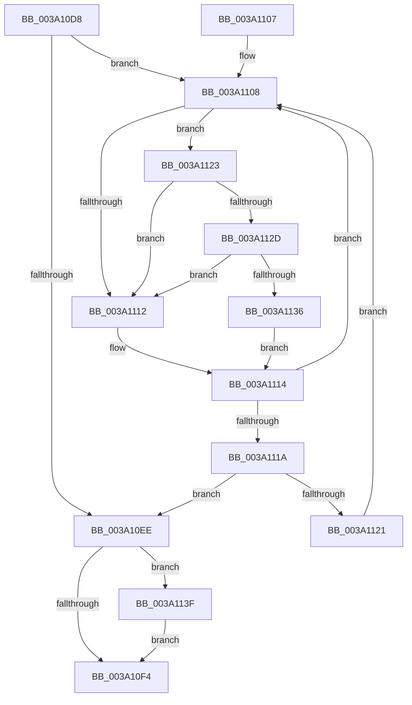

# KiAcquireTimer2LockUnlessDisabled

- RVA: `0x003A10D8`–`0x003A1148` (길이 `112` bytes)
- VA: `0x00000001403A10D8`
- 실행 섹션: `.text`
- PDB 이름 있음: `예`; PDB Function 태그: `아니요`
- unwind 정보 RVA: `0x00081E48`
- 디코드: `38`개 명령, `112/112` bytes 표시
- 미해석 바이트: `0` (있으면 어셈블리에 `.byte`로 보존)

> 이 문서는 커널 이미지의 기계어와 PDB 기호를 분석해 생성했습니다. 4번과 5번은 함수 원형과 자료형을 바이너리 사용 방식에서 추정한 C 해석이며 원본 소스 복구 결과는 아닙니다.

## 1. Dependencies

- 직접 호출 지점: **2**; 고유 호출 대상: **2**
- 직접 호출자로 확인된 함수: **3**
- RIP 상대 이미지 참조: **2**

### Outgoing calls
- `0x003A112D` → [KiCheckVpBackingLongSpinWaitHypercall](../30/KiCheckVpBackingLongSpinWaitHypercall_function_0030F490.md) (function, `0x0030F490`)
- `0x003A1138` → [HvlNotifyLongSpinWait](../30/HvlNotifyLongSpinWait_function_0030F460.md) (function, `0x0030F460`)

### Direct callers
- [KeDisableTimer2](../39/KeDisableTimer2_function_0039FD58.md) at `0x0039FE7B`
- [KeCancelTimer2](KeCancelTimer2_function_003A01E0.md) at `0x003A0235`
- [KeSetTimer2](KeSetTimer2_function_003A08E0.md) at `0x003A09CE`

### Static image references
- `0x003A110A` → RVA `0x00FC52AC` (`ALMOSTRO`; reference)
- `0x003A1123` → RVA `0x00FC6AB8` (`ALMOSTRO`; read)

## 2. Other-region calls and transfers

- 다른 실행 섹션으로 향하는 call: **0**
- 별도 외부 분기/꼬리 이동을 확인하지 못했습니다.

## 3. Assembly (complete function range)

```asm
003A10D8  48 89 5C 24 10                  mov qword ptr [rsp + 0x10], rbx
003A10DD  57                              push rdi
003A10DE  48 83 EC 20                     sub rsp, 0x20
003A10E2  33 FF                           xor edi, edi
003A10E4  48 8B D9                        mov rbx, rcx
003A10E7  F0 0F BA 29 07                  lock bts dword ptr [rcx], 7
003A10EC  72 1A                           jb 0x1403a1108
003A10EE  F6 43 01 20                     test byte ptr [rbx + 1], 0x20
003A10F2  75 4B                           jne 0x1403a113f
003A10F4  8A 43 01                        mov al, byte ptr [rbx + 1]
003A10F7  48 8B 5C 24 38                  mov rbx, qword ptr [rsp + 0x38]
003A10FC  C0 E8 05                        shr al, 5
003A10FF  24 01                           and al, 1
003A1101  48 83 C4 20                     add rsp, 0x20
003A1105  5F                              pop rdi
003A1106  C3                              ret
003A1107  CC                              int3
003A1108  FF C7                           inc edi
003A110A  85 3D 9C 41 C2 00               test dword ptr [rip + 0xc2419c], edi
003A1110  74 11                           je 0x1403a1123
003A1112  F3 90                           pause
003A1114  8B 03                           mov eax, dword ptr [rbx]
003A1116  84 C0                           test al, al
003A1118  78 EE                           js 0x1403a1108
003A111A  F0 0F BA 2B 07                  lock bts dword ptr [rbx], 7
003A111F  73 CD                           jae 0x1403a10ee
003A1121  EB E5                           jmp 0x1403a1108
003A1123  8B 05 8F 59 C2 00               mov eax, dword ptr [rip + 0xc2598f]
003A1129  A8 40                           test al, 0x40
003A112B  74 E5                           je 0x1403a1112
003A112D  E8 5E E3 F6 FF                  call 0x14030f490
003A1132  84 C0                           test al, al
003A1134  74 DC                           je 0x1403a1112
003A1136  8B CF                           mov ecx, edi
003A1138  E8 23 E3 F6 FF                  call 0x14030f460
003A113D  EB D5                           jmp 0x1403a1114
003A113F  F0 81 23 7F FF FF FF            lock and dword ptr [rbx], 0xffffff7f
003A1146  EB AC                           jmp 0x1403a10f4
```

## 4. C-style interpretation (structured pseudocode)

```c
__int64 __fastcall KiAcquireTimer2LockUnlessDisabled(__int64 a1)
{
    __int64 result;
    __int64 v_rdi;
    __int64 v_rsp;
    unsigned __int64 v_stack_p10;

    v_stack_p10 = v_rbx;
    v_rsp = (v_rsp) - (32);
    v_rdi = 0;
    if (condition_is_below) goto loc_003A1108;
loc_003A10EE:
    if (((*(unsigned __int8 *)(a1 + 1)) & (32)) != 0) goto loc_003A113F;
loc_003A10F4:
    result = (unsigned __int8)((*(unsigned __int8 *)(a1 + 1)) >> (5));
    result = (unsigned __int8)((result) & (1));
    v_rsp = (v_rsp) + (32);
    return result;
loc_003A1108:
    v_rdi = (unsigned int)((v_rdi) + 1);
    if (((*(unsigned int *)(v_rip + 12730780)) & ((unsigned int)(v_rdi))) == 0) goto loc_003A1123;
loc_003A1112:
loc_003A1114:
    if (sign_flag) goto loc_003A1108;
    if (condition_is_above_or_equal) goto loc_003A10EE;
    goto loc_003A1108;
loc_003A1123:
    if ((((unsigned __int8)((unsigned int)(*(unsigned int *)(v_rip + 12736911)))) & (64)) == 0) goto loc_003A1112;
    result = KiCheckVpBackingLongSpinWaitHypercall(a1, a2, a3, a4);
    if ((unsigned __int8)(result) == 0) goto loc_003A1112;
    result = HvlNotifyLongSpinWait((unsigned int)((unsigned int)(v_rdi)), a2, a3, a4);
    goto loc_003A1114;
loc_003A113F:
    goto loc_003A10F4;
}
```

## 5. (Beta) C Style

```c
int64_t KiAcquireTimer2LockUnlessDisabled(void *Arg1)
{
    uint8_t *arg1 = (uint8_t *)Arg1;

    int64_t result;
    int64_t local_rdi;
    int64_t local_rsp;
    uint64_t v_stack_p10;

    v_stack_p10 = local_rbx;
    local_rsp = (local_rsp) - (32);
    local_rdi = 0;
    if (condition_is_below) goto loc_003A1108;
loc_003A10EE:
    if (((*(uint8_t *)(arg1 + 0x1)) & (32)) != 0) goto loc_003A113F;
loc_003A10F4:
    result = (uint8_t)((*(uint8_t *)(arg1 + 0x1)) >> (5));
    result = (uint8_t)((result) & (1));
    local_rsp = (local_rsp) + (32);
    return result;
loc_003A1108:
    local_rdi = (uint32_t)((local_rdi) + 1);
    if (((*(uint32_t *)(v_rip + 0xC2419C)) & ((uint32_t)(local_rdi))) == 0) goto loc_003A1123;
loc_003A1112:
loc_003A1114:
    if (sign_flag) goto loc_003A1108;
    if (condition_is_above_or_equal) goto loc_003A10EE;
    goto loc_003A1108;
loc_003A1123:
    if ((((uint8_t)((uint32_t)(*(uint32_t *)(v_rip + 0xC2598F)))) & (64)) == 0) goto loc_003A1112;
    result = KiCheckVpBackingLongSpinWaitHypercall(Arg1, a2, a3, a4);
    if ((uint8_t)(result) == 0) goto loc_003A1112;
    result = HvlNotifyLongSpinWait((uint32_t)((uint32_t)(local_rdi)), a2, a3, a4);
    goto loc_003A1114;
loc_003A113F:
    goto loc_003A10F4;
}
```

### 관측된 메모리 오프셋

구조체 형식이 확인되지 않은 접근은 인자 기준의 오프셋으로만 기록했습니다.

| 기준 인자 | 오프셋 표현 | 폭 (bit) | 접근 |
|---|---:|---:|---|
| `Arg1` | `+ 0x0` | `32` | `R` |
| `Arg1` | `+ 0x0` | `32` | `R/W` |
| `Arg1` | `+ 0x1` | `8` | `R` |

## 6. Execution-region graph

[열기: 2D/3D 그래프와 함수 탐색 컨트롤 패널](../../../control-panel.html?section=text&rva=0x003A10D8&view=graph)

- 2D 그래프는 위에서 아래로 흐르고, 3D 그래프는 빈 공간을 드래그해 회전합니다. Shift+드래그는 이동, 휠은 확대·축소, 함수 노드 선택은 대상 보고서 이동입니다.

### Static fallback


