# KiAdjustTimer2DueTimes

- RVA: `0x003A3550`–`0x003A3785` (길이 `565` bytes)
- VA: `0x00000001403A3550`
- 실행 섹션: `.text`
- PDB 이름 있음: `예`; PDB Function 태그: `예`
- unwind 정보 RVA: `0x000821F4`
- 디코드: `161`개 명령, `565/565` bytes 표시
- 미해석 바이트: `0` (있으면 어셈블리에 `.byte`로 보존)

> 이 문서는 커널 이미지의 기계어와 PDB 기호를 분석해 생성했습니다. 4번과 5번은 함수 원형과 자료형을 바이너리 사용 방식에서 추정한 C 해석이며 원본 소스 복구 결과는 아닙니다.

## 1. Dependencies

- 직접 호출 지점: **6**; 고유 호출 대상: **6**
- 직접 호출자로 확인된 함수: **1**
- RIP 상대 이미지 참조: **5**

### Outgoing calls
- `0x003A3626` → [KiRemoveTimer2](KiRemoveTimer2_function_003A1D60.md) (function, `0x003A1D60`)
- `0x003A36F2` → [KiInsertTimer2](KiInsertTimer2_function_003A244C.md) (function, `0x003A244C`)
- `0x003A3731` → [KiShouldActivateHRTimerClock](KiShouldActivateHRTimerClock_function_003A46C0.md) (function, `0x003A46C0`)
- `0x003A375B` → [RtlULongLongSub](../48/RtlULongLongSub_function_004831AC.md) (function, `0x004831AC`)
- `0x003A3771` → [KiRequestTimer2Expiration](../39/KiRequestTimer2Expiration_function_0039F118.md) (function, `0x0039F118`)
- `0x003A377E` → [KiSendClockInterruptToTargetProcessor](../23/KiSendClockInterruptToTargetProcessor_function_00234700.md) (function, `0x00234700`)

### Direct callers
- [KiAdjustTimerDueTimes](../4E/KiAdjustTimerDueTimes_function_004E8CD4.md) at `0x004E8F7C`

### Static image references
- `0x003A3586` → RVA `0x00F23320` (`.data`; read)
- `0x003A36C6` → RVA `0x00F233C8` (`.data`; read)
- `0x003A370E` → RVA `0x00F23360` (`.data`; read)
- `0x003A371F` → RVA `0x00F23348` (`.data`; read)
- `0x003A3778` → RVA `0x00F21FB0` (`.data`; read)

## 2. Other-region calls and transfers

- 다른 실행 섹션으로 향하는 call: **0**
- call이 아닌 외부 분기/꼬리 이동: **2**
  - `0x003A3762` → [sub_006E635E](../6E/Unknown_function_006E635E.md) (`tail-transfer`)
  - `0x003A376C` → [sub_006E635E](../6E/Unknown_function_006E635E.md) (`tail-transfer`)

## 3. Assembly (complete function range)

```asm
003A3550  48 89 5C 24 18                  mov qword ptr [rsp + 0x18], rbx
003A3555  48 89 4C 24 08                  mov qword ptr [rsp + 8], rcx
003A355A  55                              push rbp
003A355B  56                              push rsi
003A355C  57                              push rdi
003A355D  41 54                           push r12
003A355F  41 55                           push r13
003A3561  41 56                           push r14
003A3563  41 57                           push r15
003A3565  48 8B EC                        mov rbp, rsp
003A3568  48 83 EC 30                     sub rsp, 0x30
003A356C  45 33 ED                        xor r13d, r13d
003A356F  C6 45 48 00                     mov byte ptr [rbp + 0x48], 0
003A3573  48 8D 45 F0                     lea rax, [rbp - 0x10]
003A3577  4C 8B D1                        mov r10, rcx
003A357A  48 8D 7D F0                     lea rdi, [rbp - 0x10]
003A357E  48 89 45 F8                     mov qword ptr [rbp - 8], rax
003A3582  48 89 7D F0                     mov qword ptr [rbp - 0x10], rdi
003A3586  4C 8D 35 93 FD B7 00            lea r14, [rip + 0xb7fd93]
003A358D  41 8D 75 01                     lea esi, [r13 + 1]
003A3591  8D 4E 17                        lea ecx, [rsi + 0x17]
003A3594  49 8B 46 08                     mov rax, qword ptr [r14 + 8]
003A3598  40 84 C6                        test sil, al
003A359B  0F 84 B2 01 00 00               je 0x1403a3753
003A35A1  48 3B C6                        cmp rax, rsi
003A35A4  0F 84 19 01 00 00               je 0x1403a36c3
003A35AA  49 8B DE                        mov rbx, r14
003A35AD  48 0B DE                        or rbx, rsi
003A35B0  48 33 D8                        xor rbx, rax
003A35B3  48 85 DB                        test rbx, rbx
003A35B6  0F 84 07 01 00 00               je 0x1403a36c3
003A35BC  45 33 E4                        xor r12d, r12d
003A35BF  49 83 FD 03                     cmp r13, 3
003A35C3  4C 0F 4D E1                     cmovge r12, rcx
003A35C7  48 8B 43 08                     mov rax, qword ptr [rbx + 8]
003A35CB  4C 8B FB                        mov r15, rbx
003A35CE  4D 2B FC                        sub r15, r12
003A35D1  48 8B CB                        mov rcx, rbx
003A35D4  48 85 C0                        test rax, rax
003A35D7  74 23                           je 0x1403a35fc
003A35D9  48 8B 08                        mov rcx, qword ptr [rax]
003A35DC  48 8B D8                        mov rbx, rax
003A35DF  48 85 C9                        test rcx, rcx
003A35E2  74 22                           je 0x1403a3606
003A35E4  48 8B 01                        mov rax, qword ptr [rcx]
003A35E7  48 8B D9                        mov rbx, rcx
003A35EA  48 8B C8                        mov rcx, rax
003A35ED  48 85 C0                        test rax, rax
003A35F0  75 F2                           jne 0x1403a35e4
003A35F2  EB 12                           jmp 0x1403a3606
003A35F4  48 39 0B                        cmp qword ptr [rbx], rcx
003A35F7  74 0D                           je 0x1403a3606
003A35F9  48 8B CB                        mov rcx, rbx
003A35FC  48 8B 5B 10                     mov rbx, qword ptr [rbx + 0x10]
003A3600  48 83 E3 FC                     and rbx, 0xfffffffffffffffc
003A3604  75 EE                           jne 0x1403a35f4
003A3606  41 8A 47 68                     mov al, byte ptr [r15 + 0x68]
003A360A  41 3A 02                        cmp al, byte ptr [r10]
003A360D  0F 84 A1 00 00 00               je 0x1403a36b4
003A3613  84 C0                           test al, al
003A3615  75 0B                           jne 0x1403a3622
003A3617  41 F6 47 69 02                  test byte ptr [r15 + 0x69], 2
003A361C  0F 85 92 00 00 00               jne 0x1403a36b4
003A3622  49 8D 4F E8                     lea rcx, [r15 - 0x18]
003A3626  E8 35 E7 FF FF                  call 0x1403a1d60
003A362B  4C 8B 55 40                     mov r10, qword ptr [rbp + 0x40]
003A362F  4D 8D 47 30                     lea r8, [r15 + 0x30]
003A3633  49 8B 08                        mov rcx, qword ptr [r8]
003A3636  49 8B 52 18                     mov rdx, qword ptr [r10 + 0x18]
003A363A  48 85 D2                        test rdx, rdx
003A363D  0F 89 18 01 00 00               jns 0x1403a375b
003A3643  48 F7 DA                        neg rdx
003A3646  48 8D 04 11                     lea rax, [rcx + rdx]
003A364A  48 3B C1                        cmp rax, rcx
003A364D  72 2B                           jb 0x1403a367a
003A364F  48 83 F8 FF                     cmp rax, -1
003A3653  74 25                           je 0x1403a367a
003A3655  49 8B 4F 38                     mov rcx, qword ptr [r15 + 0x38]
003A3659  49 89 00                        mov qword ptr [r8], rax
003A365C  48 83 F9 FF                     cmp rcx, -1
003A3660  75 21                           jne 0x1403a3683
003A3662  48 8B 45 F0                     mov rax, qword ptr [rbp - 0x10]
003A3666  48 8D 4D F0                     lea rcx, [rbp - 0x10]
003A366A  49 8B FF                        mov rdi, r15
003A366D  48 39 48 08                     cmp qword ptr [rax + 8], rcx
003A3671  74 2E                           je 0x1403a36a1
003A3673  B9 03 00 00 00                  mov ecx, 3
003A3678  CD 29                           int 0x29
003A367A  48 C7 C0 FE FF FF FF            mov rax, 0xfffffffffffffffe
003A3681  EB D2                           jmp 0x1403a3655
003A3683  48 8D 04 11                     lea rax, [rcx + rdx]
003A3687  48 3B C1                        cmp rax, rcx
003A368A  72 0C                           jb 0x1403a3698
003A368C  48 83 F8 FF                     cmp rax, -1
003A3690  74 06                           je 0x1403a3698
003A3692  49 89 47 38                     mov qword ptr [r15 + 0x38], rax
003A3696  EB CA                           jmp 0x1403a3662
003A3698  48 C7 C0 FE FF FF FF            mov rax, 0xfffffffffffffffe
003A369F  EB F1                           jmp 0x1403a3692
003A36A1  49 89 07                        mov qword ptr [r15], rax
003A36A4  48 8D 4D F0                     lea rcx, [rbp - 0x10]
003A36A8  49 89 4F 08                     mov qword ptr [r15 + 8], rcx
003A36AC  4C 89 78 08                     mov qword ptr [rax + 8], r15
003A36B0  4C 89 7D F0                     mov qword ptr [rbp - 0x10], r15
003A36B4  48 85 DB                        test rbx, rbx
003A36B7  0F 85 0A FF FF FF               jne 0x1403a35c7
003A36BD  8D 73 01                        lea esi, [rbx + 1]
003A36C0  8D 4B 18                        lea ecx, [rbx + 0x18]
003A36C3  4C 03 EE                        add r13, rsi
003A36C6  48 8D 05 FB FC B7 00            lea rax, [rip + 0xb7fcfb]
003A36CD  4C 03 F1                        add r14, rcx
003A36D0  4C 3B F0                        cmp r14, rax
003A36D3  0F 8C BB FE FF FF               jl 0x1403a3594
003A36D9  32 DB                           xor bl, bl
003A36DB  48 8D 45 F0                     lea rax, [rbp - 0x10]
003A36DF  48 3B F8                        cmp rdi, rax
003A36E2  74 2A                           je 0x1403a370e
003A36E4  48 8D 4F E8                     lea rcx, [rdi - 0x18]
003A36E8  40 8A D6                        mov dl, sil
003A36EB  48 8B 3F                        mov rdi, qword ptr [rdi]
003A36EE  4C 8D 45 48                     lea r8, [rbp + 0x48]
003A36F2  E8 55 ED FF FF                  call 0x1403a244c
003A36F7  80 7D 48 00                     cmp byte ptr [rbp + 0x48], 0
003A36FB  48 8D 45 F0                     lea rax, [rbp - 0x10]
003A36FF  0F B6 DB                        movzx ebx, bl
003A3702  0F 45 DE                        cmovne ebx, esi
003A3705  48 3B F8                        cmp rdi, rax
003A3708  75 DA                           jne 0x1403a36e4
003A370A  84 DB                           test bl, bl
003A370C  75 63                           jne 0x1403a3771
003A370E  48 8B 15 4B FC B7 00            mov rdx, qword ptr [rip + 0xb7fc4b]
003A3715  48 B9 08 00 00 00 80 F7 FF FF   movabs rcx, 0xfffff78000000008
003A371F  48 3B 15 22 FC B7 00            cmp rdx, qword ptr [rip + 0xb7fc22]
003A3726  48 0F 43 15 1A FC B7 00         cmovae rdx, qword ptr [rip + 0xb7fc1a]
003A372E  48 8B 09                        mov rcx, qword ptr [rcx]
003A3731  E8 8A 0F 00 00                  call 0x1403a46c0
003A3736  84 C0                           test al, al
003A3738  75 3E                           jne 0x1403a3778
003A373A  48 8B 9C 24 80 00 00 00         mov rbx, qword ptr [rsp + 0x80]
003A3742  48 83 C4 30                     add rsp, 0x30
003A3746  41 5F                           pop r15
003A3748  41 5E                           pop r14
003A374A  41 5D                           pop r13
003A374C  41 5C                           pop r12
003A374E  5F                              pop rdi
003A374F  5E                              pop rsi
003A3750  5D                              pop rbp
003A3751  C3                              ret
003A3752  CC                              int3
003A3753  48 8B D8                        mov rbx, rax
003A3756  E9 58 FE FF FF                  jmp 0x1403a35b3
003A375B  E8 4C FA 0D 00                  call 0x1404831ac
003A3760  85 C0                           test eax, eax
003A3762  0F 84 F6 2B 34 00               je 0x1406e635e
003A3768  49 83 20 00                     and qword ptr [r8], 0
003A376C  E9 ED 2B 34 00                  jmp 0x1406e635e
003A3771  E8 A2 B9 FF FF                  call 0x14039f118
003A3776  EB 96                           jmp 0x1403a370e
003A3778  8B 0D 32 E8 B7 00               mov ecx, dword ptr [rip + 0xb7e832]
003A377E  E8 7D 0F E9 FF                  call 0x140234700
003A3783  EB B5                           jmp 0x1403a373a
```

## 4. C-style interpretation (structured pseudocode)

```c
__int64 __fastcall KiAdjustTimer2DueTimes(__int64 a1)
{
    __int64 result;
    __int64 v_r12;
    __int64 v_r13;
    __int64 v_r14;
    __int64 v_r15;
    __int64 v_rbx;
    __int64 v_rsp;
    unsigned __int64 v_stack_m40;
    unsigned __int64 v_stack_m48;
    unsigned __int8 v_stack_p10;
    unsigned __int64 v_stack_p18;
    unsigned __int64 v_stack_p8;

    v_stack_p18 = v_rbx;
    v_stack_p8 = a1;
    v_rsp = (v_rsp) - (48);
    v_r13 = 0;
    v_stack_p10 = 0;
    v_stack_m40 = v_stack_m48;
    v_stack_m48 = v_stack_m48;
loc_003A3594:
    if ((((unsigned __int8)(v_r13 + 1)) & ((unsigned __int8)(*(unsigned __int64 *)(v_rip + 12058003 + 8)))) == 0) goto loc_003A3753;
    if ((*(unsigned __int64 *)(v_rip + 12058003 + 8)) == (v_r13 + 1)) goto loc_003A36C3;
    v_rbx = (v_rip + 12058003) | (v_r13 + 1);
    v_rbx = (v_rbx) ^ (*(unsigned __int64 *)(v_rip + 12058003 + 8));
loc_003A35B3:
    if (v_rbx == 0) goto loc_003A36C3;
    v_r12 = 0;
    if (0 >= 3) { v_r12 = v_r13 + 1 + 23; }
loc_003A35C7:
    v_r15 = (v_rbx) - (v_r12);
    if (*(unsigned __int64 *)(v_rbx + 8) == 0) goto loc_003A35FC;
    if (*(unsigned __int64 *)(*(unsigned __int64 *)(v_rbx + 8)) == 0) goto loc_003A3606;
loc_003A35E4:
    if (*(unsigned __int64 *)(*(unsigned __int64 *)(*(unsigned __int64 *)(v_rbx + 8))) != 0) goto loc_003A35E4;
    goto loc_003A3606;
loc_003A35F4:
    if ((*(unsigned __int64 *)(*(unsigned __int64 *)(*(unsigned __int64 *)(v_rbx + 8)))) == (*(unsigned __int64 *)(*(unsigned __int64 *)(*(unsigned __int64 *)(v_rbx + 8))))) goto loc_003A3606;
loc_003A35FC:
    v_rbx = (*(unsigned __int64 *)(*(unsigned __int64 *)(*(unsigned __int64 *)(v_rbx + 8)) + 16)) & (-4);
    if (condition_is_not_equal) goto loc_003A35F4;
loc_003A3606:
    if (((unsigned __int8)(*(unsigned __int8 *)(v_r15 + 104))) == (*(unsigned __int8 *)(a1))) goto loc_003A36B4;
    if ((unsigned __int8)(*(unsigned __int8 *)(v_r15 + 104)) != 0) goto loc_003A3622;
    if (((*(unsigned __int8 *)(v_r15 + 105)) & (2)) != 0) goto loc_003A36B4;
loc_003A3622:
    result = KiRemoveTimer2(v_r15 - 24, a2, a3, a4);
    if (!sign_flag) goto loc_003A375B;
    a2 = -(*(unsigned __int64 *)(v_stack_p8 + 24));
    if ((*(unsigned __int64 *)(v_r15 + 48) + a2 * 1) < (*(unsigned __int64 *)(v_r15 + 48))) goto loc_003A367A;
    if ((*(unsigned __int64 *)(v_r15 + 48) + a2 * 1) == -1) goto loc_003A367A;
loc_003A3655:
    *(unsigned __int64 *)(v_r15 + 48) = *(unsigned __int64 *)(v_r15 + 48) + a2 * 1;
    if ((*(unsigned __int64 *)(v_r15 + 56)) != -1) goto loc_003A3683;
loc_003A3662:
    if ((*(unsigned __int64 *)(v_stack_m48 + 8)) == v_stack_m48) goto loc_003A36A1;
loc_003A367A:
    goto loc_003A3655;
loc_003A3683:
    if ((3 + a2 * 1) < 3) goto loc_003A3698;
    if ((3 + a2 * 1) == -1) goto loc_003A3698;
loc_003A3692:
    *(unsigned __int64 *)(v_r15 + 56) = 3 + a2 * 1;
    goto loc_003A3662;
loc_003A3698:
    goto loc_003A3692;
loc_003A36A1:
    *(unsigned __int64 *)(v_r15) = -2;
    *(unsigned __int64 *)(v_r15 + 8) = v_stack_m48;
    *(unsigned __int64 *)(-2 + 8) = v_r15;
    v_stack_m48 = v_r15;
loc_003A36B4:
    if (v_rbx != 0) goto loc_003A35C7;
loc_003A36C3:
    v_r13 = (v_r13) + (v_rbx + 1);
    v_r14 = (v_rip + 12058003) + (v_rbx + 24);
    if (v_r14 < (v_rip + 12057851)) goto loc_003A3594;
    v_rbx = 0;
    if (v_r15 == v_stack_m48) goto loc_003A370E;
loc_003A36E4:
    result = KiInsertTimer2(v_r15 - 24, (unsigned __int8)(v_rbx + 1), v_stack_p10, a4);
    v_rbx = 0;
    if (v_stack_p10 != 0) { v_rbx = (unsigned int)(v_rbx + 1); }
    if ((*(unsigned __int64 *)(v_r15)) != v_stack_m48) goto loc_003A36E4;
    if ((unsigned __int8)(v_rbx) != 0) goto loc_003A3771;
loc_003A370E:
    a2 = *(unsigned __int64 *)(v_rip + 12057675);
    if ((*(unsigned __int64 *)(v_rip + 12057675)) >= (*(unsigned __int64 *)(v_rip + 12057634))) { a2 = *(unsigned __int64 *)(v_rip + 12057626); }
    result = KiShouldActivateHRTimerClock(*(unsigned __int64 *)(v_r15 - 24), a2, v_stack_p10, a4);
    if ((unsigned __int8)(result) != 0) goto loc_003A3778;
loc_003A373A:
    v_rsp = (v_rsp) + (48);
    return result;
loc_003A3753:
    goto loc_003A35B3;
loc_003A375B:
    result = RtlULongLongSub(*(unsigned __int64 *)(v_r15 - 24), a2, v_stack_p10, a4);
loc_003A3771:
    result = KiRequestTimer2Expiration(*(unsigned __int64 *)(v_r15 - 24), a2, v_stack_p10, a4);
    goto loc_003A370E;
loc_003A3778:
    result = KiSendClockInterruptToTargetProcessor((unsigned int)(*(unsigned int *)(v_rip + 12052530)), a2, v_stack_p10, a4);
    goto loc_003A373A;
}
```

## 5. (Beta) C Style

```c
int64_t KiAdjustTimer2DueTimes(int64_t Arg1)
{
    int64_t result;
    int64_t local_r12;
    int64_t local_r13;
    int64_t local_r14;
    int64_t local_r15;
    int64_t local_rbx;
    int64_t local_rsp;
    uint64_t v_stack_m40;
    uint64_t v_stack_m48;
    uint8_t v_stack_p10;
    uint64_t v_stack_p18;
    uint64_t v_stack_p8;

    v_stack_p18 = local_rbx;
    v_stack_p8 = Arg1;
    local_rsp = (local_rsp) - (48);
    local_r13 = 0;
    v_stack_p10 = 0;
    v_stack_m40 = v_stack_m48;
    v_stack_m48 = v_stack_m48;
loc_003A3594:
    if ((((uint8_t)(local_r13 + 1)) & ((uint8_t)(*(uint64_t *)(v_rip + 0xB7FD93 + 0x8)))) == 0) goto loc_003A3753;
    if ((*(uint64_t *)(v_rip + 0xB7FD93 + 0x8)) == (local_r13 + 1)) goto loc_003A36C3;
    local_rbx = (v_rip + 12058003) | (local_r13 + 1);
    local_rbx = (local_rbx) ^ (*(uint64_t *)(v_rip + 0xB7FD93 + 0x8));
loc_003A35B3:
    if (local_rbx == 0) goto loc_003A36C3;
    local_r12 = 0;
    if (0 >= 3) { local_r12 = local_r13 + 1 + 23; }
loc_003A35C7:
    local_r15 = (local_rbx) - (local_r12);
    if (*(uint64_t *)(local_rbx + 0x8) == 0) goto loc_003A35FC;
    if (*(uint64_t *)(*(uint64_t *)(local_rbx + 0x8)) == 0) goto loc_003A3606;
loc_003A35E4:
    if (*(uint64_t *)(*(uint64_t *)(*(uint64_t *)(local_rbx + 0x8))) != 0) goto loc_003A35E4;
    goto loc_003A3606;
loc_003A35F4:
    if ((*(uint64_t *)(*(uint64_t *)(*(uint64_t *)(local_rbx + 0x8)))) == (*(uint64_t *)(*(uint64_t *)(*(uint64_t *)(local_rbx + 0x8))))) goto loc_003A3606;
loc_003A35FC:
    local_rbx = (*(uint64_t *)(*(uint64_t *)(*(uint64_t *)(local_rbx + 0x8)) + 0x10)) & (-4);
    if (condition_is_not_equal) goto loc_003A35F4;
loc_003A3606:
    if (((uint8_t)(*(uint8_t *)(local_r15 + 0x68))) == (*(uint8_t *)(Arg1))) goto loc_003A36B4;
    if ((uint8_t)(*(uint8_t *)(local_r15 + 0x68)) != 0) goto loc_003A3622;
    if (((*(uint8_t *)(local_r15 + 0x69)) & (2)) != 0) goto loc_003A36B4;
loc_003A3622:
    result = KiRemoveTimer2(local_r15 - 24, a2, a3, a4);
    if (!sign_flag) goto loc_003A375B;
    a2 = -(*(uint64_t *)(v_stack_p8 + 0x18));
    if ((*(uint64_t *)(local_r15 + 0x30) + a2 * 1) < (*(uint64_t *)(local_r15 + 0x30))) goto loc_003A367A;
    if ((*(uint64_t *)(local_r15 + 0x30) + a2 * 1) == -1) goto loc_003A367A;
loc_003A3655:
    *(uint64_t *)(local_r15 + 0x30) = *(uint64_t *)(local_r15 + 0x30) + a2 * 1;
    if ((*(uint64_t *)(local_r15 + 0x38)) != -1) goto loc_003A3683;
loc_003A3662:
    if ((*(uint64_t *)(v_stack_m48 + 0x8)) == v_stack_m48) goto loc_003A36A1;
loc_003A367A:
    goto loc_003A3655;
loc_003A3683:
    if ((3 + a2 * 1) < 3) goto loc_003A3698;
    if ((3 + a2 * 1) == -1) goto loc_003A3698;
loc_003A3692:
    *(uint64_t *)(local_r15 + 0x38) = 3 + a2 * 1;
    goto loc_003A3662;
loc_003A3698:
    goto loc_003A3692;
loc_003A36A1:
    *(uint64_t *)(local_r15) = -2;
    *(uint64_t *)(local_r15 + 0x8) = v_stack_m48;
    *(uint64_t *)(- 0x2 + 0x8) = local_r15;
    v_stack_m48 = local_r15;
loc_003A36B4:
    if (local_rbx != 0) goto loc_003A35C7;
loc_003A36C3:
    local_r13 = (local_r13) + (local_rbx + 1);
    local_r14 = (v_rip + 12058003) + (local_rbx + 24);
    if (local_r14 < (v_rip + 12057851)) goto loc_003A3594;
    local_rbx = 0;
    if (local_r15 == v_stack_m48) goto loc_003A370E;
loc_003A36E4:
    result = KiInsertTimer2(local_r15 - 24, (uint8_t)(local_rbx + 1), v_stack_p10, a4);
    local_rbx = 0;
    if (v_stack_p10 != 0) { local_rbx = (uint32_t)(local_rbx + 1); }
    if ((*(uint64_t *)(local_r15)) != v_stack_m48) goto loc_003A36E4;
    if ((uint8_t)(local_rbx) != 0) goto loc_003A3771;
loc_003A370E:
    a2 = *(uint64_t *)(v_rip + 0xB7FC4B);
    if ((*(uint64_t *)(v_rip + 0xB7FC4B)) >= (*(uint64_t *)(v_rip + 0xB7FC22))) { a2 = *(uint64_t *)(v_rip + 0xB7FC1A); }
    result = KiShouldActivateHRTimerClock(*(uint64_t *)(local_r15 - 0x18), a2, v_stack_p10, a4);
    if ((uint8_t)(result) != 0) goto loc_003A3778;
loc_003A373A:
    local_rsp = (local_rsp) + (48);
    return result;
loc_003A3753:
    goto loc_003A35B3;
loc_003A375B:
    result = RtlULongLongSub(*(uint64_t *)(local_r15 - 0x18), a2, v_stack_p10, a4);
loc_003A3771:
    result = KiRequestTimer2Expiration(*(uint64_t *)(local_r15 - 0x18), a2, v_stack_p10, a4);
    goto loc_003A370E;
loc_003A3778:
    result = KiSendClockInterruptToTargetProcessor((uint32_t)(*(uint32_t *)(v_rip + 0xB7E832)), a2, v_stack_p10, a4);
    goto loc_003A373A;
}
```

## 6. Execution-region graph

[열기: 2D/3D 그래프와 함수 탐색 컨트롤 패널](../../../control-panel.html?section=text&rva=0x003A3550&view=graph)

- 2D 그래프는 위에서 아래로 흐르고, 3D 그래프는 빈 공간을 드래그해 회전합니다. Shift+드래그는 이동, 휠은 확대·축소, 함수 노드 선택은 대상 보고서 이동입니다.

### Static fallback

```mermaid
flowchart TD
  bb_003A3550[BB_003A3550]
  bb_003A3594[BB_003A3594]
  bb_003A35A1[BB_003A35A1]
  bb_003A35AA[BB_003A35AA]
  bb_003A35B3[BB_003A35B3]
  bb_003A35BC[BB_003A35BC]
  bb_003A35C7[BB_003A35C7]
  bb_003A35D9[BB_003A35D9]
  bb_003A35E4[BB_003A35E4]
  bb_003A35F2[BB_003A35F2]
  bb_003A35F4[BB_003A35F4]
  bb_003A35F9[BB_003A35F9]
  bb_003A35FC[BB_003A35FC]
  bb_003A3606[BB_003A3606]
  bb_003A3613[BB_003A3613]
  bb_003A3617[BB_003A3617]
  bb_003A3622[BB_003A3622]
  bb_003A3643[BB_003A3643]
  bb_003A364F[BB_003A364F]
  bb_003A3655[BB_003A3655]
  bb_003A3662[BB_003A3662]
  bb_003A3673[BB_003A3673]
  bb_003A367A[BB_003A367A]
  bb_003A3683[BB_003A3683]
  bb_003A368C[BB_003A368C]
  bb_003A3692[BB_003A3692]
  bb_003A3698[BB_003A3698]
  bb_003A36A1[BB_003A36A1]
  bb_003A36B4[BB_003A36B4]
  bb_003A36BD[BB_003A36BD]
  bb_003A36C3[BB_003A36C3]
  bb_003A36D9[BB_003A36D9]
  bb_003A36E4[BB_003A36E4]
  bb_003A370A[BB_003A370A]
  bb_003A370E[BB_003A370E]
  bb_003A373A[BB_003A373A]
  bb_003A3752[BB_003A3752]
  bb_003A3753[BB_003A3753]
  bb_003A375B[BB_003A375B]
  bb_003A3768[BB_003A3768]
  bb_003A3771[BB_003A3771]
  bb_003A3778[BB_003A3778]
  bb_003A3550 -->|flow| bb_003A3594
  bb_003A3594 -->|branch| bb_003A3753
  bb_003A3594 -->|fallthrough| bb_003A35A1
  bb_003A35A1 -->|branch| bb_003A36C3
  bb_003A35A1 -->|fallthrough| bb_003A35AA
  bb_003A35AA -->|flow| bb_003A35B3
  bb_003A35B3 -->|branch| bb_003A36C3
  bb_003A35B3 -->|fallthrough| bb_003A35BC
  bb_003A35BC -->|flow| bb_003A35C7
  bb_003A35C7 -->|branch| bb_003A35FC
  bb_003A35C7 -->|fallthrough| bb_003A35D9
  bb_003A35D9 -->|branch| bb_003A3606
  bb_003A35D9 -->|fallthrough| bb_003A35E4
  bb_003A35E4 -->|branch| bb_003A35E4
  bb_003A35E4 -->|fallthrough| bb_003A35F2
  bb_003A35F2 -->|branch| bb_003A3606
  bb_003A35F4 -->|branch| bb_003A3606
  bb_003A35F4 -->|fallthrough| bb_003A35F9
  bb_003A35F9 -->|flow| bb_003A35FC
  bb_003A35FC -->|branch| bb_003A35F4
  bb_003A35FC -->|fallthrough| bb_003A3606
  bb_003A3606 -->|branch| bb_003A36B4
  bb_003A3606 -->|fallthrough| bb_003A3613
  bb_003A3613 -->|branch| bb_003A3622
  bb_003A3613 -->|fallthrough| bb_003A3617
  bb_003A3617 -->|branch| bb_003A36B4
  bb_003A3617 -->|fallthrough| bb_003A3622
  bb_003A3622 -->|branch| bb_003A375B
  bb_003A3622 -->|fallthrough| bb_003A3643
  bb_003A3643 -->|branch| bb_003A367A
  bb_003A3643 -->|fallthrough| bb_003A364F
  bb_003A364F -->|branch| bb_003A367A
  bb_003A364F -->|fallthrough| bb_003A3655
  bb_003A3655 -->|branch| bb_003A3683
  bb_003A3655 -->|fallthrough| bb_003A3662
  bb_003A3662 -->|branch| bb_003A36A1
  bb_003A3662 -->|fallthrough| bb_003A3673
  bb_003A3673 -->|flow| bb_003A367A
  bb_003A367A -->|branch| bb_003A3655
  bb_003A3683 -->|branch| bb_003A3698
  bb_003A3683 -->|fallthrough| bb_003A368C
  bb_003A368C -->|branch| bb_003A3698
  bb_003A368C -->|fallthrough| bb_003A3692
  bb_003A3692 -->|branch| bb_003A3662
  bb_003A3698 -->|branch| bb_003A3692
  bb_003A36A1 -->|flow| bb_003A36B4
  bb_003A36B4 -->|branch| bb_003A35C7
  bb_003A36B4 -->|fallthrough| bb_003A36BD
  bb_003A36BD -->|flow| bb_003A36C3
  bb_003A36C3 -->|branch| bb_003A3594
  bb_003A36C3 -->|fallthrough| bb_003A36D9
  bb_003A36D9 -->|branch| bb_003A370E
  bb_003A36D9 -->|fallthrough| bb_003A36E4
  bb_003A36E4 -->|branch| bb_003A36E4
  bb_003A36E4 -->|fallthrough| bb_003A370A
  bb_003A370A -->|branch| bb_003A3771
  bb_003A370A -->|fallthrough| bb_003A370E
  bb_003A370E -->|branch| bb_003A3778
  bb_003A370E -->|fallthrough| bb_003A373A
  bb_003A3752 -->|flow| bb_003A3753
  bb_003A3753 -->|branch| bb_003A35B3
  bb_003A375B -->|fallthrough| bb_003A3768
  bb_003A3771 -->|branch| bb_003A370E
  bb_003A3778 -->|branch| bb_003A373A
```


