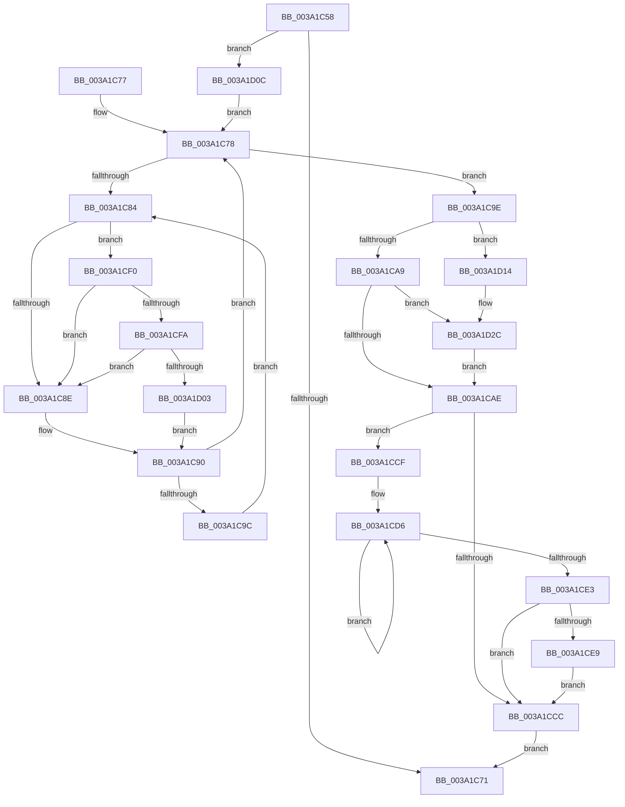

# KiCheckAndRearmForceIdle

- RVA: `0x003A1C58`–`0x003A1D52` (길이 `250` bytes)
- VA: `0x00000001403A1C58`
- 실행 섹션: `.text`
- PDB 이름 있음: `예`; PDB Function 태그: `아니요`
- unwind 정보 RVA: `0x00081F60`
- 디코드: `65`개 명령, `250/250` bytes 표시
- 미해석 바이트: `0` (있으면 어셈블리에 `.byte`로 보존)

> 이 문서는 커널 이미지의 기계어와 PDB 기호를 분석해 생성했습니다. 4번과 5번은 함수 원형과 자료형을 바이너리 사용 방식에서 추정한 C 해석이며 원본 소스 복구 결과는 아닙니다.

## 1. Dependencies

- 직접 호출 지점: **6**; 고유 호출 대상: **6**
- 직접 호출자로 확인된 함수: **3**
- RIP 상대 이미지 참조: **9**

### Outgoing calls
- `0x003A1CE9` → [KiRemoveSystemWorkPriorityKick](../26/KiRemoveSystemWorkPriorityKick_function_002631D0.md) (function, `0x002631D0`)
- `0x003A1CFA` → [KiCheckVpBackingLongSpinWaitHypercall](../30/KiCheckVpBackingLongSpinWaitHypercall_function_0030F490.md) (function, `0x0030F490`)
- `0x003A1D05` → [HvlNotifyLongSpinWait](../30/HvlNotifyLongSpinWait_function_0030F460.md) (function, `0x0030F460`)
- `0x003A1D1D` → [KeRemoveQueueDpcEx](../46/KeRemoveQueueDpcEx_function_0046CDC0.md) (function, `0x0046CDC0`)
- `0x003A1D27` → [KiSetForceIdleState](../48/KiSetForceIdleState_function_0048DCC0.md) (function, `0x0048DCC0`)
- `0x003A1D31` → [RtlGetInterruptTimePrecise](../20/RtlGetInterruptTimePrecise_function_0020A4C0.md) (function, `0x0020A4C0`)

### Direct callers
- [sub_00208A2D](../20/Unknown_function_00208A2D.md) at `0x00208A5F`
- [sub_003A18D4](Unknown_function_003A18D4.md) at `0x003A196B`
- [KiForceIdleInterruptNotify](KiForceIdleInterruptNotify_function_003A3830.md) at `0x003A3855`

### Static image references
- `0x003A1C64` → RVA `0x00FC6FF0` (`ALMOSTRO`; read)
- `0x003A1C78` → RVA `0x00F23140` (`.data`; read/write)
- `0x003A1C86` → RVA `0x00FC52AC` (`ALMOSTRO`; reference)
- `0x003A1C90` → RVA `0x00F23140` (`.data`; read)
- `0x003A1C9E` → RVA `0x00F233CC` (`.data`; read)
- `0x003A1CF0` → RVA `0x00FC6AB8` (`ALMOSTRO`; read)
- `0x003A1D16` → RVA `0x00F23100` (`.data`; read)
- `0x003A1D36` → RVA `0x00FC51BC` (`ALMOSTRO`; read)
- `0x003A1D46` → RVA `0x00F23148` (`.data`; write)

## 2. Other-region calls and transfers

- 다른 실행 섹션으로 향하는 call: **0**
- 별도 외부 분기/꼬리 이동을 확인하지 못했습니다.

## 3. Assembly (complete function range)

```asm
003A1C58  40 53                           push rbx
003A1C5A  48 83 EC 20                     sub rsp, 0x20
003A1C5E  48 83 64 24 30 00               and qword ptr [rsp + 0x30], 0
003A1C64  83 3D 85 53 C2 00 00            cmp dword ptr [rip + 0xc25385], 0
003A1C6B  0F 84 9B 00 00 00               je 0x1403a1d0c
003A1C71  48 83 C4 20                     add rsp, 0x20
003A1C75  5B                              pop rbx
003A1C76  C3                              ret
003A1C77  CC                              int3
003A1C78  F0 48 0F BA 2D BE 14 B8 00 00   lock bts qword ptr [rip + 0xb814be], 0
003A1C82  73 1A                           jae 0x1403a1c9e
003A1C84  FF C3                           inc ebx
003A1C86  85 1D 20 36 C2 00               test dword ptr [rip + 0xc23620], ebx
003A1C8C  74 62                           je 0x1403a1cf0
003A1C8E  F3 90                           pause
003A1C90  48 8B 05 A9 14 B8 00            mov rax, qword ptr [rip + 0xb814a9]
003A1C97  48 85 C0                        test rax, rax
003A1C9A  74 DC                           je 0x1403a1c78
003A1C9C  EB E6                           jmp 0x1403a1c84
003A1C9E  8B 05 28 17 B8 00               mov eax, dword ptr [rip + 0xb81728]
003A1CA4  83 F8 01                        cmp eax, 1
003A1CA7  74 6B                           je 0x1403a1d14
003A1CA9  83 F8 02                        cmp eax, 2
003A1CAC  74 7E                           je 0x1403a1d2c
003A1CAE  F0 48 83 25 89 14 B8 00 00      lock and qword ptr [rip + 0xb81489], 0
003A1CB7  65 48 8B 0C 25 20 00 00 00      mov rcx, qword ptr gs:[0x20]
003A1CC0  4C 8B 81 B8 8E 00 00            mov r8, qword ptr [rcx + 0x8eb8]
003A1CC7  4D 85 C0                        test r8, r8
003A1CCA  75 03                           jne 0x1403a1ccf
003A1CCC  FB                              sti
003A1CCD  EB A2                           jmp 0x1403a1c71
003A1CCF  41 0F 0D 08                     prefetchw byte ptr [r8]
003A1CD3  41 8B 00                        mov eax, dword ptr [r8]
003A1CD6  8B D0                           mov edx, eax
003A1CD8  0F BA F2 15                     btr edx, 0x15
003A1CDC  F0 41 0F B1 10                  lock cmpxchg dword ptr [r8], edx
003A1CE1  75 F3                           jne 0x1403a1cd6
003A1CE3  0F BA E0 15                     bt eax, 0x15
003A1CE7  73 E3                           jae 0x1403a1ccc
003A1CE9  E8 E2 14 EC FF                  call 0x1402631d0
003A1CEE  EB DC                           jmp 0x1403a1ccc
003A1CF0  8B 05 C2 4D C2 00               mov eax, dword ptr [rip + 0xc24dc2]
003A1CF6  A8 40                           test al, 0x40
003A1CF8  74 94                           je 0x1403a1c8e
003A1CFA  E8 91 D7 F6 FF                  call 0x14030f490
003A1CFF  84 C0                           test al, al
003A1D01  74 8B                           je 0x1403a1c8e
003A1D03  8B CB                           mov ecx, ebx
003A1D05  E8 56 D7 F6 FF                  call 0x14030f460
003A1D0A  EB 84                           jmp 0x1403a1c90
003A1D0C  FA                              cli
003A1D0D  33 DB                           xor ebx, ebx
003A1D0F  E9 64 FF FF FF                  jmp 0x1403a1c78
003A1D14  33 D2                           xor edx, edx
003A1D16  48 8D 0D E3 13 B8 00            lea rcx, [rip + 0xb813e3]
003A1D1D  E8 9E B0 0C 00                  call 0x14046cdc0
003A1D22  B9 02 00 00 00                  mov ecx, 2
003A1D27  E8 94 BF 0E 00                  call 0x14048dcc0
003A1D2C  48 8D 4C 24 30                  lea rcx, [rsp + 0x30]
003A1D31  E8 8A 87 E6 FF                  call 0x14020a4c0
003A1D36  8B 0D 80 34 C2 00               mov ecx, dword ptr [rip + 0xc23480]
003A1D3C  48 69 D1 80 96 98 00            imul rdx, rcx, 0x989680
003A1D43  48 03 C2                        add rax, rdx
003A1D46  48 89 05 FB 13 B8 00            mov qword ptr [rip + 0xb813fb], rax
003A1D4D  E9 5C FF FF FF                  jmp 0x1403a1cae
```

## 4. C-style interpretation (structured pseudocode)

```c
__int64 __fastcall KiCheckAndRearmForceIdle(void)
{
    __int64 result;
    __int64 v_rbx;
    __int64 v_rsp;
    unsigned __int64 v_stack_p30;
    unsigned __int64 v_stack_p8;

    v_rsp = (v_rsp) - (32);
    if ((*(unsigned int *)(v_rip + 12735365)) == 0) goto loc_003A1D0C;
loc_003A1C71:
    v_rsp = (v_rsp) + (32);
    return result;
loc_003A1C78:
    if (condition_is_above_or_equal) goto loc_003A1C9E;
loc_003A1C84:
    v_rbx = (unsigned int)((v_rbx) + 1);
    if (((*(unsigned int *)(v_rip + 12727840)) & ((unsigned int)(v_rbx))) == 0) goto loc_003A1CF0;
loc_003A1C8E:
loc_003A1C90:
    if (*(unsigned __int64 *)(v_rip + 12063913) == 0) goto loc_003A1C78;
    goto loc_003A1C84;
loc_003A1C9E:
    if (((unsigned int)((unsigned int)(*(unsigned int *)(v_rip + 12064552)))) == 1) goto loc_003A1D14;
    if (((unsigned int)((unsigned int)(*(unsigned int *)(v_rip + 12064552)))) == 2) goto loc_003A1D2C;
loc_003A1CAE:
    if (*(unsigned __int64 *)(*(unsigned __int64 *)(gs_base + (0 + 32)) + 36536) != 0) goto loc_003A1CCF;
loc_003A1CCC:
    goto loc_003A1C71;
loc_003A1CCF:
loc_003A1CD6:
    if (*(unsigned __int64 *)(*(unsigned __int64 *)(gs_base + (0 + 32)) + 36536) != 0) goto loc_003A1CD6;
    if (condition_is_above_or_equal) goto loc_003A1CCC;
    result = KiRemoveSystemWorkPriorityKick(*(unsigned __int64 *)(gs_base + (0 + 32)), (unsigned int)((unsigned int)((unsigned int)(*(unsigned int *)(*(unsigned __int64 *)(*(unsigned __int64 *)(gs_base + (0 + 32)) + 36536))))), *(unsigned __int64 *)(*(unsigned __int64 *)(gs_base + (0 + 32)) + 36536), a4);
    goto loc_003A1CCC;
loc_003A1CF0:
    if ((((unsigned __int8)((unsigned int)(*(unsigned int *)(v_rip + 12733890)))) & (64)) == 0) goto loc_003A1C8E;
    result = KiCheckVpBackingLongSpinWaitHypercall(*(unsigned __int64 *)(gs_base + (0 + 32)), (unsigned int)((unsigned int)((unsigned int)(*(unsigned int *)(*(unsigned __int64 *)(*(unsigned __int64 *)(gs_base + (0 + 32)) + 36536))))), *(unsigned __int64 *)(*(unsigned __int64 *)(gs_base + (0 + 32)) + 36536), a4);
    if ((unsigned __int8)(result) == 0) goto loc_003A1C8E;
    result = HvlNotifyLongSpinWait((unsigned int)((unsigned int)(v_rbx)), (unsigned int)((unsigned int)((unsigned int)(*(unsigned int *)(*(unsigned __int64 *)(*(unsigned __int64 *)(gs_base + (0 + 32)) + 36536))))), *(unsigned __int64 *)(*(unsigned __int64 *)(gs_base + (0 + 32)) + 36536), a4);
    goto loc_003A1C90;
loc_003A1D0C:
    v_rbx = 0;
    goto loc_003A1C78;
loc_003A1D14:
    a2 = 0;
    result = KeRemoveQueueDpcEx(v_rip + 12063715, a2, *(unsigned __int64 *)(*(unsigned __int64 *)(gs_base + (0 + 32)) + 36536), a4);
    result = KiSetForceIdleState(2, a2, *(unsigned __int64 *)(*(unsigned __int64 *)(gs_base + (0 + 32)) + 36536), a4);
loc_003A1D2C:
    result = RtlGetInterruptTimePrecise(v_stack_p30, a2, *(unsigned __int64 *)(*(unsigned __int64 *)(gs_base + (0 + 32)) + 36536), a4);
    a2 = (a2) * ((unsigned int)(*(unsigned int *)(v_rip + 12727424)));
    result = (result) + (a2);
    *(unsigned __int64 *)(v_rip + 12063739) = result;
    goto loc_003A1CAE;
}
```

## 5. (Beta) C Style

```c
void KiCheckAndRearmForceIdle(void)
{
    int64_t result;
    int64_t local_rbx;
    int64_t local_rsp;
    uint64_t v_stack_p30;
    uint64_t v_stack_p8;

    local_rsp = (local_rsp) - (32);
    if ((*(uint32_t *)(v_rip + 0xC25385)) == 0) goto loc_003A1D0C;
loc_003A1C71:
    local_rsp = (local_rsp) + (32);
    return result;
loc_003A1C78:
    if (condition_is_above_or_equal) goto loc_003A1C9E;
loc_003A1C84:
    local_rbx = (uint32_t)((local_rbx) + 1);
    if (((*(uint32_t *)(v_rip + 0xC23620)) & ((uint32_t)(local_rbx))) == 0) goto loc_003A1CF0;
loc_003A1C8E:
loc_003A1C90:
    if (*(uint64_t *)(v_rip + 0xB814A9) == 0) goto loc_003A1C78;
    goto loc_003A1C84;
loc_003A1C9E:
    if (((uint32_t)((uint32_t)(*(uint32_t *)(v_rip + 0xB81728)))) == 1) goto loc_003A1D14;
    if (((uint32_t)((uint32_t)(*(uint32_t *)(v_rip + 0xB81728)))) == 2) goto loc_003A1D2C;
loc_003A1CAE:
    if (*(uint64_t *)(*(uint64_t *)(gs_base + (0 + 0x20)) + 0x8EB8) != 0) goto loc_003A1CCF;
loc_003A1CCC:
    goto loc_003A1C71;
loc_003A1CCF:
loc_003A1CD6:
    if (*(uint64_t *)(*(uint64_t *)(gs_base + (0 + 0x20)) + 0x8EB8) != 0) goto loc_003A1CD6;
    if (condition_is_above_or_equal) goto loc_003A1CCC;
    result = KiRemoveSystemWorkPriorityKick(*(uint64_t *)(gs_base + (0 + 0x20)), (uint32_t)((uint32_t)((uint32_t)(*(uint32_t *)(*(uint64_t *)(*(uint64_t *)(gs_base + (0 + 0x20)) + 0x8EB8))))), *(uint64_t *)(*(uint64_t *)(gs_base + (0 + 0x20)) + 0x8EB8), a4);
    goto loc_003A1CCC;
loc_003A1CF0:
    if ((((uint8_t)((uint32_t)(*(uint32_t *)(v_rip + 0xC24DC2)))) & (64)) == 0) goto loc_003A1C8E;
    result = KiCheckVpBackingLongSpinWaitHypercall(*(uint64_t *)(gs_base + (0 + 0x20)), (uint32_t)((uint32_t)((uint32_t)(*(uint32_t *)(*(uint64_t *)(*(uint64_t *)(gs_base + (0 + 0x20)) + 0x8EB8))))), *(uint64_t *)(*(uint64_t *)(gs_base + (0 + 0x20)) + 0x8EB8), a4);
    if ((uint8_t)(result) == 0) goto loc_003A1C8E;
    result = HvlNotifyLongSpinWait((uint32_t)((uint32_t)(local_rbx)), (uint32_t)((uint32_t)((uint32_t)(*(uint32_t *)(*(uint64_t *)(*(uint64_t *)(gs_base + (0 + 0x20)) + 0x8EB8))))), *(uint64_t *)(*(uint64_t *)(gs_base + (0 + 0x20)) + 0x8EB8), a4);
    goto loc_003A1C90;
loc_003A1D0C:
    local_rbx = 0;
    goto loc_003A1C78;
loc_003A1D14:
    a2 = 0;
    result = KeRemoveQueueDpcEx(v_rip + 12063715, a2, *(uint64_t *)(*(uint64_t *)(gs_base + (0 + 0x20)) + 0x8EB8), a4);
    result = KiSetForceIdleState(2, a2, *(uint64_t *)(*(uint64_t *)(gs_base + (0 + 0x20)) + 0x8EB8), a4);
loc_003A1D2C:
    result = RtlGetInterruptTimePrecise(v_stack_p30, a2, *(uint64_t *)(*(uint64_t *)(gs_base + (0 + 0x20)) + 0x8EB8), a4);
    a2 = (a2) * ((uint32_t)(*(uint32_t *)(v_rip + 0xC23480)));
    result = (result) + (a2);
    *(uint64_t *)(v_rip + 0xB813FB) = result;
    goto loc_003A1CAE;
}
```

## 6. Execution-region graph

[열기: 2D/3D 그래프와 함수 탐색 컨트롤 패널](../../../control-panel.html?section=text&rva=0x003A1C58&view=graph)

- 2D 그래프는 위에서 아래로 흐르고, 3D 그래프는 빈 공간을 드래그해 회전합니다. Shift+드래그는 이동, 휠은 확대·축소, 함수 노드 선택은 대상 보고서 이동입니다.

### Static fallback


