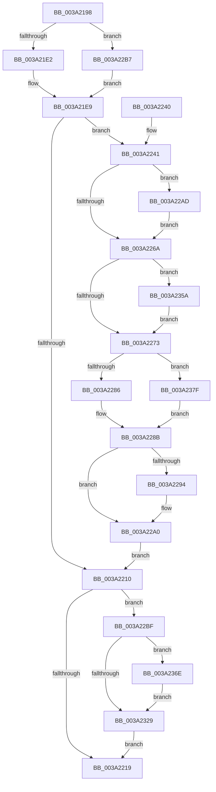

# KiFinalizeTimer2Disablement

- RVA: `0x003A2198`–`0x003A238C` (길이 `500` bytes)
- VA: `0x00000001403A2198`
- 실행 섹션: `.text`
- PDB 이름 있음: `예`; PDB Function 태그: `아니요`
- unwind 정보 RVA: `0x00082078`
- 디코드: `124`개 명령, `500/500` bytes 표시
- 미해석 바이트: `0` (있으면 어셈블리에 `.byte`로 보존)

> 이 문서는 커널 이미지의 기계어와 PDB 기호를 분석해 생성했습니다. 4번과 5번은 함수 원형과 자료형을 바이너리 사용 방식에서 추정한 C 해석이며 원본 소스 복구 결과는 아닙니다.

## 1. Dependencies

- 직접 호출 지점: **8**; 고유 호출 대상: **7**
- 직접 호출자로 확인된 함수: **2**
- RIP 상대 이미지 참조: **6**

### Outgoing calls
- `0x003A2221` → [_security_check_cookie](../6A/_security_check_cookie_function_006AC640.md) (function, `0x006AC640`)
- `0x003A2286` → [ExpFinalizeTimerDeletion](ExpFinalizeTimerDeletion_function_003A33B0.md) (function, `0x003A33B0`)
- `0x003A229B` → [KiLowerIrqlProcessIrqlFlags](../4F/KiLowerIrqlProcessIrqlFlags_function_004F5698.md) (function, `0x004F5698`)
- `0x003A22B0` → [KiRaiseIrqlProcessIrqlFlags](../4F/KiRaiseIrqlProcessIrqlFlags_function_004F56FC.md) (function, `0x004F56FC`)
- `0x003A2350` → [EtwTraceTimedEvent](EtwTraceTimedEvent_function_003A3430.md) (function, `0x003A3430`)
- `0x003A2364` → [EtwGetKernelTraceTimestamp](../39/EtwGetKernelTraceTimestamp_function_0039FC50.md) (function, `0x0039FC50`)
- `0x003A2378` → [EtwGetKernelTraceTimestamp](../39/EtwGetKernelTraceTimestamp_function_0039FC50.md) (function, `0x0039FC50`)
- `0x003A2382` → [guard_dispatch_icall](../6B/guard_dispatch_icall_function_006BAAD0.md) (function, `0x006BAAD0`)

### Direct callers
- [KiUpdateTimer2Flags](KiUpdateTimer2Flags_function_003A2100.md) at `0x003A2182`
- [KiExpireTimer2](KiExpireTimer2_function_003A24E0.md) at `0x003A2761`
- [KiExpireTimer2](KiExpireTimer2_function_003A24E0.md) at `0x003A2BC3`

### Static image references
- `0x003A21B0` → RVA `0x00E0A740` (`.data`; read)
- `0x003A21C5` → RVA `0x00FC6B08` (`ALMOSTRO`; read)
- `0x003A21E9` → RVA `0x00FC6F78` (`ALMOSTRO`; read)
- `0x003A21F2` → RVA `0x00FC7250` (`ALMOSTRO`; read)
- `0x003A2261` → RVA `0x00FC6D20` (`ALMOSTRO`; read)
- `0x003A2273` → RVA `0x003A33B0` (`ExpFinalizeTimerDeletion`; read)

## 2. Other-region calls and transfers

- 다른 실행 섹션으로 향하는 call: **0**
- 별도 외부 분기/꼬리 이동을 확인하지 못했습니다.

## 3. Assembly (complete function range)

```asm
003A2198  48 89 5C 24 10                  mov qword ptr [rsp + 0x10], rbx
003A219D  48 89 6C 24 18                  mov qword ptr [rsp + 0x18], rbp
003A21A2  48 89 74 24 20                  mov qword ptr [rsp + 0x20], rsi
003A21A7  57                              push rdi
003A21A8  41 56                           push r14
003A21AA  41 57                           push r15
003A21AC  48 83 EC 70                     sub rsp, 0x70
003A21B0  48 8B 05 89 85 A6 00            mov rax, qword ptr [rip + 0xa68589]
003A21B7  48 33 C4                        xor rax, rsp
003A21BA  48 89 44 24 68                  mov qword ptr [rsp + 0x68], rax
003A21BF  0F 57 C0                        xorps xmm0, xmm0
003A21C2  45 33 FF                        xor r15d, r15d
003A21C5  F7 05 39 49 C2 00 00 00 02 00   test dword ptr [rip + 0xc24939], 0x20000
003A21CF  48 8B F1                        mov rsi, rcx
003A21D2  0F 11 44 24 48                  movups xmmword ptr [rsp + 0x48], xmm0
003A21D7  0F 11 44 24 58                  movups xmmword ptr [rsp + 0x58], xmm0
003A21DC  0F 84 D5 00 00 00               je 0x1403a22b7
003A21E2  4C 8B 79 60                     mov r15, qword ptr [rcx + 0x60]
003A21E6  40 B5 01                        mov bpl, 1
003A21E9  48 8B 05 88 4D C2 00            mov rax, qword ptr [rip + 0xc24d88]
003A21F0  33 DB                           xor ebx, ebx
003A21F2  48 8B 15 57 50 C2 00            mov rdx, qword ptr [rip + 0xc25057]
003A21F9  48 8B F8                        mov rdi, rax
003A21FC  48 33 79 70                     xor rdi, qword ptr [rcx + 0x70]
003A2200  8B C8                           mov ecx, eax
003A2202  48 D3 C7                        rol rdi, cl
003A2205  48 33 FE                        xor rdi, rsi
003A2208  48 0F CF                        bswap rdi
003A220B  48 33 FA                        xor rdi, rdx
003A220E  75 31                           jne 0x1403a2241
003A2210  40 84 ED                        test bpl, bpl
003A2213  0F 85 A6 00 00 00               jne 0x1403a22bf
003A2219  48 8B 4C 24 68                  mov rcx, qword ptr [rsp + 0x68]
003A221E  48 33 CC                        xor rcx, rsp
003A2221  E8 1A A4 30 00                  call 0x1406ac640
003A2226  4C 8D 5C 24 70                  lea r11, [rsp + 0x70]
003A222B  49 8B 5B 28                     mov rbx, qword ptr [r11 + 0x28]
003A222F  49 8B 6B 30                     mov rbp, qword ptr [r11 + 0x30]
003A2233  49 8B 73 38                     mov rsi, qword ptr [r11 + 0x38]
003A2237  49 8B E3                        mov rsp, r11
003A223A  41 5F                           pop r15
003A223C  41 5E                           pop r14
003A223E  5F                              pop rdi
003A223F  C3                              ret
003A2240  CC                              int3
003A2241  48 8B D8                        mov rbx, rax
003A2244  48 33 5E 78                     xor rbx, qword ptr [rsi + 0x78]
003A2248  48 D3 C3                        rol rbx, cl
003A224B  48 33 DE                        xor rbx, rsi
003A224E  48 0F CB                        bswap rbx
003A2251  48 33 DA                        xor rbx, rdx
003A2254  45 0F 20 C6                     mov r14, cr8
003A2258  BA 02 00 00 00                  mov edx, 2
003A225D  44 0F 22 C2                     mov cr8, rdx
003A2261  83 3D B8 4A C2 00 00            cmp dword ptr [rip + 0xc24ab8], 0
003A2268  75 43                           jne 0x1403a22ad
003A226A  40 84 ED                        test bpl, bpl
003A226D  0F 85 E7 00 00 00               jne 0x1403a235a
003A2273  48 8D 05 36 11 00 00            lea rax, [rip + 0x1136]
003A227A  48 8B CB                        mov rcx, rbx
003A227D  48 3B F8                        cmp rdi, rax
003A2280  0F 85 F9 00 00 00               jne 0x1403a237f
003A2286  E8 25 11 00 00                  call 0x1403a33b0
003A228B  83 3D 8E 4A C2 00 00            cmp dword ptr [rip + 0xc24a8e], 0
003A2292  74 0C                           je 0x1403a22a0
003A2294  44 0F 20 C1                     mov rcx, cr8
003A2298  41 8A D6                        mov dl, r14b
003A229B  E8 F8 33 15 00                  call 0x1404f5698
003A22A0  41 0F B6 C6                     movzx eax, r14b
003A22A4  44 0F 22 C0                     mov cr8, rax
003A22A8  E9 63 FF FF FF                  jmp 0x1403a2210
003A22AD  41 8A CE                        mov cl, r14b
003A22B0  E8 47 34 15 00                  call 0x1404f56fc
003A22B5  EB B3                           jmp 0x1403a226a
003A22B7  40 32 ED                        xor bpl, bpl
003A22BA  E9 2A FF FF FF                  jmp 0x1403a21e9
003A22BF  4C 8B 0D B2 4C C2 00            mov r9, qword ptr [rip + 0xc24cb2]
003A22C6  48 8B C6                        mov rax, rsi
003A22C9  48 8B 15 80 4F C2 00            mov rdx, qword ptr [rip + 0xc24f80]
003A22D0  41 8B C9                        mov ecx, r9d
003A22D3  48 33 DA                        xor rbx, rdx
003A22D6  48 89 7C 24 38                  mov qword ptr [rsp + 0x38], rdi
003A22DB  48 0F CB                        bswap rbx
003A22DE  48 33 DE                        xor rbx, rsi
003A22E1  48 33 C2                        xor rax, rdx
003A22E4  48 D3 CB                        ror rbx, cl
003A22E7  4D 8B C1                        mov r8, r9
003A22EA  4D 33 C7                        xor r8, r15
003A22ED  49 33 D9                        xor rbx, r9
003A22F0  49 D3 C0                        rol r8, cl
003A22F3  4C 33 C6                        xor r8, rsi
003A22F6  49 0F C8                        bswap r8
003A22F9  48 0F C8                        bswap rax
003A22FC  4C 33 C0                        xor r8, rax
003A22FF  48 B8 77 72 DD F3 C7 C6 35 7E   movabs rax, 0x7e35c6c7f3dd7277
003A2309  4C 33 C2                        xor r8, rdx
003A230C  49 D3 C8                        ror r8, cl
003A230F  4D 33 C1                        xor r8, r9
003A2312  4C 0F AF C0                     imul r8, rax
003A2316  48 0F AF D8                     imul rbx, rax
003A231A  4C 89 44 24 30                  mov qword ptr [rsp + 0x30], r8
003A231F  48 89 5C 24 40                  mov qword ptr [rsp + 0x40], rbx
003A2324  48 85 FF                        test rdi, rdi
003A2327  74 45                           je 0x1403a236e
003A2329  48 8D 44 24 48                  lea rax, [rsp + 0x48]
003A232E  B9 6C 0F 00 00                  mov ecx, 0xf6c
003A2333  48 89 44 24 28                  mov qword ptr [rsp + 0x28], rax
003A2338  4C 8D 44 24 30                  lea r8, [rsp + 0x30]
003A233D  41 B9 18 00 00 00               mov r9d, 0x18
003A2343  C7 44 24 20 02 0E 50 00         mov dword ptr [rsp + 0x20], 0x500e02
003A234B  BA 00 00 02 40                  mov edx, 0x40020000
003A2350  E8 DB 10 00 00                  call 0x1403a3430
003A2355  E9 BF FE FF FF                  jmp 0x1403a2219
003A235A  BA 00 00 02 40                  mov edx, 0x40020000
003A235F  48 8D 4C 24 48                  lea rcx, [rsp + 0x48]
003A2364  E8 E7 D8 FF FF                  call 0x14039fc50
003A2369  E9 05 FF FF FF                  jmp 0x1403a2273
003A236E  BA 00 00 02 40                  mov edx, 0x40020000
003A2373  48 8D 4C 24 48                  lea rcx, [rsp + 0x48]
003A2378  E8 D3 D8 FF FF                  call 0x14039fc50
003A237D  EB AA                           jmp 0x1403a2329
003A237F  48 8B C7                        mov rax, rdi
003A2382  E8 49 87 31 00                  call 0x1406baad0
003A2387  E9 FF FE FF FF                  jmp 0x1403a228b
```

## 4. C-style interpretation (structured pseudocode)

```c
__int64 __fastcall KiFinalizeTimer2Disablement(__int64 a1)
{
    __int64 result;
    __int64 v_r15;
    __int64 v_rbp;
    __int64 v_rbx;
    __int64 v_rdi;
    __int64 v_rsp;
    unsigned __int64 v_stack_m18;
    unsigned __int64 v_stack_m20;
    unsigned __int64 v_stack_m28;
    unsigned __int64 v_stack_m30;
    unsigned __int64 v_stack_m38;
    unsigned __int64 v_stack_m40;
    unsigned __int64 v_stack_m48;
    unsigned int v_stack_m50;
    unsigned __int64 v_stack_p10;
    unsigned __int64 v_stack_p18;
    unsigned __int64 v_stack_p20;

    v_stack_p10 = v_rbx;
    v_stack_p18 = v_rbp;
    v_stack_p20 = v_rsi;
    v_rsp = (v_rsp) - (112);
    result = (*(unsigned __int64 *)(v_rip + 10913161)) ^ (v_rsp);
    v_stack_m20 = result;
    v_r15 = 0;
    v_stack_m40 = v_xmm0;
    v_stack_m30 = v_xmm0;
    if (((*(unsigned int *)(v_rip + 12732729)) & (0x20000ULL)) == 0) goto loc_003A22B7;
loc_003A21E9:
    v_rbx = 0;
    v_rdi = (*(unsigned __int64 *)(v_rip + 12733832)) ^ (*(unsigned __int64 *)(a1 + 112));
    v_rdi = (v_rdi) ^ (a1);
    v_rdi = (v_rdi) ^ (*(unsigned __int64 *)(v_rip + 12734551));
    if (condition_is_not_equal) goto loc_003A2241;
loc_003A2210:
    if (1 != 0) goto loc_003A22BF;
loc_003A2219:
    a1 = (v_stack_m20) ^ (v_rsp);
    result = _security_check_cookie(a1, *(unsigned __int64 *)(v_rip + 12734551), a3, a4);
    return result;
loc_003A2241:
    v_rbx = (result) ^ (*(unsigned __int64 *)(*(unsigned __int64 *)(v_stack_m18 + 56) + 120));
    v_rbx = (v_rbx) ^ (*(unsigned __int64 *)(v_stack_m18 + 56));
    v_rbx = (v_rbx) ^ (*(unsigned __int64 *)(v_rip + 12734551));
    if ((*(unsigned int *)(v_rip + 12733112)) != 0) goto loc_003A22AD;
loc_003A226A:
    if ((unsigned __int8)(*(unsigned __int64 *)(v_stack_m18 + 48)) != 0) goto loc_003A235A;
loc_003A2273:
    if (v_rdi != (v_rip + 4406)) goto loc_003A237F;
    result = ExpFinalizeTimerDeletion(v_rbx, 2, a3, a4);
loc_003A228B:
    if ((*(unsigned int *)(v_rip + 12733070)) != 0) {
        a1 = 2;
        a2 = (unsigned __int8)(v_cr8);
        result = KiLowerIrqlProcessIrqlFlags(a1, a2, a3, a4);
    }
    goto loc_003A2210;
loc_003A22AD:
    result = KiRaiseIrqlProcessIrqlFlags((unsigned __int8)(v_cr8), a2, a3, a4);
    goto loc_003A226A;
loc_003A22B7:
    v_rbp = 0;
    goto loc_003A21E9;
loc_003A22BF:
    v_rbx = (v_rbx) ^ (*(unsigned __int64 *)(v_rip + 12734336));
    v_stack_m38 = v_rdi;
    v_rbx = (v_rbx) ^ (*(unsigned __int64 *)(v_stack_m18 + 56));
    result = (*(unsigned __int64 *)(v_stack_m18 + 56)) ^ (*(unsigned __int64 *)(v_rip + 12734336));
    a3 = (*(unsigned __int64 *)(v_rip + 12733618)) ^ (*(unsigned __int64 *)(a1 + 96));
    v_rbx = (v_rbx) ^ (*(unsigned __int64 *)(v_rip + 12733618));
    a3 = (a3) ^ (*(unsigned __int64 *)(v_stack_m18 + 56));
    a3 = (a3) ^ (result);
    a3 = (a3) ^ (*(unsigned __int64 *)(v_rip + 12734336));
    a3 = (a3) ^ (*(unsigned __int64 *)(v_rip + 12733618));
    a3 = (a3) * (result);
    v_rbx = (v_rbx) * (result);
    v_stack_m40 = a3;
    v_stack_m30 = v_rbx;
    if (v_rdi == 0) goto loc_003A236E;
loc_003A2329:
    v_stack_m48 = v_stack_m28;
    v_stack_m50 = 0x500E02ULL;
    result = EtwTraceTimedEvent((unsigned int)(0xF6CULL), (unsigned int)(0x40020000ULL), v_stack_m40, 24);
    goto loc_003A2219;
loc_003A235A:
    result = EtwGetKernelTraceTimestamp(v_stack_m28, (unsigned int)(0x40020000ULL), v_stack_m40, 24);
    goto loc_003A2273;
loc_003A236E:
    result = EtwGetKernelTraceTimestamp(v_stack_m28, (unsigned int)(0x40020000ULL), v_stack_m40, 24);
    goto loc_003A2329;
loc_003A237F:
    result = guard_dispatch_icall(v_stack_m28, (unsigned int)(0x40020000ULL), v_stack_m40, 24);
    goto loc_003A228B;
}
```

## 5. (Beta) C Style

```c
int64_t KiFinalizeTimer2Disablement(void *Arg1)
{
    uint8_t *arg1 = (uint8_t *)Arg1;

    int64_t result;
    int64_t local_r15;
    int64_t local_rbp;
    int64_t local_rbx;
    int64_t local_rdi;
    int64_t local_rsp;
    uint64_t v_stack_m18;
    uint64_t v_stack_m20;
    uint64_t v_stack_m28;
    uint64_t v_stack_m30;
    uint64_t v_stack_m38;
    uint64_t v_stack_m40;
    uint64_t v_stack_m48;
    uint32_t v_stack_m50;
    uint64_t v_stack_p10;
    uint64_t v_stack_p18;
    uint64_t v_stack_p20;

    v_stack_p10 = local_rbx;
    v_stack_p18 = local_rbp;
    v_stack_p20 = local_rsi;
    local_rsp = (local_rsp) - (112);
    result = (*(uint64_t *)(v_rip + 0xA68589)) ^ (local_rsp);
    v_stack_m20 = result;
    local_r15 = 0;
    v_stack_m40 = v_xmm0;
    v_stack_m30 = v_xmm0;
    if (((*(uint32_t *)(v_rip + 0xC24939)) & (0x20000ULL)) == 0) goto loc_003A22B7;
loc_003A21E9:
    local_rbx = 0;
    local_rdi = (*(uint64_t *)(v_rip + 0xC24D88)) ^ (*(uint64_t *)(arg1 + 0x70));
    local_rdi = (local_rdi) ^ (Arg1);
    local_rdi = (local_rdi) ^ (*(uint64_t *)(v_rip + 0xC25057));
    if (condition_is_not_equal) goto loc_003A2241;
loc_003A2210:
    if (1 != 0) goto loc_003A22BF;
loc_003A2219:
    Arg1 = (v_stack_m20) ^ (local_rsp);
    result = _security_check_cookie(Arg1, *(uint64_t *)(v_rip + 0xC25057), a3, a4);
    return result;
loc_003A2241:
    local_rbx = (result) ^ (*(uint64_t *)(*(uint64_t *)(v_stack_m18 + 0x38) + 0x78));
    local_rbx = (local_rbx) ^ (*(uint64_t *)(v_stack_m18 + 0x38));
    local_rbx = (local_rbx) ^ (*(uint64_t *)(v_rip + 0xC25057));
    if ((*(uint32_t *)(v_rip + 0xC24AB8)) != 0) goto loc_003A22AD;
loc_003A226A:
    if ((uint8_t)(*(uint64_t *)(v_stack_m18 + 0x30)) != 0) goto loc_003A235A;
loc_003A2273:
    if (local_rdi != (v_rip + 4406)) goto loc_003A237F;
    result = ExpFinalizeTimerDeletion(local_rbx, 2, a3, a4);
loc_003A228B:
    if ((*(uint32_t *)(v_rip + 0xC24A8E)) != 0) {
        Arg1 = 2;
        a2 = (uint8_t)(v_cr8);
        result = KiLowerIrqlProcessIrqlFlags(Arg1, a2, a3, a4);
    }
    goto loc_003A2210;
loc_003A22AD:
    result = KiRaiseIrqlProcessIrqlFlags((uint8_t)(v_cr8), a2, a3, a4);
    goto loc_003A226A;
loc_003A22B7:
    local_rbp = 0;
    goto loc_003A21E9;
loc_003A22BF:
    local_rbx = (local_rbx) ^ (*(uint64_t *)(v_rip + 0xC24F80));
    v_stack_m38 = local_rdi;
    local_rbx = (local_rbx) ^ (*(uint64_t *)(v_stack_m18 + 0x38));
    result = (*(uint64_t *)(v_stack_m18 + 0x38)) ^ (*(uint64_t *)(v_rip + 0xC24F80));
    a3 = (*(uint64_t *)(v_rip + 0xC24CB2)) ^ (*(uint64_t *)(arg1 + 0x60));
    local_rbx = (local_rbx) ^ (*(uint64_t *)(v_rip + 0xC24CB2));
    a3 = (a3) ^ (*(uint64_t *)(v_stack_m18 + 0x38));
    a3 = (a3) ^ (result);
    a3 = (a3) ^ (*(uint64_t *)(v_rip + 0xC24F80));
    a3 = (a3) ^ (*(uint64_t *)(v_rip + 0xC24CB2));
    a3 = (a3) * (result);
    local_rbx = (local_rbx) * (result);
    v_stack_m40 = a3;
    v_stack_m30 = local_rbx;
    if (local_rdi == 0) goto loc_003A236E;
loc_003A2329:
    v_stack_m48 = v_stack_m28;
    v_stack_m50 = 0x500E02ULL;
    result = EtwTraceTimedEvent((uint32_t)(0xF6CULL), (uint32_t)(0x40020000ULL), v_stack_m40, 24);
    goto loc_003A2219;
loc_003A235A:
    result = EtwGetKernelTraceTimestamp(v_stack_m28, (uint32_t)(0x40020000ULL), v_stack_m40, 24);
    goto loc_003A2273;
loc_003A236E:
    result = EtwGetKernelTraceTimestamp(v_stack_m28, (uint32_t)(0x40020000ULL), v_stack_m40, 24);
    goto loc_003A2329;
loc_003A237F:
    result = guard_dispatch_icall(v_stack_m28, (uint32_t)(0x40020000ULL), v_stack_m40, 24);
    goto loc_003A228B;
}
```

### 관측된 메모리 오프셋

구조체 형식이 확인되지 않은 접근은 인자 기준의 오프셋으로만 기록했습니다.

| 기준 인자 | 오프셋 표현 | 폭 (bit) | 접근 |
|---|---:|---:|---|
| `Arg1` | `+ 0x60` | `64` | `R` |
| `Arg1` | `+ 0x70` | `64` | `R` |
| `Arg1` | `+ 0x78` | `64` | `R` |

## 6. Execution-region graph

[열기: 2D/3D 그래프와 함수 탐색 컨트롤 패널](../../../control-panel.html?section=text&rva=0x003A2198&view=graph)

- 2D 그래프는 위에서 아래로 흐르고, 3D 그래프는 빈 공간을 드래그해 회전합니다. Shift+드래그는 이동, 휠은 확대·축소, 함수 노드 선택은 대상 보고서 이동입니다.

### Static fallback


