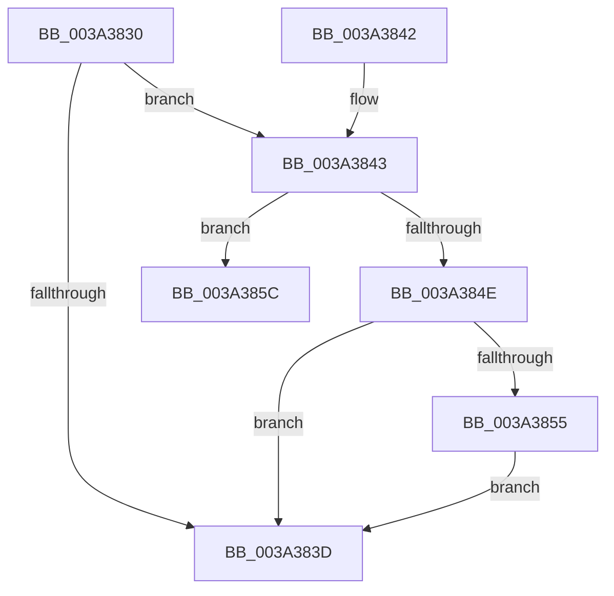

# KiForceIdleInterruptNotify

- RVA: `0x003A3830`–`0x003A385F` (길이 `47` bytes)
- VA: `0x00000001403A3830`
- 실행 섹션: `.text`
- PDB 이름 있음: `예`; PDB Function 태그: `예`
- unwind 정보 RVA: `0x00082220`
- 디코드: `15`개 명령, `47/47` bytes 표시
- 미해석 바이트: `0` (있으면 어셈블리에 `.byte`로 보존)

> 이 문서는 커널 이미지의 기계어와 PDB 기호를 분석해 생성했습니다. 4번과 5번은 함수 원형과 자료형을 바이너리 사용 방식에서 추정한 C 해석이며 원본 소스 복구 결과는 아닙니다.

## 1. Dependencies

- 직접 호출 지점: **1**; 고유 호출 대상: **1**
- 직접 호출자로 확인된 함수: **1**
- RIP 상대 이미지 참조: **2**

### Outgoing calls
- `0x003A3855` → [KiCheckAndRearmForceIdle](KiCheckAndRearmForceIdle_function_003A1C58.md) (function, `0x003A1C58`)

### Direct callers
- [KiDispatchPassiveInterrupts](../4C/KiDispatchPassiveInterrupts_function_004C7610.md) at `0x004C7641`

### Static image references
- `0x003A3834` → RVA `0x00FC6FF0` (`ALMOSTRO`; read)
- `0x003A3843` → RVA `0x00F233CC` (`.data`; read)

## 2. Other-region calls and transfers

- 다른 실행 섹션으로 향하는 call: **0**
- 별도 외부 분기/꼬리 이동을 확인하지 못했습니다.

## 3. Assembly (complete function range)

```asm
003A3830  48 83 EC 28                     sub rsp, 0x28
003A3834  83 3D B5 37 C2 00 00            cmp dword ptr [rip + 0xc237b5], 0
003A383B  74 06                           je 0x1403a3843
003A383D  48 83 C4 28                     add rsp, 0x28
003A3841  C3                              ret
003A3842  CC                              int3
003A3843  8B 05 83 FB B7 00               mov eax, dword ptr [rip + 0xb7fb83]
003A3849  83 F8 04                        cmp eax, 4
003A384C  74 0E                           je 0x1403a385c
003A384E  FF C8                           dec eax
003A3850  83 F8 01                        cmp eax, 1
003A3853  77 E8                           ja 0x1403a383d
003A3855  E8 FE E3 FF FF                  call 0x1403a1c58
003A385A  EB E1                           jmp 0x1403a383d
003A385C  45 33 C0                        xor r8d, r8d
```

## 4. C-style interpretation (structured pseudocode)

```c
__int64 __fastcall KiForceIdleInterruptNotify(__int64 a1, __int64 a2, int a3)
{
    __int64 result;
    __int64 v_rsp;

    v_rsp = (v_rsp) - (40);
    if ((*(unsigned int *)(v_rip + 12728245)) == 0) goto loc_003A3843;
loc_003A383D:
    v_rsp = (v_rsp) + (40);
    return result;
loc_003A3843:
    if (((unsigned int)((unsigned int)(*(unsigned int *)(v_rip + 12057475)))) == 4) goto loc_003A385C;
    result = (unsigned int)(((unsigned int)(*(unsigned int *)(v_rip + 12057475))) - 1);
    if (((unsigned int)(result)) > 1) goto loc_003A383D;
    result = KiCheckAndRearmForceIdle(a1, a2, a3, a4);
    goto loc_003A383D;
loc_003A385C:
    a3 = 0;
    return result;
}
```

## 5. (Beta) C Style

```c
int64_t KiForceIdleInterruptNotify(int64_t Arg1, int64_t Arg2, int32_t Arg3)
{
    int64_t result;
    int64_t local_rsp;

    local_rsp = (local_rsp) - (40);
    if ((*(uint32_t *)(v_rip + 0xC237B5)) == 0) goto loc_003A3843;
loc_003A383D:
    local_rsp = (local_rsp) + (40);
    return result;
loc_003A3843:
    if (((uint32_t)((uint32_t)(*(uint32_t *)(v_rip + 0xB7FB83)))) == 4) goto loc_003A385C;
    result = (uint32_t)(((uint32_t)(*(uint32_t *)(v_rip + 0xB7FB83))) - 1);
    if (((uint32_t)(result)) > 1) goto loc_003A383D;
    result = KiCheckAndRearmForceIdle(Arg1, Arg2, Arg3, a4);
    goto loc_003A383D;
loc_003A385C:
    Arg3 = 0;
    return result;
}
```

## 6. Execution-region graph

[열기: 2D/3D 그래프와 함수 탐색 컨트롤 패널](../../../control-panel.html?section=text&rva=0x003A3830&view=graph)

- 2D 그래프는 위에서 아래로 흐르고, 3D 그래프는 빈 공간을 드래그해 회전합니다. Shift+드래그는 이동, 휠은 확대·축소, 함수 노드 선택은 대상 보고서 이동입니다.

### Static fallback


