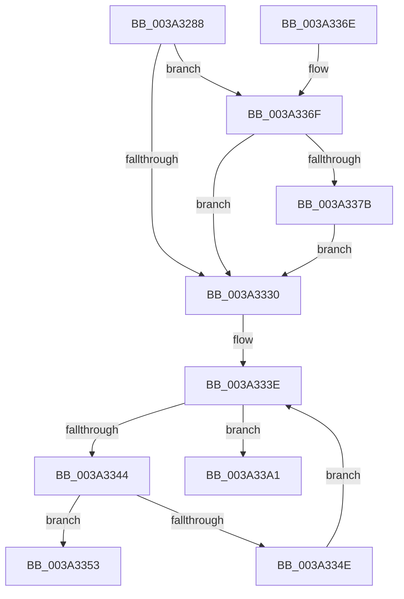

# KiInitializeTimer2

- RVA: `0x003A3288`–`0x003A33A8` (길이 `288` bytes)
- VA: `0x00000001403A3288`
- 실행 섹션: `.text`
- PDB 이름 있음: `예`; PDB Function 태그: `아니요`
- unwind 정보 RVA: `0x0007FBE8`
- 디코드: `74`개 명령, `288/288` bytes 표시
- 미해석 바이트: `0` (있으면 어셈블리에 `.byte`로 보존)

> 이 문서는 커널 이미지의 기계어와 PDB 기호를 분석해 생성했습니다. 4번과 5번은 함수 원형과 자료형을 바이너리 사용 방식에서 추정한 C 해석이며 원본 소스 복구 결과는 아닙니다.

## 1. Dependencies

- 직접 호출 지점: **1**; 고유 호출 대상: **1**
- 직접 호출자로 확인된 함수: **16**
- RIP 상대 이미지 참조: **3**

### Outgoing calls
- `0x003A338B` → [PsTimerResolutionActive](PsTimerResolutionActive_function_003A3010.md) (function, `0x003A3010`)

### Direct callers
- [KeInitializeTimer2](KeInitializeTimer2_function_003A30B0.md) at `0x003A30B9`
- [ExAllocateTimerInternal2](ExAllocateTimerInternal2_function_003A3110.md) at `0x003A31A6`
- [KeInitializeIRTimer](KeInitializeIRTimer_function_003A4204.md) at `0x003A4245`
- [MiStoreEvictThread](MiStoreEvictThread_function_003A42D0.md) at `0x003A435D`
- [KiInitializeIdealProcessorRebalancer](../5C/KiInitializeIdealProcessorRebalancer_function_005C1BA0.md) at `0x005C1BCF`
- [KiAllocateForceParkingData](../5C/KiAllocateForceParkingData_function_005C96C8.md) at `0x005C9786`
- [KiAllocateForceParkingData](../5C/KiAllocateForceParkingData_function_005C96C8.md) at `0x005C97A3`
- [SMKM_STORE_MGR&lt;SM_TRAITS&gt;::SmInitialize](../60/SMKM_STORE_MGR_SM_TRAITS_SmInitialize_function_0060C8CC.md) at `0x0060CA7F`
- [HalpBlkInitSystem](../../init/C2/HalpBlkInitSystem_function_00C24B98.md) at `0x00C24C8E`
- [KiInitializeDpcRuntimeHistoryHashTables](../../init/C3/KiInitializeDpcRuntimeHistoryHashTables_function_00C3A398.md) at `0x00C3A410`
- [PopThermalInit](../../init/C3/PopThermalInit_function_00C3F128.md) at `0x00C3F1D1`
- [PpmCheckInit](../../init/C4/PpmCheckInit_function_00C40578.md) at `0x00C40626`
- [SshpAlpcInitialize](../../init/C4/SshpAlpcInitialize_function_00C448B4.md) at `0x00C4496A`
- [EtwpInitialize](../../init/C4/EtwpInitialize_function_00C4DBCC.md) at `0x00C4DE0B`
- [ExInitializeTimeRefresh](../../init/C5/ExInitializeTimeRefresh_function_00C51090.md) at `0x00C51149`
- [PopSleepstudyInitialize](../../init/C7/PopSleepstudyInitialize_function_00C76C60.md) at `0x00C76D1C`
- [PopPowerAggregatorInitialize](../../init/C7/PopPowerAggregatorInitialize_function_00C77B94.md) at `0x00C77C42`

### Static image references
- `0x003A32AA` → RVA `0x00FC7250` (`ALMOSTRO`; read)
- `0x003A32B1` → RVA `0x00FC6F78` (`ALMOSTRO`; read)
- `0x003A3337` → RVA `0x00011300` (`.rdata`; read)

## 2. Other-region calls and transfers

- 다른 실행 섹션으로 향하는 call: **0**
- 별도 외부 분기/꼬리 이동을 확인하지 못했습니다.

## 3. Assembly (complete function range)

```asm
003A3288  48 83 EC 28                     sub rsp, 0x28
003A328C  4C 8B D9                        mov r11, rcx
003A328F  45 33 D2                        xor r10d, r10d
003A3292  4C 89 11                        mov qword ptr [rcx], r10
003A3295  45 85 C9                        test r9d, r9d
003A3298  0F 99 C0                        setns al
003A329B  04 18                           add al, 0x18
003A329D  88 01                           mov byte ptr [rcx], al
003A329F  48 8D 41 08                     lea rax, [rcx + 8]
003A32A3  48 89 40 08                     mov qword ptr [rax + 8], rax
003A32A7  48 89 00                        mov qword ptr [rax], rax
003A32AA  48 33 15 9F 3F C2 00            xor rdx, qword ptr [rip + 0xc23f9f]
003A32B1  48 8B 05 C0 3C C2 00            mov rax, qword ptr [rip + 0xc23cc0]
003A32B8  48 0F CA                        bswap rdx
003A32BB  48 33 D1                        xor rdx, rcx
003A32BE  8B C8                           mov ecx, eax
003A32C0  48 D3 CA                        ror rdx, cl
003A32C3  48 33 D0                        xor rdx, rax
003A32C6  49 89 53 60                     mov qword ptr [r11 + 0x60], rdx
003A32CA  4C 33 05 7F 3F C2 00            xor r8, qword ptr [rip + 0xc23f7f]
003A32D1  48 8B 05 A0 3C C2 00            mov rax, qword ptr [rip + 0xc23ca0]
003A32D8  8B C8                           mov ecx, eax
003A32DA  49 0F C8                        bswap r8
003A32DD  4D 33 C3                        xor r8, r11
003A32E0  49 D3 C8                        ror r8, cl
003A32E3  4C 33 C0                        xor r8, rax
003A32E6  4D 89 43 68                     mov qword ptr [r11 + 0x68], r8
003A32EA  48 8B 05 87 3C C2 00            mov rax, qword ptr [rip + 0xc23c87]
003A32F1  48 8B 15 58 3F C2 00            mov rdx, qword ptr [rip + 0xc23f58]
003A32F8  8B C8                           mov ecx, eax
003A32FA  48 0F CA                        bswap rdx
003A32FD  49 33 D3                        xor rdx, r11
003A3300  48 D3 CA                        ror rdx, cl
003A3303  48 33 D0                        xor rdx, rax
003A3306  49 89 53 70                     mov qword ptr [r11 + 0x70], rdx
003A330A  48 8B 05 67 3C C2 00            mov rax, qword ptr [rip + 0xc23c67]
003A3311  48 8B 15 38 3F C2 00            mov rdx, qword ptr [rip + 0xc23f38]
003A3318  8B C8                           mov ecx, eax
003A331A  48 0F CA                        bswap rdx
003A331D  49 33 D3                        xor rdx, r11
003A3320  48 D3 CA                        ror rdx, cl
003A3323  48 33 D0                        xor rdx, rax
003A3326  49 89 53 78                     mov qword ptr [r11 + 0x78], rdx
003A332A  41 80 E1 2E                     and r9b, 0x2e
003A332E  74 3F                           je 0x1403a336f
003A3330  45 88 8B 81 00 00 00            mov byte ptr [r11 + 0x81], r9b
003A3337  48 8D 15 C2 DF C6 FF            lea rdx, [rip - 0x39203e]
003A333E  41 83 FA 09                     cmp r10d, 9
003A3342  73 5D                           jae 0x1403a33a1
003A3344  4B 8D 0C 52                     lea rcx, [r10 + r10*2]
003A3348  44 38 0C 11                     cmp byte ptr [rcx + rdx], r9b
003A334C  74 05                           je 0x1403a3353
003A334E  41 FF C2                        inc r10d
003A3351  EB EB                           jmp 0x1403a333e
003A3353  8A 44 11 01                     mov al, byte ptr [rcx + rdx + 1]
003A3357  41 88 83 82 00 00 00            mov byte ptr [r11 + 0x82], al
003A335E  8A 44 11 02                     mov al, byte ptr [rcx + rdx + 2]
003A3362  41 88 83 83 00 00 00            mov byte ptr [r11 + 0x83], al
003A3369  48 83 C4 28                     add rsp, 0x28
003A336D  C3                              ret
003A336E  CC                              int3
003A336F  65 8A 04 25 A0 01 00 00         mov al, byte ptr gs:[0x1a0]
003A3377  84 C0                           test al, al
003A3379  75 B5                           jne 0x1403a3330
003A337B  65 48 8B 0C 25 88 01 00 00      mov rcx, qword ptr gs:[0x188]
003A3384  48 8B 89 B8 00 00 00            mov rcx, qword ptr [rcx + 0xb8]
003A338B  E8 80 FC FF FF                  call 0x1403a3010
003A3390  84 C0                           test al, al
003A3392  45 0F B6 C9                     movzx r9d, r9b
003A3396  BA 10 00 00 00                  mov edx, 0x10
003A339B  44 0F 45 CA                     cmovne r9d, edx
003A339F  EB 8F                           jmp 0x1403a3330
003A33A1  B9 05 00 00 00                  mov ecx, 5
003A33A6  CD 29                           int 0x29
```

## 4. C-style interpretation (structured pseudocode)

```c
__int64 __fastcall KiInitializeTimer2(__int64 a1, __int64 a2, __int64 a3, int a4)
{
    __int64 result;
    __int64 v_r10;
    __int64 v_rsp;

    v_rsp = (v_rsp) - (40);
    v_r10 = 0;
    *(unsigned __int64 *)(a1) = 0;
    result = (!sign_flag) ? 1 : 0;
    result = (unsigned __int8)((result) + (24));
    *(unsigned __int8 *)(a1) = (unsigned __int8)(result);
    *(unsigned __int64 *)(a1 + 8 + 8) = a1 + 8;
    *(unsigned __int64 *)(a1 + 8) = a1 + 8;
    a2 = (a2) ^ (*(unsigned __int64 *)(v_rip + 12730271));
    a2 = (a2) ^ (a1);
    a2 = (a2) ^ (*(unsigned __int64 *)(v_rip + 12729536));
    *(unsigned __int64 *)(a1 + 96) = a2;
    a3 = (a3) ^ (*(unsigned __int64 *)(v_rip + 12730239));
    a3 = (a3) ^ (a1);
    a3 = (a3) ^ (*(unsigned __int64 *)(v_rip + 12729504));
    *(unsigned __int64 *)(a1 + 104) = a3;
    a2 = (*(unsigned __int64 *)(v_rip + 12730200)) ^ (a1);
    a2 = (a2) ^ (*(unsigned __int64 *)(v_rip + 12729479));
    *(unsigned __int64 *)(a1 + 112) = a2;
    a2 = (*(unsigned __int64 *)(v_rip + 12730168)) ^ (a1);
    a2 = (a2) ^ (*(unsigned __int64 *)(v_rip + 12729447));
    *(unsigned __int64 *)(a1 + 120) = a2;
    a4 = (unsigned __int8)((a4) & (46));
    if (condition_is_equal) goto loc_003A336F;
loc_003A3330:
    *(unsigned __int8 *)(a1 + 129) = (unsigned __int8)(a4);
loc_003A333E:
    if (0 >= 9) goto loc_003A33A1;
    if ((*(unsigned __int8 *)(v_r10 + v_r10 * 2 + v_rip - 3743806 * 1)) == ((unsigned __int8)(a4))) goto loc_003A3353;
    v_r10 = (unsigned int)((v_r10) + 1);
    goto loc_003A333E;
loc_003A3353:
    *(unsigned __int8 *)(a1 + 130) = (unsigned __int8)(*(unsigned __int8 *)(v_r10 + v_r10 * 2 + v_rip - 3743806 * 1 + 1));
    *(unsigned __int8 *)(a1 + 131) = (unsigned __int8)(*(unsigned __int8 *)(v_r10 + v_r10 * 2 + v_rip - 3743806 * 1 + 2));
    v_rsp = (v_rsp) + (40);
    return *(unsigned __int8 *)(v_r10 + v_r10 * 2 + v_rip - 3743806 * 1 + 2);
loc_003A336F:
    if ((unsigned __int8)(*(unsigned __int8 *)(gs_base + (0 + 416))) != 0) goto loc_003A3330;
    result = PsTimerResolutionActive(*(unsigned __int64 *)(*(unsigned __int64 *)(gs_base + (0 + 392)) + 184), v_rip - 3743806, a3, a4);
    a4 = (unsigned __int8)(a4);
    if ((unsigned __int8)(result) != 0) { a4 = 16; }
    goto loc_003A3330;
loc_003A33A1:
    return result;
}
```

## 5. (Beta) C Style

```c
int64_t KiInitializeTimer2(void *Arg1, int64_t Arg2, int64_t Arg3, int32_t Arg4)
{
    uint8_t *arg1 = (uint8_t *)Arg1;

    int64_t result;
    int64_t local_r10;
    int64_t local_rsp;

    local_rsp = (local_rsp) - (40);
    local_r10 = 0;
    *(uint64_t *)(arg1) = 0;
    result = (!sign_flag) ? 1 : 0;
    result = (uint8_t)((result) + (24));
    *(uint8_t *)(arg1) = (uint8_t)(result);
    *(void **)(arg1 + 0x8 + 0x8) = Arg1 + 8;
    *(void **)(arg1 + 0x8) = Arg1 + 8;
    Arg2 = (Arg2) ^ (*(uint64_t *)(v_rip + 0xC23F9F));
    Arg2 = (Arg2) ^ (Arg1);
    Arg2 = (Arg2) ^ (*(uint64_t *)(v_rip + 0xC23CC0));
    *(uint64_t *)(arg1 + 0x60) = Arg2;
    Arg3 = (Arg3) ^ (*(uint64_t *)(v_rip + 0xC23F7F));
    Arg3 = (Arg3) ^ (Arg1);
    Arg3 = (Arg3) ^ (*(uint64_t *)(v_rip + 0xC23CA0));
    *(uint64_t *)(arg1 + 0x68) = Arg3;
    Arg2 = (*(uint64_t *)(v_rip + 0xC23F58)) ^ (Arg1);
    Arg2 = (Arg2) ^ (*(uint64_t *)(v_rip + 0xC23C87));
    *(uint64_t *)(arg1 + 0x70) = Arg2;
    Arg2 = (*(uint64_t *)(v_rip + 0xC23F38)) ^ (Arg1);
    Arg2 = (Arg2) ^ (*(uint64_t *)(v_rip + 0xC23C67));
    *(uint64_t *)(arg1 + 0x78) = Arg2;
    Arg4 = (uint8_t)((Arg4) & (46));
    if (condition_is_equal) goto loc_003A336F;
loc_003A3330:
    *(uint8_t *)(arg1 + 0x81) = (uint8_t)(Arg4);
loc_003A333E:
    if (0 >= 9) goto loc_003A33A1;
    if ((*(uint8_t *)(local_r10 + local_r10 * 2 + v_rip - 0x39203E * 1)) == ((uint8_t)(Arg4))) goto loc_003A3353;
    local_r10 = (uint32_t)((local_r10) + 1);
    goto loc_003A333E;
loc_003A3353:
    *(uint8_t *)(arg1 + 0x82) = (uint8_t)(*(uint8_t *)(local_r10 + local_r10 * 2 + v_rip - 0x39203E * 1 + 0x1));
    *(uint8_t *)(arg1 + 0x83) = (uint8_t)(*(uint8_t *)(local_r10 + local_r10 * 2 + v_rip - 0x39203E * 1 + 0x2));
    local_rsp = (local_rsp) + (40);
    return *(uint8_t *)(local_r10 + local_r10 * 2 + v_rip - 0x39203E * 1 + 0x2);
loc_003A336F:
    if ((uint8_t)(*(uint8_t *)(gs_base + (0 + 0x1A0))) != 0) goto loc_003A3330;
    result = PsTimerResolutionActive(*(uint64_t *)(*(uint64_t *)(gs_base + (0 + 0x188)) + 0xB8), v_rip - 3743806, Arg3, Arg4);
    Arg4 = (uint8_t)(Arg4);
    if ((uint8_t)(result) != 0) { Arg4 = 16; }
    goto loc_003A3330;
loc_003A33A1:
    return result;
}
```

### 관측된 메모리 오프셋

구조체 형식이 확인되지 않은 접근은 인자 기준의 오프셋으로만 기록했습니다.

| 기준 인자 | 오프셋 표현 | 폭 (bit) | 접근 |
|---|---:|---:|---|
| `Arg1` | `+ 0x0` | `8` | `W` |
| `Arg1` | `+ 0x0` | `64` | `W` |
| `Arg1` | `+ 0x8` | `64` | `R` |
| `Arg1` | `+ 0x8` | `64` | `W` |
| `Arg1` | `+ 0x60` | `64` | `W` |
| `Arg1` | `+ 0x68` | `64` | `W` |
| `Arg1` | `+ 0x70` | `64` | `W` |
| `Arg1` | `+ 0x78` | `64` | `W` |

## 6. Execution-region graph

[열기: 2D/3D 그래프와 함수 탐색 컨트롤 패널](../../../control-panel.html?section=text&rva=0x003A3288&view=graph)

- 2D 그래프는 위에서 아래로 흐르고, 3D 그래프는 빈 공간을 드래그해 회전합니다. Shift+드래그는 이동, 휠은 확대·축소, 함수 노드 선택은 대상 보고서 이동입니다.

### Static fallback


