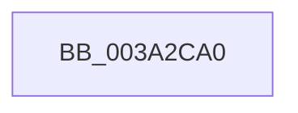

# KiInsertTimer2WithCollectionLockHeld

- RVA: `0x003A2CA0`–`0x003A2CB3` (길이 `19` bytes)
- VA: `0x00000001403A2CA0`
- 실행 섹션: `.text`
- PDB 이름 있음: `예`; PDB Function 태그: `아니요`
- unwind 정보 RVA: `0x000820C4`
- 디코드: `7`개 명령, `19/19` bytes 표시
- 미해석 바이트: `0` (있으면 어셈블리에 `.byte`로 보존)

> 이 문서는 커널 이미지의 기계어와 PDB 기호를 분석해 생성했습니다. 4번과 5번은 함수 원형과 자료형을 바이너리 사용 방식에서 추정한 C 해석이며 원본 소스 복구 결과는 아닙니다.

## 1. Dependencies

- 직접 호출 지점: **0**; 고유 호출 대상: **0**
- 직접 호출자로 확인된 함수: **2**
- RIP 상대 이미지 참조: **0**

### Outgoing calls
- 직접 디코드된 call 명령이 없습니다.

### Direct callers
- [KiInsertTimer2](KiInsertTimer2_function_003A244C.md) at `0x003A2483`
- [KiExpireTimer2](KiExpireTimer2_function_003A24E0.md) at `0x003A2833`

### Static image references
- 디코드된 RIP-relative 메모리 참조가 없습니다.

## 2. Other-region calls and transfers

- 다른 실행 섹션으로 향하는 call: **0**
- 별도 외부 분기/꼬리 이동을 확인하지 못했습니다.

## 3. Assembly (complete function range)

```asm
003A2CA0  48 8B C4                        mov rax, rsp
003A2CA3  4C 89 40 18                     mov qword ptr [rax + 0x18], r8
003A2CA7  88 50 10                        mov byte ptr [rax + 0x10], dl
003A2CAA  55                              push rbp
003A2CAB  41 54                           push r12
003A2CAD  41 55                           push r13
003A2CAF  48 83 EC 40                     sub rsp, 0x40
```

## 4. C-style interpretation (structured pseudocode)

```c
__int64 __fastcall KiInsertTimer2WithCollectionLockHeld(__int64 a1, unsigned __int8 a2, __int64 a3)
{
    __int64 v_rsp;

    *(unsigned __int64 *)(v_rsp + 24) = a3;
    *(unsigned __int8 *)(v_rsp + 16) = a2;
    v_rsp = (v_rsp) - (64);
    return v_rsp;
}
```

## 5. (Beta) C Style

```c
int64_t KiInsertTimer2WithCollectionLockHeld(int64_t Arg1, uint8_t Arg2, int64_t Arg3)
{
    int64_t local_rsp;

    *(uint64_t *)(local_rsp + 0x18) = Arg3;
    *(uint8_t *)(local_rsp + 0x10) = Arg2;
    local_rsp = (local_rsp) - (64);
    return local_rsp;
}
```

## 6. Execution-region graph

[열기: 2D/3D 그래프와 함수 탐색 컨트롤 패널](../../../control-panel.html?section=text&rva=0x003A2CA0&view=graph)

- 2D 그래프는 위에서 아래로 흐르고, 3D 그래프는 빈 공간을 드래그해 회전합니다. Shift+드래그는 이동, 휠은 확대·축소, 함수 노드 선택은 대상 보고서 이동입니다.

### Static fallback


