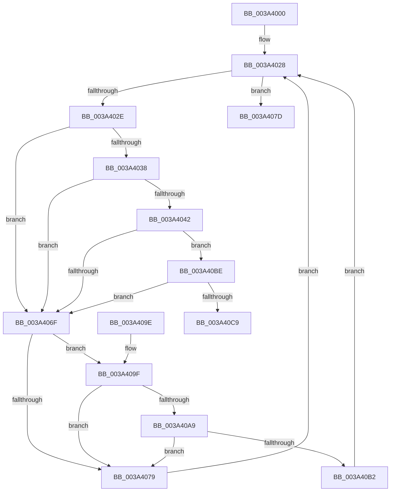

# KiIpiGenericCallTarget

- RVA: `0x003A4000`–`0x003A40E2` (길이 `226` bytes)
- VA: `0x00000001403A4000`
- 실행 섹션: `.text`
- PDB 이름 있음: `예`; PDB Function 태그: `아니요`
- unwind 정보 RVA: `0x000823E4`
- 디코드: `65`개 명령, `226/226` bytes 표시
- 미해석 바이트: `0` (있으면 어셈블리에 `.byte`로 보존)

> 이 문서는 커널 이미지의 기계어와 PDB 기호를 분석해 생성했습니다. 4번과 5번은 함수 원형과 자료형을 바이너리 사용 방식에서 추정한 C 해석이며 원본 소스 복구 결과는 아닙니다.

## 1. Dependencies

- 직접 호출 지점: **5**; 고유 호출 대상: **5**
- 직접 호출자로 확인된 함수: **1**
- RIP 상대 이미지 참조: **3**

### Outgoing calls
- `0x003A4047` → [KeQueryPerformanceCounter](../37/KeQueryPerformanceCounter_function_0037E7E0.md) (function, `0x0037E7E0`)
- `0x003A4084` → [guard_dispatch_icall](../6B/guard_dispatch_icall_function_006BAAD0.md) (function, `0x006BAAD0`)
- `0x003A40A9` → [KiCheckVpBackingLongSpinWaitHypercall](../30/KiCheckVpBackingLongSpinWaitHypercall_function_0030F490.md) (function, `0x0030F490`)
- `0x003A40B4` → [HvlNotifyLongSpinWait](../30/HvlNotifyLongSpinWait_function_0030F460.md) (function, `0x0030F460`)
- `0x003A40DC` → [KeBugCheckEx](../4F/KeBugCheckEx_function_004FD660.md) (function, `0x004FD660`)

### Direct callers
- [sub_003A3F33](Unknown_function_003A3F33.md) at `0x003A3F33`

### Static image references
- `0x003A402E` → RVA `0x00FC6C50` (`ALMOSTRO`; read)
- `0x003A4038` → RVA `0x00FC6AB8` (`ALMOSTRO`; read)
- `0x003A4071` → RVA `0x00FC52AC` (`ALMOSTRO`; reference)

## 2. Other-region calls and transfers

- 다른 실행 섹션으로 향하는 call: **0**
- 별도 외부 분기/꼬리 이동을 확인하지 못했습니다.

## 3. Assembly (complete function range)

```asm
003A4000  48 8B C4                        mov rax, rsp
003A4003  48 89 58 08                     mov qword ptr [rax + 8], rbx
003A4007  48 89 68 10                     mov qword ptr [rax + 0x10], rbp
003A400B  48 89 70 18                     mov qword ptr [rax + 0x18], rsi
003A400F  57                              push rdi
003A4010  48 83 EC 40                     sub rsp, 0x40
003A4014  48 83 60 E8 00                  and qword ptr [rax - 0x18], 0
003A4019  33 DB                           xor ebx, ebx
003A401B  F0 41 FF 09                     lock dec dword ptr [r9]
003A401F  49 8B F9                        mov rdi, r9
003A4022  49 8B F0                        mov rsi, r8
003A4025  48 8B EA                        mov rbp, rdx
003A4028  8B 07                           mov eax, dword ptr [rdi]
003A402A  85 C0                           test eax, eax
003A402C  74 4F                           je 0x1403a407d
003A402E  8B 05 1C 2C C2 00               mov eax, dword ptr [rip + 0xc22c1c]
003A4034  85 C0                           test eax, eax
003A4036  75 37                           jne 0x1403a406f
003A4038  8B 05 7A 2A C2 00               mov eax, dword ptr [rip + 0xc22a7a]
003A403E  A8 20                           test al, 0x20
003A4040  75 2D                           jne 0x1403a406f
003A4042  48 8D 4C 24 30                  lea rcx, [rsp + 0x30]
003A4047  E8 94 A7 FD FF                  call 0x14037e7e0
003A404C  F0 83 0C 24 00                  lock or dword ptr [rsp], 0
003A4051  49 B9 50 03 00 00 80 F7 FF FF   movabs r9, 0xfffff78000000350
003A405B  4D 8B 09                        mov r9, qword ptr [r9]
003A405E  48 69 4C 24 30 2C 01 00 00      imul rcx, qword ptr [rsp + 0x30], 0x12c
003A4067  49 03 C9                        add rcx, r9
003A406A  48 3B C1                        cmp rax, rcx
003A406D  77 4F                           ja 0x1403a40be
003A406F  FF C3                           inc ebx
003A4071  85 1D 35 12 C2 00               test dword ptr [rip + 0xc21235], ebx
003A4077  74 26                           je 0x1403a409f
003A4079  F3 90                           pause
003A407B  EB AB                           jmp 0x1403a4028
003A407D  48 8B CE                        mov rcx, rsi
003A4080  48 8B C5                        mov rax, rbp
003A4083  90                              nop
003A4084  E8 47 6A 31 00                  call 0x1406baad0
003A4089  48 8B 5C 24 50                  mov rbx, qword ptr [rsp + 0x50]
003A408E  48 8B 6C 24 58                  mov rbp, qword ptr [rsp + 0x58]
003A4093  48 8B 74 24 60                  mov rsi, qword ptr [rsp + 0x60]
003A4098  48 83 C4 40                     add rsp, 0x40
003A409C  5F                              pop rdi
003A409D  C3                              ret
003A409E  CC                              int3
003A409F  8B 05 13 2A C2 00               mov eax, dword ptr [rip + 0xc22a13]
003A40A5  A8 40                           test al, 0x40
003A40A7  74 D0                           je 0x1403a4079
003A40A9  E8 E2 B3 F6 FF                  call 0x14030f490
003A40AE  84 C0                           test al, al
003A40B0  74 C7                           je 0x1403a4079
003A40B2  8B CB                           mov ecx, ebx
003A40B4  E8 A7 B3 F6 FF                  call 0x14030f460
003A40B9  E9 6A FF FF FF                  jmp 0x1403a4028
003A40BE  F0 83 0C 24 00                  lock or dword ptr [rsp], 0
003A40C3  8B 0F                           mov ecx, dword ptr [rdi]
003A40C5  85 C9                           test ecx, ecx
003A40C7  74 A6                           je 0x1403a406f
003A40C9  48 83 64 24 20 00               and qword ptr [rsp + 0x20], 0
003A40CF  4C 8B C0                        mov r8, rax
003A40D2  48 8B 54 24 30                  mov rdx, qword ptr [rsp + 0x30]
003A40D7  B9 DB 01 00 00                  mov ecx, 0x1db
003A40DC  E8 7F 95 15 00                  call 0x1404fd660
003A40E1  CC                              int3
```

## 4. C-style interpretation (structured pseudocode)

```c
__int64 __fastcall KiIpiGenericCallTarget(__int64 a1, __int64 a2, __int64 a3, __int64 a4)
{
    __int64 result;
    __int64 v_rbx;
    __int64 v_rsp;
    unsigned __int64 v_stack_m18;
    unsigned int v_stack_m48;
    unsigned int v_stack_p0;
    unsigned __int64 v_stack_p10;
    unsigned __int64 v_stack_p18;
    unsigned __int64 v_stack_p20;
    unsigned __int64 v_stack_p30;
    unsigned __int64 v_stack_p8;

    *(unsigned __int64 *)(v_rsp + 8) = v_rbx;
    *(unsigned __int64 *)(v_rsp + 16) = v_rbp;
    *(unsigned __int64 *)(v_rsp + 24) = v_rsi;
    v_rsp = (v_rsp) - (64);
    v_rbx = 0;
loc_003A4028:
    if ((unsigned int)((unsigned int)(*(unsigned int *)(a4))) == 0) goto loc_003A407D;
    if ((unsigned int)((unsigned int)(*(unsigned int *)(v_rip + 12725276))) != 0) goto loc_003A406F;
    if ((((unsigned __int8)((unsigned int)(*(unsigned int *)(v_rip + 12724858)))) & (32)) != 0) goto loc_003A406F;
    result = KeQueryPerformanceCounter(v_stack_m18, a2, a3, a4);
    a1 = (v_stack_m18) * (v_stack_m18);
    a1 = (a1) + (*(unsigned __int64 *)(a4));
    if (result > a1) goto loc_003A40BE;
loc_003A406F:
    v_rbx = (unsigned int)((v_rbx) + 1);
    if (((*(unsigned int *)(v_rip + 12718645)) & ((unsigned int)(v_rbx))) == 0) goto loc_003A409F;
loc_003A4079:
    goto loc_003A4028;
loc_003A407D:
    result = guard_dispatch_icall(a3, a2, a3, *(unsigned __int64 *)(a4));
    v_rsp = (v_rsp) + (64);
    return result;
loc_003A409F:
    if ((((unsigned __int8)((unsigned int)(*(unsigned int *)(v_rip + 12724755)))) & (64)) == 0) goto loc_003A4079;
    result = KiCheckVpBackingLongSpinWaitHypercall(a3, a2, a3, *(unsigned __int64 *)(a4));
    if ((unsigned __int8)(result) == 0) goto loc_003A4079;
    result = HvlNotifyLongSpinWait((unsigned int)((unsigned int)(v_stack_p8)), a2, a3, *(unsigned __int64 *)(a4));
    goto loc_003A4028;
loc_003A40BE:
    if ((unsigned int)((unsigned int)(*(unsigned int *)(a4))) == 0) goto loc_003A406F;
    result = KeBugCheckEx(475, v_stack_p30, result, *(unsigned __int64 *)(a4));
    return result;
}
```

## 5. (Beta) C Style

```c
int64_t KiIpiGenericCallTarget(int64_t Arg1, int64_t Arg2, int64_t Arg3, void *Arg4)
{
    uint8_t *arg4 = (uint8_t *)Arg4;

    int64_t result;
    int64_t local_rbx;
    int64_t local_rsp;
    uint64_t v_stack_m18;
    uint32_t v_stack_m48;
    uint32_t v_stack_p0;
    uint64_t v_stack_p10;
    uint64_t v_stack_p18;
    uint64_t v_stack_p20;
    uint64_t v_stack_p30;
    uint64_t v_stack_p8;

    *(uint64_t *)(local_rsp + 0x8) = local_rbx;
    *(uint64_t *)(local_rsp + 0x10) = local_rbp;
    *(uint64_t *)(local_rsp + 0x18) = local_rsi;
    local_rsp = (local_rsp) - (64);
    local_rbx = 0;
loc_003A4028:
    if ((uint32_t)((uint32_t)(*(uint32_t *)(arg4))) == 0) goto loc_003A407D;
    if ((uint32_t)((uint32_t)(*(uint32_t *)(v_rip + 0xC22C1C))) != 0) goto loc_003A406F;
    if ((((uint8_t)((uint32_t)(*(uint32_t *)(v_rip + 0xC22A7A)))) & (32)) != 0) goto loc_003A406F;
    result = KeQueryPerformanceCounter(v_stack_m18, Arg2, Arg3, Arg4);
    Arg1 = (v_stack_m18) * (v_stack_m18);
    Arg1 = (Arg1) + (*(uint64_t *)(arg4));
    if (result > Arg1) goto loc_003A40BE;
loc_003A406F:
    local_rbx = (uint32_t)((local_rbx) + 1);
    if (((*(uint32_t *)(v_rip + 0xC21235)) & ((uint32_t)(local_rbx))) == 0) goto loc_003A409F;
loc_003A4079:
    goto loc_003A4028;
loc_003A407D:
    result = guard_dispatch_icall(Arg3, Arg2, Arg3, *(uint64_t *)(arg4));
    local_rsp = (local_rsp) + (64);
    return result;
loc_003A409F:
    if ((((uint8_t)((uint32_t)(*(uint32_t *)(v_rip + 0xC22A13)))) & (64)) == 0) goto loc_003A4079;
    result = KiCheckVpBackingLongSpinWaitHypercall(Arg3, Arg2, Arg3, *(uint64_t *)(arg4));
    if ((uint8_t)(result) == 0) goto loc_003A4079;
    result = HvlNotifyLongSpinWait((uint32_t)((uint32_t)(v_stack_p8)), Arg2, Arg3, *(uint64_t *)(arg4));
    goto loc_003A4028;
loc_003A40BE:
    if ((uint32_t)((uint32_t)(*(uint32_t *)(arg4))) == 0) goto loc_003A406F;
    result = KeBugCheckEx(475, v_stack_p30, result, *(uint64_t *)(arg4));
    return result;
}
```

### 관측된 메모리 오프셋

구조체 형식이 확인되지 않은 접근은 인자 기준의 오프셋으로만 기록했습니다.

| 기준 인자 | 오프셋 표현 | 폭 (bit) | 접근 |
|---|---:|---:|---|
| `Arg4` | `+ 0x0` | `32` | `R` |
| `Arg4` | `+ 0x0` | `32` | `R/W` |

## 6. Execution-region graph

[열기: 2D/3D 그래프와 함수 탐색 컨트롤 패널](../../../control-panel.html?section=text&rva=0x003A4000&view=graph)

- 2D 그래프는 위에서 아래로 흐르고, 3D 그래프는 빈 공간을 드래그해 회전합니다. Shift+드래그는 이동, 휠은 확대·축소, 함수 노드 선택은 대상 보고서 이동입니다.

### Static fallback


