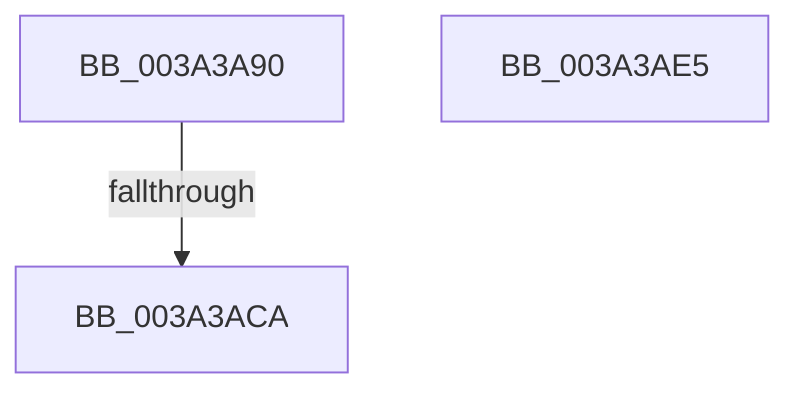

# KiIpiProcessRequests

- RVA: `0x003A3A90`–`0x003A3AE6` (길이 `86` bytes)
- VA: `0x00000001403A3A90`
- 실행 섹션: `.text`
- PDB 이름 있음: `예`; PDB Function 태그: `예`
- unwind 정보 RVA: `0x00082304`
- 디코드: `18`개 명령, `86/86` bytes 표시
- 미해석 바이트: `0` (있으면 어셈블리에 `.byte`로 보존)

> 이 문서는 커널 이미지의 기계어와 PDB 기호를 분석해 생성했습니다. 4번과 5번은 함수 원형과 자료형을 바이너리 사용 방식에서 추정한 C 해석이며 원본 소스 복구 결과는 아닙니다.

## 1. Dependencies

- 직접 호출 지점: **1**; 고유 호출 대상: **1**
- 직접 호출자로 확인된 함수: **1**
- RIP 상대 이미지 참조: **1**

### Outgoing calls
- `0x003A3AD7` → [_security_check_cookie](../6A/_security_check_cookie_function_006AC640.md) (function, `0x006AC640`)

### Direct callers
- [KiIpiInterruptSubDispatch](../6B/KiIpiInterruptSubDispatch_function_006B9660.md) at `0x006B969B`

### Static image references
- `0x003A3A99` → RVA `0x00E0A740` (`.data`; read)

## 2. Other-region calls and transfers

- 다른 실행 섹션으로 향하는 call: **0**
- call이 아닌 외부 분기/꼬리 이동: **1**
  - `0x003A3AC8` → [sub_003A3AE6](Unknown_function_003A3AE6.md) (`tail-transfer`)

## 3. Assembly (complete function range)

```asm
003A3A90  40 57                           push rdi
003A3A92  48 81 EC E0 00 00 00            sub rsp, 0xe0
003A3A99  48 8B 05 A0 6C A6 00            mov rax, qword ptr [rip + 0xa66ca0]
003A3AA0  48 33 C4                        xor rax, rsp
003A3AA3  48 89 84 24 B8 00 00 00         mov qword ptr [rsp + 0xb8], rax
003A3AAB  65 48 8B 3C 25 20 00 00 00      mov rdi, qword ptr gs:[0x20]
003A3AB4  48 89 7C 24 50                  mov qword ptr [rsp + 0x50], rdi
003A3AB9  0F 0D 8F C0 9A 00 00            prefetchw byte ptr [rdi + 0x9ac0]
003A3AC0  48 83 BF C0 9A 00 00 00         cmp qword ptr [rdi + 0x9ac0], 0
003A3AC8  75 1C                           jne 0x1403a3ae6
003A3ACA  32 C0                           xor al, al
003A3ACC  48 8B 8C 24 B8 00 00 00         mov rcx, qword ptr [rsp + 0xb8]
003A3AD4  48 33 CC                        xor rcx, rsp
003A3AD7  E8 64 8B 30 00                  call 0x1406ac640
003A3ADC  48 81 C4 E0 00 00 00            add rsp, 0xe0
003A3AE3  5F                              pop rdi
003A3AE4  C3                              ret
003A3AE5  CC                              int3
```

## 4. C-style interpretation (structured pseudocode)

```c
__int64 __fastcall KiIpiProcessRequests(void)
{
    __int64 result;
    __int64 v_rsp;
    unsigned __int64 v_stack_m30;
    unsigned __int64 v_stack_m98;

    v_rsp = (v_rsp) - (224);
    result = (*(unsigned __int64 *)(v_rip + 10906784)) ^ (v_rsp);
    v_stack_m30 = result;
    v_stack_m98 = *(unsigned __int64 *)(gs_base + (0 + 32));
    result = 0;
    a1 = (v_stack_m30) ^ (v_rsp);
    result = _security_check_cookie(a1, a2, a3, a4);
    v_rsp = (v_rsp) + (224);
    return result;
}
```

## 5. (Beta) C Style

```c
void KiIpiProcessRequests(void)
{
    int64_t result;
    int64_t local_rsp;
    uint64_t v_stack_m30;
    uint64_t v_stack_m98;

    local_rsp = (local_rsp) - (224);
    result = (*(uint64_t *)(v_rip + 0xA66CA0)) ^ (local_rsp);
    v_stack_m30 = result;
    v_stack_m98 = *(uint64_t *)(gs_base + (0 + 0x20));
    result = 0;
    a1 = (v_stack_m30) ^ (local_rsp);
    result = _security_check_cookie(a1, a2, a3, a4);
    local_rsp = (local_rsp) + (224);
    return result;
}
```

## 6. Execution-region graph

[열기: 2D/3D 그래프와 함수 탐색 컨트롤 패널](../../../control-panel.html?section=text&rva=0x003A3A90&view=graph)

- 2D 그래프는 위에서 아래로 흐르고, 3D 그래프는 빈 공간을 드래그해 회전합니다. Shift+드래그는 이동, 휠은 확대·축소, 함수 노드 선택은 대상 보고서 이동입니다.

### Static fallback


