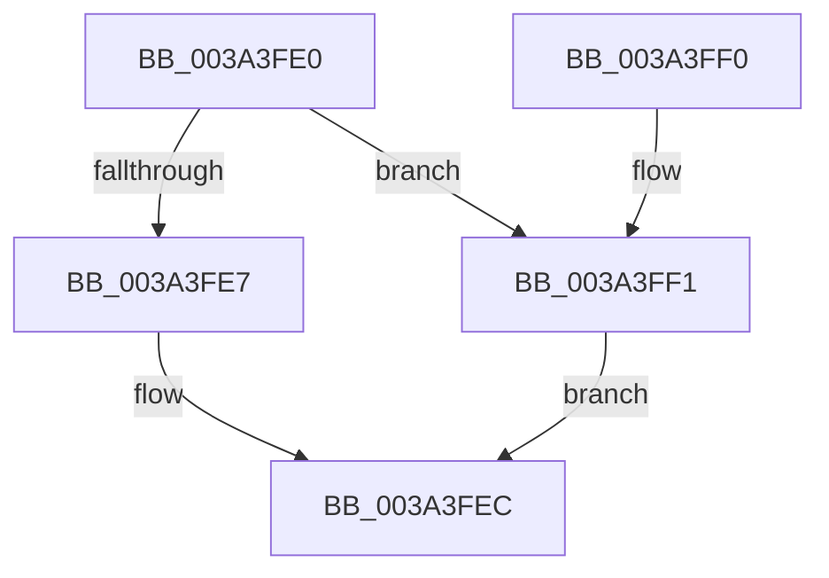

# KiIpiUpdateThreadTag

- RVA: `0x003A3FE0`–`0x003A3FF8` (길이 `24` bytes)
- VA: `0x00000001403A3FE0`
- 실행 섹션: `.text`
- PDB 이름 있음: `예`; PDB Function 태그: `아니요`
- unwind 정보 RVA: `0x000DB714`
- 디코드: `9`개 명령, `24/24` bytes 표시
- 미해석 바이트: `0` (있으면 어셈블리에 `.byte`로 보존)

> 이 문서는 커널 이미지의 기계어와 PDB 기호를 분석해 생성했습니다. 4번과 5번은 함수 원형과 자료형을 바이너리 사용 방식에서 추정한 C 해석이며 원본 소스 복구 결과는 아닙니다.

## 1. Dependencies

- 직접 호출 지점: **0**; 고유 호출 대상: **0**
- 직접 호출자로 확인된 함수: **1**
- RIP 상대 이미지 참조: **0**

### Outgoing calls
- 직접 디코드된 call 명령이 없습니다.

### Direct callers
- [sub_003A3E54](Unknown_function_003A3E54.md) at `0x003A3F0E`

### Static image references
- 디코드된 RIP-relative 메모리 참조가 없습니다.

## 2. Other-region calls and transfers

- 다른 실행 섹션으로 향하는 call: **0**
- 별도 외부 분기/꼬리 이동을 확인하지 못했습니다.

## 3. Assembly (complete function range)

```asm
003A3FE0  41 8B 00                        mov eax, dword ptr [r8]
003A3FE3  85 C0                           test eax, eax
003A3FE5  74 0A                           je 0x1403a3ff1
003A3FE7  F0 0F BA 2A 14                  lock bts dword ptr [rdx], 0x14
003A3FEC  88 42 7C                        mov byte ptr [rdx + 0x7c], al
003A3FEF  C3                              ret
003A3FF0  CC                              int3
003A3FF1  F0 0F BA 32 14                  lock btr dword ptr [rdx], 0x14
003A3FF6  EB F4                           jmp 0x1403a3fec
```

## 4. C-style interpretation (structured pseudocode)

```c
__int64 __fastcall KiIpiUpdateThreadTag(__int64 a1, __int64 a2, __int64 a3)
{
    if ((unsigned int)((unsigned int)(*(unsigned int *)(a3))) == 0) goto loc_003A3FF1;
loc_003A3FEC:
    *(unsigned __int8 *)(a2 + 124) = (unsigned __int8)((unsigned int)(*(unsigned int *)(a3)));
    return (unsigned int)(*(unsigned int *)(a3));
loc_003A3FF1:
    goto loc_003A3FEC;
}
```

## 5. (Beta) C Style

```c
int64_t KiIpiUpdateThreadTag(int64_t Arg1, void *Arg2, void *Arg3)
{
    uint8_t *arg2 = (uint8_t *)Arg2;
    uint8_t *arg3 = (uint8_t *)Arg3;

    if ((uint32_t)((uint32_t)(*(uint32_t *)(arg3))) == 0) goto loc_003A3FF1;
loc_003A3FEC:
    *(uint8_t *)(arg2 + 0x7C) = (uint8_t)((uint32_t)(*(uint32_t *)(arg3)));
    return (uint32_t)(*(uint32_t *)(arg3));
loc_003A3FF1:
    goto loc_003A3FEC;
}
```

### 관측된 메모리 오프셋

구조체 형식이 확인되지 않은 접근은 인자 기준의 오프셋으로만 기록했습니다.

| 기준 인자 | 오프셋 표현 | 폭 (bit) | 접근 |
|---|---:|---:|---|
| `Arg2` | `+ 0x0` | `32` | `R/W` |
| `Arg2` | `+ 0x7C` | `8` | `W` |
| `Arg3` | `+ 0x0` | `32` | `R` |

## 6. Execution-region graph

[열기: 2D/3D 그래프와 함수 탐색 컨트롤 패널](../../../control-panel.html?section=text&rva=0x003A3FE0&view=graph)

- 2D 그래프는 위에서 아래로 흐르고, 3D 그래프는 빈 공간을 드래그해 회전합니다. Shift+드래그는 이동, 휠은 확대·축소, 함수 노드 선택은 대상 보고서 이동입니다.

### Static fallback


