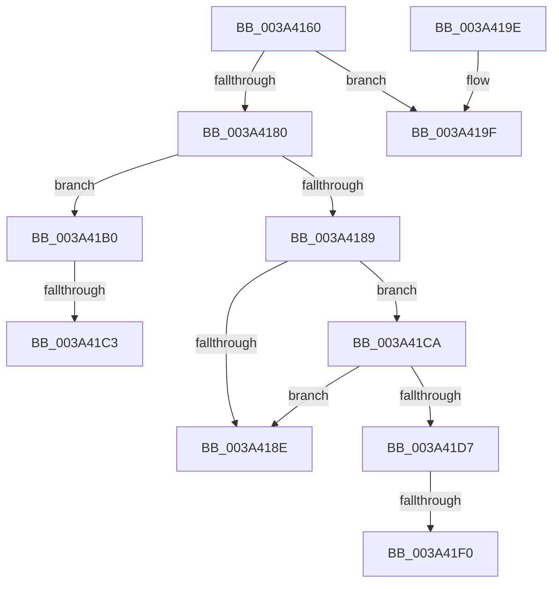

# KiResetForceIdle

- RVA: `0x003A4160`–`0x003A41FC` (길이 `156` bytes)
- VA: `0x00000001403A4160`
- 실행 섹션: `.text`
- PDB 이름 있음: `예`; PDB Function 태그: `예`
- unwind 정보 RVA: `0x000823FC`
- 디코드: `41`개 명령, `156/156` bytes 표시
- 미해석 바이트: `0` (있으면 어셈블리에 `.byte`로 보존)

> 이 문서는 커널 이미지의 기계어와 PDB 기호를 분석해 생성했습니다. 4번과 5번은 함수 원형과 자료형을 바이너리 사용 방식에서 추정한 C 해석이며 원본 소스 복구 결과는 아닙니다.

## 1. Dependencies

- 직접 호출 지점: **3**; 고유 호출 대상: **3**
- 직접 호출자로 확인된 함수: **3**
- RIP 상대 이미지 참조: **1**

### Outgoing calls
- `0x003A4180` → [KeIsForceIdleEngaged](KeIsForceIdleEngaged_function_003A38D0.md) (function, `0x003A38D0`)
- `0x003A419F` → [KeDisableInterrupts](../21/KeDisableInterrupts_function_00217BE0.md) (function, `0x00217BE0`)
- `0x003A41B5` → [KiSetForceIdleState](../48/KiSetForceIdleState_function_0048DCC0.md) (function, `0x0048DCC0`)

### Direct callers
- [KeClearForceIdle](../48/KeClearForceIdle_function_0048D69C.md) at `0x0048D76E`
- [KeResumeClockTimerFromIdle](../5B/KeResumeClockTimerFromIdle_function_005BACC4.md) at `0x005BB12B`
- [sub_006E5A5E](../6E/Unknown_function_006E5A5E.md) at `0x006E5AEA`

### Static image references
- `0x003A41CA` → RVA `0x00F23140` (`.data`; read/write)

## 2. Other-region calls and transfers

- 다른 실행 섹션으로 향하는 call: **0**
- call이 아닌 외부 분기/꼬리 이동: **5**
  - `0x003A41AB` → [sub_006E650A](../6E/Unknown_function_006E650A.md) (`tail-transfer`)
  - `0x003A41BD` → [sub_006E650A + 0x28](../6E/Unknown_function_006E650A.md) (`tail-transfer`)
  - `0x003A41C5` → [sub_006E650A + 0x42](../6E/Unknown_function_006E650A.md) (`tail-transfer`)
  - `0x003A41EA` → [sub_006E650A + 0xA0](../6E/Unknown_function_006E650A.md) (`tail-transfer`)
  - `0x003A41F7` → [sub_006E650A + 0x88](../6E/Unknown_function_006E650A.md) (`tail-transfer`)

## 3. Assembly (complete function range)

```asm
003A4160  48 89 5C 24 08                  mov qword ptr [rsp + 8], rbx
003A4165  48 89 74 24 20                  mov qword ptr [rsp + 0x20], rsi
003A416A  57                              push rdi
003A416B  48 83 EC 20                     sub rsp, 0x20
003A416F  48 83 64 24 40 00               and qword ptr [rsp + 0x40], 0
003A4175  32 DB                           xor bl, bl
003A4177  40 8A FA                        mov dil, dl
003A417A  8B F1                           mov esi, ecx
003A417C  84 D2                           test dl, dl
003A417E  74 1F                           je 0x1403a419f
003A4180  E8 4B F7 FF FF                  call 0x1403a38d0
003A4185  84 C0                           test al, al
003A4187  75 27                           jne 0x1403a41b0
003A4189  40 84 FF                        test dil, dil
003A418C  74 3C                           je 0x1403a41ca
003A418E  48 8B 5C 24 30                  mov rbx, qword ptr [rsp + 0x30]
003A4193  48 8B 74 24 48                  mov rsi, qword ptr [rsp + 0x48]
003A4198  48 83 C4 20                     add rsp, 0x20
003A419C  5F                              pop rdi
003A419D  C3                              ret
003A419E  CC                              int3
003A419F  E8 3C 3A E7 FF                  call 0x140217be0
003A41A4  83 64 24 38 00                  and dword ptr [rsp + 0x38], 0
003A41A9  8A D8                           mov bl, al
003A41AB  E9 5A 23 34 00                  jmp 0x1406e650a
003A41B0  B9 03 00 00 00                  mov ecx, 3
003A41B5  E8 06 9B 0E 00                  call 0x14048dcc0
003A41BA  83 FE 03                        cmp esi, 3
003A41BD  0F 85 6F 23 34 00               jne 0x1406e6532
003A41C3  33 C0                           xor eax, eax
003A41C5  E9 82 23 34 00                  jmp 0x1406e654c
003A41CA  F0 48 83 25 6D EF B7 00 00      lock and qword ptr [rip + 0xb7ef6d], 0
003A41D3  84 DB                           test bl, bl
003A41D5  74 B7                           je 0x1403a418e
003A41D7  65 48 8B 0C 25 20 00 00 00      mov rcx, qword ptr gs:[0x20]
003A41E0  4C 8B 81 B8 8E 00 00            mov r8, qword ptr [rcx + 0x8eb8]
003A41E7  4D 85 C0                        test r8, r8
003A41EA  0F 84 BA 23 34 00               je 0x1406e65aa
003A41F0  41 0F 0D 08                     prefetchw byte ptr [r8]
003A41F4  41 8B 00                        mov eax, dword ptr [r8]
003A41F7  E9 96 23 34 00                  jmp 0x1406e6592
```

## 4. C-style interpretation (structured pseudocode)

```c
__int64 __fastcall KiResetForceIdle(int a1, unsigned __int8 a2)
{
    __int64 result;
    __int64 v_rbx;
    __int64 v_rsp;
    unsigned __int64 v_stack_p18;
    unsigned __int64 v_stack_p20;
    unsigned int v_stack_p38;
    unsigned __int64 v_stack_p8;

    v_stack_p8 = v_rbx;
    v_stack_p20 = v_rsi;
    v_rsp = (v_rsp) - (32);
    v_rbx = 0;
    if (a2 == 0) goto loc_003A419F;
    result = KeIsForceIdleEngaged(a1, a2, a3, a4);
    if ((unsigned __int8)(result) != 0) goto loc_003A41B0;
    if (a2 == 0) goto loc_003A41CA;
loc_003A418E:
    v_rsp = (v_rsp) + (32);
    return result;
loc_003A419F:
    result = KeDisableInterrupts(a1, a2, a3, a4);
loc_003A41B0:
    result = KiSetForceIdleState(3, a2, a3, a4);
    result = 0;
loc_003A41CA:
    if ((unsigned __int8)((unsigned __int8)(result)) == 0) goto loc_003A418E;
}
```

## 5. (Beta) C Style

```c
int64_t KiResetForceIdle(int32_t Arg1, uint8_t Arg2)
{
    int64_t result;
    int64_t local_rbx;
    int64_t local_rsp;
    uint64_t v_stack_p18;
    uint64_t v_stack_p20;
    uint32_t v_stack_p38;
    uint64_t v_stack_p8;

    v_stack_p8 = local_rbx;
    v_stack_p20 = local_rsi;
    local_rsp = (local_rsp) - (32);
    local_rbx = 0;
    if (Arg2 == 0) goto loc_003A419F;
    result = KeIsForceIdleEngaged(Arg1, Arg2, a3, a4);
    if ((uint8_t)(result) != 0) goto loc_003A41B0;
    if (Arg2 == 0) goto loc_003A41CA;
loc_003A418E:
    local_rsp = (local_rsp) + (32);
    return result;
loc_003A419F:
    result = KeDisableInterrupts(Arg1, Arg2, a3, a4);
loc_003A41B0:
    result = KiSetForceIdleState(3, Arg2, a3, a4);
    result = 0;
loc_003A41CA:
    if ((uint8_t)((uint8_t)(result)) == 0) goto loc_003A418E;
}
```

## 6. Execution-region graph

[열기: 2D/3D 그래프와 함수 탐색 컨트롤 패널](../../../control-panel.html?section=text&rva=0x003A4160&view=graph)

- 2D 그래프는 위에서 아래로 흐르고, 3D 그래프는 빈 공간을 드래그해 회전합니다. Shift+드래그는 이동, 휠은 확대·축소, 함수 노드 선택은 대상 보고서 이동입니다.

### Static fallback


