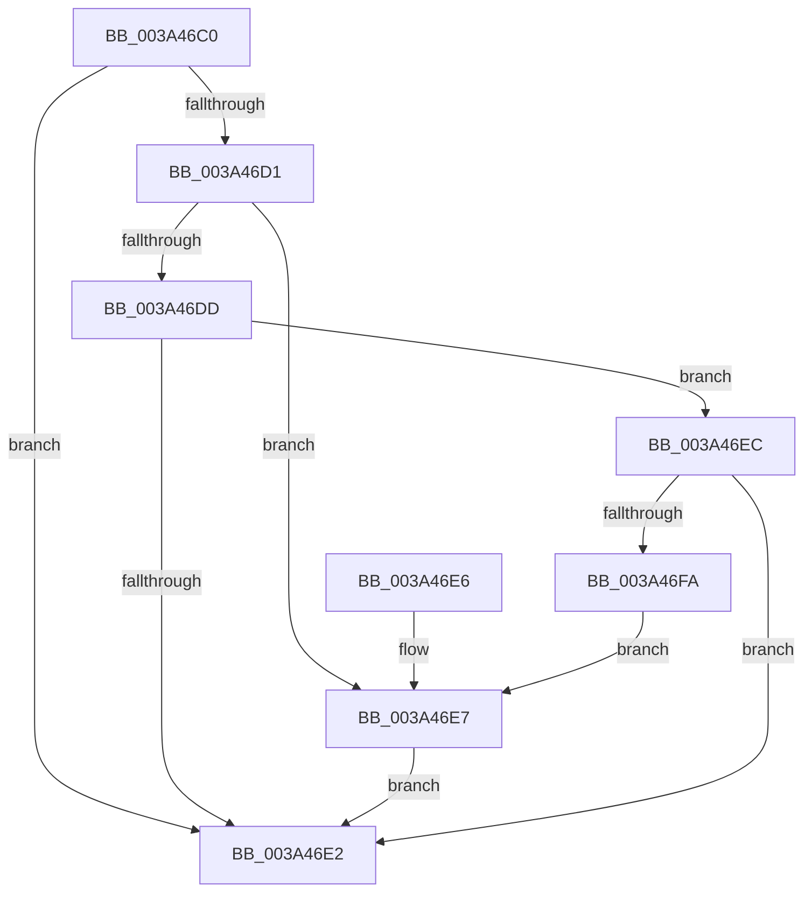

# KiShouldActivateHRTimerClock

- RVA: `0x003A46C0`–`0x003A46FC` (길이 `60` bytes)
- VA: `0x00000001403A46C0`
- 실행 섹션: `.text`
- PDB 이름 있음: `예`; PDB Function 태그: `아니요`
- unwind 정보 RVA: `0x000DB714`
- 디코드: `20`개 명령, `60/60` bytes 표시
- 미해석 바이트: `0` (있으면 어셈블리에 `.byte`로 보존)

> 이 문서는 커널 이미지의 기계어와 PDB 기호를 분석해 생성했습니다. 4번과 5번은 함수 원형과 자료형을 바이너리 사용 방식에서 추정한 C 해석이며 원본 소스 복구 결과는 아닙니다.

## 1. Dependencies

- 직접 호출 지점: **0**; 고유 호출 대상: **0**
- 직접 호출자로 확인된 함수: **1**
- RIP 상대 이미지 참조: **3**

### Outgoing calls
- 직접 디코드된 call 명령이 없습니다.

### Direct callers
- [KiAdjustTimer2DueTimes](KiAdjustTimer2DueTimes_function_003A3550.md) at `0x003A3731`

### Static image references
- `0x003A46C0` → RVA `0x00FC6AA0` (`ALMOSTRO`; read)
- `0x003A46D1` → RVA `0x00F21F90` (`.data`; read)
- `0x003A46EC` → RVA `0x00FC6B3C` (`ALMOSTRO`; read)

## 2. Other-region calls and transfers

- 다른 실행 섹션으로 향하는 call: **0**
- 별도 외부 분기/꼬리 이동을 확인하지 못했습니다.

## 3. Assembly (complete function range)

```asm
003A46C0  8B 05 DA 23 C2 00               mov eax, dword ptr [rip + 0xc223da]
003A46C6  45 33 C0                        xor r8d, r8d
003A46C9  48 03 C1                        add rax, rcx
003A46CC  48 3B D0                        cmp rdx, rax
003A46CF  73 11                           jae 0x1403a46e2
003A46D1  48 8B 0D B8 D8 B7 00            mov rcx, qword ptr [rip + 0xb7d8b8]
003A46D8  48 85 C9                        test rcx, rcx
003A46DB  74 0A                           je 0x1403a46e7
003A46DD  48 3B D1                        cmp rdx, rcx
003A46E0  72 0A                           jb 0x1403a46ec
003A46E2  41 8A C0                        mov al, r8b
003A46E5  C3                              ret
003A46E6  CC                              int3
003A46E7  41 B0 01                        mov r8b, 1
003A46EA  EB F6                           jmp 0x1403a46e2
003A46EC  8B 05 4A 24 C2 00               mov eax, dword ptr [rip + 0xc2244a]
003A46F2  48 2B CA                        sub rcx, rdx
003A46F5  48 3B C8                        cmp rcx, rax
003A46F8  76 E8                           jbe 0x1403a46e2
003A46FA  EB EB                           jmp 0x1403a46e7
```

## 4. C-style interpretation (structured pseudocode)

```c
__int64 __fastcall KiShouldActivateHRTimerClock(__int64 a1, __int64 a2, int a3)
{
    __int64 result;

    a3 = 0;
    result = ((unsigned int)(*(unsigned int *)(v_rip + 12723162))) + (a1);
    if (a2 >= result) goto loc_003A46E2;
    if (*(unsigned __int64 *)(v_rip + 12048568) == 0) goto loc_003A46E7;
    if (a2 < (*(unsigned __int64 *)(v_rip + 12048568))) goto loc_003A46EC;
loc_003A46E2:
    return 0;
loc_003A46E7:
    goto loc_003A46E2;
loc_003A46EC:
    a1 = (*(unsigned __int64 *)(v_rip + 12048568)) - (a2);
    if (a1 <= ((unsigned int)(*(unsigned int *)(v_rip + 12723274)))) goto loc_003A46E2;
    goto loc_003A46E7;
}
```

## 5. (Beta) C Style

```c
int64_t KiShouldActivateHRTimerClock(int64_t Arg1, int64_t Arg2, int32_t Arg3)
{
    int64_t result;

    Arg3 = 0;
    result = ((uint32_t)(*(uint32_t *)(v_rip + 0xC223DA))) + (Arg1);
    if (Arg2 >= result) goto loc_003A46E2;
    if (*(uint64_t *)(v_rip + 0xB7D8B8) == 0) goto loc_003A46E7;
    if (Arg2 < (*(uint64_t *)(v_rip + 0xB7D8B8))) goto loc_003A46EC;
loc_003A46E2:
    return 0;
loc_003A46E7:
    goto loc_003A46E2;
loc_003A46EC:
    Arg1 = (*(uint64_t *)(v_rip + 0xB7D8B8)) - (Arg2);
    if (Arg1 <= ((uint32_t)(*(uint32_t *)(v_rip + 0xC2244A)))) goto loc_003A46E2;
    goto loc_003A46E7;
}
```

## 6. Execution-region graph

[열기: 2D/3D 그래프와 함수 탐색 컨트롤 패널](../../../control-panel.html?section=text&rva=0x003A46C0&view=graph)

- 2D 그래프는 위에서 아래로 흐르고, 3D 그래프는 빈 공간을 드래그해 회전합니다. Shift+드래그는 이동, 휠은 확대·축소, 함수 노드 선택은 대상 보고서 이동입니다.

### Static fallback


