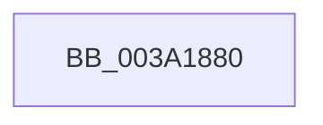

# KiTimer2Expiration

- RVA: `0x003A1880`–`0x003A18D4` (길이 `84` bytes)
- VA: `0x00000001403A1880`
- 실행 섹션: `.text`
- PDB 이름 있음: `예`; PDB Function 태그: `아니요`
- unwind 정보 RVA: `0x00081EF8`
- 디코드: `21`개 명령, `84/84` bytes 표시
- 미해석 바이트: `0` (있으면 어셈블리에 `.byte`로 보존)

> 이 문서는 커널 이미지의 기계어와 PDB 기호를 분석해 생성했습니다. 4번과 5번은 함수 원형과 자료형을 바이너리 사용 방식에서 추정한 C 해석이며 원본 소스 복구 결과는 아닙니다.

## 1. Dependencies

- 직접 호출 지점: **0**; 고유 호출 대상: **0**
- 직접 호출자로 확인된 함수: **2**
- RIP 상대 이미지 참조: **2**

### Outgoing calls
- 직접 디코드된 call 명령이 없습니다.

### Direct callers
- [KiRetireDpcList](../21/KiRetireDpcList_function_0021A0B0.md) at `0x0021AD76`
- [KiTimerExpirationDpc](../5C/KiTimerExpirationDpc_function_005C86D0.md) at `0x005C8831`

### Static image references
- `0x003A1892` → RVA `0x00E0A740` (`.data`; read)
- `0x003A18A1` → RVA `0x00F23300` (`.data`; read)

## 2. Other-region calls and transfers

- 다른 실행 섹션으로 향하는 call: **0**
- call이 아닌 외부 분기/꼬리 이동: **1**
  - `0x003A18CE` → [sub_003A19EE](Unknown_function_003A19EE.md) (`tail-transfer`)

## 3. Assembly (complete function range)

```asm
003A1880  4C 8B DC                        mov r11, rsp
003A1883  56                              push rsi
003A1884  57                              push rdi
003A1885  41 55                           push r13
003A1887  41 56                           push r14
003A1889  41 57                           push r15
003A188B  48 81 EC 90 00 00 00            sub rsp, 0x90
003A1892  48 8B 05 A7 8E A6 00            mov rax, qword ptr [rip + 0xa68ea7]
003A1899  48 33 C4                        xor rax, rsp
003A189C  48 89 44 24 70                  mov qword ptr [rsp + 0x70], rax
003A18A1  48 8B 05 58 1A B8 00            mov rax, qword ptr [rip + 0xb81a58]
003A18A8  0F 57 C0                        xorps xmm0, xmm0
003A18AB  4C 8B B4 24 E0 00 00 00         mov r14, qword ptr [rsp + 0xe0]
003A18B3  41 0F B6 F9                     movzx edi, r9b
003A18B7  C6 44 24 30 00                  mov byte ptr [rsp + 0x30], 0
003A18BC  41 0F B6 F0                     movzx esi, r8b
003A18C0  4C 8B EA                        mov r13, rdx
003A18C3  4C 8B F9                        mov r15, rcx
003A18C6  0F 11 44 24 50                  movups xmmword ptr [rsp + 0x50], xmm0
003A18CB  48 3B D0                        cmp rdx, rax
003A18CE  0F 82 1A 01 00 00               jb 0x1403a19ee
```

## 4. C-style interpretation (structured pseudocode)

```c
__int64 __fastcall KiTimer2Expiration(__int64 a1, __int64 a2, unsigned __int8 a3, unsigned __int8 a4, __int64 a5)
{
    __int64 result;
    __int64 v_rsp;
    unsigned __int64 v_stack_m48;
    unsigned __int64 v_stack_m68;
    unsigned __int8 v_stack_m88;

    v_rsp = (v_rsp) - (144);
    result = (*(unsigned __int64 *)(v_rip + 10915495)) ^ (v_rsp);
    v_stack_m48 = result;
    v_stack_m88 = 0;
    v_stack_m68 = v_xmm0;
}
```

## 5. (Beta) C Style

```c
int64_t KiTimer2Expiration(int64_t Arg1, int64_t Arg2, uint8_t Arg3, uint8_t Arg4, int64_t Arg5)
{
    int64_t result;
    int64_t local_rsp;
    uint64_t v_stack_m48;
    uint64_t v_stack_m68;
    uint8_t v_stack_m88;

    local_rsp = (local_rsp) - (144);
    result = (*(uint64_t *)(v_rip + 0xA68EA7)) ^ (local_rsp);
    v_stack_m48 = result;
    v_stack_m88 = 0;
    v_stack_m68 = v_xmm0;
}
```

## 6. Execution-region graph

[열기: 2D/3D 그래프와 함수 탐색 컨트롤 패널](../../../control-panel.html?section=text&rva=0x003A1880&view=graph)

- 2D 그래프는 위에서 아래로 흐르고, 3D 그래프는 빈 공간을 드래그해 회전합니다. Shift+드래그는 이동, 휠은 확대·축소, 함수 노드 선택은 대상 보고서 이동입니다.

### Static fallback


