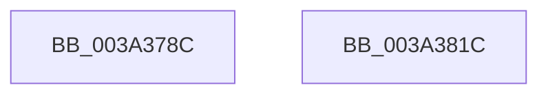

# KiTraceCancelTimer2

- RVA: `0x003A378C`–`0x003A381D` (길이 `145` bytes)
- VA: `0x00000001403A378C`
- 실행 섹션: `.text`
- PDB 이름 있음: `예`; PDB Function 태그: `아니요`
- unwind 정보 RVA: `0x00079788`
- 디코드: `32`개 명령, `145/145` bytes 표시
- 미해석 바이트: `0` (있으면 어셈블리에 `.byte`로 보존)

> 이 문서는 커널 이미지의 기계어와 PDB 기호를 분석해 생성했습니다. 4번과 5번은 함수 원형과 자료형을 바이너리 사용 방식에서 추정한 C 해석이며 원본 소스 복구 결과는 아닙니다.

## 1. Dependencies

- 직접 호출 지점: **2**; 고유 호출 대상: **2**
- 직접 호출자로 확인된 함수: **3**
- RIP 상대 이미지 참조: **3**

### Outgoing calls
- `0x003A3805` → [EtwTraceKernelEvent](../23/EtwTraceKernelEvent_function_00235350.md) (function, `0x00235350`)
- `0x003A3812` → [_security_check_cookie](../6A/_security_check_cookie_function_006AC640.md) (function, `0x006AC640`)

### Direct callers
- [KeDisableTimer2](../39/KeDisableTimer2_function_0039FD58.md) at `0x003A0103`
- [KeCancelTimer2](KeCancelTimer2_function_003A01E0.md) at `0x003A0300`
- [KiTraceSetTimer2](KiTraceSetTimer2_function_003A1F28.md) at `0x003A1FE2`

### Static image references
- `0x003A3793` → RVA `0x00E0A740` (`.data`; read)
- `0x003A37A2` → RVA `0x00FC6F78` (`ALMOSTRO`; read)
- `0x003A37AC` → RVA `0x00FC7250` (`ALMOSTRO`; read)

## 2. Other-region calls and transfers

- 다른 실행 섹션으로 향하는 call: **0**
- 별도 외부 분기/꼬리 이동을 확인하지 못했습니다.

## 3. Assembly (complete function range)

```asm
003A378C  4C 8B DC                        mov r11, rsp
003A378F  48 83 EC 58                     sub rsp, 0x58
003A3793  48 8B 05 A6 6F A6 00            mov rax, qword ptr [rip + 0xa66fa6]
003A379A  48 33 C4                        xor rax, rsp
003A379D  48 89 44 24 48                  mov qword ptr [rsp + 0x48], rax
003A37A2  48 8B 05 CF 37 C2 00            mov rax, qword ptr [rip + 0xc237cf]
003A37A9  4C 8B C1                        mov r8, rcx
003A37AC  4C 33 05 9D 3A C2 00            xor r8, qword ptr [rip + 0xc23a9d]
003A37B3  8B C8                           mov ecx, eax
003A37B5  49 0F C8                        bswap r8
003A37B8  4C 33 C2                        xor r8, rdx
003A37BB  C7 44 24 20 02 06 00 00         mov dword ptr [rsp + 0x20], 0x602
003A37C3  49 D3 C8                        ror r8, cl
003A37C6  41 B9 6A 0F 00 00               mov r9d, 0xf6a
003A37CC  4C 33 C0                        xor r8, rax
003A37CF  49 8D 4B E0                     lea rcx, [r11 - 0x20]
003A37D3  48 B8 77 72 DD F3 C7 C6 35 7E   movabs rax, 0x7e35c6c7f3dd7277
003A37DD  BA 01 00 00 00                  mov edx, 1
003A37E2  4C 0F AF C0                     imul r8, rax
003A37E6  49 8D 43 D8                     lea rax, [r11 - 0x28]
003A37EA  49 89 43 E0                     mov qword ptr [r11 - 0x20], rax
003A37EE  83 64 24 44 00                  and dword ptr [rsp + 0x44], 0
003A37F3  4D 89 43 D8                     mov qword ptr [r11 - 0x28], r8
003A37F7  41 B8 00 00 02 40               mov r8d, 0x40020000
003A37FD  C7 44 24 40 08 00 00 00         mov dword ptr [rsp + 0x40], 8
003A3805  E8 46 1B E9 FF                  call 0x140235350
003A380A  48 8B 4C 24 48                  mov rcx, qword ptr [rsp + 0x48]
003A380F  48 33 CC                        xor rcx, rsp
003A3812  E8 29 8E 30 00                  call 0x1406ac640
003A3817  48 83 C4 58                     add rsp, 0x58
003A381B  C3                              ret
003A381C  CC                              int3
```

## 4. C-style interpretation (structured pseudocode)

```c
__int64 __fastcall KiTraceCancelTimer2(__int64 a1, __int64 a2)
{
    __int64 result;
    __int64 v_rsp;
    unsigned __int64 v_stack_m10;
    unsigned int v_stack_m14;
    unsigned int v_stack_m18;
    unsigned int v_stack_m38;

    v_rsp = (v_rsp) - (88);
    result = (*(unsigned __int64 *)(v_rip + 10907558)) ^ (v_rsp);
    v_stack_m10 = result;
    a3 = (a1) ^ (*(unsigned __int64 *)(v_rip + 12728989));
    a3 = (a3) ^ (a2);
    v_stack_m38 = 0x602ULL;
    a3 = (a3) ^ (*(unsigned __int64 *)(v_rip + 12728271));
    a3 = (a3) * (*(unsigned __int64 *)(v_rip + 12728271));
    *(unsigned __int64 *)(v_rsp - 32) = v_rsp - 40;
    *(unsigned __int64 *)(v_rsp - 40) = a3;
    v_stack_m18 = 8;
    result = EtwTraceKernelEvent(v_rsp - 32, 1, (unsigned int)(0x40020000ULL), (unsigned int)(0xF6AULL));
    a1 = (v_stack_m10) ^ (v_rsp);
    result = _security_check_cookie(a1, 1, (unsigned int)(0x40020000ULL), (unsigned int)(0xF6AULL));
    v_rsp = (v_rsp) + (88);
    return result;
}
```

## 5. (Beta) C Style

```c
int64_t KiTraceCancelTimer2(int64_t Arg1, int64_t Arg2)
{
    int64_t result;
    int64_t local_rsp;
    uint64_t v_stack_m10;
    uint32_t v_stack_m14;
    uint32_t v_stack_m18;
    uint32_t v_stack_m38;

    local_rsp = (local_rsp) - (88);
    result = (*(uint64_t *)(v_rip + 0xA66FA6)) ^ (local_rsp);
    v_stack_m10 = result;
    a3 = (Arg1) ^ (*(uint64_t *)(v_rip + 0xC23A9D));
    a3 = (a3) ^ (Arg2);
    v_stack_m38 = 0x602ULL;
    a3 = (a3) ^ (*(uint64_t *)(v_rip + 0xC237CF));
    a3 = (a3) * (*(uint64_t *)(v_rip + 0xC237CF));
    *(uint64_t *)(local_rsp - 0x20) = local_rsp - 40;
    *(uint64_t *)(local_rsp - 0x28) = a3;
    v_stack_m18 = 8;
    result = EtwTraceKernelEvent(local_rsp - 32, 1, (uint32_t)(0x40020000ULL), (uint32_t)(0xF6AULL));
    Arg1 = (v_stack_m10) ^ (local_rsp);
    result = _security_check_cookie(Arg1, 1, (uint32_t)(0x40020000ULL), (uint32_t)(0xF6AULL));
    local_rsp = (local_rsp) + (88);
    return result;
}
```

## 6. Execution-region graph

[열기: 2D/3D 그래프와 함수 탐색 컨트롤 패널](../../../control-panel.html?section=text&rva=0x003A378C&view=graph)

- 2D 그래프는 위에서 아래로 흐르고, 3D 그래프는 빈 공간을 드래그해 회전합니다. Shift+드래그는 이동, 휠은 확대·축소, 함수 노드 선택은 대상 보고서 이동입니다.

### Static fallback


