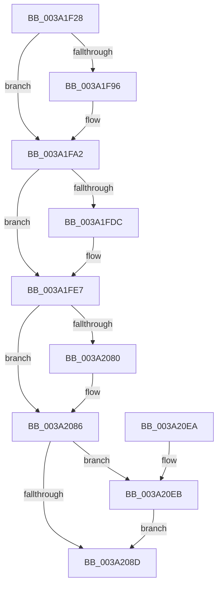

# KiTraceSetTimer2

- RVA: `0x003A1F28`–`0x003A20F3` (길이 `459` bytes)
- VA: `0x00000001403A1F28`
- 실행 섹션: `.text`
- PDB 이름 있음: `예`; PDB Function 태그: `아니요`
- unwind 정보 RVA: `0x00082044`
- 디코드: `125`개 명령, `459/459` bytes 표시
- 미해석 바이트: `0` (있으면 어셈블리에 `.byte`로 보존)

> 이 문서는 커널 이미지의 기계어와 PDB 기호를 분석해 생성했습니다. 4번과 5번은 함수 원형과 자료형을 바이너리 사용 방식에서 추정한 C 해석이며 원본 소스 복구 결과는 아닙니다.

## 1. Dependencies

- 직접 호출 지점: **5**; 고유 호출 대상: **5**
- 직접 호출자로 확인된 함수: **1**
- RIP 상대 이미지 참조: **4**

### Outgoing calls
- `0x003A1F8C` → [KiUpdateTimer2Flags](KiUpdateTimer2Flags_function_003A2100.md) (function, `0x003A2100`)
- `0x003A1F9D` → [KxReleaseSpinLock](../20/KxReleaseSpinLock_function_00206670.md) (function, `0x00206670`)
- `0x003A1FE2` → [KiTraceCancelTimer2](KiTraceCancelTimer2_function_003A378C.md) (function, `0x003A378C`)
- `0x003A20BD` → [EtwTraceKernelEvent](../23/EtwTraceKernelEvent_function_00235350.md) (function, `0x00235350`)
- `0x003A20C9` → [_security_check_cookie](../6A/_security_check_cookie_function_006AC640.md) (function, `0x006AC640`)

### Direct callers
- [KeSetTimer2](KeSetTimer2_function_003A08E0.md) at `0x003A0E89`

### Static image references
- `0x003A1F44` → RVA `0x00E0A740` (`.data`; read)
- `0x003A1F96` → RVA `0x00FCF600` (`CACHEALI`; read)
- `0x003A1FA2` → RVA `0x00FC6F78` (`ALMOSTRO`; read)
- `0x003A1FC6` → RVA `0x00FC7250` (`ALMOSTRO`; read)

## 2. Other-region calls and transfers

- 다른 실행 섹션으로 향하는 call: **0**
- 별도 외부 분기/꼬리 이동을 확인하지 못했습니다.

## 3. Assembly (complete function range)

```asm
003A1F28  48 89 5C 24 10                  mov qword ptr [rsp + 0x10], rbx
003A1F2D  48 89 74 24 20                  mov qword ptr [rsp + 0x20], rsi
003A1F32  55                              push rbp
003A1F33  57                              push rdi
003A1F34  41 54                           push r12
003A1F36  41 56                           push r14
003A1F38  41 57                           push r15
003A1F3A  48 8B EC                        mov rbp, rsp
003A1F3D  48 81 EC 80 00 00 00            sub rsp, 0x80
003A1F44  48 8B 05 F5 87 A6 00            mov rax, qword ptr [rip + 0xa687f5]
003A1F4B  48 33 C4                        xor rax, rsp
003A1F4E  48 89 45 F8                     mov qword ptr [rbp - 8], rax
003A1F52  48 8B 41 48                     mov rax, qword ptr [rcx + 0x48]
003A1F56  41 8B D8                        mov ebx, r8d
003A1F59  48 83 65 F0 00                  and qword ptr [rbp - 0x10], 0
003A1F5E  44 8A F2                        mov r14b, dl
003A1F61  48 8B 71 60                     mov rsi, qword ptr [rcx + 0x60]
003A1F65  45 33 C0                        xor r8d, r8d
003A1F68  4C 8B 79 68                     mov r15, qword ptr [rcx + 0x68]
003A1F6C  8B D3                           mov edx, ebx
003A1F6E  44 8A A1 81 00 00 00            mov r12b, byte ptr [rcx + 0x81]
003A1F75  48 8B F9                        mov rdi, rcx
003A1F78  48 89 45 C0                     mov qword ptr [rbp - 0x40], rax
003A1F7C  48 8B 41 50                     mov rax, qword ptr [rcx + 0x50]
003A1F80  48 89 45 C8                     mov qword ptr [rbp - 0x38], rax
003A1F84  48 8B 41 58                     mov rax, qword ptr [rcx + 0x58]
003A1F88  48 89 45 D0                     mov qword ptr [rbp - 0x30], rax
003A1F8C  E8 6F 01 00 00                  call 0x1403a2100
003A1F91  83 FB 01                        cmp ebx, 1
003A1F94  75 0C                           jne 0x1403a1fa2
003A1F96  48 8D 0D 63 D6 C2 00            lea rcx, [rip + 0xc2d663]
003A1F9D  E8 CE 46 E6 FF                  call 0x140206670
003A1FA2  48 8B 15 CF 4F C2 00            mov rdx, qword ptr [rip + 0xc24fcf]
003A1FA9  8B CA                           mov ecx, edx
003A1FAB  48 8B DA                        mov rbx, rdx
003A1FAE  48 33 DE                        xor rbx, rsi
003A1FB1  48 8B F2                        mov rsi, rdx
003A1FB4  49 33 F7                        xor rsi, r15
003A1FB7  48 D3 C3                        rol rbx, cl
003A1FBA  48 D3 C6                        rol rsi, cl
003A1FBD  48 33 DF                        xor rbx, rdi
003A1FC0  48 33 F7                        xor rsi, rdi
003A1FC3  48 0F CE                        bswap rsi
003A1FC6  48 33 35 83 52 C2 00            xor rsi, qword ptr [rip + 0xc25283]
003A1FCD  48 0F CB                        bswap rbx
003A1FD0  48 33 1D 79 52 C2 00            xor rbx, qword ptr [rip + 0xc25279]
003A1FD7  45 84 F6                        test r14b, r14b
003A1FDA  74 0B                           je 0x1403a1fe7
003A1FDC  48 8B D3                        mov rdx, rbx
003A1FDF  48 8B CF                        mov rcx, rdi
003A1FE2  E8 A5 17 00 00                  call 0x1403a378c
003A1FE7  48 33 35 62 52 C2 00            xor rsi, qword ptr [rip + 0xc25262]
003A1FEE  49 B9 77 72 DD F3 C7 C6 35 7E   movabs r9, 0x7e35c6c7f3dd7277
003A1FF8  4C 8B 05 79 4F C2 00            mov r8, qword ptr [rip + 0xc24f79]
003A1FFF  48 8B C7                        mov rax, rdi
003A2002  48 33 05 47 52 C2 00            xor rax, qword ptr [rip + 0xc25247]
003A2009  41 8B C8                        mov ecx, r8d
003A200C  48 0F C8                        bswap rax
003A200F  48 33 C3                        xor rax, rbx
003A2012  48 89 5D E0                     mov qword ptr [rbp - 0x20], rbx
003A2016  48 D3 C8                        ror rax, cl
003A2019  49 33 C0                        xor rax, r8
003A201C  49 0F AF C1                     imul rax, r9
003A2020  48 0F CE                        bswap rsi
003A2023  48 89 45 D8                     mov qword ptr [rbp - 0x28], rax
003A2027  48 33 F7                        xor rsi, rdi
003A202A  48 D3 CE                        ror rsi, cl
003A202D  41 8A C4                        mov al, r12b
003A2030  24 20                           and al, 0x20
003A2032  49 33 F0                        xor rsi, r8
003A2035  02 C0                           add al, al
003A2037  44 0F B6 C0                     movzx r8d, al
003A203B  49 0F AF F1                     imul rsi, r9
003A203F  41 8A C0                        mov al, r8b
003A2042  0C 04                           or al, 4
003A2044  48 89 75 E8                     mov qword ptr [rbp - 0x18], rsi
003A2048  0F B6 C8                        movzx ecx, al
003A204B  41 F6 C4 02                     test r12b, 2
003A204F  41 0F 44 C8                     cmove ecx, r8d
003A2053  44 0F B6 C1                     movzx r8d, cl
003A2057  41 8A C0                        mov al, r8b
003A205A  0C 08                           or al, 8
003A205C  41 F6 C4 04                     test r12b, 4
003A2060  0F B6 C8                        movzx ecx, al
003A2063  41 0F 44 C8                     cmove ecx, r8d
003A2067  0F B6 D1                        movzx edx, cl
003A206A  8A C2                           mov al, dl
003A206C  0C 10                           or al, 0x10
003A206E  41 F6 C4 08                     test r12b, 8
003A2072  0F B6 C8                        movzx ecx, al
003A2075  0F 44 CA                        cmove ecx, edx
003A2078  88 4D F0                        mov byte ptr [rbp - 0x10], cl
003A207B  48 85 DB                        test rbx, rbx
003A207E  74 06                           je 0x1403a2086
003A2080  80 C9 01                        or cl, 1
003A2083  88 4D F0                        mov byte ptr [rbp - 0x10], cl
003A2086  48 83 7D D0 00                  cmp qword ptr [rbp - 0x30], 0
003A208B  75 5E                           jne 0x1403a20eb
003A208D  83 65 BC 00                     and dword ptr [rbp - 0x44], 0
003A2091  48 8D 45 C0                     lea rax, [rbp - 0x40]
003A2095  41 B9 68 0F 00 00               mov r9d, 0xf68
003A209B  48 89 45 B0                     mov qword ptr [rbp - 0x50], rax
003A209F  BA 01 00 00 00                  mov edx, 1
003A20A4  C7 45 B8 38 00 00 00            mov dword ptr [rbp - 0x48], 0x38
003A20AB  41 B8 00 00 02 40               mov r8d, 0x40020000
003A20B1  C7 44 24 20 02 1B 60 00         mov dword ptr [rsp + 0x20], 0x601b02
003A20B9  48 8D 4D B0                     lea rcx, [rbp - 0x50]
003A20BD  E8 8E 32 E9 FF                  call 0x140235350
003A20C2  48 8B 4D F8                     mov rcx, qword ptr [rbp - 8]
003A20C6  48 33 CC                        xor rcx, rsp
003A20C9  E8 72 A5 30 00                  call 0x1406ac640
003A20CE  4C 8D 9C 24 80 00 00 00         lea r11, [rsp + 0x80]
003A20D6  49 8B 5B 38                     mov rbx, qword ptr [r11 + 0x38]
003A20DA  49 8B 73 48                     mov rsi, qword ptr [r11 + 0x48]
003A20DE  49 8B E3                        mov rsp, r11
003A20E1  41 5F                           pop r15
003A20E3  41 5E                           pop r14
003A20E5  41 5C                           pop r12
003A20E7  5F                              pop rdi
003A20E8  5D                              pop rbp
003A20E9  C3                              ret
003A20EA  CC                              int3
003A20EB  80 C9 02                        or cl, 2
003A20EE  88 4D F0                        mov byte ptr [rbp - 0x10], cl
003A20F1  EB 9A                           jmp 0x1403a208d
```

## 4. C-style interpretation (structured pseudocode)

```c
__int64 __fastcall KiTraceSetTimer2(__int64 a1, unsigned __int8 a2, int a3)
{
    __int64 result;
    __int64 v_rbx;
    __int64 v_rsi;
    __int64 v_rsp;
    unsigned __int64 v_stack_m28;
    unsigned __int64 v_stack_m30;
    unsigned __int64 v_stack_m38;
    unsigned __int64 v_stack_m40;
    unsigned __int64 v_stack_m48;
    unsigned __int64 v_stack_m50;
    unsigned __int64 v_stack_m58;
    unsigned __int64 v_stack_m60;
    unsigned __int64 v_stack_m68;
    unsigned int v_stack_m6C;
    unsigned int v_stack_m70;
    unsigned __int64 v_stack_m78;
    unsigned int v_stack_m88;
    unsigned __int64 v_stack_p10;
    unsigned __int64 v_stack_p20;

    v_stack_p10 = v_rbx;
    v_stack_p20 = v_rsi;
    v_rsp = (v_rsp) - (128);
    result = (*(unsigned __int64 *)(v_rip + 10913781)) ^ (v_rsp);
    v_stack_m30 = result;
    a3 = 0;
    v_stack_m68 = *(unsigned __int64 *)(a1 + 72);
    v_stack_m60 = *(unsigned __int64 *)(a1 + 80);
    v_stack_m58 = *(unsigned __int64 *)(a1 + 88);
    result = KiUpdateTimer2Flags(a1, (unsigned int)((unsigned int)((unsigned int)(a3))), a3, a4);
    if (((unsigned int)((unsigned int)(a3))) == 1) {
        a1 = v_rip + 12768867;
        result = KxReleaseSpinLock(a1, (unsigned int)((unsigned int)((unsigned int)(a3))), a3, a4);
    }
    v_rbx = (*(unsigned __int64 *)(v_rip + 12734415)) ^ (*(unsigned __int64 *)(a1 + 96));
    v_rsi = (*(unsigned __int64 *)(v_rip + 12734415)) ^ (*(unsigned __int64 *)(a1 + 104));
    v_rbx = (v_rbx) ^ (a1);
    v_rsi = (v_rsi) ^ (a1);
    v_rsi = (v_rsi) ^ (*(unsigned __int64 *)(v_rip + 12735107));
    v_rbx = (v_rbx) ^ (*(unsigned __int64 *)(v_rip + 12735097));
    if (a2 != 0) {
        a2 = v_rbx;
        a1 = a1;
        result = KiTraceCancelTimer2(a1, a2, a3, a4);
    }
    v_rsi = (v_rsi) ^ (*(unsigned __int64 *)(v_rip + 12735074));
    result = (a1) ^ (*(unsigned __int64 *)(v_rip + 12735047));
    result = (result) ^ (v_rbx);
    v_stack_m48 = v_rbx;
    result = (result) ^ (*(unsigned __int64 *)(v_rip + 12734329));
    result = (result) * (a4);
    v_stack_m50 = result;
    v_rsi = (v_rsi) ^ (a1);
    result = (unsigned __int8)(((unsigned __int8)(*(unsigned __int8 *)(a1 + 129))) & (32));
    v_rsi = (v_rsi) ^ (*(unsigned __int64 *)(v_rip + 12734329));
    result = (unsigned __int8)((result) + ((unsigned __int8)(result)));
    v_rsi = (v_rsi) * (a4);
    result = (unsigned __int8)(((unsigned __int8)((unsigned __int8)(result))) | (4));
    v_stack_m40 = v_rsi;
    a1 = (unsigned __int8)(result);
    if ((((unsigned __int8)(*(unsigned __int8 *)(a1 + 129))) & (2)) == 0) { a1 = (unsigned int)((unsigned __int8)(result)); }
    result = (unsigned __int8)(((unsigned __int8)((unsigned __int8)(a1))) | (8));
    a1 = (unsigned __int8)(result);
    if ((((unsigned __int8)(*(unsigned __int8 *)(a1 + 129))) & (4)) == 0) { a1 = (unsigned int)((unsigned __int8)(a1)); }
    result = (unsigned __int8)(((unsigned __int8)((unsigned __int8)(a1))) | (16));
    a1 = (unsigned __int8)(result);
    if ((((unsigned __int8)(*(unsigned __int8 *)(a1 + 129))) & (8)) == 0) { a1 = (unsigned int)((unsigned __int8)(a1)); }
    v_stack_m38 = (unsigned __int8)(a1);
    if (v_rbx != 0) {
        a1 = (unsigned __int8)((a1) | (1));
        v_stack_m38 = (unsigned __int8)(a1);
    }
    if (v_stack_m58 != 0) goto loc_003A20EB;
loc_003A208D:
    v_stack_m78 = v_stack_m68;
    v_stack_m70 = 56;
    v_stack_m88 = 0x601B02ULL;
    result = EtwTraceKernelEvent(v_stack_m78, 1, (unsigned int)(0x40020000ULL), (unsigned int)(0xF68ULL));
    a1 = (v_stack_m30) ^ (v_rsp);
    result = _security_check_cookie(a1, 1, (unsigned int)(0x40020000ULL), (unsigned int)(0xF68ULL));
    return result;
loc_003A20EB:
    a1 = (unsigned __int8)((a1) | (2));
    v_stack_m38 = (unsigned __int8)(a1);
    goto loc_003A208D;
}
```

## 5. (Beta) C Style

```c
int64_t KiTraceSetTimer2(void *Arg1, uint8_t Arg2, int32_t Arg3)
{
    uint8_t *arg1 = (uint8_t *)Arg1;

    int64_t result;
    int64_t local_rbx;
    int64_t local_rsi;
    int64_t local_rsp;
    uint64_t v_stack_m28;
    uint64_t v_stack_m30;
    uint64_t v_stack_m38;
    uint64_t v_stack_m40;
    uint64_t v_stack_m48;
    uint64_t v_stack_m50;
    uint64_t v_stack_m58;
    uint64_t v_stack_m60;
    uint64_t v_stack_m68;
    uint32_t v_stack_m6C;
    uint32_t v_stack_m70;
    uint64_t v_stack_m78;
    uint32_t v_stack_m88;
    uint64_t v_stack_p10;
    uint64_t v_stack_p20;

    v_stack_p10 = local_rbx;
    v_stack_p20 = local_rsi;
    local_rsp = (local_rsp) - (128);
    result = (*(uint64_t *)(v_rip + 0xA687F5)) ^ (local_rsp);
    v_stack_m30 = result;
    Arg3 = 0;
    v_stack_m68 = *(uint64_t *)(arg1 + 0x48);
    v_stack_m60 = *(uint64_t *)(arg1 + 0x50);
    v_stack_m58 = *(uint64_t *)(arg1 + 0x58);
    result = KiUpdateTimer2Flags(Arg1, (uint32_t)((uint32_t)((uint32_t)(Arg3))), Arg3, a4);
    if (((uint32_t)((uint32_t)(Arg3))) == 1) {
        Arg1 = v_rip + 12768867;
        result = KxReleaseSpinLock(Arg1, (uint32_t)((uint32_t)((uint32_t)(Arg3))), Arg3, a4);
    }
    local_rbx = (*(uint64_t *)(v_rip + 0xC24FCF)) ^ (*(uint64_t *)(arg1 + 0x60));
    local_rsi = (*(uint64_t *)(v_rip + 0xC24FCF)) ^ (*(uint64_t *)(arg1 + 0x68));
    local_rbx = (local_rbx) ^ (Arg1);
    local_rsi = (local_rsi) ^ (Arg1);
    local_rsi = (local_rsi) ^ (*(uint64_t *)(v_rip + 0xC25283));
    local_rbx = (local_rbx) ^ (*(uint64_t *)(v_rip + 0xC25279));
    if (Arg2 != 0) {
        Arg2 = local_rbx;
        Arg1 = Arg1;
        result = KiTraceCancelTimer2(Arg1, Arg2, Arg3, a4);
    }
    local_rsi = (local_rsi) ^ (*(uint64_t *)(v_rip + 0xC25262));
    result = (Arg1) ^ (*(uint64_t *)(v_rip + 0xC25247));
    result = (result) ^ (local_rbx);
    v_stack_m48 = local_rbx;
    result = (result) ^ (*(uint64_t *)(v_rip + 0xC24F79));
    result = (result) * (a4);
    v_stack_m50 = result;
    local_rsi = (local_rsi) ^ (Arg1);
    result = (uint8_t)(((uint8_t)(*(uint8_t *)(arg1 + 0x81))) & (32));
    local_rsi = (local_rsi) ^ (*(uint64_t *)(v_rip + 0xC24F79));
    result = (uint8_t)((result) + ((uint8_t)(result)));
    local_rsi = (local_rsi) * (a4);
    result = (uint8_t)(((uint8_t)((uint8_t)(result))) | (4));
    v_stack_m40 = local_rsi;
    Arg1 = (uint8_t)(result);
    if ((((uint8_t)(*(uint8_t *)(arg1 + 0x81))) & (2)) == 0) { Arg1 = (uint32_t)((uint8_t)(result)); }
    result = (uint8_t)(((uint8_t)((uint8_t)(Arg1))) | (8));
    Arg1 = (uint8_t)(result);
    if ((((uint8_t)(*(uint8_t *)(arg1 + 0x81))) & (4)) == 0) { Arg1 = (uint32_t)((uint8_t)(Arg1)); }
    result = (uint8_t)(((uint8_t)((uint8_t)(Arg1))) | (16));
    Arg1 = (uint8_t)(result);
    if ((((uint8_t)(*(uint8_t *)(arg1 + 0x81))) & (8)) == 0) { Arg1 = (uint32_t)((uint8_t)(Arg1)); }
    v_stack_m38 = (uint8_t)(Arg1);
    if (local_rbx != 0) {
        Arg1 = (uint8_t)((Arg1) | (1));
        v_stack_m38 = (uint8_t)(Arg1);
    }
    if (v_stack_m58 != 0) goto loc_003A20EB;
loc_003A208D:
    v_stack_m78 = v_stack_m68;
    v_stack_m70 = 56;
    v_stack_m88 = 0x601B02ULL;
    result = EtwTraceKernelEvent(v_stack_m78, 1, (uint32_t)(0x40020000ULL), (uint32_t)(0xF68ULL));
    Arg1 = (v_stack_m30) ^ (local_rsp);
    result = _security_check_cookie(Arg1, 1, (uint32_t)(0x40020000ULL), (uint32_t)(0xF68ULL));
    return result;
loc_003A20EB:
    Arg1 = (uint8_t)((Arg1) | (2));
    v_stack_m38 = (uint8_t)(Arg1);
    goto loc_003A208D;
}
```

### 관측된 메모리 오프셋

구조체 형식이 확인되지 않은 접근은 인자 기준의 오프셋으로만 기록했습니다.

| 기준 인자 | 오프셋 표현 | 폭 (bit) | 접근 |
|---|---:|---:|---|
| `Arg1` | `+ 0x48` | `64` | `R` |
| `Arg1` | `+ 0x50` | `64` | `R` |
| `Arg1` | `+ 0x58` | `64` | `R` |
| `Arg1` | `+ 0x60` | `64` | `R` |
| `Arg1` | `+ 0x68` | `64` | `R` |
| `Arg1` | `+ 0x81` | `8` | `R` |

## 6. Execution-region graph

[열기: 2D/3D 그래프와 함수 탐색 컨트롤 패널](../../../control-panel.html?section=text&rva=0x003A1F28&view=graph)

- 2D 그래프는 위에서 아래로 흐르고, 3D 그래프는 빈 공간을 드래그해 회전합니다. Shift+드래그는 이동, 휠은 확대·축소, 함수 노드 선택은 대상 보고서 이동입니다.

### Static fallback


