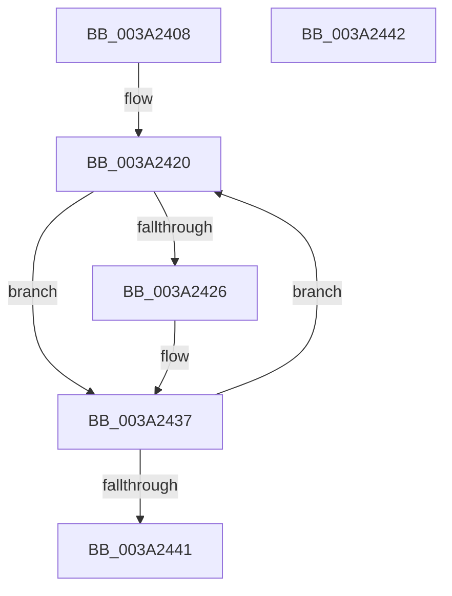

# KiUpdateTimer2Collections

- RVA: `0x003A2408`–`0x003A2443` (길이 `59` bytes)
- VA: `0x00000001403A2408`
- 실행 섹션: `.text`
- PDB 이름 있음: `예`; PDB Function 태그: `아니요`
- unwind 정보 RVA: `0x000DB714`
- 디코드: `15`개 명령, `59/59` bytes 표시
- 미해석 바이트: `0` (있으면 어셈블리에 `.byte`로 보존)

> 이 문서는 커널 이미지의 기계어와 PDB 기호를 분석해 생성했습니다. 4번과 5번은 함수 원형과 자료형을 바이너리 사용 방식에서 추정한 C 해석이며 원본 소스 복구 결과는 아닙니다.

## 1. Dependencies

- 직접 호출 지점: **0**; 고유 호출 대상: **0**
- 직접 호출자로 확인된 함수: **2**
- RIP 상대 이미지 참조: **1**

### Outgoing calls
- 직접 디코드된 call 명령이 없습니다.

### Direct callers
- [KeSetTimer2](KeSetTimer2_function_003A08E0.md) at `0x003A0ECD`
- [KeSetTimer2](KeSetTimer2_function_003A08E0.md) at `0x003A0F3B`
- [KiExpireTimer2](KiExpireTimer2_function_003A24E0.md) at `0x003A27F2`

### Static image references
- `0x003A240F` → RVA `0x00011301` (`.rdata`; read)

## 2. Other-region calls and transfers

- 다른 실행 섹션으로 향하는 call: **0**
- 별도 외부 분기/꼬리 이동을 확인하지 못했습니다.

## 3. Assembly (complete function range)

```asm
003A2408  44 8A 81 81 00 00 00            mov r8b, byte ptr [rcx + 0x81]
003A240F  48 8D 15 EB EE C6 FF            lea rdx, [rip - 0x391115]
003A2416  41 80 E0 3E                     and r8b, 0x3e
003A241A  41 B9 09 00 00 00               mov r9d, 9
003A2420  44 38 42 FF                     cmp byte ptr [rdx - 1], r8b
003A2424  75 11                           jne 0x1403a2437
003A2426  8A 02                           mov al, byte ptr [rdx]
003A2428  88 81 82 00 00 00               mov byte ptr [rcx + 0x82], al
003A242E  8A 42 01                        mov al, byte ptr [rdx + 1]
003A2431  88 81 83 00 00 00               mov byte ptr [rcx + 0x83], al
003A2437  48 83 C2 03                     add rdx, 3
003A243B  49 83 E9 01                     sub r9, 1
003A243F  75 DF                           jne 0x1403a2420
003A2441  C3                              ret
003A2442  CC                              int3
```

## 4. C-style interpretation (structured pseudocode)

```c
__int64 __fastcall KiUpdateTimer2Collections(__int64 a1)
{
    __int64 result;

    a3 = (unsigned __int8)((*(unsigned __int8 *)(a1 + 129)) & (62));
loc_003A2420:
    if ((*(unsigned __int8 *)(v_rip - 3739925 - 1)) == ((unsigned __int8)(a3))) {
        result = *(unsigned __int8 *)(v_rip - 3739925);
        *(unsigned __int8 *)(a1 + 130) = (unsigned __int8)(result);
        result = *(unsigned __int8 *)(v_rip - 3739925 + 1);
        *(unsigned __int8 *)(a1 + 131) = (unsigned __int8)(result);
    }
    a2 = (v_rip - 3739925) + (3);
    a4 = (9) - (1);
    if (condition_is_not_equal) goto loc_003A2420;
    return result;
}
```

## 5. (Beta) C Style

```c
int64_t KiUpdateTimer2Collections(void *Arg1)
{
    uint8_t *arg1 = (uint8_t *)Arg1;

    int64_t result;

    a3 = (uint8_t)((*(uint8_t *)(arg1 + 0x81)) & (62));
loc_003A2420:
    if ((*(uint8_t *)(v_rip - 0x391115 - 0x1)) == ((uint8_t)(a3))) {
        result = *(uint8_t *)(v_rip - 0x391115);
        *(uint8_t *)(arg1 + 0x82) = (uint8_t)(result);
        result = *(uint8_t *)(v_rip - 0x391115 + 0x1);
        *(uint8_t *)(arg1 + 0x83) = (uint8_t)(result);
    }
    a2 = (v_rip - 3739925) + (3);
    a4 = (9) - (1);
    if (condition_is_not_equal) goto loc_003A2420;
    return result;
}
```

### 관측된 메모리 오프셋

구조체 형식이 확인되지 않은 접근은 인자 기준의 오프셋으로만 기록했습니다.

| 기준 인자 | 오프셋 표현 | 폭 (bit) | 접근 |
|---|---:|---:|---|
| `Arg1` | `+ 0x81` | `8` | `R` |
| `Arg1` | `+ 0x82` | `8` | `W` |
| `Arg1` | `+ 0x83` | `8` | `W` |

## 6. Execution-region graph

[열기: 2D/3D 그래프와 함수 탐색 컨트롤 패널](../../../control-panel.html?section=text&rva=0x003A2408&view=graph)

- 2D 그래프는 위에서 아래로 흐르고, 3D 그래프는 빈 공간을 드래그해 회전합니다. Shift+드래그는 이동, 휠은 확대·축소, 함수 노드 선택은 대상 보고서 이동입니다.

### Static fallback


