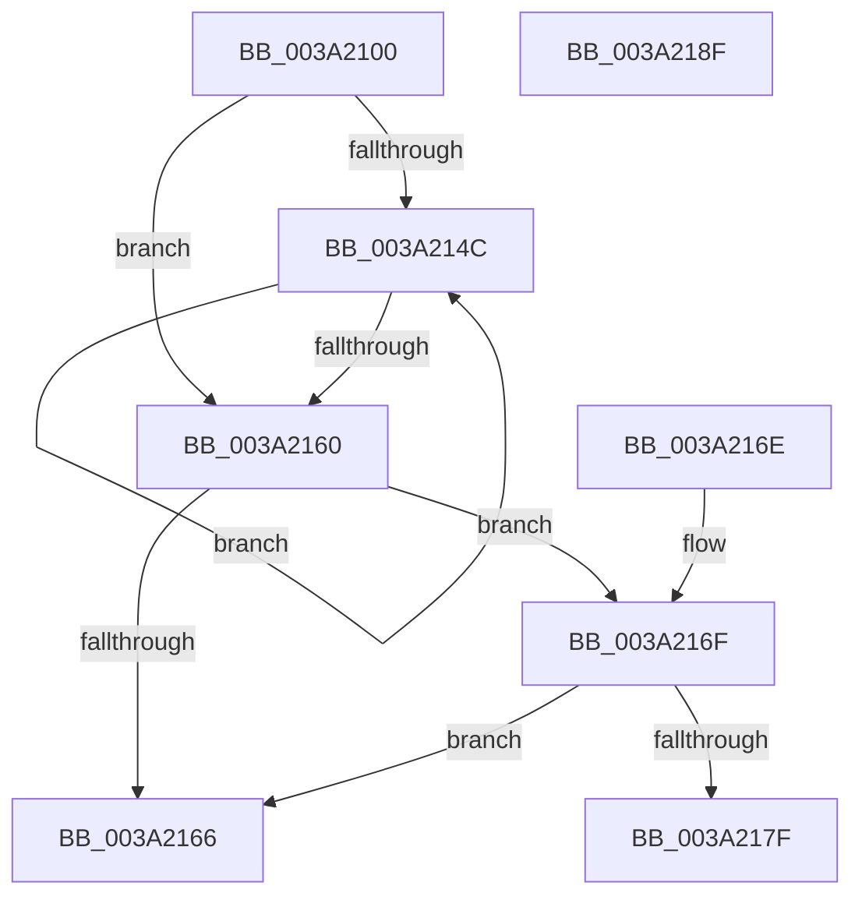

# KiUpdateTimer2Flags

- RVA: `0x003A2100`–`0x003A2190` (길이 `144` bytes)
- VA: `0x00000001403A2100`
- 실행 섹션: `.text`
- PDB 이름 있음: `예`; PDB Function 태그: `아니요`
- unwind 정보 RVA: `0x00082068`
- 디코드: `47`개 명령, `144/144` bytes 표시
- 미해석 바이트: `0` (있으면 어셈블리에 `.byte`로 보존)

> 이 문서는 커널 이미지의 기계어와 PDB 기호를 분석해 생성했습니다. 4번과 5번은 함수 원형과 자료형을 바이너리 사용 방식에서 추정한 C 해석이며 원본 소스 복구 결과는 아닙니다.

## 1. Dependencies

- 직접 호출 지점: **1**; 고유 호출 대상: **1**
- 직접 호출자로 확인된 함수: **4**
- RIP 상대 이미지 참조: **0**

### Outgoing calls
- `0x003A2182` → [KiFinalizeTimer2Disablement](KiFinalizeTimer2Disablement_function_003A2198.md) (function, `0x003A2198`)

### Direct callers
- [KeDisableTimer2](../39/KeDisableTimer2_function_0039FD58.md) at `0x0039FEE0`
- [KeCancelTimer2](KeCancelTimer2_function_003A01E0.md) at `0x003A0272`
- [sub_003A1A0C](Unknown_function_003A1A0C.md) at `0x003A1C0A`
- [KiTraceSetTimer2](KiTraceSetTimer2_function_003A1F28.md) at `0x003A1F8C`

### Static image references
- 디코드된 RIP-relative 메모리 참조가 없습니다.

## 2. Other-region calls and transfers

- 다른 실행 섹션으로 향하는 call: **0**
- 별도 외부 분기/꼬리 이동을 확인하지 못했습니다.

## 3. Assembly (complete function range)

```asm
003A2100  40 53                           push rbx
003A2102  48 83 EC 20                     sub rsp, 0x20
003A2106  44 8B 11                        mov r10d, dword ptr [rcx]
003A2109  8B DA                           mov ebx, edx
003A210B  45 8B C8                        mov r9d, r8d
003A210E  4C 8B D9                        mov r11, rcx
003A2111  41 F7 D1                        not r9d
003A2114  41 8B C2                        mov eax, r10d
003A2117  41 83 E1 01                     and r9d, 1
003A211B  41 83 C1 1E                     add r9d, 0x1e
003A211F  41 C1 E1 07                     shl r9d, 7
003A2123  41 8B D1                        mov edx, r9d
003A2126  81 E2 FF F0 FF FF               and edx, 0xfffff0ff
003A212C  41 F6 C0 02                     test r8b, 2
003A2130  41 0F 44 D1                     cmove edx, r9d
003A2134  C1 E3 08                        shl ebx, 8
003A2137  F7 D2                           not edx
003A2139  44 8B CA                        mov r9d, edx
003A213C  45 23 CA                        and r9d, r10d
003A213F  44 0B CB                        or r9d, ebx
003A2142  F0 44 0F B1 09                  lock cmpxchg dword ptr [rcx], r9d
003A2147  44 3B D0                        cmp r10d, eax
003A214A  74 14                           je 0x1403a2160
003A214C  44 8B CA                        mov r9d, edx
003A214F  8B C8                           mov ecx, eax
003A2151  44 23 C8                        and r9d, eax
003A2154  44 0B CB                        or r9d, ebx
003A2157  F0 45 0F B1 0B                  lock cmpxchg dword ptr [r11], r9d
003A215C  3B C8                           cmp ecx, eax
003A215E  75 EC                           jne 0x1403a214c
003A2160  41 F6 C0 04                     test r8b, 4
003A2164  75 09                           jne 0x1403a216f
003A2166  32 C0                           xor al, al
003A2168  48 83 C4 20                     add rsp, 0x20
003A216C  5B                              pop rbx
003A216D  C3                              ret
003A216E  CC                              int3
003A216F  41 81 E1 00 3F 00 00            and r9d, 0x3f00
003A2176  41 81 F9 00 20 00 00            cmp r9d, 0x2000
003A217D  75 E7                           jne 0x1403a2166
003A217F  49 8B CB                        mov rcx, r11
003A2182  E8 11 00 00 00                  call 0x1403a2198
003A2187  B0 01                           mov al, 1
003A2189  48 83 C4 20                     add rsp, 0x20
003A218D  5B                              pop rbx
003A218E  C3                              ret
003A218F  CC                              int3
```

## 4. C-style interpretation (structured pseudocode)

```c
__int64 __fastcall KiUpdateTimer2Flags(__int64 a1, int a2, int a3)
{
    __int64 result;
    __int64 v_rbx;
    __int64 v_rsp;

    v_rsp = (v_rsp) - (32);
    a4 = (unsigned int)(~((unsigned int)(a3)));
    a4 = (unsigned int)((a4) & (1));
    a4 = (unsigned int)((a4) + (30));
    a4 = (unsigned int)((a4) << (7));
    a2 = (unsigned int)(((unsigned int)((unsigned int)(a4))) & (0xFFFFF0FFULL));
    if ((((unsigned __int8)(a3)) & (2)) == 0) { a2 = (unsigned int)(a4); }
    v_rbx = (unsigned int)(((unsigned int)(a2)) << (8));
    a2 = (unsigned int)(~(a2));
    a4 = (unsigned int)(((unsigned int)(a2)) & ((unsigned int)((unsigned int)(*(unsigned int *)(a1)))));
    a4 = (unsigned int)((a4) | ((unsigned int)(v_rbx)));
    if (((unsigned int)((unsigned int)(*(unsigned int *)(a1)))) == ((unsigned int)((unsigned int)((unsigned int)((unsigned int)(*(unsigned int *)(a1))))))) goto loc_003A2160;
loc_003A214C:
    a4 = (unsigned int)(((unsigned int)(a2)) & ((unsigned int)((unsigned int)((unsigned int)((unsigned int)(*(unsigned int *)(a1)))))));
    a4 = (unsigned int)((a4) | ((unsigned int)(v_rbx)));
    if (((unsigned int)((unsigned int)((unsigned int)((unsigned int)((unsigned int)((unsigned int)(*(unsigned int *)(a1)))))))) != ((unsigned int)((unsigned int)((unsigned int)((unsigned int)(*(unsigned int *)(a1))))))) goto loc_003A214C;
loc_003A2160:
    if ((((unsigned __int8)(a3)) & (4)) != 0) goto loc_003A216F;
loc_003A2166:
    result = 0;
    v_rsp = (v_rsp) + (32);
    return result;
loc_003A216F:
    a4 = (unsigned int)((a4) & (0x3F00ULL));
    if (((unsigned int)(a4)) != 0x2000ULL) goto loc_003A2166;
    result = KiFinalizeTimer2Disablement(a1, a2, a3, a4);
    v_rsp = (v_rsp) + (32);
    return 1;
}
```

## 5. (Beta) C Style

```c
int64_t KiUpdateTimer2Flags(void *Arg1, int32_t Arg2, int32_t Arg3)
{
    uint8_t *arg1 = (uint8_t *)Arg1;

    int64_t result;
    int64_t local_rbx;
    int64_t local_rsp;

    local_rsp = (local_rsp) - (32);
    a4 = (uint32_t)(~((uint32_t)(Arg3)));
    a4 = (uint32_t)((a4) & (1));
    a4 = (uint32_t)((a4) + (30));
    a4 = (uint32_t)((a4) << (7));
    Arg2 = (uint32_t)(((uint32_t)((uint32_t)(a4))) & (0xFFFFF0FFULL));
    if ((((uint8_t)(Arg3)) & (2)) == 0) { Arg2 = (uint32_t)(a4); }
    local_rbx = (uint32_t)(((uint32_t)(Arg2)) << (8));
    Arg2 = (uint32_t)(~(Arg2));
    a4 = (uint32_t)(((uint32_t)(Arg2)) & ((uint32_t)((uint32_t)(*(uint32_t *)(arg1)))));
    a4 = (uint32_t)((a4) | ((uint32_t)(local_rbx)));
    if (((uint32_t)((uint32_t)(*(uint32_t *)(arg1)))) == ((uint32_t)((uint32_t)((uint32_t)((uint32_t)(*(uint32_t *)(arg1))))))) goto loc_003A2160;
loc_003A214C:
    a4 = (uint32_t)(((uint32_t)(Arg2)) & ((uint32_t)((uint32_t)((uint32_t)((uint32_t)(*(uint32_t *)(arg1)))))));
    a4 = (uint32_t)((a4) | ((uint32_t)(local_rbx)));
    if (((uint32_t)((uint32_t)((uint32_t)((uint32_t)((uint32_t)((uint32_t)(*(uint32_t *)(arg1)))))))) != ((uint32_t)((uint32_t)((uint32_t)((uint32_t)(*(uint32_t *)(arg1))))))) goto loc_003A214C;
loc_003A2160:
    if ((((uint8_t)(Arg3)) & (4)) != 0) goto loc_003A216F;
loc_003A2166:
    result = 0;
    local_rsp = (local_rsp) + (32);
    return result;
loc_003A216F:
    a4 = (uint32_t)((a4) & (0x3F00ULL));
    if (((uint32_t)(a4)) != 0x2000ULL) goto loc_003A2166;
    result = KiFinalizeTimer2Disablement(Arg1, Arg2, Arg3, a4);
    local_rsp = (local_rsp) + (32);
    return 1;
}
```

### 관측된 메모리 오프셋

구조체 형식이 확인되지 않은 접근은 인자 기준의 오프셋으로만 기록했습니다.

| 기준 인자 | 오프셋 표현 | 폭 (bit) | 접근 |
|---|---:|---:|---|
| `Arg1` | `+ 0x0` | `32` | `R` |

## 6. Execution-region graph

[열기: 2D/3D 그래프와 함수 탐색 컨트롤 패널](../../../control-panel.html?section=text&rva=0x003A2100&view=graph)

- 2D 그래프는 위에서 아래로 흐르고, 3D 그래프는 빈 공간을 드래그해 회전합니다. Shift+드래그는 이동, 휠은 확대·축소, 함수 노드 선택은 대상 보고서 이동입니다.

### Static fallback


