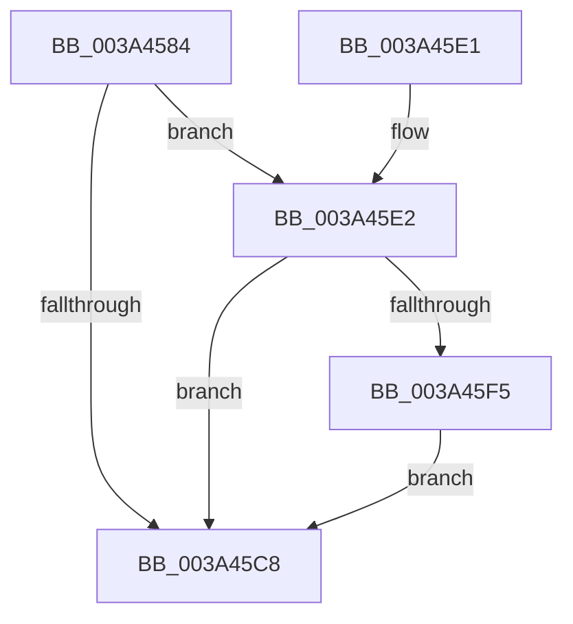

# MiStoreAttemptContractPageFile

- RVA: `0x003A4584`–`0x003A4686` (길이 `258` bytes)
- VA: `0x00000001403A4584`
- 실행 섹션: `.text`
- PDB 이름 있음: `예`; PDB Function 태그: `아니요`
- unwind 정보 RVA: `0x00082458`
- 디코드: `64`개 명령, `258/258` bytes 표시
- 미해석 바이트: `0` (있으면 어셈블리에 `.byte`로 보존)

> 이 문서는 커널 이미지의 기계어와 PDB 기호를 분석해 생성했습니다. 4번과 5번은 함수 원형과 자료형을 바이너리 사용 방식에서 추정한 C 해석이며 원본 소스 복구 결과는 아닙니다.

## 1. Dependencies

- 직접 호출 지점: **6**; 고유 호출 대상: **6**
- 직접 호출자로 확인된 함수: **1**
- RIP 상대 이미지 참조: **2**

### Outgoing calls
- `0x003A45AC` → [memset](../6C/memset_function_006C6C40.md) (function, `0x006C6C40`)
- `0x003A45BF` → [MiStoreCheckContractPageFile](MiStoreCheckContractPageFile_function_003A468C.md) (function, `0x003A468C`)
- `0x003A45EC` → [ExAcquireRundownProtection](../21/ExAcquireRundownProtection_function_00216620.md) (function, `0x00216620`)
- `0x003A465D` → [KeInsertQueueApc](../20/KeInsertQueueApc_function_00203F10.md) (function, `0x00203F10`)
- `0x003A4674` → [KeWaitForSingleObject](../20/KeWaitForSingleObject_function_0020E6B0.md) (function, `0x0020E6B0`)
- `0x003A467C` → [ExReleaseRundownProtection](../34/ExReleaseRundownProtection_function_00349E80.md) (function, `0x00349E80`)

### Direct callers
- [MiStoreEvictThread](MiStoreEvictThread_function_003A42D0.md) at `0x003A4559`

### Static image references
- `0x003A4635` → RVA `0x0049E550` (`EmpCheckErrataList`; read)
- `0x003A4640` → RVA `0x003A4710` (`MiStoreContractVirtualPagefileApc`; read)

## 2. Other-region calls and transfers

- 다른 실행 섹션으로 향하는 call: **0**
- 별도 외부 분기/꼬리 이동을 확인하지 못했습니다.

## 3. Assembly (complete function range)

```asm
003A4584  48 8B C4                        mov rax, rsp
003A4587  48 89 58 08                     mov qword ptr [rax + 8], rbx
003A458B  48 89 70 10                     mov qword ptr [rax + 0x10], rsi
003A458F  48 89 78 18                     mov qword ptr [rax + 0x18], rdi
003A4593  55                              push rbp
003A4594  48 8D 68 A1                     lea rbp, [rax - 0x5f]
003A4598  48 81 EC B0 00 00 00            sub rsp, 0xb0
003A459F  33 D2                           xor edx, edx
003A45A1  48 8B D9                        mov rbx, rcx
003A45A4  48 8D 4D F7                     lea rcx, [rbp - 9]
003A45A8  44 8D 42 58                     lea r8d, [rdx + 0x58]
003A45AC  E8 8F 26 32 00                  call 0x1406c6c40
003A45B1  48 8B B3 D8 00 00 00            mov rsi, qword ptr [rbx + 0xd8]
003A45B8  48 8B CB                        mov rcx, rbx
003A45BB  C6 45 DA 00                     mov byte ptr [rbp - 0x26], 0
003A45BF  E8 C8 00 00 00                  call 0x1403a468c
003A45C4  85 C0                           test eax, eax
003A45C6  75 1A                           jne 0x1403a45e2
003A45C8  4C 8D 9C 24 B0 00 00 00         lea r11, [rsp + 0xb0]
003A45D0  49 8B 5B 10                     mov rbx, qword ptr [r11 + 0x10]
003A45D4  49 8B 73 18                     mov rsi, qword ptr [r11 + 0x18]
003A45D8  49 8B 7B 20                     mov rdi, qword ptr [r11 + 0x20]
003A45DC  49 8B E3                        mov rsp, r11
003A45DF  5D                              pop rbp
003A45E0  C3                              ret
003A45E1  CC                              int3
003A45E2  48 8D BE E8 03 00 00            lea rdi, [rsi + 0x3e8]
003A45E9  48 8B CF                        mov rcx, rdi
003A45EC  E8 2F 20 E7 FF                  call 0x140216620
003A45F1  84 C0                           test al, al
003A45F3  74 D3                           je 0x1403a45c8
003A45F5  66 83 65 D7 00                  and word ptr [rbp - 0x29], 0
003A45FA  48 8D 45 DF                     lea rax, [rbp - 0x21]
003A45FE  83 65 DB 00                     and dword ptr [rbp - 0x25], 0
003A4602  48 8D 55 D7                     lea rdx, [rbp - 0x29]
003A4606  48 89 45 E7                     mov qword ptr [rbp - 0x19], rax
003A460A  48 8D 4D F7                     lea rcx, [rbp - 9]
003A460E  48 8D 45 DF                     lea rax, [rbp - 0x21]
003A4612  C6 45 D9 06                     mov byte ptr [rbp - 0x27], 6
003A4616  48 89 45 DF                     mov qword ptr [rbp - 0x21], rax
003A461A  45 33 C9                        xor r9d, r9d
003A461D  48 8B 86 E0 03 00 00            mov rax, qword ptr [rsi + 0x3e0]
003A4624  45 33 C0                        xor r8d, r8d
003A4627  66 83 65 47 00                  and word ptr [rbp + 0x47], 0
003A462C  48 83 65 1F 00                  and qword ptr [rbp + 0x1f], 0
003A4631  48 89 45 FF                     mov qword ptr [rbp - 1], rax
003A4635  48 8D 05 14 9F 0F 00            lea rax, [rip + 0xf9f14]
003A463C  48 89 45 17                     mov qword ptr [rbp + 0x17], rax
003A4640  48 8D 05 C9 00 00 00            lea rax, [rip + 0xc9]
003A4647  48 89 45 27                     mov qword ptr [rbp + 0x27], rax
003A464B  66 C7 45 F7 12 00               mov word ptr [rbp - 9], 0x12
003A4651  C6 45 F9 58                     mov byte ptr [rbp - 7], 0x58
003A4655  48 89 5D 2F                     mov qword ptr [rbp + 0x2f], rbx
003A4659  C6 45 49 00                     mov byte ptr [rbp + 0x49], 0
003A465D  E8 AE F8 E5 FF                  call 0x140203f10
003A4662  48 83 64 24 20 00               and qword ptr [rsp + 0x20], 0
003A4668  48 8D 4D D7                     lea rcx, [rbp - 0x29]
003A466C  45 33 C9                        xor r9d, r9d
003A466F  45 33 C0                        xor r8d, r8d
003A4672  33 D2                           xor edx, edx
003A4674  E8 37 A0 E6 FF                  call 0x14020e6b0
003A4679  48 8B CF                        mov rcx, rdi
003A467C  E8 FF 57 FA FF                  call 0x140349e80
003A4681  E9 42 FF FF FF                  jmp 0x1403a45c8
```

## 4. C-style interpretation (structured pseudocode)

```c
__int64 __fastcall MiStoreAttemptContractPageFile(__int64 a1, int a2, __int64 a3, int a4)
{
    __int64 result;
    __int64 v_rsp;
    unsigned __int64 v_stack_m8;
    unsigned __int64 v_stack_m90;

    *(unsigned __int64 *)(v_rsp + 8) = v_rbx;
    *(unsigned __int64 *)(v_rsp + 16) = v_rsi;
    *(unsigned __int64 *)(v_rsp + 24) = v_rdi;
    v_rsp = (v_rsp) - (176);
    a2 = 0;
    result = memset(v_rsp - 95 - 9, a2, a2 + 88, a4);
    *(unsigned __int8 *)(v_rsp - 95 - 38) = 0;
    result = MiStoreCheckContractPageFile(a1, a2, a2 + 88, a4);
    if ((unsigned int)(result) != 0) goto loc_003A45E2;
loc_003A45C8:
    return result;
loc_003A45E2:
    result = ExAcquireRundownProtection(*(unsigned __int64 *)(v_stack_m8 + 24) + 1000, a2, a2 + 88, a4);
    if ((unsigned __int8)(result) == 0) goto loc_003A45C8;
    *(unsigned __int64 *)(v_rsp - 95 - 25) = v_rsp - 95 - 33;
    *(unsigned __int8 *)(v_rsp - 95 - 39) = 6;
    *(unsigned __int64 *)(v_rsp - 95 - 33) = v_rsp - 95 - 33;
    a4 = 0;
    a3 = 0;
    *(unsigned __int64 *)(v_rsp - 95 - 1) = *(unsigned __int64 *)(*(unsigned __int64 *)(v_stack_m8 + 24) + 992);
    *(unsigned __int64 *)(v_rsp - 95 + 23) = v_rip + 1023764;
    *(unsigned __int64 *)(v_rsp - 95 + 39) = v_rip + 201;
    *(unsigned __int16 *)(v_rsp - 95 - 9) = 18;
    *(unsigned __int8 *)(v_rsp - 95 - 7) = 88;
    *(unsigned __int64 *)(v_rsp - 95 + 47) = *(unsigned __int64 *)(v_stack_m8 + 16);
    *(unsigned __int8 *)(v_rsp - 95 + 73) = 0;
    result = KeInsertQueueApc(v_rsp - 95 - 9, v_rsp - 95 - 41, a3, a4);
    a4 = 0;
    a3 = 0;
    a2 = 0;
    result = KeWaitForSingleObject(v_rsp - 95 - 41, a2, a3, a4);
    result = ExReleaseRundownProtection(*(unsigned __int64 *)(v_stack_m8 + 24) + 1000, a2, a3, a4);
    goto loc_003A45C8;
}
```

## 5. (Beta) C Style

```c
int64_t MiStoreAttemptContractPageFile(void *Arg1, int32_t Arg2, int64_t Arg3, int32_t Arg4)
{
    uint8_t *arg1 = (uint8_t *)Arg1;

    int64_t result;
    int64_t local_rsp;
    uint64_t v_stack_m8;
    uint64_t v_stack_m90;

    *(uint64_t *)(local_rsp + 0x8) = local_rbx;
    *(uint64_t *)(local_rsp + 0x10) = local_rsi;
    *(uint64_t *)(local_rsp + 0x18) = local_rdi;
    local_rsp = (local_rsp) - (176);
    Arg2 = 0;
    result = memset(local_rsp - 95 - 9, Arg2, Arg2 + 88, Arg4);
    *(uint8_t *)(local_rsp - 0x5F - 0x26) = 0;
    result = MiStoreCheckContractPageFile(Arg1, Arg2, Arg2 + 88, Arg4);
    if ((uint32_t)(result) != 0) goto loc_003A45E2;
loc_003A45C8:
    return result;
loc_003A45E2:
    result = ExAcquireRundownProtection(*(uint64_t *)(v_stack_m8 + 0x18) + 1000, Arg2, Arg2 + 88, Arg4);
    if ((uint8_t)(result) == 0) goto loc_003A45C8;
    *(uint64_t *)(local_rsp - 0x5F - 0x19) = local_rsp - 95 - 33;
    *(uint8_t *)(local_rsp - 0x5F - 0x27) = 6;
    *(uint64_t *)(local_rsp - 0x5F - 0x21) = local_rsp - 95 - 33;
    Arg4 = 0;
    Arg3 = 0;
    *(uint64_t *)(local_rsp - 0x5F - 0x1) = *(uint64_t *)(*(uint64_t *)(v_stack_m8 + 0x18) + 0x3E0);
    *(uint64_t *)(local_rsp - 0x5F + 0x17) = v_rip + 1023764;
    *(uint64_t *)(local_rsp - 0x5F + 0x27) = v_rip + 201;
    *(uint16_t *)(local_rsp - 0x5F - 0x9) = 18;
    *(uint8_t *)(local_rsp - 0x5F - 0x7) = 88;
    *(uint64_t *)(local_rsp - 0x5F + 0x2F) = *(uint64_t *)(v_stack_m8 + 0x10);
    *(uint8_t *)(local_rsp - 0x5F + 0x49) = 0;
    result = KeInsertQueueApc(local_rsp - 95 - 9, local_rsp - 95 - 41, Arg3, Arg4);
    Arg4 = 0;
    Arg3 = 0;
    Arg2 = 0;
    result = KeWaitForSingleObject(local_rsp - 95 - 41, Arg2, Arg3, Arg4);
    result = ExReleaseRundownProtection(*(uint64_t *)(v_stack_m8 + 0x18) + 1000, Arg2, Arg3, Arg4);
    goto loc_003A45C8;
}
```

### 관측된 메모리 오프셋

구조체 형식이 확인되지 않은 접근은 인자 기준의 오프셋으로만 기록했습니다.

| 기준 인자 | 오프셋 표현 | 폭 (bit) | 접근 |
|---|---:|---:|---|
| `Arg1` | `+ 0xD8` | `64` | `R` |

## 6. Execution-region graph

[열기: 2D/3D 그래프와 함수 탐색 컨트롤 패널](../../../control-panel.html?section=text&rva=0x003A4584&view=graph)

- 2D 그래프는 위에서 아래로 흐르고, 3D 그래프는 빈 공간을 드래그해 회전합니다. Shift+드래그는 이동, 휠은 확대·축소, 함수 노드 선택은 대상 보고서 이동입니다.

### Static fallback


