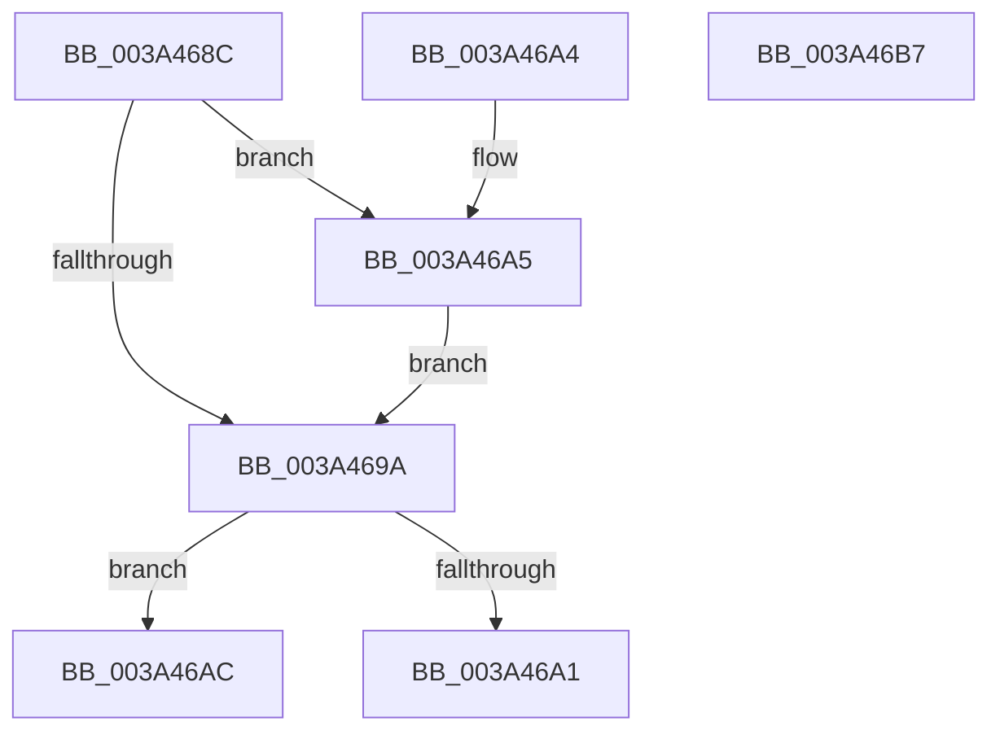

# MiStoreCheckContractPageFile

- RVA: `0x003A468C`–`0x003A46B8` (길이 `44` bytes)
- VA: `0x00000001403A468C`
- 실행 섹션: `.text`
- PDB 이름 있음: `예`; PDB Function 태그: `아니요`
- unwind 정보 RVA: `0x000DB714`
- 디코드: `17`개 명령, `44/44` bytes 표시
- 미해석 바이트: `0` (있으면 어셈블리에 `.byte`로 보존)

> 이 문서는 커널 이미지의 기계어와 PDB 기호를 분석해 생성했습니다. 4번과 5번은 함수 원형과 자료형을 바이너리 사용 방식에서 추정한 C 해석이며 원본 소스 복구 결과는 아닙니다.

## 1. Dependencies

- 직접 호출 지점: **0**; 고유 호출 대상: **0**
- 직접 호출자로 확인된 함수: **2**
- RIP 상대 이미지 참조: **0**

### Outgoing calls
- 직접 디코드된 call 명령이 없습니다.

### Direct callers
- [MiStoreAttemptContractPageFile](MiStoreAttemptContractPageFile_function_003A4584.md) at `0x003A45BF`
- [MiStoreContractVirtualPagefileApc](MiStoreContractVirtualPagefileApc_function_003A4710.md) at `0x003A4745`

### Static image references
- 디코드된 RIP-relative 메모리 참조가 없습니다.

## 2. Other-region calls and transfers

- 다른 실행 섹션으로 향하는 call: **0**
- 별도 외부 분기/꼬리 이동을 확인하지 못했습니다.

## 3. Assembly (complete function range)

```asm
003A468C  8B 41 0C                        mov eax, dword ptr [rcx + 0xc]
003A468F  8B 51 04                        mov edx, dword ptr [rcx + 4]
003A4692  44 8B 01                        mov r8d, dword ptr [rcx]
003A4695  41 3B D0                        cmp edx, r8d
003A4698  77 0B                           ja 0x1403a46a5
003A469A  3D 00 00 08 00                  cmp eax, 0x80000
003A469F  73 0B                           jae 0x1403a46ac
003A46A1  33 C0                           xor eax, eax
003A46A3  C3                              ret
003A46A4  CC                              int3
003A46A5  41 2B D0                        sub edx, r8d
003A46A8  03 C2                           add eax, edx
003A46AA  EB EE                           jmp 0x1403a469a
003A46AC  25 00 00 FC FF                  and eax, 0xfffc0000
003A46B1  2D 00 00 04 00                  sub eax, 0x40000
003A46B6  C3                              ret
003A46B7  CC                              int3
```

## 4. C-style interpretation (structured pseudocode)

```c
__int64 __fastcall MiStoreCheckContractPageFile(__int64 a1)
{
    __int64 result;

    if (((unsigned int)((unsigned int)(*(unsigned int *)(a1 + 4)))) > ((unsigned int)((unsigned int)(*(unsigned int *)(a1))))) goto loc_003A46A5;
loc_003A469A:
    if (((unsigned int)((unsigned int)(*(unsigned int *)(a1 + 12)))) >= 0x80000ULL) goto loc_003A46AC;
    result = 0;
    return result;
loc_003A46A5:
    a2 = (unsigned int)(((unsigned int)(*(unsigned int *)(a1 + 4))) - ((unsigned int)((unsigned int)(*(unsigned int *)(a1)))));
    result = (unsigned int)((result) + ((unsigned int)(a2)));
    goto loc_003A469A;
loc_003A46AC:
    result = (unsigned int)((result) & (0xFFFC0000ULL));
    result = (unsigned int)((result) - (0x40000ULL));
    return result;
}
```

## 5. (Beta) C Style

```c
int64_t MiStoreCheckContractPageFile(void *Arg1)
{
    uint8_t *arg1 = (uint8_t *)Arg1;

    int64_t result;

    if (((uint32_t)((uint32_t)(*(uint32_t *)(arg1 + 0x4)))) > ((uint32_t)((uint32_t)(*(uint32_t *)(arg1))))) goto loc_003A46A5;
loc_003A469A:
    if (((uint32_t)((uint32_t)(*(uint32_t *)(arg1 + 0xC)))) >= 0x80000ULL) goto loc_003A46AC;
    result = 0;
    return result;
loc_003A46A5:
    a2 = (uint32_t)(((uint32_t)(*(uint32_t *)(arg1 + 0x4))) - ((uint32_t)((uint32_t)(*(uint32_t *)(arg1)))));
    result = (uint32_t)((result) + ((uint32_t)(a2)));
    goto loc_003A469A;
loc_003A46AC:
    result = (uint32_t)((result) & (0xFFFC0000ULL));
    result = (uint32_t)((result) - (0x40000ULL));
    return result;
}
```

### 관측된 메모리 오프셋

구조체 형식이 확인되지 않은 접근은 인자 기준의 오프셋으로만 기록했습니다.

| 기준 인자 | 오프셋 표현 | 폭 (bit) | 접근 |
|---|---:|---:|---|
| `Arg1` | `+ 0x0` | `32` | `R` |
| `Arg1` | `+ 0x4` | `32` | `R` |
| `Arg1` | `+ 0xC` | `32` | `R` |

## 6. Execution-region graph

[열기: 2D/3D 그래프와 함수 탐색 컨트롤 패널](../../../control-panel.html?section=text&rva=0x003A468C&view=graph)

- 2D 그래프는 위에서 아래로 흐르고, 3D 그래프는 빈 공간을 드래그해 회전합니다. Shift+드래그는 이동, 휠은 확대·축소, 함수 노드 선택은 대상 보고서 이동입니다.

### Static fallback


