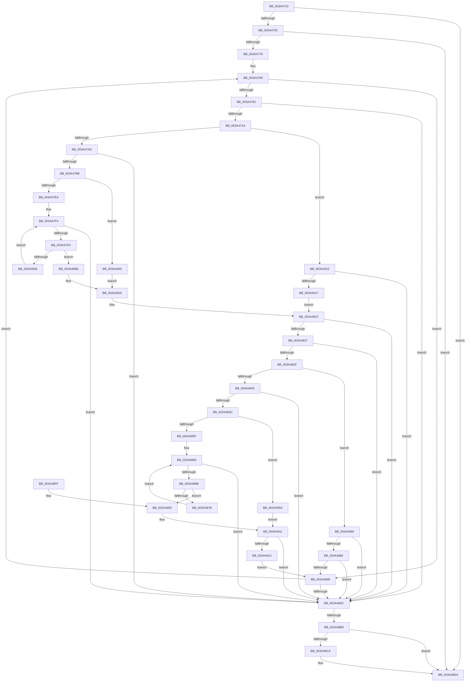

# MiStoreContractVirtualPagefileApc

- RVA: `0x003A4710`–`0x003A4970` (길이 `608` bytes)
- VA: `0x00000001403A4710`
- 실행 섹션: `.text`
- PDB 이름 있음: `예`; PDB Function 태그: `예`
- unwind 정보 RVA: `0x00082474`
- 디코드: `182`개 명령, `608/608` bytes 표시
- 미해석 바이트: `0` (있으면 어셈블리에 `.byte`로 보존)

> 이 문서는 커널 이미지의 기계어와 PDB 기호를 분석해 생성했습니다. 4번과 5번은 함수 원형과 자료형을 바이너리 사용 방식에서 추정한 C 해석이며 원본 소스 복구 결과는 아닙니다.

## 1. Dependencies

- 직접 호출 지점: **5**; 고유 호출 대상: **5**
- 직접 호출자로 확인된 함수: **0**
- RIP 상대 이미지 참조: **0**

### Outgoing calls
- `0x003A4745` → [MiStoreCheckContractPageFile](MiStoreCheckContractPageFile_function_003A468C.md) (function, `0x003A468C`)
- `0x003A477D` → [MiRefPageFileSpaceBitmaps](../40/MiRefPageFileSpaceBitmaps_function_00407DC4.md) (function, `0x00407DC4`)
- `0x003A48C0` → [MiDerefPageFileSpaceBitmaps](../47/MiDerefPageFileSpaceBitmaps_function_0047B478.md) (function, `0x0047B478`)
- `0x003A48CF` → [ExFreePoolWithTag](../../poolcode/B8/ExFreePoolWithTag_function_00B82870.md) (function, `0x00B82870`)
- `0x003A48DC` → [KeSetEvent](../33/KeSetEvent_function_0033F310.md) (function, `0x0033F310`)

### Direct callers
- 이 함수 시작 RVA로 연결되는 직접 call은 확인되지 않았습니다. 간접 호출은 완전히 역산할 수 없습니다.

### Static image references
- 디코드된 RIP-relative 메모리 참조가 없습니다.

## 2. Other-region calls and transfers

- 다른 실행 섹션으로 향하는 call: **1**
  - `0x003A48CF` → [ExFreePoolWithTag](../../poolcode/B8/ExFreePoolWithTag_function_00B82870.md) (`.text` → `POOLCODE`)
- call이 아닌 외부 분기/꼬리 이동: **1**
  - `0x003A48AF` → [sub_006E65B0](../6E/Unknown_function_006E65B0.md) (`tail-transfer`)

## 3. Assembly (complete function range)

```asm
003A4710  4C 8B DC                        mov r11, rsp
003A4713  49 89 5B 08                     mov qword ptr [r11 + 8], rbx
003A4717  49 89 6B 10                     mov qword ptr [r11 + 0x10], rbp
003A471B  49 89 73 18                     mov qword ptr [r11 + 0x18], rsi
003A471F  57                              push rdi
003A4720  41 54                           push r12
003A4722  41 55                           push r13
003A4724  41 56                           push r14
003A4726  41 57                           push r15
003A4728  48 83 EC 50                     sub rsp, 0x50
003A472C  0F 57 C0                        xorps xmm0, xmm0
003A472F  33 C0                           xor eax, eax
003A4731  0F 11 44 24 20                  movups xmmword ptr [rsp + 0x20], xmm0
003A4736  4C 8B EA                        mov r13, rdx
003A4739  4C 8B F1                        mov r14, rcx
003A473C  0F 11 44 24 30                  movups xmmword ptr [rsp + 0x30], xmm0
003A4741  49 89 43 C8                     mov qword ptr [r11 - 0x38], rax
003A4745  E8 42 FF FF FF                  call 0x1403a468c
003A474A  85 C0                           test eax, eax
003A474C  0F 84 82 01 00 00               je 0x1403a48d4
003A4752  8B 71 04                        mov esi, dword ptr [rcx + 4]
003A4755  8B FE                           mov edi, esi
003A4757  8B 29                           mov ebp, dword ptr [rcx]
003A4759  2B F8                           sub edi, eax
003A475B  81 C7 FF FF 03 00               add edi, 0x3ffff
003A4761  B8 00 00 FC FF                  mov eax, 0xfffc0000
003A4766  23 F8                           and edi, eax
003A4768  8D 9E 00 00 FC FF               lea ebx, [rsi - 0x40000]
003A476E  23 D8                           and ebx, eax
003A4770  3B DF                           cmp ebx, edi
003A4772  0F 82 5C 01 00 00               jb 0x1403a48d4
003A4778  48 8D 54 24 20                  lea rdx, [rsp + 0x20]
003A477D  E8 42 36 06 00                  call 0x140407dc4
003A4782  45 33 D2                        xor r10d, r10d
003A4785  41 83 CC FF                     or r12d, 0xffffffff
003A4789  3B DD                           cmp ebx, ebp
003A478B  0F 83 07 01 00 00               jae 0x1403a4898
003A4791  8B 44 24 28                     mov eax, dword ptr [rsp + 0x28]
003A4795  44 8B C5                        mov r8d, ebp
003A4798  44 2B C3                        sub r8d, ebx
003A479B  3B D8                           cmp ebx, eax
003A479D  0F 83 09 01 00 00               jae 0x1403a48ac
003A47A3  41 83 F8 01                     cmp r8d, 1
003A47A7  0F 86 68 01 00 00               jbe 0x1403a4915
003A47AD  2B C3                           sub eax, ebx
003A47AF  41 3B C0                        cmp eax, r8d
003A47B2  0F 82 F4 00 00 00               jb 0x1403a48ac
003A47B8  48 8B 4C 24 30                  mov rcx, qword ptr [rsp + 0x30]
003A47BD  44 8D 5D FF                     lea r11d, [rbp - 1]
003A47C1  8B C3                           mov eax, ebx
003A47C3  48 C1 E8 05                     shr rax, 5
003A47C7  4C 8D 0C 85 00 00 00 00         lea r9, [rax*4]
003A47CF  41 8B C3                        mov eax, r11d
003A47D2  48 C1 E8 05                     shr rax, 5
003A47D6  49 8D 14 09                     lea rdx, [r9 + rcx]
003A47DA  44 8B 3A                        mov r15d, dword ptr [rdx]
003A47DD  4C 8D 24 81                     lea r12, [rcx + rax*4]
003A47E1  49 3B D4                        cmp rdx, r12
003A47E4  0F 84 56 01 00 00               je 0x1403a4940
003A47EA  83 C8 FF                        or eax, 0xffffffff
003A47ED  8B CB                           mov ecx, ebx
003A47EF  D3 E0                           shl eax, cl
003A47F1  44 85 F8                        test eax, r15d
003A47F4  0F 85 B2 00 00 00               jne 0x1403a48ac
003A47FA  48 83 C2 04                     add rdx, 4
003A47FE  44 8B 3A                        mov r15d, dword ptr [rdx]
003A4801  49 3B D4                        cmp rdx, r12
003A4804  74 05                           je 0x1403a480b
003A4806  45 85 FF                        test r15d, r15d
003A4809  EB E9                           jmp 0x1403a47f4
003A480B  41 83 CC FF                     or r12d, 0xffffffff
003A480F  41 8B CB                        mov ecx, r11d
003A4812  F7 D1                           not ecx
003A4814  41 8B C4                        mov eax, r12d
003A4817  D3 E8                           shr eax, cl
003A4819  44 85 F8                        test eax, r15d
003A481C  0F 94 C0                        sete al
003A481F  84 C0                           test al, al
003A4821  0F 84 85 00 00 00               je 0x1403a48ac
003A4827  8B 44 24 38                     mov eax, dword ptr [rsp + 0x38]
003A482B  3B D8                           cmp ebx, eax
003A482D  73 7D                           jae 0x1403a48ac
003A482F  41 83 F8 01                     cmp r8d, 1
003A4833  76 4B                           jbe 0x1403a4880
003A4835  2B C3                           sub eax, ebx
003A4837  41 3B C0                        cmp eax, r8d
003A483A  72 70                           jb 0x1403a48ac
003A483C  48 8B 4C 24 40                  mov rcx, qword ptr [rsp + 0x40]
003A4841  41 8B C3                        mov eax, r11d
003A4844  48 C1 E8 05                     shr rax, 5
003A4848  49 8D 14 09                     lea rdx, [r9 + rcx]
003A484C  44 8B 0A                        mov r9d, dword ptr [rdx]
003A484F  4C 8D 3C 81                     lea r15, [rcx + rax*4]
003A4853  41 8B C4                        mov eax, r12d
003A4856  49 3B D7                        cmp rdx, r15
003A4859  0F 84 FB 00 00 00               je 0x1403a495a
003A485F  8B CB                           mov ecx, ebx
003A4861  D3 E0                           shl eax, cl
003A4863  44 23 C8                        and r9d, eax
003A4866  44 3B C8                        cmp r9d, eax
003A4869  75 41                           jne 0x1403a48ac
003A486B  48 83 C2 04                     add rdx, 4
003A486F  44 8B 02                        mov r8d, dword ptr [rdx]
003A4872  49 3B D7                        cmp rdx, r15
003A4875  0F 84 85 00 00 00               je 0x1403a4900
003A487B  45 3B C4                        cmp r8d, r12d
003A487E  EB E9                           jmp 0x1403a4869
003A4880  75 2A                           jne 0x1403a48ac
003A4882  48 8B 44 24 40                  mov rax, qword ptr [rsp + 0x40]
003A4887  8B CB                           mov ecx, ebx
003A4889  83 E1 1F                        and ecx, 0x1f
003A488C  41 0F A3 0C 01                  bt dword ptr [r9 + rax], ecx
003A4891  0F 92 C0                        setb al
003A4894  84 C0                           test al, al
003A4896  74 14                           je 0x1403a48ac
003A4898  44 8B D6                        mov r10d, esi
003A489B  44 2B D3                        sub r10d, ebx
003A489E  81 C3 00 00 FC FF               add ebx, 0xfffc0000
003A48A4  3B DF                           cmp ebx, edi
003A48A6  0F 83 DD FE FF FF               jae 0x1403a4789
003A48AC  45 85 D2                        test r10d, r10d
003A48AF  0F 85 FB 1C 34 00               jne 0x1406e65b0
003A48B5  45 33 C0                        xor r8d, r8d
003A48B8  48 8D 54 24 20                  lea rdx, [rsp + 0x20]
003A48BD  49 8B CE                        mov rcx, r14
003A48C0  E8 B3 6B 0D 00                  call 0x14047b478
003A48C5  48 85 C0                        test rax, rax
003A48C8  74 0A                           je 0x1403a48d4
003A48CA  33 D2                           xor edx, edx
003A48CC  48 8B C8                        mov rcx, rax
003A48CF  E8 9C DF 7D 00                  call 0x140b82870
003A48D4  45 33 C0                        xor r8d, r8d
003A48D7  33 D2                           xor edx, edx
003A48D9  49 8B CD                        mov rcx, r13
003A48DC  E8 2F AA F9 FF                  call 0x14033f310
003A48E1  4C 8D 5C 24 50                  lea r11, [rsp + 0x50]
003A48E6  49 8B 5B 30                     mov rbx, qword ptr [r11 + 0x30]
003A48EA  49 8B 6B 38                     mov rbp, qword ptr [r11 + 0x38]
003A48EE  49 8B 73 40                     mov rsi, qword ptr [r11 + 0x40]
003A48F2  49 8B E3                        mov rsp, r11
003A48F5  41 5F                           pop r15
003A48F7  41 5E                           pop r14
003A48F9  41 5D                           pop r13
003A48FB  41 5C                           pop r12
003A48FD  5F                              pop rdi
003A48FE  C3                              ret
003A48FF  CC                              int3
003A4900  41 F7 D3                        not r11d
003A4903  41 8B C4                        mov eax, r12d
003A4906  41 8A CB                        mov cl, r11b
003A4909  D3 E8                           shr eax, cl
003A490B  44 23 C0                        and r8d, eax
003A490E  44 3B C0                        cmp r8d, eax
003A4911  75 99                           jne 0x1403a48ac
003A4913  EB 83                           jmp 0x1403a4898
003A4915  75 95                           jne 0x1403a48ac
003A4917  8B C3                           mov eax, ebx
003A4919  44 8D 5D FF                     lea r11d, [rbp - 1]
003A491D  48 C1 E8 05                     shr rax, 5
003A4921  8B CB                           mov ecx, ebx
003A4923  83 E1 1F                        and ecx, 0x1f
003A4926  4C 8D 0C 85 00 00 00 00         lea r9, [rax*4]
003A492E  48 8B 44 24 30                  mov rax, qword ptr [rsp + 0x30]
003A4933  41 0F A3 0C 01                  bt dword ptr [r9 + rax], ecx
003A4938  0F 93 C0                        setae al
003A493B  E9 DF FE FF FF                  jmp 0x1403a481f
003A4940  41 83 CC FF                     or r12d, 0xffffffff
003A4944  B9 20 00 00 00                  mov ecx, 0x20
003A4949  41 2B C8                        sub ecx, r8d
003A494C  41 8B C4                        mov eax, r12d
003A494F  D3 E8                           shr eax, cl
003A4951  8B CB                           mov ecx, ebx
003A4953  D3 E0                           shl eax, cl
003A4955  E9 BF FE FF FF                  jmp 0x1403a4819
003A495A  B9 20 00 00 00                  mov ecx, 0x20
003A495F  41 2B C8                        sub ecx, r8d
003A4962  D3 E8                           shr eax, cl
003A4964  8B CB                           mov ecx, ebx
003A4966  D3 E0                           shl eax, cl
003A4968  44 23 C8                        and r9d, eax
003A496B  44 3B C8                        cmp r9d, eax
003A496E  EB A1                           jmp 0x1403a4911
```

## 4. C-style interpretation (structured pseudocode)

```c
__int64 __fastcall MiStoreContractVirtualPagefileApc(__int64 a1, __int64 a2)
{
    __int64 result;
    __int64 v_r10;
    __int64 v_r11;
    __int64 v_r12;
    __int64 v_rbx;
    __int64 v_rdi;
    __int64 v_rsp;
    unsigned __int64 v_stack_m20;
    unsigned __int64 v_stack_m28;
    unsigned __int64 v_stack_m38;
    unsigned int v_stack_m40;
    unsigned __int64 v_stack_m48;
    unsigned int v_stack_m50;
    unsigned __int64 v_stack_m58;

    *(unsigned __int64 *)(v_rsp + 8) = v_rbx;
    *(unsigned __int64 *)(v_rsp + 16) = v_rbp;
    *(unsigned __int64 *)(v_rsp + 24) = v_rsi;
    v_rsp = (v_rsp) - (80);
    result = 0;
    v_stack_m58 = v_xmm0;
    v_stack_m48 = v_xmm0;
    *(unsigned __int64 *)(v_rsp - 56) = 0;
    result = MiStoreCheckContractPageFile(a1, a2, a3, a4);
    if ((unsigned int)(result) == 0) goto loc_003A48D4;
    v_rdi = (unsigned int)(((unsigned int)((unsigned int)((unsigned int)(*(unsigned int *)(a1 + 4))))) - ((unsigned int)(result)));
    v_rdi = (unsigned int)((v_rdi) + (0x3FFFFULL));
    v_rdi = (unsigned int)((v_rdi) & ((unsigned int)((unsigned int)(0xFFFC0000ULL))));
    v_rbx = (unsigned int)(((unsigned int)(*(unsigned int *)(a1 + 4)) - 262144) & ((unsigned int)((unsigned int)(0xFFFC0000ULL))));
    if (((unsigned int)(v_rbx)) < ((unsigned int)(v_rdi))) goto loc_003A48D4;
    result = MiRefPageFileSpaceBitmaps(a1, v_stack_m58, a3, a4);
    v_r10 = 0;
    v_r12 = (unsigned int)((v_r12) | (0xFFFFFFFFULL));
loc_003A4789:
    if (((unsigned int)(v_rbx)) >= ((unsigned int)((unsigned int)(*(unsigned int *)(a1))))) goto loc_003A4898;
    a3 = (unsigned int)(((unsigned int)((unsigned int)((unsigned int)(*(unsigned int *)(a1))))) - ((unsigned int)(v_rbx)));
    if (((unsigned int)(v_rbx)) >= ((unsigned int)((unsigned int)(v_stack_m50)))) goto loc_003A48AC;
    if (((unsigned int)(a3)) <= 1) goto loc_003A4915;
    result = (unsigned int)(((unsigned int)(v_stack_m50)) - ((unsigned int)(v_rbx)));
    if (((unsigned int)(result)) < ((unsigned int)(a3))) goto loc_003A48AC;
    result = ((unsigned int)((unsigned int)(v_rbx))) >> (5);
    result = ((unsigned int)((unsigned int)((unsigned int)(*(unsigned int *)(a1)) - 1))) >> (5);
    if ((result * 4 + v_stack_m48 * 1) == (v_stack_m48 + result * 4)) goto loc_003A4940;
    result = (unsigned int)((result) | (0xFFFFFFFFULL));
    result = (unsigned int)((result) << ((unsigned __int8)((unsigned int)((unsigned int)(v_rbx)))));
loc_003A47F4:
    if ((((unsigned int)(result)) & ((unsigned int)((unsigned int)(*(unsigned int *)(result * 4 + v_stack_m48 * 1))))) != 0) goto loc_003A48AC;
    a2 = (result * 4 + v_stack_m48 * 1) + (4);
    if (a2 == (v_stack_m48 + result * 4)) goto loc_003A480B;
    goto loc_003A47F4;
loc_003A480B:
    v_r12 = (unsigned int)((v_stack_m48 + result * 4) | (0xFFFFFFFFULL));
    a1 = (unsigned int)(~((unsigned int)((unsigned int)((unsigned int)(*(unsigned int *)(a1)) - 1))));
    result = (unsigned int)(((unsigned int)((unsigned int)(v_r12))) >> ((unsigned __int8)(a1)));
loc_003A4819:
    result = ((((unsigned int)(result)) & ((unsigned int)((unsigned int)(*(unsigned int *)(a2))))) == 0) ? 1 : 0;
loc_003A481F:
    if ((unsigned __int8)(result) == 0) goto loc_003A48AC;
    if (((unsigned int)(v_rbx)) >= ((unsigned int)((unsigned int)(v_stack_m40)))) goto loc_003A48AC;
    if (((unsigned int)(a3)) <= 1) goto loc_003A4880;
    result = (unsigned int)(((unsigned int)(v_stack_m40)) - ((unsigned int)(v_rbx)));
    if (((unsigned int)(result)) < ((unsigned int)(a3))) goto loc_003A48AC;
    result = ((unsigned int)((unsigned int)((unsigned int)(*(unsigned int *)(a1)) - 1))) >> (5);
    if ((result * 4 + v_stack_m38 * 1) == (v_stack_m38 + result * 4)) goto loc_003A495A;
    result = (unsigned int)(((unsigned int)((unsigned int)(v_r12))) << ((unsigned __int8)((unsigned int)((unsigned int)(v_rbx)))));
    a4 = (unsigned int)(((unsigned int)(*(unsigned int *)(result * 4 + v_stack_m38 * 1))) & ((unsigned int)(result)));
loc_003A4869:
    if (((unsigned int)(a4)) != ((unsigned int)(result))) goto loc_003A48AC;
    a2 = (result * 4 + v_stack_m38 * 1) + (4);
    if (a2 == (v_stack_m38 + result * 4)) goto loc_003A4900;
    goto loc_003A4869;
loc_003A4880:
    if (((unsigned int)((unsigned int)(*(unsigned int *)(a2)))) != ((unsigned int)(v_r12))) goto loc_003A48AC;
    a1 = (unsigned int)(((unsigned int)((unsigned int)(v_rbx))) & (31));
    result = (condition_is_below) ? 1 : 0;
    if ((unsigned __int8)(result) == 0) goto loc_003A48AC;
loc_003A4898:
    v_r10 = (unsigned int)(((unsigned int)((unsigned int)((unsigned int)(*(unsigned int *)(a1 + 4))))) - ((unsigned int)(v_rbx)));
    v_rbx = (unsigned int)((v_rbx) + (0xFFFC0000ULL));
    if (((unsigned int)(v_rbx)) >= ((unsigned int)(v_rdi))) goto loc_003A4789;
loc_003A48AC:
    a3 = 0;
    result = MiDerefPageFileSpaceBitmaps(a1, v_stack_m58, a3, a4);
    if (result != 0) {
        a2 = 0;
        a1 = result;
        result = ExFreePoolWithTag(a1, a2, a3, a4);
    }
    a3 = 0;
    a2 = 0;
    result = KeSetEvent(0, a2, a3, a4);
    return result;
loc_003A4900:
    v_r11 = (unsigned int)(~(v_stack_m28));
    result = (unsigned int)(((unsigned int)((unsigned int)(v_r12))) >> ((unsigned __int8)((unsigned __int8)(v_r11))));
    a3 = (unsigned int)((a3) & ((unsigned int)(result)));
loc_003A4911:
    if (((unsigned int)(a3)) != ((unsigned int)(result))) goto loc_003A48AC;
    goto loc_003A4898;
loc_003A4915:
    if (((unsigned int)(a3)) != ((unsigned int)(result))) goto loc_003A48AC;
    result = ((unsigned int)((unsigned int)(*(unsigned __int64 *)(v_stack_m28 + 48)))) >> (5);
    a1 = (unsigned int)(((unsigned int)((unsigned int)(*(unsigned __int64 *)(v_stack_m28 + 48)))) & (31));
    result = (condition_is_above_or_equal) ? 1 : 0;
    goto loc_003A481F;
loc_003A4940:
    v_r12 = (unsigned int)((v_r12) | (0xFFFFFFFFULL));
    a1 = (unsigned int)((32) - ((unsigned int)(a3)));
    result = (unsigned int)(((unsigned int)((unsigned int)(v_r12))) >> ((unsigned __int8)(a1)));
    result = (unsigned int)((result) << ((unsigned __int8)((unsigned int)((unsigned int)(*(unsigned __int64 *)(v_stack_m28 + 48))))));
    goto loc_003A4819;
loc_003A495A:
    a1 = (unsigned int)((32) - ((unsigned int)(a3)));
    result = (unsigned int)((result) >> ((unsigned __int8)(a1)));
    result = (unsigned int)((result) << ((unsigned __int8)((unsigned int)((unsigned int)(*(unsigned __int64 *)(v_stack_m28 + 48))))));
    a4 = (unsigned int)((result * 4) & ((unsigned int)(result)));
    goto loc_003A4911;
}
```

## 5. (Beta) C Style

```c
int64_t MiStoreContractVirtualPagefileApc(int64_t Arg1, int64_t Arg2)
{
    int64_t result;
    int64_t local_r10;
    int64_t local_r11;
    int64_t local_r12;
    int64_t local_rbx;
    int64_t local_rdi;
    int64_t local_rsp;
    uint64_t v_stack_m20;
    uint64_t v_stack_m28;
    uint64_t v_stack_m38;
    uint32_t v_stack_m40;
    uint64_t v_stack_m48;
    uint32_t v_stack_m50;
    uint64_t v_stack_m58;

    *(uint64_t *)(local_rsp + 0x8) = local_rbx;
    *(uint64_t *)(local_rsp + 0x10) = local_rbp;
    *(uint64_t *)(local_rsp + 0x18) = local_rsi;
    local_rsp = (local_rsp) - (80);
    result = 0;
    v_stack_m58 = v_xmm0;
    v_stack_m48 = v_xmm0;
    *(uint64_t *)(local_rsp - 0x38) = 0;
    result = MiStoreCheckContractPageFile(Arg1, Arg2, a3, a4);
    if ((uint32_t)(result) == 0) goto loc_003A48D4;
    local_rdi = (uint32_t)(((uint32_t)((uint32_t)((uint32_t)(*(uint32_t *)(Arg1 + 0x4))))) - ((uint32_t)(result)));
    local_rdi = (uint32_t)((local_rdi) + (0x3FFFFULL));
    local_rdi = (uint32_t)((local_rdi) & ((uint32_t)((uint32_t)(0xFFFC0000ULL))));
    local_rbx = (uint32_t)(((uint32_t)(*(uint32_t *)(Arg1 + 0x4)) - 262144) & ((uint32_t)((uint32_t)(0xFFFC0000ULL))));
    if (((uint32_t)(local_rbx)) < ((uint32_t)(local_rdi))) goto loc_003A48D4;
    result = MiRefPageFileSpaceBitmaps(Arg1, v_stack_m58, a3, a4);
    local_r10 = 0;
    local_r12 = (uint32_t)((local_r12) | (0xFFFFFFFFULL));
loc_003A4789:
    if (((uint32_t)(local_rbx)) >= ((uint32_t)((uint32_t)(*(uint32_t *)(Arg1))))) goto loc_003A4898;
    a3 = (uint32_t)(((uint32_t)((uint32_t)((uint32_t)(*(uint32_t *)(Arg1))))) - ((uint32_t)(local_rbx)));
    if (((uint32_t)(local_rbx)) >= ((uint32_t)((uint32_t)(v_stack_m50)))) goto loc_003A48AC;
    if (((uint32_t)(a3)) <= 1) goto loc_003A4915;
    result = (uint32_t)(((uint32_t)(v_stack_m50)) - ((uint32_t)(local_rbx)));
    if (((uint32_t)(result)) < ((uint32_t)(a3))) goto loc_003A48AC;
    result = ((uint32_t)((uint32_t)(local_rbx))) >> (5);
    result = ((uint32_t)((uint32_t)((uint32_t)(*(uint32_t *)(Arg1)) - 1))) >> (5);
    if ((result * 4 + v_stack_m48 * 1) == (v_stack_m48 + result * 4)) goto loc_003A4940;
    result = (uint32_t)((result) | (0xFFFFFFFFULL));
    result = (uint32_t)((result) << ((uint8_t)((uint32_t)((uint32_t)(local_rbx)))));
loc_003A47F4:
    if ((((uint32_t)(result)) & ((uint32_t)((uint32_t)(*(uint32_t *)(result * 4 + v_stack_m48 * 1))))) != 0) goto loc_003A48AC;
    Arg2 = (result * 4 + v_stack_m48 * 1) + (4);
    if (Arg2 == (v_stack_m48 + result * 4)) goto loc_003A480B;
    goto loc_003A47F4;
loc_003A480B:
    local_r12 = (uint32_t)((v_stack_m48 + result * 4) | (0xFFFFFFFFULL));
    Arg1 = (uint32_t)(~((uint32_t)((uint32_t)((uint32_t)(*(uint32_t *)(Arg1)) - 1))));
    result = (uint32_t)(((uint32_t)((uint32_t)(local_r12))) >> ((uint8_t)(Arg1)));
loc_003A4819:
    result = ((((uint32_t)(result)) & ((uint32_t)((uint32_t)(*(uint32_t *)(Arg2))))) == 0) ? 1 : 0;
loc_003A481F:
    if ((uint8_t)(result) == 0) goto loc_003A48AC;
    if (((uint32_t)(local_rbx)) >= ((uint32_t)((uint32_t)(v_stack_m40)))) goto loc_003A48AC;
    if (((uint32_t)(a3)) <= 1) goto loc_003A4880;
    result = (uint32_t)(((uint32_t)(v_stack_m40)) - ((uint32_t)(local_rbx)));
    if (((uint32_t)(result)) < ((uint32_t)(a3))) goto loc_003A48AC;
    result = ((uint32_t)((uint32_t)((uint32_t)(*(uint32_t *)(Arg1)) - 1))) >> (5);
    if ((result * 4 + v_stack_m38 * 1) == (v_stack_m38 + result * 4)) goto loc_003A495A;
    result = (uint32_t)(((uint32_t)((uint32_t)(local_r12))) << ((uint8_t)((uint32_t)((uint32_t)(local_rbx)))));
    a4 = (uint32_t)(((uint32_t)(*(uint32_t *)(result * 4 + v_stack_m38 * 1))) & ((uint32_t)(result)));
loc_003A4869:
    if (((uint32_t)(a4)) != ((uint32_t)(result))) goto loc_003A48AC;
    Arg2 = (result * 4 + v_stack_m38 * 1) + (4);
    if (Arg2 == (v_stack_m38 + result * 4)) goto loc_003A4900;
    goto loc_003A4869;
loc_003A4880:
    if (((uint32_t)((uint32_t)(*(uint32_t *)(Arg2)))) != ((uint32_t)(local_r12))) goto loc_003A48AC;
    Arg1 = (uint32_t)(((uint32_t)((uint32_t)(local_rbx))) & (31));
    result = (condition_is_below) ? 1 : 0;
    if ((uint8_t)(result) == 0) goto loc_003A48AC;
loc_003A4898:
    local_r10 = (uint32_t)(((uint32_t)((uint32_t)((uint32_t)(*(uint32_t *)(Arg1 + 0x4))))) - ((uint32_t)(local_rbx)));
    local_rbx = (uint32_t)((local_rbx) + (0xFFFC0000ULL));
    if (((uint32_t)(local_rbx)) >= ((uint32_t)(local_rdi))) goto loc_003A4789;
loc_003A48AC:
    a3 = 0;
    result = MiDerefPageFileSpaceBitmaps(Arg1, v_stack_m58, a3, a4);
    if (result != 0) {
        Arg2 = 0;
        Arg1 = result;
        result = ExFreePoolWithTag(Arg1, Arg2, a3, a4);
    }
    a3 = 0;
    Arg2 = 0;
    result = KeSetEvent(0, Arg2, a3, a4);
    return result;
loc_003A4900:
    local_r11 = (uint32_t)(~(v_stack_m28));
    result = (uint32_t)(((uint32_t)((uint32_t)(local_r12))) >> ((uint8_t)((uint8_t)(local_r11))));
    a3 = (uint32_t)((a3) & ((uint32_t)(result)));
loc_003A4911:
    if (((uint32_t)(a3)) != ((uint32_t)(result))) goto loc_003A48AC;
    goto loc_003A4898;
loc_003A4915:
    if (((uint32_t)(a3)) != ((uint32_t)(result))) goto loc_003A48AC;
    result = ((uint32_t)((uint32_t)(*(uint64_t *)(v_stack_m28 + 0x30)))) >> (5);
    Arg1 = (uint32_t)(((uint32_t)((uint32_t)(*(uint64_t *)(v_stack_m28 + 0x30)))) & (31));
    result = (condition_is_above_or_equal) ? 1 : 0;
    goto loc_003A481F;
loc_003A4940:
    local_r12 = (uint32_t)((local_r12) | (0xFFFFFFFFULL));
    Arg1 = (uint32_t)((32) - ((uint32_t)(a3)));
    result = (uint32_t)(((uint32_t)((uint32_t)(local_r12))) >> ((uint8_t)(Arg1)));
    result = (uint32_t)((result) << ((uint8_t)((uint32_t)((uint32_t)(*(uint64_t *)(v_stack_m28 + 0x30))))));
    goto loc_003A4819;
loc_003A495A:
    Arg1 = (uint32_t)((32) - ((uint32_t)(a3)));
    result = (uint32_t)((result) >> ((uint8_t)(Arg1)));
    result = (uint32_t)((result) << ((uint8_t)((uint32_t)((uint32_t)(*(uint64_t *)(v_stack_m28 + 0x30))))));
    a4 = (uint32_t)((result * 4) & ((uint32_t)(result)));
    goto loc_003A4911;
}
```

## 6. Execution-region graph

[열기: 2D/3D 그래프와 함수 탐색 컨트롤 패널](../../../control-panel.html?section=text&rva=0x003A4710&view=graph)

- 2D 그래프는 위에서 아래로 흐르고, 3D 그래프는 빈 공간을 드래그해 회전합니다. Shift+드래그는 이동, 휠은 확대·축소, 함수 노드 선택은 대상 보고서 이동입니다.

### Static fallback


