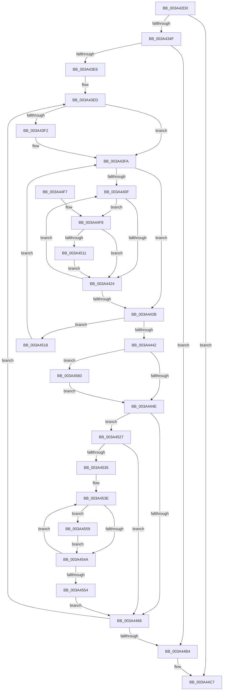

# MiStoreEvictThread

- RVA: `0x003A42D0`–`0x003A457D` (길이 `685` bytes)
- VA: `0x00000001403A42D0`
- 실행 섹션: `.text`
- PDB 이름 있음: `예`; PDB Function 태그: `아니요`
- unwind 정보 RVA: `0x0008242C`
- 디코드: `162`개 명령, `685/685` bytes 표시
- 미해석 바이트: `0` (있으면 어셈블리에 `.byte`로 보존)

> 이 문서는 커널 이미지의 기계어와 PDB 기호를 분석해 생성했습니다. 4번과 5번은 함수 원형과 자료형을 바이너리 사용 방식에서 추정한 C 해석이며 원본 소스 복구 결과는 아닙니다.

## 1. Dependencies

- 직접 호출 지점: **16**; 고유 호출 대상: **14**
- 직접 호출자로 확인된 함수: **0**
- RIP 상대 이미지 참조: **1**

### Outgoing calls
- `0x003A4317` → [memset](../6C/memset_function_006C6C40.md) (function, `0x006C6C40`)
- `0x003A4332` → [KeWaitForSingleObject](../20/KeWaitForSingleObject_function_0020E6B0.md) (function, `0x0020E6B0`)
- `0x003A4342` → [ExFreePoolWithTag](../../poolcode/B8/ExFreePoolWithTag_function_00B82870.md) (function, `0x00B82870`)
- `0x003A435D` → [KiInitializeTimer2](KiInitializeTimer2_function_003A3288.md) (function, `0x003A3288`)
- `0x003A4384` → [KeSetTimer2](KeSetTimer2_function_003A08E0.md) (function, `0x003A08E0`)
- `0x003A43D0` → [KeWaitForMultipleObjects](../20/KeWaitForMultipleObjects_function_0020D110.md) (function, `0x0020D110`)
- `0x003A43F5` → [KeResetEvent](../24/KeResetEvent_function_00248350.md) (function, `0x00248350`)
- `0x003A442E` → [ExAcquireSpinLockExclusive](../24/ExAcquireSpinLockExclusive_function_00248690.md) (function, `0x00248690`)
- `0x003A4453` → [MiReleaseSpinLockExclusive](../24/MiReleaseSpinLockExclusive_function_002482C0.md) (function, `0x002482C0`)
- `0x003A4490` → [KeWaitForMultipleObjects](../20/KeWaitForMultipleObjects_function_0020D110.md) (function, `0x0020D110`)
- `0x003A44C2` → [KeDisableTimer2](../39/KeDisableTimer2_function_0039FD58.md) (function, `0x0039FD58`)
- `0x003A44D1` → [_security_check_cookie](../6A/_security_check_cookie_function_006AC640.md) (function, `0x006AC640`)
- `0x003A44FB` → [MiStoreEvictPageFile](../24/MiStoreEvictPageFile_function_00249820.md) (function, `0x00249820`)
- `0x003A451D` → [MiReleaseSpinLockExclusive](../24/MiReleaseSpinLockExclusive_function_002482C0.md) (function, `0x002482C0`)
- `0x003A4559` → [MiStoreAttemptContractPageFile](MiStoreAttemptContractPageFile_function_003A4584.md) (function, `0x003A4584`)
- `0x003A4573` → [KeSetEvent](../33/KeSetEvent_function_0033F310.md) (function, `0x0033F310`)

### Direct callers
- 이 함수 시작 RVA로 연결되는 직접 call은 확인되지 않았습니다. 간접 호출은 완전히 역산할 수 없습니다.

### Static image references
- `0x003A42F6` → RVA `0x00E0A740` (`.data`; read)

## 2. Other-region calls and transfers

- 다른 실행 섹션으로 향하는 call: **1**
  - `0x003A4342` → [ExFreePoolWithTag](../../poolcode/B8/ExFreePoolWithTag_function_00B82870.md) (`.text` → `POOLCODE`)
- 별도 외부 분기/꼬리 이동을 확인하지 못했습니다.

## 3. Assembly (complete function range)

```asm
003A42D0  48 8B C4                        mov rax, rsp
003A42D3  48 89 58 10                     mov qword ptr [rax + 0x10], rbx
003A42D7  48 89 70 18                     mov qword ptr [rax + 0x18], rsi
003A42DB  48 89 78 20                     mov qword ptr [rax + 0x20], rdi
003A42DF  55                              push rbp
003A42E0  41 54                           push r12
003A42E2  41 55                           push r13
003A42E4  41 56                           push r14
003A42E6  41 57                           push r15
003A42E8  48 8D A8 38 FF FF FF            lea rbp, [rax - 0xc8]
003A42EF  48 81 EC A0 01 00 00            sub rsp, 0x1a0
003A42F6  48 8B 05 43 64 A6 00            mov rax, qword ptr [rip + 0xa66443]
003A42FD  48 33 C4                        xor rax, rsp
003A4300  48 89 85 90 00 00 00            mov qword ptr [rbp + 0x90], rax
003A4307  48 8B F9                        mov rdi, rcx
003A430A  33 D2                           xor edx, edx
003A430C  48 8D 4C 24 50                  lea rcx, [rsp + 0x50]
003A4311  41 B8 88 00 00 00               mov r8d, 0x88
003A4317  E8 24 29 32 00                  call 0x1406c6c40
003A431C  45 33 F6                        xor r14d, r14d
003A431F  48 8D 4F 08                     lea rcx, [rdi + 8]
003A4323  45 33 C9                        xor r9d, r9d
003A4326  4C 89 74 24 20                  mov qword ptr [rsp + 0x20], r14
003A432B  45 33 C0                        xor r8d, r8d
003A432E  41 8D 56 1A                     lea edx, [r14 + 0x1a]
003A4332  E8 79 A3 E6 FF                  call 0x14020e6b0
003A4337  8B 5F 20                        mov ebx, dword ptr [rdi + 0x20]
003A433A  33 D2                           xor edx, edx
003A433C  48 8B 37                        mov rsi, qword ptr [rdi]
003A433F  48 8B CF                        mov rcx, rdi
003A4342  E8 29 E5 7D 00                  call 0x140b82870
003A4347  85 DB                           test ebx, ebx
003A4349  0F 85 78 01 00 00               jne 0x1403a44c7
003A434F  45 8D 4E 08                     lea r9d, [r14 + 8]
003A4353  45 33 C0                        xor r8d, r8d
003A4356  33 D2                           xor edx, edx
003A4358  48 8D 4C 24 50                  lea rcx, [rsp + 0x50]
003A435D  E8 26 EF FF FF                  call 0x1403a3288
003A4362  48 83 4C 24 48 FF               or qword ptr [rsp + 0x48], 0xffffffffffffffff
003A4368  4C 8D 4C 24 40                  lea r9, [rsp + 0x40]
003A436D  48 C7 C2 00 BA 3C DC            mov rdx, 0xffffffffdc3cba00
003A4374  4C 89 74 24 40                  mov qword ptr [rsp + 0x40], r14
003A4379  41 B8 00 46 C3 23               mov r8d, 0x23c34600
003A437F  48 8D 4C 24 50                  lea rcx, [rsp + 0x50]
003A4384  E8 57 C5 FF FF                  call 0x1403a08e0
003A4389  48 8D 44 24 50                  lea rax, [rsp + 0x50]
003A438E  48 89 45 E8                     mov qword ptr [rbp - 0x18], rax
003A4392  48 8D BE 48 05 00 00            lea rdi, [rsi + 0x548]
003A4399  48 8D 45 00                     lea rax, [rbp]
003A439D  48 89 7D E0                     mov qword ptr [rbp - 0x20], rdi
003A43A1  48 89 44 24 38                  mov qword ptr [rsp + 0x38], rax
003A43A6  48 8D 9E 30 05 00 00            lea rbx, [rsi + 0x530]
003A43AD  4C 89 74 24 30                  mov qword ptr [rsp + 0x30], r14
003A43B2  45 8D 4E 12                     lea r9d, [r14 + 0x12]
003A43B6  44 88 74 24 28                  mov byte ptr [rsp + 0x28], r14b
003A43BB  45 8D 46 01                     lea r8d, [r14 + 1]
003A43BF  48 8D 55 E0                     lea rdx, [rbp - 0x20]
003A43C3  44 88 74 24 20                  mov byte ptr [rsp + 0x20], r14b
003A43C8  41 8D 4E 03                     lea ecx, [r14 + 3]
003A43CC  48 89 5D F0                     mov qword ptr [rbp - 0x10], rbx
003A43D0  E8 3B 8D E6 FF                  call 0x14020d110
003A43D5  48 63 C8                        movsxd rcx, eax
003A43D8  4C 8B 64 CD E0                  mov r12, qword ptr [rbp + rcx*8 - 0x20]
003A43DD  4C 3B E7                        cmp r12, rdi
003A43E0  0F 84 CE 00 00 00               je 0x1403a44b4
003A43E6  4C 8D AE 20 05 00 00            lea r13, [rsi + 0x520]
003A43ED  4C 3B E3                        cmp r12, rbx
003A43F0  75 08                           jne 0x1403a43fa
003A43F2  48 8B CB                        mov rcx, rbx
003A43F5  E8 56 3F EA FF                  call 0x140248350
003A43FA  44 8B BE C0 04 00 00            mov r15d, dword ptr [rsi + 0x4c0]
003A4401  33 DB                           xor ebx, ebx
003A4403  44 8B B6 58 48 00 00            mov r14d, dword ptr [rsi + 0x4858]
003A440A  45 85 F6                        test r14d, r14d
003A440D  74 1C                           je 0x1403a442b
003A440F  48 8B BC DE 60 48 00 00         mov rdi, qword ptr [rsi + rbx*8 + 0x4860]
003A4417  F6 87 AC 00 00 00 40            test byte ptr [rdi + 0xac], 0x40
003A441E  0F 85 D4 00 00 00               jne 0x1403a44f8
003A4424  FF C3                           inc ebx
003A4426  41 3B DE                        cmp ebx, r14d
003A4429  72 E4                           jb 0x1403a440f
003A442B  49 8B CD                        mov rcx, r13
003A442E  E8 5D 42 EA FF                  call 0x140248690
003A4433  8A D8                           mov bl, al
003A4435  44 3B BE C0 04 00 00            cmp r15d, dword ptr [rsi + 0x4c0]
003A443C  0F 85 D6 00 00 00               jne 0x1403a4518
003A4442  45 33 F6                        xor r14d, r14d
003A4445  45 85 FF                        test r15d, r15d
003A4448  0F 85 12 01 00 00               jne 0x1403a4560
003A444E  8A D3                           mov dl, bl
003A4450  49 8B CD                        mov rcx, r13
003A4453  E8 68 3E EA FF                  call 0x1402482c0
003A4458  48 8D 44 24 50                  lea rax, [rsp + 0x50]
003A445D  4C 3B E0                        cmp r12, rax
003A4460  0F 84 C1 00 00 00               je 0x1403a4527
003A4466  41 B9 12 00 00 00               mov r9d, 0x12
003A446C  48 8D 45 00                     lea rax, [rbp]
003A4470  48 89 44 24 38                  mov qword ptr [rsp + 0x38], rax
003A4475  48 8D 55 E0                     lea rdx, [rbp - 0x20]
003A4479  4C 89 74 24 30                  mov qword ptr [rsp + 0x30], r14
003A447E  44 88 74 24 28                  mov byte ptr [rsp + 0x28], r14b
003A4483  45 8D 41 EF                     lea r8d, [r9 - 0x11]
003A4487  44 88 74 24 20                  mov byte ptr [rsp + 0x20], r14b
003A448C  41 8D 49 F1                     lea ecx, [r9 - 0xf]
003A4490  E8 7B 8C E6 FF                  call 0x14020d110
003A4495  48 63 C8                        movsxd rcx, eax
003A4498  48 8D 9E 30 05 00 00            lea rbx, [rsi + 0x530]
003A449F  48 8D 86 48 05 00 00            lea rax, [rsi + 0x548]
003A44A6  4C 8B 64 CD E0                  mov r12, qword ptr [rbp + rcx*8 - 0x20]
003A44AB  4C 3B E0                        cmp r12, rax
003A44AE  0F 85 39 FF FF FF               jne 0x1403a43ed
003A44B4  41 B0 01                        mov r8b, 1
003A44B7  48 8D 4C 24 50                  lea rcx, [rsp + 0x50]
003A44BC  41 8A D0                        mov dl, r8b
003A44BF  45 33 C9                        xor r9d, r9d
003A44C2  E8 91 B8 FF FF                  call 0x14039fd58
003A44C7  48 8B 8D 90 00 00 00            mov rcx, qword ptr [rbp + 0x90]
003A44CE  48 33 CC                        xor rcx, rsp
003A44D1  E8 6A 81 30 00                  call 0x1406ac640
003A44D6  4C 8D 9C 24 A0 01 00 00         lea r11, [rsp + 0x1a0]
003A44DE  49 8B 5B 38                     mov rbx, qword ptr [r11 + 0x38]
003A44E2  49 8B 73 40                     mov rsi, qword ptr [r11 + 0x40]
003A44E6  49 8B 7B 48                     mov rdi, qword ptr [r11 + 0x48]
003A44EA  49 8B E3                        mov rsp, r11
003A44ED  41 5F                           pop r15
003A44EF  41 5E                           pop r14
003A44F1  41 5D                           pop r13
003A44F3  41 5C                           pop r12
003A44F5  5D                              pop rbp
003A44F6  C3                              ret
003A44F7  CC                              int3
003A44F8  48 8B CF                        mov rcx, rdi
003A44FB  E8 20 53 EA FF                  call 0x140249820
003A4500  8B 87 A8 00 00 00               mov eax, dword ptr [rdi + 0xa8]
003A4506  3D 00 01 00 00                  cmp eax, 0x100
003A450B  0F 82 13 FF FF FF               jb 0x1403a4424
003A4511  FF CB                           dec ebx
003A4513  E9 0C FF FF FF                  jmp 0x1403a4424
003A4518  8A D3                           mov dl, bl
003A451A  49 8B CD                        mov rcx, r13
003A451D  E8 9E 3D EA FF                  call 0x1402482c0
003A4522  E9 D3 FE FF FF                  jmp 0x1403a43fa
003A4527  8B 86 58 48 00 00               mov eax, dword ptr [rsi + 0x4858]
003A452D  85 C0                           test eax, eax
003A452F  0F 84 31 FF FF FF               je 0x1403a4466
003A4535  48 8D 9E 60 48 00 00            lea rbx, [rsi + 0x4860]
003A453C  8B F8                           mov edi, eax
003A453E  48 8B 0B                        mov rcx, qword ptr [rbx]
003A4541  F6 81 AC 00 00 00 40            test byte ptr [rcx + 0xac], 0x40
003A4548  75 0F                           jne 0x1403a4559
003A454A  48 83 C3 08                     add rbx, 8
003A454E  48 83 EF 01                     sub rdi, 1
003A4552  75 EA                           jne 0x1403a453e
003A4554  E9 0D FF FF FF                  jmp 0x1403a4466
003A4559  E8 26 00 00 00                  call 0x1403a4584
003A455E  EB EA                           jmp 0x1403a454a
003A4560  48 8D 8E 70 05 00 00            lea rcx, [rsi + 0x570]
003A4567  44 89 B6 C0 04 00 00            mov dword ptr [rsi + 0x4c0], r14d
003A456E  45 33 C0                        xor r8d, r8d
003A4571  33 D2                           xor edx, edx
003A4573  E8 98 AD F9 FF                  call 0x14033f310
003A4578  E9 D1 FE FF FF                  jmp 0x1403a444e
```

## 4. C-style interpretation (structured pseudocode)

```c
__int64 __fastcall MiStoreEvictThread(__int64 a1, int a2, __int64 a3, int a4)
{
    __int64 result;
    __int64 v_r14;
    __int64 v_rbx;
    __int64 v_rdi;
    __int64 v_rsp;
    unsigned __int64 v_stack_m178;
    unsigned __int64 v_stack_m180;
    unsigned __int64 v_stack_m188;
    unsigned __int64 v_stack_m190;
    unsigned __int64 v_stack_m198;
    unsigned __int8 v_stack_m1A0;
    unsigned __int64 v_stack_m1A8;
    unsigned __int64 v_stack_m28;

    *(unsigned __int64 *)(v_rsp + 16) = v_rbx;
    *(unsigned __int64 *)(v_rsp + 24) = v_rsi;
    *(unsigned __int64 *)(v_rsp + 32) = v_rdi;
    v_rsp = (v_rsp) - (416);
    result = (*(unsigned __int64 *)(v_rip + 10904643)) ^ (v_rsp);
    *(unsigned __int64 *)(v_rsp - 200 + 144) = result;
    a2 = 0;
    result = memset(v_stack_m178, a2, 136, a4);
    v_r14 = 0;
    a4 = 0;
    v_stack_m1A8 = 0;
    a3 = 0;
    result = KeWaitForSingleObject(a1 + 8, v_r14 + 26, a3, a4);
    a2 = 0;
    result = ExFreePoolWithTag(a1, a2, a3, a4);
    if ((unsigned int)((unsigned int)(*(unsigned int *)(a1 + 32))) != 0) goto loc_003A44C7;
    a3 = 0;
    a2 = 0;
    result = KiInitializeTimer2(v_stack_m178, a2, a3, v_r14 + 8);
    v_stack_m188 = 0;
    result = KeSetTimer2(v_stack_m178, 0xFFFFFFFFDC3CBA00ULL, (unsigned int)(0x23C34600ULL), v_stack_m188);
    *(unsigned __int64 *)(v_rsp - 200 - 24) = v_stack_m178;
    *(unsigned __int64 *)(v_rsp - 200 - 32) = *(unsigned __int64 *)(a1) + 1352;
    v_stack_m190 = v_rsp - 200;
    v_stack_m198 = 0;
    v_stack_m1A0 = 0;
    v_stack_m1A8 = 0;
    *(unsigned __int64 *)(v_rsp - 200 - 16) = *(unsigned __int64 *)(a1) + 1328;
    result = KeWaitForMultipleObjects(v_r14 + 3, v_rsp - 200 - 32, v_r14 + 1, v_r14 + 18);
    if ((*(unsigned __int64 *)(v_rsp - 200 + (int)((unsigned int)(result)) * 8 - 32)) == (*(unsigned __int64 *)(a1) + 1352)) goto loc_003A44B4;
loc_003A43ED:
    if ((*(unsigned __int64 *)(v_rsp - 200 + (int)((unsigned int)(result)) * 8 - 32)) == (*(unsigned __int64 *)(a1) + 1328)) {
        a1 = *(unsigned __int64 *)(a1) + 1328;
        result = KeResetEvent(a1, v_rsp - 200 - 32, v_r14 + 1, v_r14 + 18);
    }
    v_rbx = 0;
    if ((unsigned int)((unsigned int)(*(unsigned int *)(*(unsigned __int64 *)(a1) + 18520))) == 0) goto loc_003A442B;
loc_003A440F:
    if (((*(unsigned __int8 *)(*(unsigned __int64 *)(*(unsigned __int64 *)(a1) + v_rbx * 8 + 18528) + 172)) & (64)) != 0) goto loc_003A44F8;
loc_003A4424:
    v_rbx = (unsigned int)((v_rbx) + 1);
    if (((unsigned int)(v_rbx)) < ((unsigned int)((unsigned int)(*(unsigned int *)(*(unsigned __int64 *)(a1) + 18520))))) goto loc_003A440F;
loc_003A442B:
    result = ExAcquireSpinLockExclusive(*(unsigned __int64 *)(a1) + 1312, v_rsp - 200 - 32, v_r14 + 1, v_r14 + 18);
    if (((unsigned int)((unsigned int)(*(unsigned int *)(*(unsigned __int64 *)(a1) + 1216)))) != (*(unsigned int *)(*(unsigned __int64 *)(a1) + 1216))) goto loc_003A4518;
    v_r14 = 0;
    if ((unsigned int)((unsigned int)(*(unsigned int *)(*(unsigned __int64 *)(a1) + 1216))) != 0) goto loc_003A4560;
loc_003A444E:
    result = MiReleaseSpinLockExclusive(*(unsigned __int64 *)(a1) + 1312, (unsigned __int8)((unsigned __int8)(result)), v_r14 + 1, v_r14 + 18);
    if ((*(unsigned __int64 *)(v_rsp - 200 + (int)((unsigned int)(result)) * 8 - 32)) == v_stack_m178) goto loc_003A4527;
loc_003A4466:
    v_stack_m190 = v_rsp - 200;
    v_stack_m198 = 0;
    v_stack_m1A0 = 0;
    v_stack_m1A8 = 0;
    result = KeWaitForMultipleObjects(18 - 15, v_rsp - 200 - 32, 18 - 17, 18);
    if ((*(unsigned __int64 *)(v_rsp - 200 + (int)((unsigned int)(result)) * 8 - 32)) != (*(unsigned __int64 *)(a1) + 1352)) goto loc_003A43ED;
loc_003A44B4:
    a4 = 0;
    result = KeDisableTimer2(v_stack_m178, 1, 1, a4);
loc_003A44C7:
    a1 = (*(unsigned __int64 *)(v_rsp - 200 + 144)) ^ (v_rsp);
    result = _security_check_cookie(a1, 1, 1, a4);
    return result;
loc_003A44F8:
    result = MiStoreEvictPageFile(*(unsigned __int64 *)(v_stack_m28 + 72), 1, 1, a4);
    if (((unsigned int)((unsigned int)(*(unsigned int *)(*(unsigned __int64 *)(v_stack_m28 + 72) + 168)))) < 256) goto loc_003A4424;
    v_rbx = (unsigned int)((*(unsigned __int64 *)(v_stack_m28 + 56)) - 1);
    goto loc_003A4424;
loc_003A4518:
    result = MiReleaseSpinLockExclusive(*(unsigned __int64 *)(a1) + 1312, (unsigned __int8)(v_rbx), 1, a4);
    goto loc_003A43FA;
loc_003A4527:
    if ((unsigned int)((unsigned int)(*(unsigned int *)(*(unsigned __int64 *)(v_stack_m28 + 64) + 18520))) == 0) goto loc_003A4466;
loc_003A453E:
    if (((*(unsigned __int8 *)(*(unsigned __int64 *)(*(unsigned __int64 *)(v_stack_m28 + 64) + 18528) + 172)) & (64)) != 0) goto loc_003A4559;
loc_003A454A:
    v_rbx = (*(unsigned __int64 *)(v_stack_m28 + 64) + 18528) + (8);
    v_rdi = ((unsigned int)((unsigned int)((unsigned int)(*(unsigned int *)(*(unsigned __int64 *)(v_stack_m28 + 64) + 18520))))) - (1);
    if (condition_is_not_equal) goto loc_003A453E;
    goto loc_003A4466;
loc_003A4559:
    result = MiStoreAttemptContractPageFile(*(unsigned __int64 *)(*(unsigned __int64 *)(v_stack_m28 + 64) + 18528), (unsigned __int8)(v_rbx), 1, a4);
    goto loc_003A454A;
loc_003A4560:
    *(unsigned int *)(*(unsigned __int64 *)(v_stack_m28 + 64) + 1216) = 0;
    a3 = 0;
    a2 = 0;
    result = KeSetEvent(*(unsigned __int64 *)(v_stack_m28 + 64) + 1392, a2, a3, a4);
    goto loc_003A444E;
}
```

## 5. (Beta) C Style

```c
int64_t MiStoreEvictThread(void *Arg1, int32_t Arg2, int64_t Arg3, int32_t Arg4)
{
    uint8_t *arg1 = (uint8_t *)Arg1;

    int64_t result;
    int64_t local_r14;
    int64_t local_rbx;
    int64_t local_rdi;
    int64_t local_rsp;
    uint64_t v_stack_m178;
    uint64_t v_stack_m180;
    uint64_t v_stack_m188;
    uint64_t v_stack_m190;
    uint64_t v_stack_m198;
    uint8_t v_stack_m1A0;
    uint64_t v_stack_m1A8;
    uint64_t v_stack_m28;

    *(uint64_t *)(local_rsp + 0x10) = local_rbx;
    *(uint64_t *)(local_rsp + 0x18) = local_rsi;
    *(uint64_t *)(local_rsp + 0x20) = local_rdi;
    local_rsp = (local_rsp) - (416);
    result = (*(uint64_t *)(v_rip + 0xA66443)) ^ (local_rsp);
    *(uint64_t *)(local_rsp - 0xC8 + 0x90) = result;
    Arg2 = 0;
    result = memset(v_stack_m178, Arg2, 136, Arg4);
    local_r14 = 0;
    Arg4 = 0;
    v_stack_m1A8 = 0;
    Arg3 = 0;
    result = KeWaitForSingleObject(Arg1 + 8, local_r14 + 26, Arg3, Arg4);
    Arg2 = 0;
    result = ExFreePoolWithTag(Arg1, Arg2, Arg3, Arg4);
    if ((uint32_t)((uint32_t)(*(uint32_t *)(arg1 + 0x20))) != 0) goto loc_003A44C7;
    Arg3 = 0;
    Arg2 = 0;
    result = KiInitializeTimer2(v_stack_m178, Arg2, Arg3, local_r14 + 8);
    v_stack_m188 = 0;
    result = KeSetTimer2(v_stack_m178, 0xFFFFFFFFDC3CBA00ULL, (uint32_t)(0x23C34600ULL), v_stack_m188);
    *(uint64_t *)(local_rsp - 0xC8 - 0x18) = v_stack_m178;
    *(uint64_t *)(local_rsp - 0xC8 - 0x20) = *(uint64_t *)(arg1) + 1352;
    v_stack_m190 = local_rsp - 200;
    v_stack_m198 = 0;
    v_stack_m1A0 = 0;
    v_stack_m1A8 = 0;
    *(uint64_t *)(local_rsp - 0xC8 - 0x10) = *(uint64_t *)(arg1) + 1328;
    result = KeWaitForMultipleObjects(local_r14 + 3, local_rsp - 200 - 32, local_r14 + 1, local_r14 + 18);
    if ((*(uint64_t *)(local_rsp - 0xC8 + (int32_t)((uint32_t)(result)) * 8 - 0x20)) == (*(uint64_t *)(arg1) + 1352)) goto loc_003A44B4;
loc_003A43ED:
    if ((*(uint64_t *)(local_rsp - 0xC8 + (int32_t)((uint32_t)(result)) * 8 - 0x20)) == (*(uint64_t *)(arg1) + 1328)) {
        Arg1 = *(uint64_t *)(arg1) + 1328;
        result = KeResetEvent(Arg1, local_rsp - 200 - 32, local_r14 + 1, local_r14 + 18);
    }
    local_rbx = 0;
    if ((uint32_t)((uint32_t)(*(uint32_t *)(*(uint64_t *)(arg1) + 0x4858))) == 0) goto loc_003A442B;
loc_003A440F:
    if (((*(uint8_t *)(*(uint64_t *)(*(uint64_t *)(arg1) + local_rbx * 8 + 0x4860) + 0xAC)) & (64)) != 0) goto loc_003A44F8;
loc_003A4424:
    local_rbx = (uint32_t)((local_rbx) + 1);
    if (((uint32_t)(local_rbx)) < ((uint32_t)((uint32_t)(*(uint32_t *)(*(uint64_t *)(arg1) + 0x4858))))) goto loc_003A440F;
loc_003A442B:
    result = ExAcquireSpinLockExclusive(*(uint64_t *)(arg1) + 1312, local_rsp - 200 - 32, local_r14 + 1, local_r14 + 18);
    if (((uint32_t)((uint32_t)(*(uint32_t *)(*(uint64_t *)(arg1) + 0x4C0)))) != (*(uint32_t *)(*(uint64_t *)(arg1) + 0x4C0))) goto loc_003A4518;
    local_r14 = 0;
    if ((uint32_t)((uint32_t)(*(uint32_t *)(*(uint64_t *)(arg1) + 0x4C0))) != 0) goto loc_003A4560;
loc_003A444E:
    result = MiReleaseSpinLockExclusive(*(uint64_t *)(arg1) + 1312, (uint8_t)((uint8_t)(result)), local_r14 + 1, local_r14 + 18);
    if ((*(uint64_t *)(local_rsp - 0xC8 + (int32_t)((uint32_t)(result)) * 8 - 0x20)) == v_stack_m178) goto loc_003A4527;
loc_003A4466:
    v_stack_m190 = local_rsp - 200;
    v_stack_m198 = 0;
    v_stack_m1A0 = 0;
    v_stack_m1A8 = 0;
    result = KeWaitForMultipleObjects(18 - 15, local_rsp - 200 - 32, 18 - 17, 18);
    if ((*(uint64_t *)(local_rsp - 0xC8 + (int32_t)((uint32_t)(result)) * 8 - 0x20)) != (*(uint64_t *)(arg1) + 1352)) goto loc_003A43ED;
loc_003A44B4:
    Arg4 = 0;
    result = KeDisableTimer2(v_stack_m178, 1, 1, Arg4);
loc_003A44C7:
    Arg1 = (*(uint64_t *)(local_rsp - 0xC8 + 0x90)) ^ (local_rsp);
    result = _security_check_cookie(Arg1, 1, 1, Arg4);
    return result;
loc_003A44F8:
    result = MiStoreEvictPageFile(*(uint64_t *)(v_stack_m28 + 0x48), 1, 1, Arg4);
    if (((uint32_t)((uint32_t)(*(uint32_t *)(*(uint64_t *)(v_stack_m28 + 0x48) + 0xA8)))) < 256) goto loc_003A4424;
    local_rbx = (uint32_t)((*(uint64_t *)(v_stack_m28 + 0x38)) - 1);
    goto loc_003A4424;
loc_003A4518:
    result = MiReleaseSpinLockExclusive(*(uint64_t *)(arg1) + 1312, (uint8_t)(local_rbx), 1, Arg4);
    goto loc_003A43FA;
loc_003A4527:
    if ((uint32_t)((uint32_t)(*(uint32_t *)(*(uint64_t *)(v_stack_m28 + 0x40) + 0x4858))) == 0) goto loc_003A4466;
loc_003A453E:
    if (((*(uint8_t *)(*(uint64_t *)(*(uint64_t *)(v_stack_m28 + 0x40) + 0x4860) + 0xAC)) & (64)) != 0) goto loc_003A4559;
loc_003A454A:
    local_rbx = (*(uint64_t *)(v_stack_m28 + 0x40) + 18528) + (8);
    local_rdi = ((uint32_t)((uint32_t)((uint32_t)(*(uint32_t *)(*(uint64_t *)(v_stack_m28 + 0x40) + 0x4858))))) - (1);
    if (condition_is_not_equal) goto loc_003A453E;
    goto loc_003A4466;
loc_003A4559:
    result = MiStoreAttemptContractPageFile(*(uint64_t *)(*(uint64_t *)(v_stack_m28 + 0x40) + 0x4860), (uint8_t)(local_rbx), 1, Arg4);
    goto loc_003A454A;
loc_003A4560:
    *(uint32_t *)(*(uint64_t *)(v_stack_m28 + 0x40) + 0x4C0) = 0;
    Arg3 = 0;
    Arg2 = 0;
    result = KeSetEvent(*(uint64_t *)(v_stack_m28 + 0x40) + 1392, Arg2, Arg3, Arg4);
    goto loc_003A444E;
}
```

### 관측된 메모리 오프셋

구조체 형식이 확인되지 않은 접근은 인자 기준의 오프셋으로만 기록했습니다.

| 기준 인자 | 오프셋 표현 | 폭 (bit) | 접근 |
|---|---:|---:|---|
| `Arg1` | `+ 0x0` | `64` | `R` |
| `Arg1` | `+ 0x8` | `64` | `R` |
| `Arg1` | `+ 0x20` | `32` | `R` |

## 6. Execution-region graph

[열기: 2D/3D 그래프와 함수 탐색 컨트롤 패널](../../../control-panel.html?section=text&rva=0x003A42D0&view=graph)

- 2D 그래프는 위에서 아래로 흐르고, 3D 그래프는 빈 공간을 드래그해 회전합니다. Shift+드래그는 이동, 휠은 확대·축소, 함수 노드 선택은 대상 보고서 이동입니다.

### Static fallback


