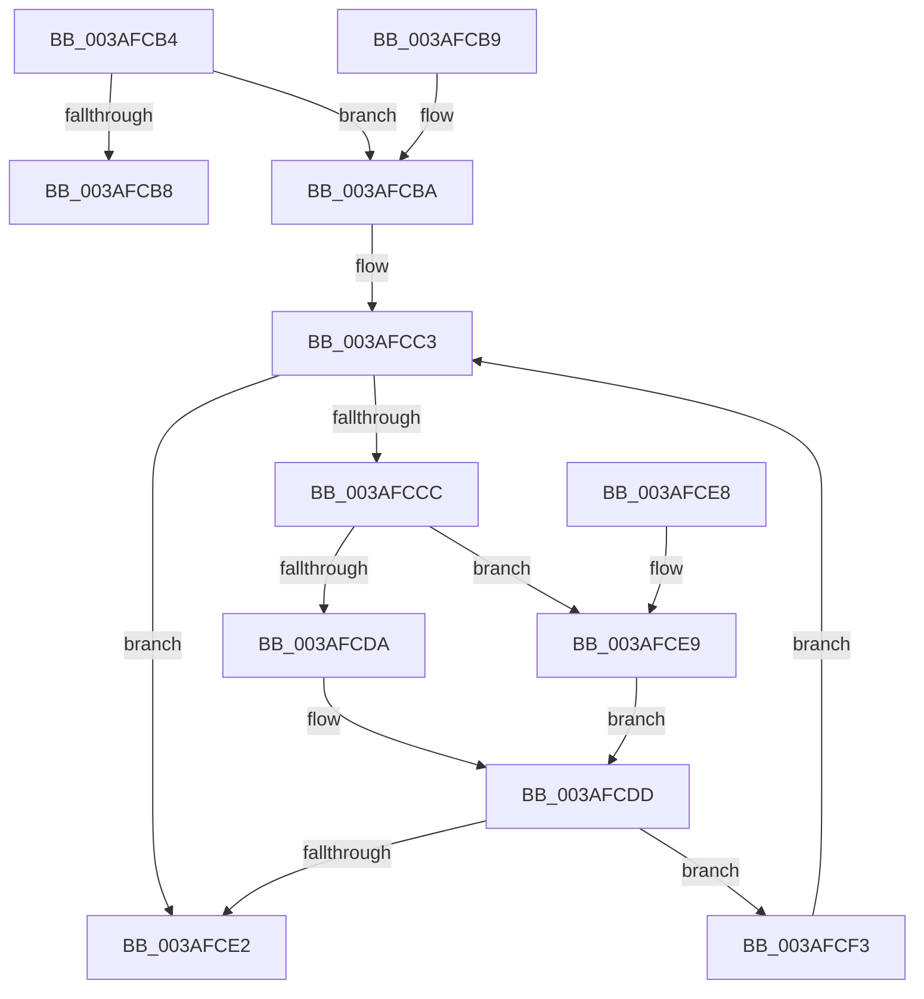

# NP_CONTEXT::NpCleanup

- RVA: `0x003AFCB4`–`0x003AFCFF` (길이 `75` bytes)
- VA: `0x00000001403AFCB4`
- 실행 섹션: `.text`
- PDB 이름 있음: `예`; PDB Function 태그: `아니요`
- unwind 정보 RVA: `0x0008C180`
- 디코드: `29`개 명령, `75/75` bytes 표시
- 미해석 바이트: `0` (있으면 어셈블리에 `.byte`로 보존)

> 이 문서는 커널 이미지의 기계어와 PDB 기호를 분석해 생성했습니다. 4번과 5번은 함수 원형과 자료형을 바이너리 사용 방식에서 추정한 C 해석이며 원본 소스 복구 결과는 아닙니다.

## 1. Dependencies

- 직접 호출 지점: **1**; 고유 호출 대상: **1**
- 직접 호출자로 확인된 함수: **1**
- RIP 상대 이미지 참조: **0**

### Outgoing calls
- `0x003AFCF8` → [ExFreePoolWithTag](../../poolcode/B8/ExFreePoolWithTag_function_00B82870.md) (function, `0x00B82870`)

### Direct callers
- [ST_STORE&lt;SM_TRAITS&gt;::StDmCleanup](ST_STORE_SM_TRAITS_StDmCleanup_function_003AF8D4.md) at `0x003AF9C1`
- [ST_STORE&lt;SM_TRAITS&gt;::StDmCleanup](ST_STORE_SM_TRAITS_StDmCleanup_function_003AF8D4.md) at `0x003AF9D2`
- [ST_STORE&lt;SM_TRAITS&gt;::StDmCleanup](ST_STORE_SM_TRAITS_StDmCleanup_function_003AF8D4.md) at `0x003AF9E3`

### Static image references
- 디코드된 RIP-relative 메모리 참조가 없습니다.

## 2. Other-region calls and transfers

- 다른 실행 섹션으로 향하는 call: **1**
  - `0x003AFCF8` → [ExFreePoolWithTag](../../poolcode/B8/ExFreePoolWithTag_function_00B82870.md) (`.text` → `POOLCODE`)
- 별도 외부 분기/꼬리 이동을 확인하지 못했습니다.

## 3. Assembly (complete function range)

```asm
003AFCB4  85 D2                           test edx, edx
003AFCB6  74 02                           je 0x1403afcba
003AFCB8  C3                              ret
003AFCB9  CC                              int3
003AFCBA  53                              push rbx
003AFCBB  48 83 EC 20                     sub rsp, 0x20
003AFCBF  48 8D 59 40                     lea rbx, [rcx + 0x40]
003AFCC3  48 8B 4B 08                     mov rcx, qword ptr [rbx + 8]
003AFCC7  48 3B CB                        cmp rcx, rbx
003AFCCA  74 16                           je 0x1403afce2
003AFCCC  4C 8B 03                        mov r8, qword ptr [rbx]
003AFCCF  49 8B 00                        mov rax, qword ptr [r8]
003AFCD2  48 89 03                        mov qword ptr [rbx], rax
003AFCD5  4C 3B C1                        cmp r8, rcx
003AFCD8  74 0F                           je 0x1403afce9
003AFCDA  48 FF 09                        dec qword ptr [rcx]
003AFCDD  4D 85 C0                        test r8, r8
003AFCE0  75 11                           jne 0x1403afcf3
003AFCE2  48 83 C4 20                     add rsp, 0x20
003AFCE6  5B                              pop rbx
003AFCE7  C3                              ret
003AFCE8  CC                              int3
003AFCE9  48 83 23 00                     and qword ptr [rbx], 0
003AFCED  48 89 5B 08                     mov qword ptr [rbx + 8], rbx
003AFCF1  EB EA                           jmp 0x1403afcdd
003AFCF3  33 D2                           xor edx, edx
003AFCF5  49 8B C8                        mov rcx, r8
003AFCF8  E8 73 2B 7D 00                  call 0x140b82870
003AFCFD  EB C4                           jmp 0x1403afcc3
```

## 4. C-style interpretation (structured pseudocode)

```c
__int64 __fastcall NP_CONTEXT__NpCleanup(__int64 a1, int a2)
{
    __int64 result;
    __int64 v_rsp;

    if (a2 == 0) goto loc_003AFCBA;
    return result;
loc_003AFCBA:
    v_rsp = (v_rsp) - (32);
loc_003AFCC3:
    if ((*(unsigned __int64 *)(a1 + 64 + 8)) == (a1 + 64)) goto loc_003AFCE2;
    *(unsigned __int64 *)(a1 + 64) = *(unsigned __int64 *)(*(unsigned __int64 *)(a1 + 64));
    if ((*(unsigned __int64 *)(a1 + 64)) == (*(unsigned __int64 *)(a1 + 64 + 8))) goto loc_003AFCE9;
loc_003AFCDD:
    if (*(unsigned __int64 *)(a1 + 64) != 0) goto loc_003AFCF3;
loc_003AFCE2:
    v_rsp = (v_rsp) + (32);
    return *(unsigned __int64 *)(*(unsigned __int64 *)(a1 + 64));
loc_003AFCE9:
    *(unsigned __int64 *)(a1 + 64 + 8) = a1 + 64;
    goto loc_003AFCDD;
loc_003AFCF3:
    a2 = 0;
    result = ExFreePoolWithTag(*(unsigned __int64 *)(a1 + 64), a2, *(unsigned __int64 *)(a1 + 64), a4);
    goto loc_003AFCC3;
}
```

## 5. (Beta) C Style

```c
int64_t NP_CONTEXT__NpCleanup(void *Arg1, int32_t Arg2)
{
    uint8_t *arg1 = (uint8_t *)Arg1;

    int64_t result;
    int64_t local_rsp;

    if (Arg2 == 0) goto loc_003AFCBA;
    return result;
loc_003AFCBA:
    local_rsp = (local_rsp) - (32);
loc_003AFCC3:
    if ((*(uint64_t *)(arg1 + 0x40 + 0x8)) == (Arg1 + 64)) goto loc_003AFCE2;
    *(uint64_t *)(arg1 + 0x40) = *(uint64_t *)(*(uint64_t *)(arg1 + 0x40));
    if ((*(uint64_t *)(arg1 + 0x40)) == (*(uint64_t *)(arg1 + 0x40 + 0x8))) goto loc_003AFCE9;
loc_003AFCDD:
    if (*(uint64_t *)(arg1 + 0x40) != 0) goto loc_003AFCF3;
loc_003AFCE2:
    local_rsp = (local_rsp) + (32);
    return *(uint64_t *)(*(uint64_t *)(arg1 + 0x40));
loc_003AFCE9:
    *(void **)(arg1 + 0x40 + 0x8) = Arg1 + 64;
    goto loc_003AFCDD;
loc_003AFCF3:
    Arg2 = 0;
    result = ExFreePoolWithTag(*(uint64_t *)(arg1 + 0x40), Arg2, *(uint64_t *)(arg1 + 0x40), a4);
    goto loc_003AFCC3;
}
```

### 관측된 메모리 오프셋

구조체 형식이 확인되지 않은 접근은 인자 기준의 오프셋으로만 기록했습니다.

| 기준 인자 | 오프셋 표현 | 폭 (bit) | 접근 |
|---|---:|---:|---|
| `Arg1` | `+ 0x0` | `64` | `R` |
| `Arg1` | `+ 0x0` | `64` | `R/W` |
| `Arg1` | `+ 0x0` | `64` | `W` |
| `Arg1` | `+ 0x8` | `64` | `R` |
| `Arg1` | `+ 0x8` | `64` | `W` |
| `Arg1` | `+ 0x40` | `64` | `R` |

## 6. Execution-region graph

[열기: 2D/3D 그래프와 함수 탐색 컨트롤 패널](../../../control-panel.html?section=text&rva=0x003AFCB4&view=graph)

- 2D 그래프는 위에서 아래로 흐르고, 3D 그래프는 빈 공간을 드래그해 회전합니다. Shift+드래그는 이동, 휠은 확대·축소, 함수 노드 선택은 대상 보고서 이동입니다.

### Static fallback


