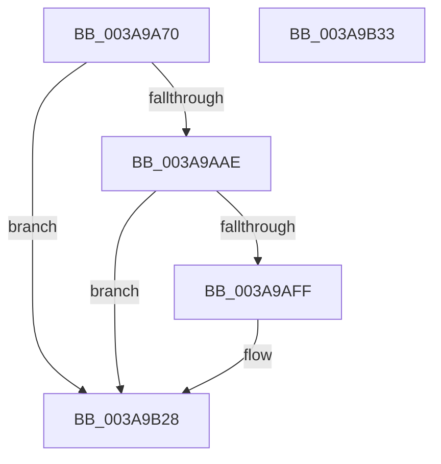

# NP_CONTEXT::NpLeafDerefInternal

- RVA: `0x003A9A70`–`0x003A9B34` (길이 `196` bytes)
- VA: `0x00000001403A9A70`
- 실행 섹션: `.text`
- PDB 이름 있음: `예`; PDB Function 태그: `아니요`
- unwind 정보 RVA: `0x0005CAAC`
- 디코드: `55`개 명령, `196/196` bytes 표시
- 미해석 바이트: `0` (있으면 어셈블리에 `.byte`로 보존)

> 이 문서는 커널 이미지의 기계어와 PDB 기호를 분석해 생성했습니다. 4번과 5번은 함수 원형과 자료형을 바이너리 사용 방식에서 추정한 C 해석이며 원본 소스 복구 결과는 아닙니다.

## 1. Dependencies

- 직접 호출 지점: **1**; 고유 호출 대상: **1**
- 직접 호출자로 확인된 함수: **33**
- RIP 상대 이미지 참조: **2**

### Outgoing calls
- `0x003A9B1D` → [guard_dispatch_icall](../6B/guard_dispatch_icall_function_006BAAD0.md) (function, `0x006BAAD0`)

### Direct callers
- [ST_STORE&lt;SM_TRAITS&gt;::StDmPageRemove](../20/ST_STORE_SM_TRAITS_StDmPageRemove_function_002049A0.md) at `0x00204F94`
- [B_TREE&lt;unsigned long,ST_STORE&lt;SM_TRAITS&gt;::_ST_REGION_ENTRY,4096,NP_CONTEXT,ST_STORE&lt;SM_TRAITS&gt;::ST_REGION_ENTRY_COMPARATOR&gt;::BTreeFindLeafSiblingEx](B_TREE_unsigned_long_ST_STORE_SM_TRAITS__ST_REGION_ENTRY_4096_NP_CONTEXT_ST_STORE_SM_TRAITS_ST_REGIO_function_003A9BD8.md) at `0x003A9CEE`
- [B_TREE&lt;unsigned long,ST_STORE&lt;SM_TRAITS&gt;::_ST_REGION_ENTRY,4096,NP_CONTEXT,ST_STORE&lt;SM_TRAITS&gt;::ST_REGION_ENTRY_COMPARATOR&gt;::BTreeChangeKey](B_TREE_unsigned_long_ST_STORE_SM_TRAITS__ST_REGION_ENTRY_4096_NP_CONTEXT_ST_STORE_SM_TRAITS_ST_REGIO_function_003A9D80.md) at `0x003AA152`
- [B_TREE&lt;unsigned long,ST_STORE&lt;SM_TRAITS&gt;::_ST_HASH_ENTRY,4096,NP_CONTEXT,ST_STORE&lt;SM_TRAITS&gt;::ST_HASH_ENTRY_COMPARATOR&gt;::BTreeMergeNodes](B_TREE_unsigned_long_ST_STORE_SM_TRAITS__ST_HASH_ENTRY_4096_NP_CONTEXT_ST_STORE_SM_TRAITS_ST_HASH_EN_function_003AA404.md) at `0x003AA578`
- [B_TREE&lt;_SM_PAGE_KEY,ST_STORE&lt;SM_TRAITS&gt;::_ST_PAGE_ENTRY,4096,NP_CONTEXT,B_TREE_KEY_COMPARATOR&lt;_SM_PAGE_KEY&gt; &gt;::BTreeFindLeafSiblingEx](B_TREE__SM_PAGE_KEY_ST_STORE_SM_TRAITS__ST_PAGE_ENTRY_4096_NP_CONTEXT_B_TREE_KEY_COMPARATOR__SM_PAGE_function_003AA60C.md) at `0x003AA737`
- [B_TREE&lt;_SM_PAGE_KEY,ST_STORE&lt;SM_TRAITS&gt;::_ST_PAGE_ENTRY,4096,NP_CONTEXT,B_TREE_KEY_COMPARATOR&lt;_SM_PAGE_KEY&gt; &gt;::BTreeMergeNodes](B_TREE__SM_PAGE_KEY_ST_STORE_SM_TRAITS__ST_PAGE_ENTRY_4096_NP_CONTEXT_B_TREE_KEY_COMPARATOR__SM_PAGE_function_003AADC4.md) at `0x003AAF01`
- [sub_003AB2CC](Unknown_function_003AB2CC.md) at `0x003AB374`
- [sub_003AB473](Unknown_function_003AB473.md) at `0x003AB4A4`
- [sub_003AB904](Unknown_function_003AB904.md) at `0x003AB9DE`
- [sub_003ABA1D](Unknown_function_003ABA1D.md) at `0x003ABA90`
- [sub_003ABC8C](Unknown_function_003ABC8C.md) at `0x003ABDC5`
- [sub_003ABC8C](Unknown_function_003ABC8C.md) at `0x003ABE55`
- [B_TREE&lt;_SM_PAGE_KEY,ST_STORE&lt;SM_TRAITS&gt;::_ST_PAGE_ENTRY,4096,NP_CONTEXT,B_TREE_KEY_COMPARATOR&lt;_SM_PAGE_KEY&gt; &gt;::BTreeSearchResultDeref](B_TREE__SM_PAGE_KEY_ST_STORE_SM_TRAITS__ST_PAGE_ENTRY_4096_NP_CONTEXT_B_TREE_KEY_COMPARATOR__SM_PAGE_function_003AC5D0.md) at `0x003AC6B8`
- [B_TREE&lt;unsigned long,ST_STORE&lt;SM_TRAITS&gt;::_ST_REGION_ENTRY,4096,NP_CONTEXT,ST_STORE&lt;SM_TRAITS&gt;::ST_REGION_ENTRY_COMPARATOR&gt;::BTreeSearchResultDeref](B_TREE_unsigned_long_ST_STORE_SM_TRAITS__ST_REGION_ENTRY_4096_NP_CONTEXT_ST_STORE_SM_TRAITS_ST_REGIO_function_003AD260.md) at `0x003AD3D9`
- [B_TREE&lt;unsigned long,ST_STORE&lt;SM_TRAITS&gt;::_ST_REGION_ENTRY,4096,NP_CONTEXT,ST_STORE&lt;SM_TRAITS&gt;::ST_REGION_ENTRY_COMPARATOR&gt;::BTreeSearchResultDeref](B_TREE_unsigned_long_ST_STORE_SM_TRAITS__ST_REGION_ENTRY_4096_NP_CONTEXT_ST_STORE_SM_TRAITS_ST_REGIO_function_003AD260.md) at `0x003AD3E6`
- [sub_003ADBF3](Unknown_function_003ADBF3.md) at `0x003ADC6E`
- [sub_003ADD5D](Unknown_function_003ADD5D.md) at `0x003ADD8E`
- [B_TREE&lt;unsigned long,ST_STORE&lt;SM_TRAITS&gt;::_ST_HASH_ENTRY,4096,NP_CONTEXT,ST_STORE&lt;SM_TRAITS&gt;::ST_HASH_ENTRY_COMPARATOR&gt;::BTreeSearchResultDeref](B_TREE_unsigned_long_ST_STORE_SM_TRAITS__ST_HASH_ENTRY_4096_NP_CONTEXT_ST_STORE_SM_TRAITS_ST_HASH_EN_function_003AE310.md) at `0x003AE3F6`
- [sub_003AE4E1](Unknown_function_003AE4E1.md) at `0x003AE551`
- [sub_003AE68A](Unknown_function_003AE68A.md) at `0x003AE6BB`
- [sub_003AE7FC](Unknown_function_003AE7FC.md) at `0x003AE8BC`
- [sub_003AE7FC](Unknown_function_003AE7FC.md) at `0x003AE958`
- [B_TREE&lt;unsigned long,ST_STORE&lt;SM_TRAITS&gt;::_ST_REGION_ENTRY,4096,NP_CONTEXT,ST_STORE&lt;SM_TRAITS&gt;::ST_REGION_ENTRY_COMPARATOR&gt;::BTreeMergeNodes](B_TREE_unsigned_long_ST_STORE_SM_TRAITS__ST_REGION_ENTRY_4096_NP_CONTEXT_ST_STORE_SM_TRAITS_ST_REGIO_function_003AF47C.md) at `0x003AF5F0`
- [B_TREE&lt;_SM_PAGE_KEY,ST_STORE&lt;SM_TRAITS&gt;::_ST_PAGE_ENTRY,4096,NP_CONTEXT,B_TREE_KEY_COMPARATOR&lt;_SM_PAGE_KEY&gt; &gt;::BTreeFindLeafSibling](../41/B_TREE__SM_PAGE_KEY_ST_STORE_SM_TRAITS__ST_PAGE_ENTRY_4096_NP_CONTEXT_B_TREE_KEY_COMPARATOR__SM_PAGE_function_00410EF0.md) at `0x00410FDC`
- [B_TREE&lt;unsigned long,ST_STORE&lt;SM_TRAITS&gt;::_ST_HASH_ENTRY,4096,NP_CONTEXT,ST_STORE&lt;SM_TRAITS&gt;::ST_HASH_ENTRY_COMPARATOR&gt;::BTreeFindLeafSibling](../43/B_TREE_unsigned_long_ST_STORE_SM_TRAITS__ST_HASH_ENTRY_4096_NP_CONTEXT_ST_STORE_SM_TRAITS_ST_HASH_EN_function_0043F728.md) at `0x0043F814`
- [B_TREE&lt;unsigned long,ST_STORE&lt;SM_TRAITS&gt;::_ST_REGION_ENTRY,4096,NP_CONTEXT,ST_STORE&lt;SM_TRAITS&gt;::ST_REGION_ENTRY_COMPARATOR&gt;::BTreeFindLeafSibling](../45/B_TREE_unsigned_long_ST_STORE_SM_TRAITS__ST_REGION_ENTRY_4096_NP_CONTEXT_ST_STORE_SM_TRAITS_ST_REGIO_function_00450FB8.md) at `0x004510AA`
- [ST_STORE&lt;SM_TRAITS&gt;::StCompactRegions](../4A/ST_STORE_SM_TRAITS_StCompactRegions_function_004A48E0.md) at `0x004A4F40`
- [ST_STORE&lt;SM_TRAITS&gt;::StDmCombineBufferAddEntry](../4E/ST_STORE_SM_TRAITS_StDmCombineBufferAddEntry_function_004EB420.md) at `0x004EB96E`
- [B_TREE&lt;unsigned long,ST_STORE&lt;SM_TRAITS&gt;::_ST_HASH_ENTRY,4096,NP_CONTEXT,ST_STORE&lt;SM_TRAITS&gt;::ST_HASH_ENTRY_COMPARATOR&gt;::BTreeFindLeafSiblingEx](../60/B_TREE_unsigned_long_ST_STORE_SM_TRAITS__ST_HASH_ENTRY_4096_NP_CONTEXT_ST_STORE_SM_TRAITS_ST_HASH_EN_function_0060BB90.md) at `0x0060BC50`
- [sub_006E6C8A](../6E/Unknown_function_006E6C8A.md) at `0x006E6C9B`
- [sub_006E6D3C](../6E/Unknown_function_006E6D3C.md) at `0x006E6DCC`
- [sub_006E6DE4](../6E/Unknown_function_006E6DE4.md) at `0x006E6DF5`
- [sub_006E6E64](../6E/Unknown_function_006E6E64.md) at `0x006E6EF8`
- [sub_006E6F04](../6E/Unknown_function_006E6F04.md) at `0x006E6F15`
- [sub_006ED0C0](../6E/Unknown_function_006ED0C0.md) at `0x006ED154`
- [sub_006EFF4C](../6E/Unknown_function_006EFF4C.md) at `0x006EFFE0`

### Static image references
- `0x003A9AC2` → RVA `0x00FC6AA0` (`ALMOSTRO`; read)
- `0x003A9B02` → RVA `0x0060C190` (`NP_CONTEXT::NpiRebaseCallback`; read)

## 2. Other-region calls and transfers

- 다른 실행 섹션으로 향하는 call: **0**
- 별도 외부 분기/꼬리 이동을 확인하지 못했습니다.

## 3. Assembly (complete function range)

```asm
003A9A70  48 89 5C 24 08                  mov qword ptr [rsp + 8], rbx
003A9A75  57                              push rdi
003A9A76  48 83 EC 20                     sub rsp, 0x20
003A9A7A  44 8B 02                        mov r8d, dword ptr [rdx]
003A9A7D  41 BB FC 0F 00 00               mov r11d, 0xffc
003A9A83  41 8B C0                        mov eax, r8d
003A9A86  48 8B F9                        mov rdi, rcx
003A9A89  C1 E8 02                        shr eax, 2
003A9A8C  B9 FF 03 00 00                  mov ecx, 0x3ff
003A9A91  FF C8                           dec eax
003A9A93  4C 8B D2                        mov r10, rdx
003A9A96  44 8D 0C 85 00 00 00 00         lea r9d, [rax*4]
003A9A9E  45 33 C8                        xor r9d, r8d
003A9AA1  45 23 CB                        and r9d, r11d
003A9AA4  45 33 C8                        xor r9d, r8d
003A9AA7  44 89 0A                        mov dword ptr [rdx], r9d
003A9AAA  85 C1                           test ecx, eax
003A9AAC  75 7A                           jne 0x1403a9b28
003A9AAE  41 83 E1 FD                     and r9d, 0xfffffffd
003A9AB2  48 B8 20 03 00 00 80 F7 FF FF   movabs rax, 0xfffff78000000320
003A9ABC  44 89 0A                        mov dword ptr [rdx], r9d
003A9ABF  48 8B 18                        mov rbx, qword ptr [rax]
003A9AC2  8B 05 D8 CF C1 00               mov eax, dword ptr [rip + 0xc1cfd8]
003A9AC8  48 C1 FB 0C                     sar rbx, 0xc
003A9ACC  8B DB                           mov ebx, ebx
003A9ACE  48 0F AF D8                     imul rbx, rax
003A9AD2  48 8B 07                        mov rax, qword ptr [rdi]
003A9AD5  48 C1 FB 11                     sar rbx, 0x11
003A9AD9  8B D3                           mov edx, ebx
003A9ADB  2B 50 34                        sub edx, dword ptr [rax + 0x34]
003A9ADE  41 8B 02                        mov eax, dword ptr [r10]
003A9AE1  3B D1                           cmp edx, ecx
003A9AE3  0F 47 D1                        cmova edx, ecx
003A9AE6  8D 0C 95 00 00 00 00            lea ecx, [rdx*4]
003A9AED  33 C8                           xor ecx, eax
003A9AEF  41 23 CB                        and ecx, r11d
003A9AF2  33 C8                           xor ecx, eax
003A9AF4  41 89 0A                        mov dword ptr [r10], ecx
003A9AF7  81 FA FF 02 00 00               cmp edx, 0x2ff
003A9AFD  72 29                           jb 0x1403a9b28
003A9AFF  48 8B 0F                        mov rcx, qword ptr [rdi]
003A9B02  48 8D 15 87 26 26 00            lea rdx, [rip + 0x262687]
003A9B09  81 C3 01 FE FF FF               add ebx, 0xfffffe01
003A9B0F  44 8B C3                        mov r8d, ebx
003A9B12  44 2B 41 34                     sub r8d, dword ptr [rcx + 0x34]
003A9B16  48 8B 41 08                     mov rax, qword ptr [rcx + 8]
003A9B1A  48 8B CF                        mov rcx, rdi
003A9B1D  E8 AE 0F 31 00                  call 0x1406baad0
003A9B22  48 8B 07                        mov rax, qword ptr [rdi]
003A9B25  89 58 34                        mov dword ptr [rax + 0x34], ebx
003A9B28  48 8B 5C 24 30                  mov rbx, qword ptr [rsp + 0x30]
003A9B2D  48 83 C4 20                     add rsp, 0x20
003A9B31  5F                              pop rdi
003A9B32  C3                              ret
003A9B33  CC                              int3
```

## 4. C-style interpretation (structured pseudocode)

```c
__int64 __fastcall NP_CONTEXT__NpLeafDerefInternal(__int64 a1, __int64 a2)
{
    __int64 result;
    __int64 v_rbx;
    __int64 v_rsp;
    unsigned __int64 v_stack_p8;

    v_stack_p8 = v_rbx;
    v_rsp = (v_rsp) - (32);
    result = (unsigned int)(((unsigned int)((unsigned int)((unsigned int)(*(unsigned int *)(a2))))) >> (2));
    result = (unsigned int)((result) - 1);
    a4 = (unsigned int)((result * 4) ^ ((unsigned int)((unsigned int)(*(unsigned int *)(a2)))));
    a4 = (unsigned int)((a4) & ((unsigned int)((unsigned int)(0xFFCULL))));
    a4 = (unsigned int)((a4) ^ ((unsigned int)((unsigned int)(*(unsigned int *)(a2)))));
    *(unsigned int *)(a2) = (unsigned int)(a4);
    if ((((unsigned int)((unsigned int)(0x3FFULL))) & ((unsigned int)(result))) != 0) goto loc_003A9B28;
    a4 = (unsigned int)((a4) & (0xFFFFFFFDULL));
    *(unsigned int *)(a2) = (unsigned int)(a4);
    v_rbx = (*(unsigned __int64 *)(result)) >> (12);
    v_rbx = ((unsigned int)((unsigned int)(v_rbx))) * ((unsigned int)(*(unsigned int *)(v_rip + 12701656)));
    v_rbx = (v_rbx) >> (17);
    a2 = (unsigned int)(((unsigned int)((unsigned int)(v_rbx))) - (*(unsigned int *)(*(unsigned __int64 *)(a1) + 52)));
    if (((unsigned int)(a2)) > ((unsigned int)((unsigned int)(0x3FFULL)))) { a2 = (unsigned int)((unsigned int)(0x3FFULL)); }
    a1 = (unsigned int)((a2 * 4) ^ ((unsigned int)((unsigned int)(*(unsigned int *)(a2)))));
    a1 = (unsigned int)((a1) & ((unsigned int)((unsigned int)(0xFFCULL))));
    a1 = (unsigned int)((a1) ^ ((unsigned int)((unsigned int)(*(unsigned int *)(a2)))));
    *(unsigned int *)(a2) = (unsigned int)(a1);
    result = (unsigned int)(*(unsigned int *)(a2));
    if (((unsigned int)(a2)) >= 767) {
        a1 = *(unsigned __int64 *)(a1);
        a2 = v_rip + 2500231;
        v_rbx = (unsigned int)((v_rbx) + (0xFFFFFE01ULL));
        a3 = (unsigned int)(v_rbx);
        a3 = (unsigned int)((a3) - (*(unsigned int *)(a1 + 52)));
        result = *(unsigned __int64 *)(a1 + 8);
        a1 = a1;
        result = guard_dispatch_icall(a1, a2, a3, a4);
        result = *(unsigned __int64 *)(a1);
        *(unsigned int *)(result + 52) = (unsigned int)(v_rbx);
    }
    v_rsp = (v_rsp) + (32);
    return result;
}
```

## 5. (Beta) C Style

```c
int64_t NP_CONTEXT__NpLeafDerefInternal(void *Arg1, void *Arg2)
{
    uint8_t *arg1 = (uint8_t *)Arg1;
    uint8_t *arg2 = (uint8_t *)Arg2;

    int64_t result;
    int64_t local_rbx;
    int64_t local_rsp;
    uint64_t v_stack_p8;

    v_stack_p8 = local_rbx;
    local_rsp = (local_rsp) - (32);
    result = (uint32_t)(((uint32_t)((uint32_t)((uint32_t)(*(uint32_t *)(arg2))))) >> (2));
    result = (uint32_t)((result) - 1);
    a4 = (uint32_t)((result * 4) ^ ((uint32_t)((uint32_t)(*(uint32_t *)(arg2)))));
    a4 = (uint32_t)((a4) & ((uint32_t)((uint32_t)(0xFFCULL))));
    a4 = (uint32_t)((a4) ^ ((uint32_t)((uint32_t)(*(uint32_t *)(arg2)))));
    *(uint32_t *)(arg2) = (uint32_t)(a4);
    if ((((uint32_t)((uint32_t)(0x3FFULL))) & ((uint32_t)(result))) != 0) goto loc_003A9B28;
    a4 = (uint32_t)((a4) & (0xFFFFFFFDULL));
    *(uint32_t *)(arg2) = (uint32_t)(a4);
    local_rbx = (*(uint64_t *)(result)) >> (12);
    local_rbx = ((uint32_t)((uint32_t)(local_rbx))) * ((uint32_t)(*(uint32_t *)(v_rip + 0xC1CFD8)));
    local_rbx = (local_rbx) >> (17);
    Arg2 = (uint32_t)(((uint32_t)((uint32_t)(local_rbx))) - (*(uint32_t *)(*(uint64_t *)(arg1) + 0x34)));
    if (((uint32_t)(Arg2)) > ((uint32_t)((uint32_t)(0x3FFULL)))) { Arg2 = (uint32_t)((uint32_t)(0x3FFULL)); }
    Arg1 = (uint32_t)((Arg2 * 4) ^ ((uint32_t)((uint32_t)(*(uint32_t *)(arg2)))));
    Arg1 = (uint32_t)((Arg1) & ((uint32_t)((uint32_t)(0xFFCULL))));
    Arg1 = (uint32_t)((Arg1) ^ ((uint32_t)((uint32_t)(*(uint32_t *)(arg2)))));
    *(uint32_t *)(arg2) = (uint32_t)(Arg1);
    result = (uint32_t)(*(uint32_t *)(arg2));
    if (((uint32_t)(Arg2)) >= 767) {
        Arg1 = *(uint64_t *)(arg1);
        Arg2 = v_rip + 2500231;
        local_rbx = (uint32_t)((local_rbx) + (0xFFFFFE01ULL));
        a3 = (uint32_t)(local_rbx);
        a3 = (uint32_t)((a3) - (*(uint32_t *)(arg1 + 0x34)));
        result = *(uint64_t *)(arg1 + 0x8);
        Arg1 = Arg1;
        result = guard_dispatch_icall(Arg1, Arg2, a3, a4);
        result = *(uint64_t *)(arg1);
        *(uint32_t *)(result + 0x34) = (uint32_t)(local_rbx);
    }
    local_rsp = (local_rsp) + (32);
    return result;
}
```

### 관측된 메모리 오프셋

구조체 형식이 확인되지 않은 접근은 인자 기준의 오프셋으로만 기록했습니다.

| 기준 인자 | 오프셋 표현 | 폭 (bit) | 접근 |
|---|---:|---:|---|
| `Arg1` | `+ 0x0` | `64` | `R` |
| `Arg2` | `+ 0x0` | `32` | `R` |
| `Arg2` | `+ 0x0` | `32` | `W` |

## 6. Execution-region graph

[열기: 2D/3D 그래프와 함수 탐색 컨트롤 패널](../../../control-panel.html?section=text&rva=0x003A9A70&view=graph)

- 2D 그래프는 위에서 아래로 흐르고, 3D 그래프는 빈 공간을 드래그해 회전합니다. Shift+드래그는 이동, 휠은 확대·축소, 함수 노드 선택은 대상 보고서 이동입니다.

### Static fallback


