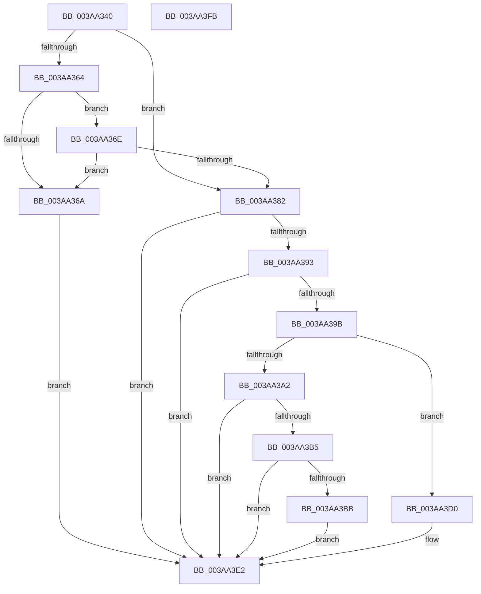

# NP_CONTEXT::NpLeafRefInternal

- RVA: `0x003AA340`–`0x003AA3FC` (길이 `188` bytes)
- VA: `0x00000001403AA340`
- 실행 섹션: `.text`
- PDB 이름 있음: `예`; PDB Function 태그: `아니요`
- unwind 정보 RVA: `0x0006F978`
- 디코드: `60`개 명령, `188/188` bytes 표시
- 미해석 바이트: `0` (있으면 어셈블리에 `.byte`로 보존)

> 이 문서는 커널 이미지의 기계어와 PDB 기호를 분석해 생성했습니다. 4번과 5번은 함수 원형과 자료형을 바이너리 사용 방식에서 추정한 C 해석이며 원본 소스 복구 결과는 아닙니다.

## 1. Dependencies

- 직접 호출 지점: **4**; 고유 호출 대상: **3**
- 직접 호출자로 확인된 함수: **20**
- RIP 상대 이미지 참조: **0**

### Outgoing calls
- `0x003AA377` → [NP_CONTEXT::NpiLeafPageIn](../60/NP_CONTEXT_NpiLeafPageIn_function_0060C01C.md) (function, `0x0060C01C`)
- `0x003AA385` → [NP_CONTEXT::NpGetResidentLeaf](../60/NP_CONTEXT_NpGetResidentLeaf_function_0060BED0.md) (function, `0x0060BED0`)
- `0x003AA3C2` → [guard_dispatch_icall](../6B/guard_dispatch_icall_function_006BAAD0.md) (function, `0x006BAAD0`)
- `0x003AA3DD` → [guard_dispatch_icall](../6B/guard_dispatch_icall_function_006BAAD0.md) (function, `0x006BAAD0`)

### Direct callers
- [B_TREE&lt;unsigned long,ST_STORE&lt;SM_TRAITS&gt;::_ST_REGION_ENTRY,4096,NP_CONTEXT,ST_STORE&lt;SM_TRAITS&gt;::ST_REGION_ENTRY_COMPARATOR&gt;::BTreeFindLeafSiblingEx](B_TREE_unsigned_long_ST_STORE_SM_TRAITS__ST_REGION_ENTRY_4096_NP_CONTEXT_ST_STORE_SM_TRAITS_ST_REGIO_function_003A9BD8.md) at `0x003A9CE1`
- [B_TREE&lt;unsigned long,ST_STORE&lt;SM_TRAITS&gt;::_ST_REGION_ENTRY,4096,NP_CONTEXT,ST_STORE&lt;SM_TRAITS&gt;::ST_REGION_ENTRY_COMPARATOR&gt;::BTreeChangeKey](B_TREE_unsigned_long_ST_STORE_SM_TRAITS__ST_REGION_ENTRY_4096_NP_CONTEXT_ST_STORE_SM_TRAITS_ST_REGIO_function_003A9D80.md) at `0x003AA147`
- [B_TREE&lt;_SM_PAGE_KEY,ST_STORE&lt;SM_TRAITS&gt;::_ST_PAGE_ENTRY,4096,NP_CONTEXT,B_TREE_KEY_COMPARATOR&lt;_SM_PAGE_KEY&gt; &gt;::BTreeFindLeafSiblingEx](B_TREE__SM_PAGE_KEY_ST_STORE_SM_TRAITS__ST_PAGE_ENTRY_4096_NP_CONTEXT_B_TREE_KEY_COMPARATOR__SM_PAGE_function_003AA60C.md) at `0x003AA71A`
- [sub_003AB473](Unknown_function_003AB473.md) at `0x003AB487`
- [ST_STORE&lt;SM_TRAITS&gt;::StDmpSinglePageLookup](ST_STORE_SM_TRAITS_StDmpSinglePageLookup_function_003ABFF0.md) at `0x003AC367`
- [B_TREE&lt;_SM_PAGE_KEY,ST_STORE&lt;SM_TRAITS&gt;::_ST_PAGE_ENTRY,4096,NP_CONTEXT,B_TREE_KEY_COMPARATOR&lt;_SM_PAGE_KEY&gt; &gt;::BTreeSearchKey](B_TREE__SM_PAGE_KEY_ST_STORE_SM_TRAITS__ST_PAGE_ENTRY_4096_NP_CONTEXT_B_TREE_KEY_COMPARATOR__SM_PAGE_function_003AC3C0.md) at `0x003AC593`
- [sub_003ACCBB](Unknown_function_003ACCBB.md) at `0x003ACCED`
- [B_TREE&lt;unsigned long,ST_STORE&lt;SM_TRAITS&gt;::_ST_REGION_ENTRY,4096,NP_CONTEXT,ST_STORE&lt;SM_TRAITS&gt;::ST_REGION_ENTRY_COMPARATOR&gt;::BTreeSearchKey](B_TREE_unsigned_long_ST_STORE_SM_TRAITS__ST_REGION_ENTRY_4096_NP_CONTEXT_ST_STORE_SM_TRAITS_ST_REGIO_function_003ACD20.md) at `0x003AD235`
- [sub_003ADA80](Unknown_function_003ADA80.md) at `0x003ADA9E`
- [sub_003ADD5D](Unknown_function_003ADD5D.md) at `0x003ADD71`
- [B_TREE&lt;unsigned long,ST_STORE&lt;SM_TRAITS&gt;::_ST_HASH_ENTRY,4096,NP_CONTEXT,ST_STORE&lt;SM_TRAITS&gt;::ST_HASH_ENTRY_COMPARATOR&gt;::BTreeSearchKey](B_TREE_unsigned_long_ST_STORE_SM_TRAITS__ST_HASH_ENTRY_4096_NP_CONTEXT_ST_STORE_SM_TRAITS_ST_HASH_EN_function_003ADDB0.md) at `0x003AE2C9`
- [sub_003AE68A](Unknown_function_003AE68A.md) at `0x003AE69E`
- [B_TREE&lt;_SM_PAGE_KEY,ST_STORE&lt;SM_TRAITS&gt;::_ST_PAGE_ENTRY,4096,NP_CONTEXT,B_TREE_KEY_COMPARATOR&lt;_SM_PAGE_KEY&gt; &gt;::BTreeIteratorAttachEx](../41/B_TREE__SM_PAGE_KEY_ST_STORE_SM_TRAITS__ST_PAGE_ENTRY_4096_NP_CONTEXT_B_TREE_KEY_COMPARATOR__SM_PAGE_function_004110A0.md) at `0x004110E2`
- [B_TREE&lt;unsigned long,ST_STORE&lt;SM_TRAITS&gt;::_ST_HASH_ENTRY,4096,NP_CONTEXT,ST_STORE&lt;SM_TRAITS&gt;::ST_HASH_ENTRY_COMPARATOR&gt;::BTreeFindLeafSiblingEx](../60/B_TREE_unsigned_long_ST_STORE_SM_TRAITS__ST_HASH_ENTRY_4096_NP_CONTEXT_ST_STORE_SM_TRAITS_ST_HASH_EN_function_0060BB90.md) at `0x0060BC01`
- [sub_006E6D20](../6E/Unknown_function_006E6D20.md) at `0x006E6D26`
- [sub_006E6F9A](../6E/Unknown_function_006E6F9A.md) at `0x006E6FA0`
- [sub_006E6FB6](../6E/Unknown_function_006E6FB6.md) at `0x006E6FBC`
- [sub_006EEC06](../6E/Unknown_function_006EEC06.md) at `0x006EECB4`
- [sub_006EF588](../6E/Unknown_function_006EF588.md) at `0x006EF636`
- [sub_006F026C](../6F/Unknown_function_006F026C.md) at `0x006F031D`

### Static image references
- 디코드된 RIP-relative 메모리 참조가 없습니다.

## 2. Other-region calls and transfers

- 다른 실행 섹션으로 향하는 call: **0**
- 별도 외부 분기/꼬리 이동을 확인하지 못했습니다.

## 3. Assembly (complete function range)

```asm
003AA340  48 89 5C 24 08                  mov qword ptr [rsp + 8], rbx
003AA345  48 89 74 24 10                  mov qword ptr [rsp + 0x10], rsi
003AA34A  48 89 7C 24 18                  mov qword ptr [rsp + 0x18], rdi
003AA34F  41 56                           push r14
003AA351  48 83 EC 20                     sub rsp, 0x20
003AA355  8B 02                           mov eax, dword ptr [rdx]
003AA357  41 8B F0                        mov esi, r8d
003AA35A  48 8B DA                        mov rbx, rdx
003AA35D  4C 8B F1                        mov r14, rcx
003AA360  A8 01                           test al, 1
003AA362  75 1E                           jne 0x1403aa382
003AA364  40 F6 C6 01                     test sil, 1
003AA368  74 04                           je 0x1403aa36e
003AA36A  33 FF                           xor edi, edi
003AA36C  EB 74                           jmp 0x1403aa3e2
003AA36E  48 8B 09                        mov rcx, qword ptr [rcx]
003AA371  4C 8B C3                        mov r8, rbx
003AA374  49 8B D6                        mov rdx, r14
003AA377  E8 A0 1C 26 00                  call 0x14060c01c
003AA37C  8B 03                           mov eax, dword ptr [rbx]
003AA37E  A8 01                           test al, 1
003AA380  74 E8                           je 0x1403aa36a
003AA382  48 8B D3                        mov rdx, rbx
003AA385  E8 46 1B 26 00                  call 0x14060bed0
003AA38A  48 8B F8                        mov rdi, rax
003AA38D  40 F6 C6 02                     test sil, 2
003AA391  75 4F                           jne 0x1403aa3e2
003AA393  49 8B 36                        mov rsi, qword ptr [r14]
003AA396  83 3E FF                        cmp dword ptr [rsi], -1
003AA399  74 47                           je 0x1403aa3e2
003AA39B  8B 0B                           mov ecx, dword ptr [rbx]
003AA39D  F6 C1 01                        test cl, 1
003AA3A0  74 2E                           je 0x1403aa3d0
003AA3A2  48 8B 1B                        mov rbx, qword ptr [rbx]
003AA3A5  48 81 E3 00 F0 FF FF            and rbx, 0xfffffffffffff000
003AA3AC  48 8B 53 08                     mov rdx, qword ptr [rbx + 8]
003AA3B0  48 85 D2                        test rdx, rdx
003AA3B3  74 2D                           je 0x1403aa3e2
003AA3B5  8B C2                           mov eax, edx
003AA3B7  A8 02                           test al, 2
003AA3B9  75 27                           jne 0x1403aa3e2
003AA3BB  48 8B 46 20                     mov rax, qword ptr [rsi + 0x20]
003AA3BF  49 8B CE                        mov rcx, r14
003AA3C2  E8 09 07 31 00                  call 0x1406baad0
003AA3C7  83 4B 08 02                     or dword ptr [rbx + 8], 2
003AA3CB  FF 4E 30                        dec dword ptr [rsi + 0x30]
003AA3CE  EB 12                           jmp 0x1403aa3e2
003AA3D0  FF 4E 2C                        dec dword ptr [rsi + 0x2c]
003AA3D3  49 8B CE                        mov rcx, r14
003AA3D6  48 8B 13                        mov rdx, qword ptr [rbx]
003AA3D9  48 8B 46 20                     mov rax, qword ptr [rsi + 0x20]
003AA3DD  E8 EE 06 31 00                  call 0x1406baad0
003AA3E2  48 8B 5C 24 30                  mov rbx, qword ptr [rsp + 0x30]
003AA3E7  48 8B C7                        mov rax, rdi
003AA3EA  48 8B 7C 24 40                  mov rdi, qword ptr [rsp + 0x40]
003AA3EF  48 8B 74 24 38                  mov rsi, qword ptr [rsp + 0x38]
003AA3F4  48 83 C4 20                     add rsp, 0x20
003AA3F8  41 5E                           pop r14
003AA3FA  C3                              ret
003AA3FB  CC                              int3
```

## 4. C-style interpretation (structured pseudocode)

```c
__int64 __fastcall NP_CONTEXT__NpLeafRefInternal(__int64 a1, __int64 a2, int a3)
{
    __int64 result;
    __int64 v_rbx;
    __int64 v_rdi;
    __int64 v_rsp;
    unsigned __int64 v_stack_p10;
    unsigned __int64 v_stack_p18;
    unsigned __int64 v_stack_p8;

    v_stack_p8 = v_rbx;
    v_stack_p10 = v_rsi;
    v_stack_p18 = v_rdi;
    v_rsp = (v_rsp) - (32);
    if ((((unsigned __int8)((unsigned int)(*(unsigned int *)(a2)))) & (1)) != 0) goto loc_003AA382;
    if ((((unsigned __int8)((unsigned int)(a3))) & (1)) == 0) goto loc_003AA36E;
loc_003AA36A:
    v_rdi = 0;
    goto loc_003AA3E2;
loc_003AA36E:
    result = NP_CONTEXT__NpiLeafPageIn(*(unsigned __int64 *)(a1), a1, a2, a4);
    if ((((unsigned __int8)((unsigned int)(*(unsigned int *)(a2)))) & (1)) == 0) goto loc_003AA36A;
loc_003AA382:
    result = NP_CONTEXT__NpGetResidentLeaf(*(unsigned __int64 *)(a1), a2, a2, a4);
    if ((((unsigned __int8)((unsigned int)(a3))) & (2)) != 0) goto loc_003AA3E2;
    if ((*(unsigned int *)(*(unsigned __int64 *)(a1))) == -1) goto loc_003AA3E2;
    if ((((unsigned __int8)((unsigned int)(*(unsigned int *)(a2)))) & (1)) == 0) goto loc_003AA3D0;
    v_rbx = (*(unsigned __int64 *)(a2)) & (0xFFFFFFFFFFFFF000ULL);
    if (*(unsigned __int64 *)(v_rbx + 8) == 0) goto loc_003AA3E2;
    if ((((unsigned __int8)((unsigned int)((unsigned int)(*(unsigned __int64 *)(v_rbx + 8))))) & (2)) != 0) goto loc_003AA3E2;
    result = guard_dispatch_icall(a1, *(unsigned __int64 *)(v_rbx + 8), a2, a4);
    goto loc_003AA3E2;
loc_003AA3D0:
    result = guard_dispatch_icall(a1, *(unsigned __int64 *)(v_rbx), a2, a4);
loc_003AA3E2:
    v_rsp = (v_rsp) + (32);
    return result;
}
```

## 5. (Beta) C Style

```c
int64_t NP_CONTEXT__NpLeafRefInternal(void *Arg1, void *Arg2, int32_t Arg3)
{
    uint8_t *arg1 = (uint8_t *)Arg1;
    uint8_t *arg2 = (uint8_t *)Arg2;

    int64_t result;
    int64_t local_rbx;
    int64_t local_rdi;
    int64_t local_rsp;
    uint64_t v_stack_p10;
    uint64_t v_stack_p18;
    uint64_t v_stack_p8;

    v_stack_p8 = local_rbx;
    v_stack_p10 = local_rsi;
    v_stack_p18 = local_rdi;
    local_rsp = (local_rsp) - (32);
    if ((((uint8_t)((uint32_t)(*(uint32_t *)(arg2)))) & (1)) != 0) goto loc_003AA382;
    if ((((uint8_t)((uint32_t)(Arg3))) & (1)) == 0) goto loc_003AA36E;
loc_003AA36A:
    local_rdi = 0;
    goto loc_003AA3E2;
loc_003AA36E:
    result = NP_CONTEXT__NpiLeafPageIn(*(uint64_t *)(arg1), Arg1, Arg2, a4);
    if ((((uint8_t)((uint32_t)(*(uint32_t *)(arg2)))) & (1)) == 0) goto loc_003AA36A;
loc_003AA382:
    result = NP_CONTEXT__NpGetResidentLeaf(*(uint64_t *)(arg1), Arg2, Arg2, a4);
    if ((((uint8_t)((uint32_t)(Arg3))) & (2)) != 0) goto loc_003AA3E2;
    if ((*(uint32_t *)(*(uint64_t *)(arg1))) == -1) goto loc_003AA3E2;
    if ((((uint8_t)((uint32_t)(*(uint32_t *)(arg2)))) & (1)) == 0) goto loc_003AA3D0;
    local_rbx = (*(uint64_t *)(arg2)) & (0xFFFFFFFFFFFFF000ULL);
    if (*(uint64_t *)(local_rbx + 0x8) == 0) goto loc_003AA3E2;
    if ((((uint8_t)((uint32_t)((uint32_t)(*(uint64_t *)(local_rbx + 0x8))))) & (2)) != 0) goto loc_003AA3E2;
    result = guard_dispatch_icall(Arg1, *(uint64_t *)(local_rbx + 0x8), Arg2, a4);
    goto loc_003AA3E2;
loc_003AA3D0:
    result = guard_dispatch_icall(Arg1, *(uint64_t *)(local_rbx), Arg2, a4);
loc_003AA3E2:
    local_rsp = (local_rsp) + (32);
    return result;
}
```

### 관측된 메모리 오프셋

구조체 형식이 확인되지 않은 접근은 인자 기준의 오프셋으로만 기록했습니다.

| 기준 인자 | 오프셋 표현 | 폭 (bit) | 접근 |
|---|---:|---:|---|
| `Arg1` | `+ 0x0` | `64` | `R` |
| `Arg2` | `+ 0x0` | `32` | `R` |
| `Arg2` | `+ 0x0` | `64` | `R` |

## 6. Execution-region graph

[열기: 2D/3D 그래프와 함수 탐색 컨트롤 패널](../../../control-panel.html?section=text&rva=0x003AA340&view=graph)

- 2D 그래프는 위에서 아래로 흐르고, 3D 그래프는 빈 공간을 드래그해 회전합니다. Shift+드래그는 이동, 휠은 확대·축소, 함수 노드 선택은 대상 보고서 이동입니다.

### Static fallback


