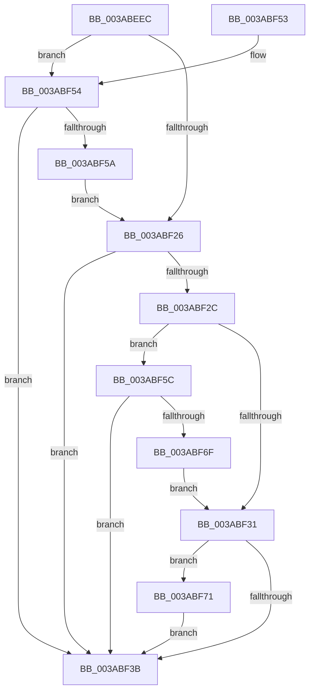

# NP_CONTEXT::NpNodeAllocate

- RVA: `0x003ABEEC`–`0x003ABF7E` (길이 `146` bytes)
- VA: `0x00000001403ABEEC`
- 실행 섹션: `.text`
- PDB 이름 있음: `예`; PDB Function 태그: `아니요`
- unwind 정보 RVA: `0x0007593C`
- 디코드: `45`개 명령, `146/146` bytes 표시
- 미해석 바이트: `0` (있으면 어셈블리에 `.byte`로 보존)

> 이 문서는 커널 이미지의 기계어와 PDB 기호를 분석해 생성했습니다. 4번과 5번은 함수 원형과 자료형을 바이너리 사용 방식에서 추정한 C 해석이며 원본 소스 복구 결과는 아닙니다.

## 1. Dependencies

- 직접 호출 지점: **3**; 고유 호출 대상: **3**
- 직접 호출자로 확인된 함수: **3**
- RIP 상대 이미지 참조: **0**

### Outgoing calls
- `0x003ABF19` → [ExAllocatePool2](../../poolcode/B8/ExAllocatePool2_function_00B820F0.md) (function, `0x00B820F0`)
- `0x003ABF62` → [NP_CONTEXT::NpiGetReservedBuffer](../60/NP_CONTEXT_NpiGetReservedBuffer_function_0060BFA0.md) (function, `0x0060BFA0`)
- `0x003ABF77` → [NP_CONTEXT::NpiPerformPageOut](../60/NP_CONTEXT_NpiPerformPageOut_function_0060C0BC.md) (function, `0x0060C0BC`)

### Direct callers
- [B_TREE&lt;_SM_PAGE_KEY,ST_STORE&lt;SM_TRAITS&gt;::_ST_PAGE_ENTRY,4096,NP_CONTEXT,B_TREE_KEY_COMPARATOR&lt;_SM_PAGE_KEY&gt; &gt;::BTreeNewNode](B_TREE__SM_PAGE_KEY_ST_STORE_SM_TRAITS__ST_PAGE_ENTRY_4096_NP_CONTEXT_B_TREE_KEY_COMPARATOR__SM_PAGE_function_003AAD60.md) at `0x003AAD84`
- [sub_003ABBB5](Unknown_function_003ABBB5.md) at `0x003ABBD1`
- [NP_CONTEXT::NpiLeafPageIn](../60/NP_CONTEXT_NpiLeafPageIn_function_0060C01C.md) at `0x0060C042`

### Static image references
- 디코드된 RIP-relative 메모리 참조가 없습니다.

## 2. Other-region calls and transfers

- 다른 실행 섹션으로 향하는 call: **1**
  - `0x003ABF19` → [ExAllocatePool2](../../poolcode/B8/ExAllocatePool2_function_00B820F0.md) (`.text` → `POOLCODE`)
- 별도 외부 분기/꼬리 이동을 확인하지 못했습니다.

## 3. Assembly (complete function range)

```asm
003ABEEC  48 89 5C 24 08                  mov qword ptr [rsp + 8], rbx
003ABEF1  48 89 6C 24 10                  mov qword ptr [rsp + 0x10], rbp
003ABEF6  48 89 74 24 18                  mov qword ptr [rsp + 0x18], rsi
003ABEFB  57                              push rdi
003ABEFC  48 83 EC 20                     sub rsp, 0x20
003ABF00  48 8B 19                        mov rbx, qword ptr [rcx]
003ABF03  41 8B E8                        mov ebp, r8d
003ABF06  48 8B F1                        mov rsi, rcx
003ABF09  41 B8 73 6D 4E 70               mov r8d, 0x704e6d73
003ABF0F  B9 40 00 00 00                  mov ecx, 0x40
003ABF14  BA 00 10 00 00                  mov edx, 0x1000
003ABF19  E8 D2 61 7D 00                  call 0x140b820f0
003ABF1E  48 8B F8                        mov rdi, rax
003ABF21  48 85 C0                        test rax, rax
003ABF24  74 2E                           je 0x1403abf54
003ABF26  40 F6 C5 01                     test bpl, 1
003ABF2A  74 0F                           je 0x1403abf3b
003ABF2C  48 85 C0                        test rax, rax
003ABF2F  74 2B                           je 0x1403abf5c
003ABF31  FF 43 28                        inc dword ptr [rbx + 0x28]
003ABF34  8B 53 28                        mov edx, dword ptr [rbx + 0x28]
003ABF37  3B 13                           cmp edx, dword ptr [rbx]
003ABF39  77 36                           ja 0x1403abf71
003ABF3B  48 8B 5C 24 30                  mov rbx, qword ptr [rsp + 0x30]
003ABF40  48 8B C7                        mov rax, rdi
003ABF43  48 8B 6C 24 38                  mov rbp, qword ptr [rsp + 0x38]
003ABF48  48 8B 74 24 40                  mov rsi, qword ptr [rsp + 0x40]
003ABF4D  48 83 C4 20                     add rsp, 0x20
003ABF51  5F                              pop rdi
003ABF52  C3                              ret
003ABF53  CC                              int3
003ABF54  40 F6 C5 02                     test bpl, 2
003ABF58  74 E1                           je 0x1403abf3b
003ABF5A  EB CA                           jmp 0x1403abf26
003ABF5C  48 8B D6                        mov rdx, rsi
003ABF5F  48 8B CB                        mov rcx, rbx
003ABF62  E8 39 00 26 00                  call 0x14060bfa0
003ABF67  48 8B F8                        mov rdi, rax
003ABF6A  48 85 C0                        test rax, rax
003ABF6D  74 CC                           je 0x1403abf3b
003ABF6F  EB C0                           jmp 0x1403abf31
003ABF71  48 8B D6                        mov rdx, rsi
003ABF74  48 8B CB                        mov rcx, rbx
003ABF77  E8 40 01 26 00                  call 0x14060c0bc
003ABF7C  EB BD                           jmp 0x1403abf3b
```

## 4. C-style interpretation (structured pseudocode)

```c
__int64 __fastcall NP_CONTEXT__NpNodeAllocate(__int64 a1, __int64 a2, int a3)
{
    __int64 result;
    __int64 v_rsp;
    unsigned __int64 v_stack_p10;
    unsigned __int64 v_stack_p18;
    unsigned __int64 v_stack_p8;

    v_stack_p8 = v_rbx;
    v_stack_p10 = v_rbp;
    v_stack_p18 = v_rsi;
    v_rsp = (v_rsp) - (32);
    result = ExAllocatePool2(64, (unsigned int)(0x1000ULL), (unsigned int)(0x704E6D73ULL), a4);
    if (result == 0) goto loc_003ABF54;
loc_003ABF26:
    if ((((unsigned __int8)((unsigned int)(a3))) & (1)) == 0) goto loc_003ABF3B;
    if (result == 0) goto loc_003ABF5C;
loc_003ABF31:
    if (((unsigned int)((unsigned int)(*(unsigned int *)(*(unsigned __int64 *)(a1) + 40)))) > (*(unsigned int *)(*(unsigned __int64 *)(a1)))) goto loc_003ABF71;
loc_003ABF3B:
    v_rsp = (v_rsp) + (32);
    return result;
loc_003ABF54:
    if ((((unsigned __int8)(v_stack_p10)) & (2)) == 0) goto loc_003ABF3B;
    goto loc_003ABF26;
loc_003ABF5C:
    result = NP_CONTEXT__NpiGetReservedBuffer(v_stack_p8, v_stack_p18, (unsigned int)(0x704E6D73ULL), a4);
    if (result == 0) goto loc_003ABF3B;
    goto loc_003ABF31;
loc_003ABF71:
    result = NP_CONTEXT__NpiPerformPageOut(v_stack_p8, v_stack_p18, (unsigned int)(0x704E6D73ULL), a4);
    goto loc_003ABF3B;
}
```

## 5. (Beta) C Style

```c
int64_t NP_CONTEXT__NpNodeAllocate(void *Arg1, int64_t Arg2, int32_t Arg3)
{
    uint8_t *arg1 = (uint8_t *)Arg1;

    int64_t result;
    int64_t local_rsp;
    uint64_t v_stack_p10;
    uint64_t v_stack_p18;
    uint64_t v_stack_p8;

    v_stack_p8 = local_rbx;
    v_stack_p10 = local_rbp;
    v_stack_p18 = local_rsi;
    local_rsp = (local_rsp) - (32);
    result = ExAllocatePool2(64, (uint32_t)(0x1000ULL), (uint32_t)(0x704E6D73ULL), a4);
    if (result == 0) goto loc_003ABF54;
loc_003ABF26:
    if ((((uint8_t)((uint32_t)(Arg3))) & (1)) == 0) goto loc_003ABF3B;
    if (result == 0) goto loc_003ABF5C;
loc_003ABF31:
    if (((uint32_t)((uint32_t)(*(uint32_t *)(*(uint64_t *)(arg1) + 0x28)))) > (*(uint32_t *)(*(uint64_t *)(arg1)))) goto loc_003ABF71;
loc_003ABF3B:
    local_rsp = (local_rsp) + (32);
    return result;
loc_003ABF54:
    if ((((uint8_t)(v_stack_p10)) & (2)) == 0) goto loc_003ABF3B;
    goto loc_003ABF26;
loc_003ABF5C:
    result = NP_CONTEXT__NpiGetReservedBuffer(v_stack_p8, v_stack_p18, (uint32_t)(0x704E6D73ULL), a4);
    if (result == 0) goto loc_003ABF3B;
    goto loc_003ABF31;
loc_003ABF71:
    result = NP_CONTEXT__NpiPerformPageOut(v_stack_p8, v_stack_p18, (uint32_t)(0x704E6D73ULL), a4);
    goto loc_003ABF3B;
}
```

### 관측된 메모리 오프셋

구조체 형식이 확인되지 않은 접근은 인자 기준의 오프셋으로만 기록했습니다.

| 기준 인자 | 오프셋 표현 | 폭 (bit) | 접근 |
|---|---:|---:|---|
| `Arg1` | `+ 0x0` | `64` | `R` |

## 6. Execution-region graph

[열기: 2D/3D 그래프와 함수 탐색 컨트롤 패널](../../../control-panel.html?section=text&rva=0x003ABEEC&view=graph)

- 2D 그래프는 위에서 아래로 흐르고, 3D 그래프는 빈 공간을 드래그해 회전합니다. Shift+드래그는 이동, 휠은 확대·축소, 함수 노드 선택은 대상 보고서 이동입니다.

### Static fallback


