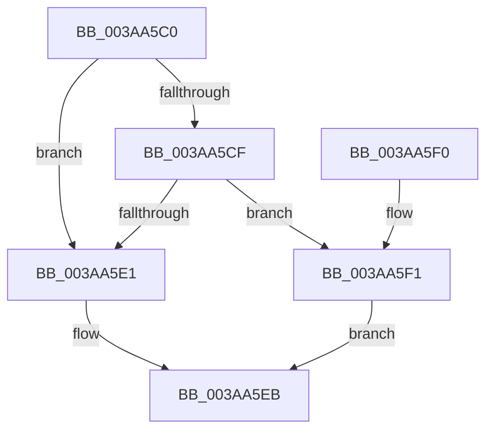

# NP_CONTEXT::NpNodeFree

- RVA: `0x003AA5C0`–`0x003AA605` (길이 `69` bytes)
- VA: `0x00000001403AA5C0`
- 실행 섹션: `.text`
- PDB 이름 있음: `예`; PDB Function 태그: `아니요`
- unwind 정보 RVA: `0x0008A618`
- 디코드: `23`개 명령, `69/69` bytes 표시
- 미해석 바이트: `0` (있으면 어셈블리에 `.byte`로 보존)

> 이 문서는 커널 이미지의 기계어와 PDB 기호를 분석해 생성했습니다. 4번과 5번은 함수 원형과 자료형을 바이너리 사용 방식에서 추정한 C 해석이며 원본 소스 복구 결과는 아닙니다.

## 1. Dependencies

- 직접 호출 지점: **1**; 고유 호출 대상: **1**
- 직접 호출자로 확인된 함수: **3**
- RIP 상대 이미지 참조: **0**

### Outgoing calls
- `0x003AA5E6` → [ExFreePoolWithTag](../../poolcode/B8/ExFreePoolWithTag_function_00B82870.md) (function, `0x00B82870`)

### Direct callers
- [B_TREE&lt;_SM_PAGE_KEY,ST_STORE&lt;SM_TRAITS&gt;::_ST_PAGE_ENTRY,4096,NP_CONTEXT,B_TREE_KEY_COMPARATOR&lt;_SM_PAGE_KEY&gt; &gt;::BTreeDeleteNode](B_TREE__SM_PAGE_KEY_ST_STORE_SM_TRAITS__ST_PAGE_ENTRY_4096_NP_CONTEXT_B_TREE_KEY_COMPARATOR__SM_PAGE_function_003AA598.md) at `0x003AA5AE`
- [NP_CONTEXT::NpiLeafPageIn](../60/NP_CONTEXT_NpiLeafPageIn_function_0060C01C.md) at `0x0060C079`
- [NP_CONTEXT::NpiPerformPageOut](../60/NP_CONTEXT_NpiPerformPageOut_function_0060C0BC.md) at `0x0060C147`

### Static image references
- 디코드된 RIP-relative 메모리 참조가 없습니다.

## 2. Other-region calls and transfers

- 다른 실행 섹션으로 향하는 call: **1**
  - `0x003AA5E6` → [ExFreePoolWithTag](../../poolcode/B8/ExFreePoolWithTag_function_00B82870.md) (`.text` → `POOLCODE`)
- 별도 외부 분기/꼬리 이동을 확인하지 못했습니다.

## 3. Assembly (complete function range)

```asm
003AA5C0  48 83 EC 28                     sub rsp, 0x28
003AA5C4  4C 8B CA                        mov r9, rdx
003AA5C7  48 8B 11                        mov rdx, qword ptr [rcx]
003AA5CA  45 85 C0                        test r8d, r8d
003AA5CD  74 12                           je 0x1403aa5e1
003AA5CF  48 8B 42 48                     mov rax, qword ptr [rdx + 0x48]
003AA5D3  FF 4A 28                        dec dword ptr [rdx + 0x28]
003AA5D6  48 8B 08                        mov rcx, qword ptr [rax]
003AA5D9  8B 42 04                        mov eax, dword ptr [rdx + 4]
003AA5DC  48 3B C8                        cmp rcx, rax
003AA5DF  72 10                           jb 0x1403aa5f1
003AA5E1  33 D2                           xor edx, edx
003AA5E3  49 8B C9                        mov rcx, r9
003AA5E6  E8 85 82 7D 00                  call 0x140b82870
003AA5EB  48 83 C4 28                     add rsp, 0x28
003AA5EF  C3                              ret
003AA5F0  CC                              int3
003AA5F1  48 8D 41 01                     lea rax, [rcx + 1]
003AA5F5  49 89 01                        mov qword ptr [r9], rax
003AA5F8  48 8B 42 48                     mov rax, qword ptr [rdx + 0x48]
003AA5FC  4C 89 08                        mov qword ptr [rax], r9
003AA5FF  4C 89 4A 48                     mov qword ptr [rdx + 0x48], r9
003AA603  EB E6                           jmp 0x1403aa5eb
```

## 4. C-style interpretation (structured pseudocode)

```c
__int64 __fastcall NP_CONTEXT__NpNodeFree(__int64 a1, __int64 a2, int a3)
{
    __int64 result;
    __int64 v_rsp;

    v_rsp = (v_rsp) - (40);
    if (a3 == 0) goto loc_003AA5E1;
    if ((*(unsigned __int64 *)(*(unsigned __int64 *)(*(unsigned __int64 *)(a1) + 72))) < ((unsigned int)(*(unsigned int *)(*(unsigned __int64 *)(a1) + 4)))) goto loc_003AA5F1;
loc_003AA5E1:
    a2 = 0;
    result = ExFreePoolWithTag(0, a2, a3, a2);
loc_003AA5EB:
    v_rsp = (v_rsp) + (40);
    return result;
loc_003AA5F1:
    *(unsigned __int64 *)(a2) = 0 + 1;
    *(unsigned __int64 *)(*(unsigned __int64 *)(a2 + 72)) = 0;
    *(unsigned __int64 *)(a2 + 72) = 0;
    goto loc_003AA5EB;
}
```

## 5. (Beta) C Style

```c
int64_t NP_CONTEXT__NpNodeFree(void *Arg1, void *Arg2, int32_t Arg3)
{
    uint8_t *arg1 = (uint8_t *)Arg1;
    uint8_t *arg2 = (uint8_t *)Arg2;

    int64_t result;
    int64_t local_rsp;

    local_rsp = (local_rsp) - (40);
    if (Arg3 == 0) goto loc_003AA5E1;
    if ((*(uint64_t *)(*(uint64_t *)(*(uint64_t *)(arg1) + 0x48))) < ((uint32_t)(*(uint32_t *)(*(uint64_t *)(arg1) + 0x4)))) goto loc_003AA5F1;
loc_003AA5E1:
    Arg2 = 0;
    result = ExFreePoolWithTag(0, Arg2, Arg3, Arg2);
loc_003AA5EB:
    local_rsp = (local_rsp) + (40);
    return result;
loc_003AA5F1:
    *(uint64_t *)(arg2) = 0 + 1;
    *(uint64_t *)(*(uint64_t *)(arg2 + 0x48)) = 0;
    *(uint64_t *)(arg2 + 0x48) = 0;
    goto loc_003AA5EB;
}
```

### 관측된 메모리 오프셋

구조체 형식이 확인되지 않은 접근은 인자 기준의 오프셋으로만 기록했습니다.

| 기준 인자 | 오프셋 표현 | 폭 (bit) | 접근 |
|---|---:|---:|---|
| `Arg1` | `+ 0x0` | `64` | `R` |
| `Arg2` | `+ 0x0` | `64` | `W` |

## 6. Execution-region graph

[열기: 2D/3D 그래프와 함수 탐색 컨트롤 패널](../../../control-panel.html?section=text&rva=0x003AA5C0&view=graph)

- 2D 그래프는 위에서 아래로 흐르고, 3D 그래프는 빈 공간을 드래그해 회전합니다. Shift+드래그는 이동, 휠은 확대·축소, 함수 노드 선택은 대상 보고서 이동입니다.

### Static fallback


