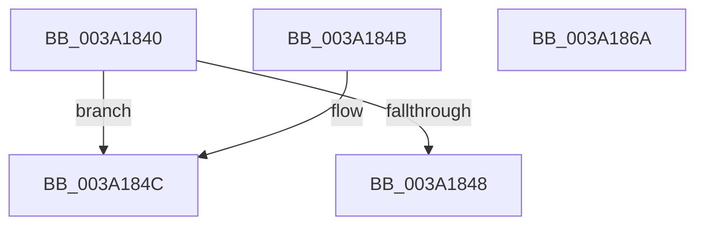

# OBJECT_HEADER_TO_HANDLE_REVOCATION_INFO

- RVA: `0x003A1840`–`0x003A186B` (길이 `43` bytes)
- VA: `0x00000001403A1840`
- 실행 섹션: `.text`
- PDB 이름 있음: `예`; PDB Function 태그: `아니요`
- unwind 정보 RVA: `0x000DB714`
- 디코드: `16`개 명령, `43/43` bytes 표시
- 미해석 바이트: `0` (있으면 어셈블리에 `.byte`로 보존)

> 이 문서는 커널 이미지의 기계어와 PDB 기호를 분석해 생성했습니다. 4번과 5번은 함수 원형과 자료형을 바이너리 사용 방식에서 추정한 C 해석이며 원본 소스 복구 결과는 아닙니다.

## 1. Dependencies

- 직접 호출 지점: **0**; 고유 호출 대상: **0**
- 직접 호출자로 확인된 함수: **7**
- RIP 상대 이미지 참조: **1**

### Outgoing calls
- 직접 디코드된 call 명령이 없습니다.

### Direct callers
- [ObpDereferenceNamedObject](ObpDereferenceNamedObject_function_003A0310.md) at `0x003A03FE`
- [ExpSetTimerObject2](ExpSetTimerObject2_function_003A0658.md) at `0x003A07B2`
- [NtSignalAndWaitForSingleObject](NtSignalAndWaitForSingleObject_function_003A11D0.md) at `0x003A15C4`
- [NtSignalAndWaitForSingleObject](NtSignalAndWaitForSingleObject_function_003A11D0.md) at `0x003A1612`
- [IopUnloadSafeCompletion](IopUnloadSafeCompletion_function_003A16A0.md) at `0x003A17DB`
- [ObpCreateHandle](../../page/86/ObpCreateHandle_function_0086B950.md) at `0x0086CF15`
- [ObHandleRevocationBlockAddObject](../../page/9A/ObHandleRevocationBlockAddObject_function_009A9280.md) at `0x009A92A9`
- [ObpProcessRemoveObjectQueue](../../page/9D/ObpProcessRemoveObjectQueue_function_009D7B40.md) at `0x009D7CF7`

### Static image references
- `0x003A184F` → RVA `0x00F0FF80` (`.data`; read)

## 2. Other-region calls and transfers

- 다른 실행 섹션으로 향하는 call: **0**
- 별도 외부 분기/꼬리 이동을 확인하지 못했습니다.

## 3. Assembly (complete function range)

```asm
003A1840  0F B6 41 1A                     movzx eax, byte ptr [rcx + 0x1a]
003A1844  A8 40                           test al, 0x40
003A1846  75 04                           jne 0x1403a184c
003A1848  33 C0                           xor eax, eax
003A184A  C3                              ret
003A184B  CC                              int3
003A184C  83 E0 7F                        and eax, 0x7f
003A184F  48 8D 15 2A E7 B6 00            lea rdx, [rip + 0xb6e72a]
003A1856  0F B6 14 10                     movzx edx, byte ptr [rax + rdx]
003A185A  33 C0                           xor eax, eax
003A185C  48 2B CA                        sub rcx, rdx
003A185F  48 8B 09                        mov rcx, qword ptr [rcx]
003A1862  38 41 18                        cmp byte ptr [rcx + 0x18], al
003A1865  48 0F 45 C1                     cmovne rax, rcx
003A1869  C3                              ret
003A186A  CC                              int3
```

## 4. C-style interpretation (structured pseudocode)

```c
__int64 __fastcall OBJECT_HEADER_TO_HANDLE_REVOCATION_INFO(__int64 a1)
{
    __int64 result;

    if ((((unsigned __int8)(*(unsigned __int8 *)(a1 + 26))) & (64)) != 0) goto loc_003A184C;
    result = 0;
    return result;
loc_003A184C:
    result = (unsigned int)((result) & (127));
    result = 0;
    a1 = (a1) - (*(unsigned __int8 *)(result + v_rip + 11986730 * 1));
    if ((*(unsigned __int8 *)(*(unsigned __int64 *)(a1) + 24)) != 0) { result = *(unsigned __int64 *)(a1); }
    return result;
}
```

## 5. (Beta) C Style

```c
int64_t OBJECT_HEADER_TO_HANDLE_REVOCATION_INFO(void *Arg1)
{
    uint8_t *arg1 = (uint8_t *)Arg1;

    int64_t result;

    if ((((uint8_t)(*(uint8_t *)(arg1 + 0x1A))) & (64)) != 0) goto loc_003A184C;
    result = 0;
    return result;
loc_003A184C:
    result = (uint32_t)((result) & (127));
    result = 0;
    Arg1 = (Arg1) - (*(uint8_t *)(result + v_rip + 0xB6E72A * 1));
    if ((*(uint8_t *)(*(uint64_t *)(arg1) + 0x18)) != 0) { result = *(uint64_t *)(arg1); }
    return result;
}
```

### 관측된 메모리 오프셋

구조체 형식이 확인되지 않은 접근은 인자 기준의 오프셋으로만 기록했습니다.

| 기준 인자 | 오프셋 표현 | 폭 (bit) | 접근 |
|---|---:|---:|---|
| `Arg1` | `+ 0x0` | `64` | `R` |
| `Arg1` | `+ 0x1A` | `8` | `R` |

## 6. Execution-region graph

[열기: 2D/3D 그래프와 함수 탐색 컨트롤 패널](../../../control-panel.html?section=text&rva=0x003A1840&view=graph)

- 2D 그래프는 위에서 아래로 흐르고, 3D 그래프는 빈 공간을 드래그해 회전합니다. Shift+드래그는 이동, 휠은 확대·축소, 함수 노드 선택은 대상 보고서 이동입니다.

### Static fallback


