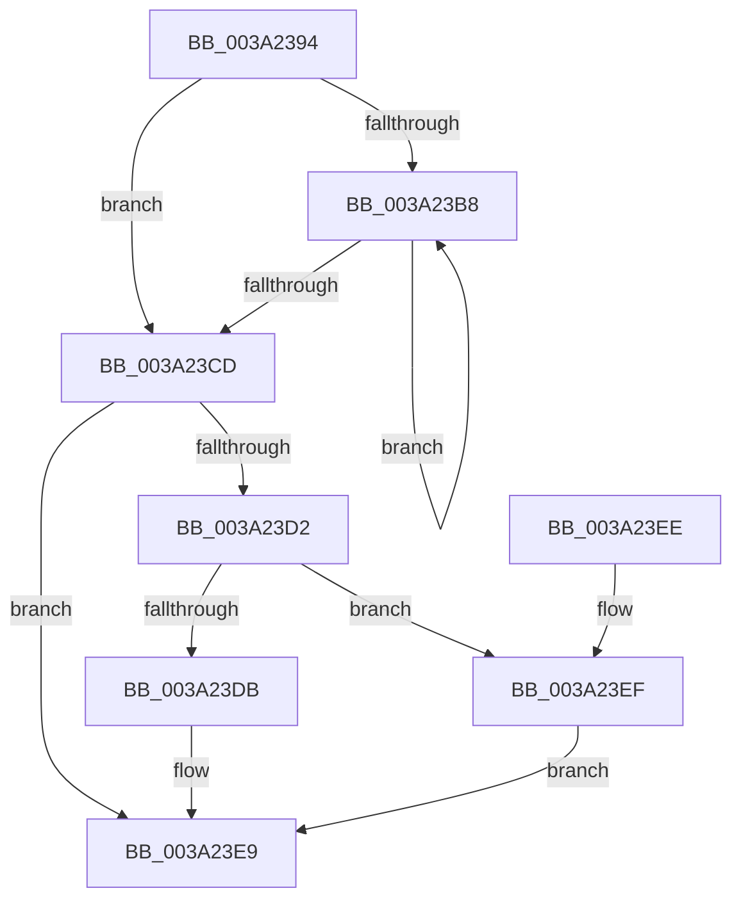

# ObpDeferObjectDeletion

- RVA: `0x003A2394`–`0x003A2402` (길이 `110` bytes)
- VA: `0x00000001403A2394`
- 실행 섹션: `.text`
- PDB 이름 있음: `예`; PDB Function 태그: `아니요`
- unwind 정보 RVA: `0x00068D6C`
- 디코드: `28`개 명령, `110/110` bytes 표시
- 미해석 바이트: `0` (있으면 어셈블리에 `.byte`로 보존)

> 이 문서는 커널 이미지의 기계어와 PDB 기호를 분석해 생성했습니다. 4번과 5번은 함수 원형과 자료형을 바이너리 사용 방식에서 추정한 C 해석이며 원본 소스 복구 결과는 아닙니다.

## 1. Dependencies

- 직접 호출 지점: **3**; 고유 호출 대상: **3**
- 직접 호출자로 확인된 함수: **35**
- RIP 상대 이미지 참조: **3**

### Outgoing calls
- `0x003A23D2` → [KeGetEffectiveIrql](../2F/KeGetEffectiveIrql_function_002F8030.md) (function, `0x002F8030`)
- `0x003A23E4` → [ExQueueWorkItem](../2F/ExQueueWorkItem_function_002F9520.md) (function, `0x002F9520`)
- `0x003A23FB` → [KeInsertQueueDpc](../20/KeInsertQueueDpc_function_00207C50.md) (function, `0x00207C50`)

### Direct callers
- [IoRemoveIoCompletion](../20/IoRemoveIoCompletion_function_0020B580.md) at `0x0020BCFB`
- [IoRemoveIoCompletion](../20/IoRemoveIoCompletion_function_0020B580.md) at `0x0020BD08`
- [IoRemoveIoCompletion](../20/IoRemoveIoCompletion_function_0020B580.md) at `0x0020BD16`
- [ExpFreeOwnerEntry](../20/ExpFreeOwnerEntry_function_0020F740.md) at `0x0020F904`
- [sub_002142F9](../21/Unknown_function_002142F9.md) at `0x00214D0A`
- [sub_002142F9](../21/Unknown_function_002142F9.md) at `0x00214D18`
- [NtCancelTimer](../23/NtCancelTimer_function_00230D90.md) at `0x00230FBB`
- [ExpSetTimerObject](../23/ExpSetTimerObject_function_00231730.md) at `0x002324F6`
- [sub_00237945](../23/Unknown_function_00237945.md) at `0x002379AD`
- [sub_0024E650](../24/Unknown_function_0024E650.md) at `0x0024E67C`
- [sub_0024ED60](../24/Unknown_function_0024ED60.md) at `0x0024ED8C`
- [sub_0025EB5D](../25/Unknown_function_0025EB5D.md) at `0x0025ED32`
- [sub_00260D5A](../26/Unknown_function_00260D5A.md) at `0x00260FD6`
- [sub_00260D5A](../26/Unknown_function_00260D5A.md) at `0x00260FE4`
- [ObDereferenceObjectDeferDeleteWithTag](../26/ObDereferenceObjectDeferDeleteWithTag_function_00263EA0.md) at `0x00263F4F`
- [sub_0027475D](../27/Unknown_function_0027475D.md) at `0x0027544C`
- [sub_0027475D](../27/Unknown_function_0027475D.md) at `0x0027545A`
- [sub_0029B44F](../29/Unknown_function_0029B44F.md) at `0x0029B492`
- [NtSetInformationFile](../29/NtSetInformationFile_function_0029C5E0.md) at `0x0029D454`
- [sub_002F06DC](../2F/Unknown_function_002F06DC.md) at `0x002F06F2`
- [PfSnGetFileInformation](../34/PfSnGetFileInformation_function_00343210.md) at `0x003436F8`
- [sub_00343D34](../34/Unknown_function_00343D34.md) at `0x00343DFB`
- [IopFreeWaitCompletionPacket](../35/IopFreeWaitCompletionPacket_function_00351A50.md) at `0x00351EBC`
- [IopFreeWaitCompletionPacket](../35/IopFreeWaitCompletionPacket_function_00351A50.md) at `0x00351ECA`
- [IopFreeWaitCompletionPacket](../35/IopFreeWaitCompletionPacket_function_00351A50.md) at `0x00351ED8`
- [ExAllocateHeapPool](../35/ExAllocateHeapPool_function_0035BA30.md) at `0x0035E9FA`
- [ExAllocateHeapPool](../35/ExAllocateHeapPool_function_0035BA30.md) at `0x0035EA0D`
- [sub_00360968](../36/Unknown_function_00360968.md) at `0x00361030`
- [sub_00360968](../36/Unknown_function_00360968.md) at `0x0036103E`
- [sub_0038C58B](../38/Unknown_function_0038C58B.md) at `0x0038C861`
- [PspUpdateContainerImpersonation](../39/PspUpdateContainerImpersonation_function_003931EC.md) at `0x00393437`
- [sub_00394132](../39/Unknown_function_00394132.md) at `0x0039419E`
- [sub_00394132](../39/Unknown_function_00394132.md) at `0x003941AC`
- [sub_00394132](../39/Unknown_function_00394132.md) at `0x003941BA`
- [NtWaitForWorkViaWorkerFactory](../39/NtWaitForWorkViaWorkerFactory_function_00394270.md) at `0x00394EC7`
- [sub_0039555D](../39/Unknown_function_0039555D.md) at `0x003955C5`
- [ObpDereferenceNamedObject](ObpDereferenceNamedObject_function_003A0310.md) at `0x003A0430`
- [ExpSetTimerObject2](ExpSetTimerObject2_function_003A0658.md) at `0x003A07E4`
- [NtSignalAndWaitForSingleObject](NtSignalAndWaitForSingleObject_function_003A11D0.md) at `0x003A15FC`
- [NtSignalAndWaitForSingleObject](NtSignalAndWaitForSingleObject_function_003A11D0.md) at `0x003A164B`
- [IopUnloadSafeCompletion](IopUnloadSafeCompletion_function_003A16A0.md) at `0x003A180F`
- [sub_003CB673](../3C/Unknown_function_003CB673.md) at `0x003CB677`
- [sub_003ED730](../3E/Unknown_function_003ED730.md) at `0x003ED75E`
- [ObDereferenceObjectDeferDelete](../3F/ObDereferenceObjectDeferDelete_function_003FCE40.md) at `0x003FCEF2`
- [ObDereferenceObjectEx](../43/ObDereferenceObjectEx_function_0043BD80.md) at `0x0043BDF8`
- [ObDereferenceObjectExWithTag](../43/ObDereferenceObjectExWithTag_function_0043CBC0.md) at `0x0043CC34`
- [sub_00B8371E](../../poolcode/B8/Unknown_function_00B8371E.md) at `0x00B83DEA`
- [sub_00B8371E](../../poolcode/B8/Unknown_function_00B8371E.md) at `0x00B83DF8`

### Static image references
- `0x003A2398` → RVA `0x00F0F640` (`.data`; read)
- `0x003A23DD` → RVA `0x00F0F620` (`.data`; read)
- `0x003A23F2` → RVA `0x00F0F5E0` (`.data`; read)

## 2. Other-region calls and transfers

- 다른 실행 섹션으로 향하는 call: **0**
- 별도 외부 분기/꼬리 이동을 확인하지 못했습니다.

## 3. Assembly (complete function range)

```asm
003A2394  48 83 EC 28                     sub rsp, 0x28
003A2398  0F 0D 0D A1 D2 B6 00            prefetchw byte ptr [rip + 0xb6d2a1]
003A239F  48 8B 15 9A D2 B6 00            mov rdx, qword ptr [rip + 0xb6d29a]
003A23A6  48 89 51 08                     mov qword ptr [rcx + 8], rdx
003A23AA  48 8B C2                        mov rax, rdx
003A23AD  F0 48 0F B1 0D 8A D2 B6 00      lock cmpxchg qword ptr [rip + 0xb6d28a], rcx
003A23B6  74 15                           je 0x1403a23cd
003A23B8  48 8B D0                        mov rdx, rax
003A23BB  48 89 41 08                     mov qword ptr [rcx + 8], rax
003A23BF  F0 48 0F B1 0D 78 D2 B6 00      lock cmpxchg qword ptr [rip + 0xb6d278], rcx
003A23C8  48 3B C2                        cmp rax, rdx
003A23CB  75 EB                           jne 0x1403a23b8
003A23CD  48 85 D2                        test rdx, rdx
003A23D0  75 17                           jne 0x1403a23e9
003A23D2  E8 59 5C F5 FF                  call 0x1402f8030
003A23D7  3C 02                           cmp al, 2
003A23D9  77 14                           ja 0x1403a23ef
003A23DB  33 D2                           xor edx, edx
003A23DD  48 8D 0D 3C D2 B6 00            lea rcx, [rip + 0xb6d23c]
003A23E4  E8 37 71 F5 FF                  call 0x1402f9520
003A23E9  48 83 C4 28                     add rsp, 0x28
003A23ED  C3                              ret
003A23EE  CC                              int3
003A23EF  45 33 C0                        xor r8d, r8d
003A23F2  48 8D 0D E7 D1 B6 00            lea rcx, [rip + 0xb6d1e7]
003A23F9  33 D2                           xor edx, edx
003A23FB  E8 50 58 E6 FF                  call 0x140207c50
003A2400  EB E7                           jmp 0x1403a23e9
```

## 4. C-style interpretation (structured pseudocode)

```c
__int64 __fastcall ObpDeferObjectDeletion(__int64 a1, __int64 a2, int a3)
{
    __int64 result;
    __int64 v_rsp;

    v_rsp = (v_rsp) - (40);
    *(unsigned __int64 *)(a1 + 8) = *(unsigned __int64 *)(v_rip + 11981466);
    if (condition_is_equal) goto loc_003A23CD;
loc_003A23B8:
    *(unsigned __int64 *)(a1 + 8) = *(unsigned __int64 *)(v_rip + 11981466);
    if ((*(unsigned __int64 *)(v_rip + 11981466)) != (*(unsigned __int64 *)(v_rip + 11981466))) goto loc_003A23B8;
loc_003A23CD:
    if (*(unsigned __int64 *)(v_rip + 11981466) != 0) goto loc_003A23E9;
    result = KeGetEffectiveIrql(a1, *(unsigned __int64 *)(v_rip + 11981466), a3, a4);
    if (((unsigned __int8)(result)) > 2) goto loc_003A23EF;
    a2 = 0;
    result = ExQueueWorkItem(v_rip + 11981372, a2, a3, a4);
loc_003A23E9:
    v_rsp = (v_rsp) + (40);
    return result;
loc_003A23EF:
    a3 = 0;
    a2 = 0;
    result = KeInsertQueueDpc(v_rip + 11981287, a2, a3, a4);
    goto loc_003A23E9;
}
```

## 5. (Beta) C Style

```c
int64_t ObpDeferObjectDeletion(void *Arg1, int64_t Arg2, int32_t Arg3)
{
    uint8_t *arg1 = (uint8_t *)Arg1;

    int64_t result;
    int64_t local_rsp;

    local_rsp = (local_rsp) - (40);
    *(uint64_t *)(arg1 + 0x8) = *(uint64_t *)(v_rip + 0xB6D29A);
    if (condition_is_equal) goto loc_003A23CD;
loc_003A23B8:
    *(uint64_t *)(arg1 + 0x8) = *(uint64_t *)(v_rip + 0xB6D29A);
    if ((*(uint64_t *)(v_rip + 0xB6D29A)) != (*(uint64_t *)(v_rip + 0xB6D29A))) goto loc_003A23B8;
loc_003A23CD:
    if (*(uint64_t *)(v_rip + 0xB6D29A) != 0) goto loc_003A23E9;
    result = KeGetEffectiveIrql(Arg1, *(uint64_t *)(v_rip + 0xB6D29A), Arg3, a4);
    if (((uint8_t)(result)) > 2) goto loc_003A23EF;
    Arg2 = 0;
    result = ExQueueWorkItem(v_rip + 11981372, Arg2, Arg3, a4);
loc_003A23E9:
    local_rsp = (local_rsp) + (40);
    return result;
loc_003A23EF:
    Arg3 = 0;
    Arg2 = 0;
    result = KeInsertQueueDpc(v_rip + 11981287, Arg2, Arg3, a4);
    goto loc_003A23E9;
}
```

### 관측된 메모리 오프셋

구조체 형식이 확인되지 않은 접근은 인자 기준의 오프셋으로만 기록했습니다.

| 기준 인자 | 오프셋 표현 | 폭 (bit) | 접근 |
|---|---:|---:|---|
| `Arg1` | `+ 0x8` | `64` | `W` |

## 6. Execution-region graph

[열기: 2D/3D 그래프와 함수 탐색 컨트롤 패널](../../../control-panel.html?section=text&rva=0x003A2394&view=graph)

- 2D 그래프는 위에서 아래로 흐르고, 3D 그래프는 빈 공간을 드래그해 회전합니다. Shift+드래그는 이동, 휠은 확대·축소, 함수 노드 선택은 대상 보고서 이동입니다.

### Static fallback


