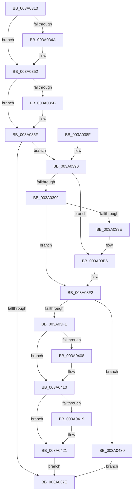

# ObpDereferenceNamedObject

- RVA: `0x003A0310`–`0x003A043A` (길이 `298` bytes)
- VA: `0x00000001403A0310`
- 실행 섹션: `.text`
- PDB 이름 있음: `예`; PDB Function 태그: `아니요`
- unwind 정보 RVA: `0x00081DD0`
- 디코드: `78`개 명령, `298/298` bytes 표시
- 미해석 바이트: `0` (있으면 어셈블리에 `.byte`로 보존)

> 이 문서는 커널 이미지의 기계어와 PDB 기호를 분석해 생성했습니다. 4번과 5번은 함수 원형과 자료형을 바이너리 사용 방식에서 추정한 C 해석이며 원본 소스 복구 결과는 아닙니다.

## 1. Dependencies

- 직접 호출 지점: **10**; 고유 호출 대상: **9**
- 직접 호출자로 확인된 함수: **1**
- RIP 상대 이미지 참조: **3**

### Outgoing calls
- `0x003A034D` → [ObpDeleteNameCheck](../../page/89/ObpDeleteNameCheck_function_0089A3F0.md) (function, `0x0089A3F0`)
- `0x003A036A` → [ObpPushStackInfo](../21/ObpPushStackInfo_function_002109E4.md) (function, `0x002109E4`)
- `0x003A03B0` → [KeBugCheckEx](../4F/KeBugCheckEx_function_004FD660.md) (function, `0x004FD660`)
- `0x003A03EC` → [KeBugCheckEx](../4F/KeBugCheckEx_function_004FD660.md) (function, `0x004FD660`)
- `0x003A03F2` → [KeAreAllApcsDisabled](../2F/KeAreAllApcsDisabled_function_002F7AC0.md) (function, `0x002F7AC0`)
- `0x003A03FE` → [OBJECT_HEADER_TO_HANDLE_REVOCATION_INFO](OBJECT_HEADER_TO_HANDLE_REVOCATION_INFO_function_003A1840.md) (function, `0x003A1840`)
- `0x003A040B` → [ObpHandleRevocationBlockRemoveObject](../../page/9D/ObpHandleRevocationBlockRemoveObject_function_009D7E30.md) (function, `0x009D7E30`)
- `0x003A041C` → [ObpDeregisterObject](../../page/9D/ObpDeregisterObject_function_009D7F78.md) (function, `0x009D7F78`)
- `0x003A0426` → [ObpRemoveObjectRoutine](../../page/86/ObpRemoveObjectRoutine_function_00864A60.md) (function, `0x00864A60`)
- `0x003A0430` → [ObpDeferObjectDeletion](ObpDeferObjectDeletion_function_003A2394.md) (function, `0x003A2394`)

### Direct callers
- [ObpInsertOrLocateNamedObject](../../page/99/ObpInsertOrLocateNamedObject_function_0099F2C0.md) at `0x0099F6B5`
- [ObpInsertOrLocateNamedObject](../../page/99/ObpInsertOrLocateNamedObject_function_0099F2C0.md) at `0x0099F6F9`
- [ObpInsertOrLocateNamedObject](../../page/99/ObpInsertOrLocateNamedObject_function_0099F2C0.md) at `0x0099F88D`

### Static image references
- `0x003A0324` → RVA `0x00000000` (`image boundary/outside`; read)
- `0x003A0352` → RVA `0x00FC5010` (`ALMOSTRO`; read)
- `0x003A03DA` → RVA `0x00FC6E4C` (`ALMOSTRO`; read)

## 2. Other-region calls and transfers

- 다른 실행 섹션으로 향하는 call: **4**
  - `0x003A034D` → [ObpDeleteNameCheck](../../page/89/ObpDeleteNameCheck_function_0089A3F0.md) (`.text` → `PAGE`)
  - `0x003A040B` → [ObpHandleRevocationBlockRemoveObject](../../page/9D/ObpHandleRevocationBlockRemoveObject_function_009D7E30.md) (`.text` → `PAGE`)
  - `0x003A041C` → [ObpDeregisterObject](../../page/9D/ObpDeregisterObject_function_009D7F78.md) (`.text` → `PAGE`)
  - `0x003A0426` → [ObpRemoveObjectRoutine](../../page/86/ObpRemoveObjectRoutine_function_00864A60.md) (`.text` → `PAGE`)
- 별도 외부 분기/꼬리 이동을 확인하지 못했습니다.

## 3. Assembly (complete function range)

```asm
003A0310  48 89 5C 24 10                  mov qword ptr [rsp + 0x10], rbx
003A0315  48 89 7C 24 18                  mov qword ptr [rsp + 0x18], rdi
003A031A  41 56                           push r14
003A031C  48 83 EC 30                     sub rsp, 0x30
003A0320  0F B6 41 1A                     movzx eax, byte ptr [rcx + 0x1a]
003A0324  4C 8D 35 D5 FC C5 FF            lea r14, [rip - 0x3a032b]
003A032B  83 E0 03                        and eax, 3
003A032E  48 8B D9                        mov rbx, rcx
003A0331  42 0F B6 84 30 80 FF F0 00      movzx eax, byte ptr [rax + r14 + 0xf0ff80]
003A033A  48 2B C8                        sub rcx, rax
003A033D  83 C8 FF                        or eax, 0xffffffff
003A0340  F0 0F C1 41 18                  lock xadd dword ptr [rcx + 0x18], eax
003A0345  83 F8 01                        cmp eax, 1
003A0348  75 08                           jne 0x1403a0352
003A034A  48 8B CB                        mov rcx, rbx
003A034D  E8 9E A0 4F 00                  call 0x14089a3f0
003A0352  83 3D B7 4C C2 00 00            cmp dword ptr [rip + 0xc24cb7], 0
003A0359  74 14                           je 0x1403a036f
003A035B  33 D2                           xor edx, edx
003A035D  41 B9 44 66 6C 74               mov r9d, 0x746c6644
003A0363  48 8B CB                        mov rcx, rbx
003A0366  44 8D 42 01                     lea r8d, [rdx + 1]
003A036A  E8 75 06 E7 FF                  call 0x1402109e4
003A036F  48 83 C8 FF                     or rax, 0xffffffffffffffff
003A0373  F0 48 0F C1 03                  lock xadd qword ptr [rbx], rax
003A0378  48 83 E8 01                     sub rax, 1
003A037C  7E 12                           jle 0x1403a0390
003A037E  48 8B 5C 24 48                  mov rbx, qword ptr [rsp + 0x48]
003A0383  48 8B 7C 24 50                  mov rdi, qword ptr [rsp + 0x50]
003A0388  48 83 C4 30                     add rsp, 0x30
003A038C  41 5E                           pop r14
003A038E  C3                              ret
003A038F  CC                              int3
003A0390  48 8B 4B 08                     mov rcx, qword ptr [rbx + 8]
003A0394  48 85 C9                        test rcx, rcx
003A0397  75 1D                           jne 0x1403a03b6
003A0399  48 85 C0                        test rax, rax
003A039C  79 54                           jns 0x1403a03f2
003A039E  33 D2                           xor edx, edx
003A03A0  48 89 44 24 20                  mov qword ptr [rsp + 0x20], rax
003A03A5  44 8D 49 02                     lea r9d, [rcx + 2]
003A03A9  4C 8D 43 30                     lea r8, [rbx + 0x30]
003A03AD  8D 4A 18                        lea ecx, [rdx + 0x18]
003A03B0  E8 AB D2 15 00                  call 0x1404fd660
003A03B5  CC                              int3
003A03B6  41 B9 01 00 00 00               mov r9d, 1
003A03BC  48 89 4C 24 20                  mov qword ptr [rsp + 0x20], rcx
003A03C1  48 8B C3                        mov rax, rbx
003A03C4  4C 8D 43 30                     lea r8, [rbx + 0x30]
003A03C8  48 C1 E8 08                     shr rax, 8
003A03CC  0F B6 D0                        movzx edx, al
003A03CF  0F B6 43 18                     movzx eax, byte ptr [rbx + 0x18]
003A03D3  41 8D 49 17                     lea ecx, [r9 + 0x17]
003A03D7  48 33 D0                        xor rdx, rax
003A03DA  0F B6 05 6B 6A C2 00            movzx eax, byte ptr [rip + 0xc26a6b]
003A03E1  48 33 D0                        xor rdx, rax
003A03E4  49 8B 94 D6 00 78 FC 00         mov rdx, qword ptr [r14 + rdx*8 + 0xfc7800]
003A03EC  E8 6F D2 15 00                  call 0x1404fd660
003A03F1  CC                              int3
003A03F2  E8 C9 76 F5 FF                  call 0x1402f7ac0
003A03F7  48 8B CB                        mov rcx, rbx
003A03FA  84 C0                           test al, al
003A03FC  75 32                           jne 0x1403a0430
003A03FE  E8 3D 14 00 00                  call 0x1403a1840
003A0403  48 85 C0                        test rax, rax
003A0406  74 08                           je 0x1403a0410
003A0408  48 8B C8                        mov rcx, rax
003A040B  E8 20 7A 63 00                  call 0x1409d7e30
003A0410  83 3D F9 4B C2 00 00            cmp dword ptr [rip + 0xc24bf9], 0
003A0417  74 08                           je 0x1403a0421
003A0419  48 8B CB                        mov rcx, rbx
003A041C  E8 57 7B 63 00                  call 0x1409d7f78
003A0421  33 D2                           xor edx, edx
003A0423  48 8B CB                        mov rcx, rbx
003A0426  E8 35 46 4C 00                  call 0x140864a60
003A042B  E9 4E FF FF FF                  jmp 0x1403a037e
003A0430  E8 5F 1F 00 00                  call 0x1403a2394
003A0435  E9 44 FF FF FF                  jmp 0x1403a037e
```

## 4. C-style interpretation (structured pseudocode)

```c
__int64 __fastcall ObpDereferenceNamedObject(__int64 a1, int a2)
{
    __int64 result;
    __int64 v_rsp;
    unsigned __int64 v_stack_p10;
    unsigned __int64 v_stack_p18;
    unsigned __int64 v_stack_p20;

    v_stack_p10 = v_rbx;
    v_stack_p18 = v_rdi;
    v_rsp = (v_rsp) - (48);
    result = (unsigned int)((*(unsigned __int8 *)(a1 + 26)) & (3));
    a1 = (a1) - (*(unsigned __int8 *)(result + v_rip - 3801899 * 1 + 15794048));
    result = (unsigned int)((*(unsigned __int8 *)(result + v_rip - 3801899 * 1 + 15794048)) | (0xFFFFFFFFULL));
    if (((unsigned int)(result)) == 1) {
        a1 = a1;
        result = ObpDeleteNameCheck(a1, a2, a3, a4);
    }
    if ((*(unsigned int *)(v_rip + 12733623)) != 0) {
        a2 = 0;
        a4 = 0x746C6644ULL;
        a1 = a1;
        a3 = a2 + 1;
        result = ObpPushStackInfo(a1, a2, a3, a4);
    }
    result = (result) | (-1);
    result = (result) - (1);
    if (condition_is_less_or_equal) goto loc_003A0390;
loc_003A037E:
    v_rsp = (v_rsp) + (48);
    return result;
loc_003A0390:
    if (*(unsigned __int64 *)(v_stack_p10 + 8) != 0) goto loc_003A03B6;
    if (!sign_flag) goto loc_003A03F2;
    a2 = 0;
    v_stack_p20 = result;
    result = KeBugCheckEx(a2 + 24, a2, v_stack_p10 + 48, *(unsigned __int64 *)(v_stack_p10 + 8) + 2);
loc_003A03B6:
    v_stack_p20 = a2 + 24;
    result = (v_stack_p10) >> (8);
    a2 = ((unsigned __int8)(result)) ^ (*(unsigned __int8 *)(v_stack_p10 + 24));
    a2 = (a2) ^ (*(unsigned __int8 *)(v_rip + 12741227));
    result = KeBugCheckEx(1 + 23, *(unsigned __int64 *)(v_rip - 3801899 + a2 * 8 + 16545792), v_stack_p10 + 48, 1);
loc_003A03F2:
    result = KeAreAllApcsDisabled(1 + 23, *(unsigned __int64 *)(v_rip - 3801899 + a2 * 8 + 16545792), v_stack_p10 + 48, 1);
    if ((unsigned __int8)(result) != 0) goto loc_003A0430;
    result = OBJECT_HEADER_TO_HANDLE_REVOCATION_INFO(v_stack_p10, *(unsigned __int64 *)(v_rip - 3801899 + a2 * 8 + 16545792), v_stack_p10 + 48, 1);
    if (result != 0) {
        a1 = result;
        result = ObpHandleRevocationBlockRemoveObject(a1, *(unsigned __int64 *)(v_rip - 3801899 + a2 * 8 + 16545792), v_stack_p10 + 48, 1);
    }
    if ((*(unsigned int *)(v_rip + 12733433)) != 0) {
        a1 = v_stack_p10;
        result = ObpDeregisterObject(a1, *(unsigned __int64 *)(v_rip - 3801899 + a2 * 8 + 16545792), v_stack_p10 + 48, 1);
    }
    a2 = 0;
    result = ObpRemoveObjectRoutine(v_stack_p10, a2, v_stack_p10 + 48, 1);
    goto loc_003A037E;
loc_003A0430:
    result = ObpDeferObjectDeletion(v_stack_p10, a2, v_stack_p10 + 48, 1);
    goto loc_003A037E;
}
```

## 5. (Beta) C Style

```c
int64_t ObpDereferenceNamedObject(void *Arg1, int32_t Arg2)
{
    uint8_t *arg1 = (uint8_t *)Arg1;

    int64_t result;
    int64_t local_rsp;
    uint64_t v_stack_p10;
    uint64_t v_stack_p18;
    uint64_t v_stack_p20;

    v_stack_p10 = local_rbx;
    v_stack_p18 = local_rdi;
    local_rsp = (local_rsp) - (48);
    result = (uint32_t)((*(uint8_t *)(arg1 + 0x1A)) & (3));
    Arg1 = (Arg1) - (*(uint8_t *)(result + v_rip - 0x3A032B * 1 + 0xF0FF80));
    result = (uint32_t)((*(uint8_t *)(result + v_rip - 0x3A032B * 1 + 0xF0FF80)) | (0xFFFFFFFFULL));
    if (((uint32_t)(result)) == 1) {
        Arg1 = Arg1;
        result = ObpDeleteNameCheck(Arg1, Arg2, a3, a4);
    }
    if ((*(uint32_t *)(v_rip + 0xC24CB7)) != 0) {
        Arg2 = 0;
        a4 = 0x746C6644ULL;
        Arg1 = Arg1;
        a3 = Arg2 + 1;
        result = ObpPushStackInfo(Arg1, Arg2, a3, a4);
    }
    result = (result) | (-1);
    result = (result) - (1);
    if (condition_is_less_or_equal) goto loc_003A0390;
loc_003A037E:
    local_rsp = (local_rsp) + (48);
    return result;
loc_003A0390:
    if (*(uint64_t *)(v_stack_p10 + 0x8) != 0) goto loc_003A03B6;
    if (!sign_flag) goto loc_003A03F2;
    Arg2 = 0;
    v_stack_p20 = result;
    result = KeBugCheckEx(Arg2 + 24, Arg2, v_stack_p10 + 48, *(uint64_t *)(v_stack_p10 + 0x8) + 2);
loc_003A03B6:
    v_stack_p20 = Arg2 + 24;
    result = (v_stack_p10) >> (8);
    Arg2 = ((uint8_t)(result)) ^ (*(uint8_t *)(v_stack_p10 + 0x18));
    Arg2 = (Arg2) ^ (*(uint8_t *)(v_rip + 0xC26A6B));
    result = KeBugCheckEx(1 + 23, *(uint64_t *)(v_rip - 0x3A032B + Arg2 * 8 + 0xFC7800), v_stack_p10 + 48, 1);
loc_003A03F2:
    result = KeAreAllApcsDisabled(1 + 23, *(uint64_t *)(v_rip - 0x3A032B + Arg2 * 8 + 0xFC7800), v_stack_p10 + 48, 1);
    if ((uint8_t)(result) != 0) goto loc_003A0430;
    result = OBJECT_HEADER_TO_HANDLE_REVOCATION_INFO(v_stack_p10, *(uint64_t *)(v_rip - 0x3A032B + Arg2 * 8 + 0xFC7800), v_stack_p10 + 48, 1);
    if (result != 0) {
        Arg1 = result;
        result = ObpHandleRevocationBlockRemoveObject(Arg1, *(uint64_t *)(v_rip - 0x3A032B + Arg2 * 8 + 0xFC7800), v_stack_p10 + 48, 1);
    }
    if ((*(uint32_t *)(v_rip + 0xC24BF9)) != 0) {
        Arg1 = v_stack_p10;
        result = ObpDeregisterObject(Arg1, *(uint64_t *)(v_rip - 0x3A032B + Arg2 * 8 + 0xFC7800), v_stack_p10 + 48, 1);
    }
    Arg2 = 0;
    result = ObpRemoveObjectRoutine(v_stack_p10, Arg2, v_stack_p10 + 48, 1);
    goto loc_003A037E;
loc_003A0430:
    result = ObpDeferObjectDeletion(v_stack_p10, Arg2, v_stack_p10 + 48, 1);
    goto loc_003A037E;
}
```

### 관측된 메모리 오프셋

구조체 형식이 확인되지 않은 접근은 인자 기준의 오프셋으로만 기록했습니다.

| 기준 인자 | 오프셋 표현 | 폭 (bit) | 접근 |
|---|---:|---:|---|
| `Arg1` | `+ 0x0` | `64` | `R/W` |
| `Arg1` | `+ 0x8` | `64` | `R` |
| `Arg1` | `+ 0x18` | `8` | `R` |
| `Arg1` | `+ 0x18` | `32` | `R/W` |
| `Arg1` | `+ 0x1A` | `8` | `R` |
| `Arg1` | `+ 0x30` | `64` | `R` |

## 6. Execution-region graph

[열기: 2D/3D 그래프와 함수 탐색 컨트롤 패널](../../../control-panel.html?section=text&rva=0x003A0310&view=graph)

- 2D 그래프는 위에서 아래로 흐르고, 3D 그래프는 빈 공간을 드래그해 회전합니다. Shift+드래그는 이동, 휠은 확대·축소, 함수 노드 선택은 대상 보고서 이동입니다.

### Static fallback


