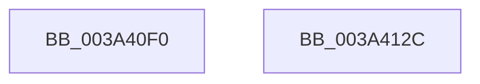

# PerfInfoLogIpiReceive

- RVA: `0x003A40F0`–`0x003A412D` (길이 `61` bytes)
- VA: `0x00000001403A40F0`
- 실행 섹션: `.text`
- PDB 이름 있음: `예`; PDB Function 태그: `아니요`
- unwind 정보 RVA: `0x00063458`
- 디코드: `14`개 명령, `61/61` bytes 표시
- 미해석 바이트: `0` (있으면 어셈블리에 `.byte`로 보존)

> 이 문서는 커널 이미지의 기계어와 PDB 기호를 분석해 생성했습니다. 4번과 5번은 함수 원형과 자료형을 바이너리 사용 방식에서 추정한 C 해석이며 원본 소스 복구 결과는 아닙니다.

## 1. Dependencies

- 직접 호출 지점: **1**; 고유 호출 대상: **1**
- 직접 호출자로 확인된 함수: **1**
- RIP 상대 이미지 참조: **0**

### Outgoing calls
- `0x003A4122` → [EtwTraceTimedEvent](EtwTraceTimedEvent_function_003A3430.md) (function, `0x003A3430`)

### Direct callers
- [sub_003A3F33](Unknown_function_003A3F33.md) at `0x003A3F9F`

### Static image references
- 디코드된 RIP-relative 메모리 참조가 없습니다.

## 2. Other-region calls and transfers

- 다른 실행 섹션으로 향하는 call: **0**
- 별도 외부 분기/꼬리 이동을 확인하지 못했습니다.

## 3. Assembly (complete function range)

```asm
003A40F0  48 83 EC 48                     sub rsp, 0x48
003A40F4  48 8B C1                        mov rax, rcx
003A40F7  89 54 24 38                     mov dword ptr [rsp + 0x38], edx
003A40FB  4C 89 44 24 30                  mov qword ptr [rsp + 0x30], r8
003A4100  B9 71 0F 00 00                  mov ecx, 0xf71
003A4105  48 89 44 24 28                  mov qword ptr [rsp + 0x28], rax
003A410A  4C 8D 44 24 30                  lea r8, [rsp + 0x30]
003A410F  41 B9 0C 00 00 00               mov r9d, 0xc
003A4115  C7 44 24 20 02 0A 50 00         mov dword ptr [rsp + 0x20], 0x500a02
003A411D  BA 00 00 40 40                  mov edx, 0x40400000
003A4122  E8 09 F3 FF FF                  call 0x1403a3430
003A4127  48 83 C4 48                     add rsp, 0x48
003A412B  C3                              ret
003A412C  CC                              int3
```

## 4. C-style interpretation (structured pseudocode)

```c
__int64 __fastcall PerfInfoLogIpiReceive(__int64 a1, int a2, __int64 a3)
{
    __int64 result;
    __int64 v_rsp;
    unsigned int v_stack_m10;
    unsigned __int64 v_stack_m18;
    unsigned __int64 v_stack_m20;
    unsigned int v_stack_m28;

    v_rsp = (v_rsp) - (72);
    v_stack_m10 = a2;
    v_stack_m18 = a3;
    v_stack_m20 = a1;
    v_stack_m28 = 0x500A02ULL;
    result = EtwTraceTimedEvent((unsigned int)(0xF71ULL), (unsigned int)(0x40400000ULL), v_stack_m18, 12);
    v_rsp = (v_rsp) + (72);
    return result;
}
```

## 5. (Beta) C Style

```c
int64_t PerfInfoLogIpiReceive(int64_t Arg1, int32_t Arg2, int64_t Arg3)
{
    int64_t result;
    int64_t local_rsp;
    uint32_t v_stack_m10;
    uint64_t v_stack_m18;
    uint64_t v_stack_m20;
    uint32_t v_stack_m28;

    local_rsp = (local_rsp) - (72);
    v_stack_m10 = Arg2;
    v_stack_m18 = Arg3;
    v_stack_m20 = Arg1;
    v_stack_m28 = 0x500A02ULL;
    result = EtwTraceTimedEvent((uint32_t)(0xF71ULL), (uint32_t)(0x40400000ULL), v_stack_m18, 12);
    local_rsp = (local_rsp) + (72);
    return result;
}
```

## 6. Execution-region graph

[열기: 2D/3D 그래프와 함수 탐색 컨트롤 패널](../../../control-panel.html?section=text&rva=0x003A40F0&view=graph)

- 2D 그래프는 위에서 아래로 흐르고, 3D 그래프는 빈 공간을 드래그해 회전합니다. Shift+드래그는 이동, 휠은 확대·축소, 함수 노드 선택은 대상 보고서 이동입니다.

### Static fallback


