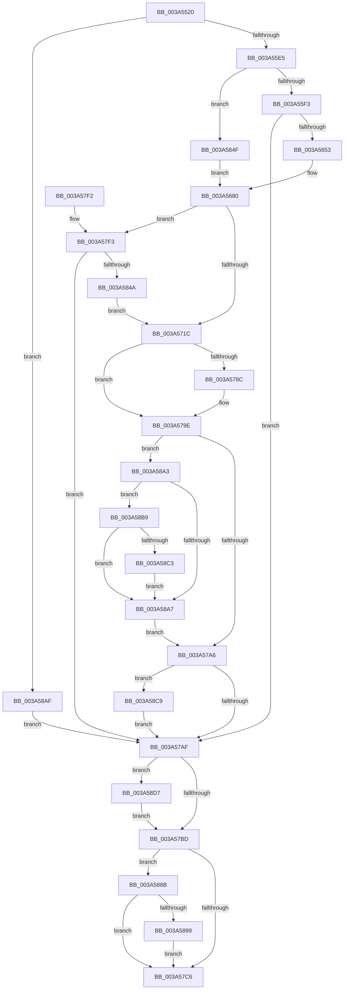

# RtlCheckTokenCapability

- RVA: `0x003A5520`–`0x003A58E3` (길이 `963` bytes)
- VA: `0x00000001403A5520`
- 실행 섹션: `.text`
- PDB 이름 있음: `예`; PDB Function 태그: `아니요`
- unwind 정보 RVA: `0x00089A70`
- 디코드: `225`개 명령, `963/963` bytes 표시
- 미해석 바이트: `0` (있으면 어셈블리에 `.byte`로 보존)

> 이 문서는 커널 이미지의 기계어와 PDB 기호를 분석해 생성했습니다. 4번과 5번은 함수 원형과 자료형을 바이너리 사용 방식에서 추정한 C 해석이며 원본 소스 복구 결과는 아닙니다.

## 1. Dependencies

- 직접 호출 지점: **21**; 고유 호출 대상: **19**
- 직접 호출자로 확인된 함수: **1**
- RIP 상대 이미지 참조: **3**

### Outgoing calls
- `0x003A5575` → [memset](../6C/memset_function_006C6C40.md) (function, `0x006C6C40`)
- `0x003A55B5` → [memset](../6C/memset_function_006C6C40.md) (function, `0x006C6C40`)
- `0x003A55D8` → [RtlIsCapabilitySid](../../page/A5/RtlIsCapabilitySid_function_00A5ED84.md) (function, `0x00A5ED84`)
- `0x003A5644` → [ZwDuplicateToken](../6A/ZwDuplicateToken_function_006AD910.md) (function, `0x006AD910`)
- `0x003A567B` → [ZwQueryInformationToken](../6A/ZwQueryInformationToken_function_006AD4F0.md) (function, `0x006AD4F0`)
- `0x003A5689` → [RtlCreateSecurityDescriptor](../../page/9F/RtlCreateSecurityDescriptor_function_009F1DF0.md) (function, `0x009F1DF0`)
- `0x003A5699` → [RtlSetOwnerSecurityDescriptor](../../page/91/RtlSetOwnerSecurityDescriptor_function_00916F90.md) (function, `0x00916F90`)
- `0x003A56A9` → [RtlSetGroupSecurityDescriptor](../../page/A2/RtlSetGroupSecurityDescriptor_function_00A2EB10.md) (function, `0x00A2EB10`)
- `0x003A56BD` → [RtlCreateAcl](../../page/91/RtlCreateAcl_function_00916F00.md) (function, `0x00916F00`)
- `0x003A56D6` → [RtlAddAccessAllowedAce](../../page/92/RtlAddAccessAllowedAce_function_009298C0.md) (function, `0x009298C0`)
- `0x003A56EE` → [RtlAddAccessAllowedAce](../../page/92/RtlAddAccessAllowedAce_function_009298C0.md) (function, `0x009298C0`)
- `0x003A5703` → [RtlSetDaclSecurityDescriptor](../../page/9E/RtlSetDaclSecurityDescriptor_function_009EC210.md) (function, `0x009EC210`)
- `0x003A5772` → [SeAccessCheckWithHint](SeAccessCheckWithHint_function_003A6C30.md) (function, `0x003A6C30`)
- `0x003A5795` → [ObfDereferenceObjectWithTag](../2F/ObfDereferenceObjectWithTag_function_002F78E0.md) (function, `0x002F78E0`)
- `0x003A57D2` → [_security_check_cookie](../6A/_security_check_cookie_function_006AC640.md) (function, `0x006AC640`)
- `0x003A5833` → [ObReferenceObjectByHandle](../../page/86/ObReferenceObjectByHandle_function_00868DB0.md) (function, `0x00868DB0`)
- `0x003A5853` → [SeCaptureSubjectContext](../../page/86/SeCaptureSubjectContext_function_0086B820.md) (function, `0x0086B820`)
- `0x003A5874` → [SeQueryInformationToken](../../page/8B/SeQueryInformationToken_function_008B5090.md) (function, `0x008B5090`)
- `0x003A5899` → [ZwClose](../6A/ZwClose_function_006AD2B0.md) (function, `0x006AD2B0`)
- `0x003A58CD` → [SeReleaseSubjectContext](../../page/86/SeReleaseSubjectContext_function_0086B710.md) (function, `0x0086B710`)
- `0x003A58D9` → [ExFreePoolWithTag](../../poolcode/B8/ExFreePoolWithTag_function_00B82870.md) (function, `0x00B82870`)

### Direct callers
- [RtlCapabilityCheck](../../page/A2/RtlCapabilityCheck_function_00A20340.md) at `0x00A205AC`

### Static image references
- `0x003A553F` → RVA `0x00E0A740` (`.data`; read)
- `0x003A5748` → RVA `0x000118D0` (`.rdata`; read)
- `0x003A57FF` → RVA `0x00FD8020` (`PAGEDATA`; read)

## 2. Other-region calls and transfers

- 다른 실행 섹션으로 향하는 call: **13**
  - `0x003A55D8` → [RtlIsCapabilitySid](../../page/A5/RtlIsCapabilitySid_function_00A5ED84.md) (`.text` → `PAGE`)
  - `0x003A5689` → [RtlCreateSecurityDescriptor](../../page/9F/RtlCreateSecurityDescriptor_function_009F1DF0.md) (`.text` → `PAGE`)
  - `0x003A5699` → [RtlSetOwnerSecurityDescriptor](../../page/91/RtlSetOwnerSecurityDescriptor_function_00916F90.md) (`.text` → `PAGE`)
  - `0x003A56A9` → [RtlSetGroupSecurityDescriptor](../../page/A2/RtlSetGroupSecurityDescriptor_function_00A2EB10.md) (`.text` → `PAGE`)
  - `0x003A56BD` → [RtlCreateAcl](../../page/91/RtlCreateAcl_function_00916F00.md) (`.text` → `PAGE`)
  - `0x003A56D6` → [RtlAddAccessAllowedAce](../../page/92/RtlAddAccessAllowedAce_function_009298C0.md) (`.text` → `PAGE`)
  - `0x003A56EE` → [RtlAddAccessAllowedAce](../../page/92/RtlAddAccessAllowedAce_function_009298C0.md) (`.text` → `PAGE`)
  - `0x003A5703` → [RtlSetDaclSecurityDescriptor](../../page/9E/RtlSetDaclSecurityDescriptor_function_009EC210.md) (`.text` → `PAGE`)
  - `0x003A5833` → [ObReferenceObjectByHandle](../../page/86/ObReferenceObjectByHandle_function_00868DB0.md) (`.text` → `PAGE`)
  - `0x003A5853` → [SeCaptureSubjectContext](../../page/86/SeCaptureSubjectContext_function_0086B820.md) (`.text` → `PAGE`)
  - `0x003A5874` → [SeQueryInformationToken](../../page/8B/SeQueryInformationToken_function_008B5090.md) (`.text` → `PAGE`)
  - `0x003A58CD` → [SeReleaseSubjectContext](../../page/86/SeReleaseSubjectContext_function_0086B710.md) (`.text` → `PAGE`)
  - `0x003A58D9` → [ExFreePoolWithTag](../../poolcode/B8/ExFreePoolWithTag_function_00B82870.md) (`.text` → `POOLCODE`)
- 별도 외부 분기/꼬리 이동을 확인하지 못했습니다.

## 3. Assembly (complete function range)

```asm
003A5520  48 89 5C 24 20                  mov qword ptr [rsp + 0x20], rbx
003A5525  55                              push rbp
003A5526  56                              push rsi
003A5527  57                              push rdi
003A5528  41 54                           push r12
003A552A  41 55                           push r13
003A552C  41 56                           push r14
003A552E  41 57                           push r15
003A5530  48 8D AC 24 A0 FE FF FF         lea rbp, [rsp - 0x160]
003A5538  48 81 EC 60 02 00 00            sub rsp, 0x260
003A553F  48 8B 05 FA 51 A6 00            mov rax, qword ptr [rip + 0xa651fa]
003A5546  48 33 C4                        xor rax, rsp
003A5549  48 89 85 58 01 00 00            mov qword ptr [rbp + 0x158], rax
003A5550  4D 8B F0                        mov r14, r8
003A5553  4C 8B FA                        mov r15, rdx
003A5556  48 8B F9                        mov rdi, rcx
003A5559  45 33 E4                        xor r12d, r12d
003A555C  33 D2                           xor edx, edx
003A555E  44 89 64 24 68                  mov dword ptr [rsp + 0x68], r12d
003A5563  41 B8 A0 00 00 00               mov r8d, 0xa0
003A5569  44 89 64 24 60                  mov dword ptr [rsp + 0x60], r12d
003A556E  48 8D 8D 80 00 00 00            lea rcx, [rbp + 0x80]
003A5575  E8 C6 16 32 00                  call 0x1406c6c40
003A557A  33 C0                           xor eax, eax
003A557C  4C 89 64 24 70                  mov qword ptr [rsp + 0x70], r12
003A5581  0F 57 C0                        xorps xmm0, xmm0
003A5584  48 89 45 D0                     mov qword ptr [rbp - 0x30], rax
003A5588  33 D2                           xor edx, edx
003A558A  89 45 D8                        mov dword ptr [rbp - 0x28], eax
003A558D  45 8D 44 24 58                  lea r8d, [r12 + 0x58]
003A5592  48 89 45 70                     mov qword ptr [rbp + 0x70], rax
003A5596  48 8D 4D 10                     lea rcx, [rbp + 0x10]
003A559A  89 45 78                        mov dword ptr [rbp + 0x78], eax
003A559D  0F 11 45 B0                     movups xmmword ptr [rbp - 0x50], xmm0
003A55A1  48 89 45 00                     mov qword ptr [rbp], rax
003A55A5  0F 11 45 C0                     movups xmmword ptr [rbp - 0x40], xmm0
003A55A9  4C 89 65 88                     mov qword ptr [rbp - 0x78], r12
003A55AD  0F 11 45 E0                     movups xmmword ptr [rbp - 0x20], xmm0
003A55B1  0F 11 45 F0                     movups xmmword ptr [rbp - 0x10], xmm0
003A55B5  E8 86 16 32 00                  call 0x1406c6c40
003A55BA  0F 57 C0                        xorps xmm0, xmm0
003A55BD  44 89 64 24 64                  mov dword ptr [rsp + 0x64], r12d
003A55C2  49 8B CF                        mov rcx, r15
003A55C5  4C 89 64 24 78                  mov qword ptr [rsp + 0x78], r12
003A55CA  0F 11 45 90                     movups xmmword ptr [rbp - 0x70], xmm0
003A55CE  41 8A F4                        mov sil, r12b
003A55D1  45 88 26                        mov byte ptr [r14], r12b
003A55D4  0F 11 45 A0                     movups xmmword ptr [rbp - 0x60], xmm0
003A55D8  E8 A7 97 6B 00                  call 0x140a5ed84
003A55DD  84 C0                           test al, al
003A55DF  0F 84 CA 02 00 00               je 0x1403a58af
003A55E5  45 8D 6C 24 02                  lea r13d, [r12 + 2]
003A55EA  48 85 FF                        test rdi, rdi
003A55ED  0F 84 5C 02 00 00               je 0x1403a584f
003A55F3  48 8D 45 70                     lea rax, [rbp + 0x70]
003A55F7  C7 45 B0 30 00 00 00            mov dword ptr [rbp - 0x50], 0x30
003A55FE  48 89 45 D8                     mov qword ptr [rbp - 0x28], rax
003A5602  4C 8D 45 B0                     lea r8, [rbp - 0x50]
003A5606  48 8D 44 24 70                  lea rax, [rsp + 0x70]
003A560B  4C 89 65 B8                     mov qword ptr [rbp - 0x48], r12
003A560F  48 89 44 24 28                  mov qword ptr [rsp + 0x28], rax
003A5614  41 8D 54 24 08                  lea edx, [r12 + 8]
003A5619  45 33 C9                        xor r9d, r9d
003A561C  44 89 6C 24 20                  mov dword ptr [rsp + 0x20], r13d
003A5621  48 8B CF                        mov rcx, rdi
003A5624  C7 45 C8 00 02 00 00            mov dword ptr [rbp - 0x38], 0x200
003A562B  4C 89 65 C0                     mov qword ptr [rbp - 0x40], r12
003A562F  4C 89 65 D0                     mov qword ptr [rbp - 0x30], r12
003A5633  C7 45 70 0C 00 00 00            mov dword ptr [rbp + 0x70], 0xc
003A563A  44 89 6D 74                     mov dword ptr [rbp + 0x74], r13d
003A563E  66 C7 45 78 01 00               mov word ptr [rbp + 0x78], 1
003A5644  E8 C7 82 30 00                  call 0x1406ad910
003A5649  8B D8                           mov ebx, eax
003A564B  85 C0                           test eax, eax
003A564D  0F 88 5C 01 00 00               js 0x1403a57af
003A5653  48 8B 4C 24 70                  mov rcx, qword ptr [rsp + 0x70]
003A5658  48 8D 44 24 64                  lea rax, [rsp + 0x64]
003A565D  45 8D 4C 24 58                  lea r9d, [r12 + 0x58]
003A5662  48 89 44 24 20                  mov qword ptr [rsp + 0x20], rax
003A5667  4C 8D 45 10                     lea r8, [rbp + 0x10]
003A566B  C7 44 24 64 58 00 00 00         mov dword ptr [rsp + 0x64], 0x58
003A5673  41 8D 54 24 01                  lea edx, [r12 + 1]
003A5678  41 8B FC                        mov edi, r12d
003A567B  E8 70 7E 30 00                  call 0x1406ad4f0
003A5680  BA 01 00 00 00                  mov edx, 1
003A5685  48 8D 4D E0                     lea rcx, [rbp - 0x20]
003A5689  E8 62 C7 64 00                  call 0x1409f1df0
003A568E  48 8B 55 10                     mov rdx, qword ptr [rbp + 0x10]
003A5692  48 8D 4D E0                     lea rcx, [rbp - 0x20]
003A5696  45 33 C0                        xor r8d, r8d
003A5699  E8 F2 18 57 00                  call 0x140916f90
003A569E  48 8B 55 10                     mov rdx, qword ptr [rbp + 0x10]
003A56A2  48 8D 4D E0                     lea rcx, [rbp - 0x20]
003A56A6  45 33 C0                        xor r8d, r8d
003A56A9  E8 62 94 68 00                  call 0x140a2eb10
003A56AE  45 8B C5                        mov r8d, r13d
003A56B1  48 8D 8D 80 00 00 00            lea rcx, [rbp + 0x80]
003A56B8  BA A0 00 00 00                  mov edx, 0xa0
003A56BD  E8 3E 18 57 00                  call 0x140916f00
003A56C2  4C 8B 4D 10                     mov r9, qword ptr [rbp + 0x10]
003A56C6  48 8D 8D 80 00 00 00            lea rcx, [rbp + 0x80]
003A56CD  41 B8 01 00 01 00               mov r8d, 0x10001
003A56D3  41 8B D5                        mov edx, r13d
003A56D6  E8 E5 41 58 00                  call 0x1409298c0
003A56DB  4D 8B CF                        mov r9, r15
003A56DE  48 8D 8D 80 00 00 00            lea rcx, [rbp + 0x80]
003A56E5  41 B8 01 00 01 00               mov r8d, 0x10001
003A56EB  41 8B D5                        mov edx, r13d
003A56EE  E8 CD 41 58 00                  call 0x1409298c0
003A56F3  45 33 C9                        xor r9d, r9d
003A56F6  4C 8D 85 80 00 00 00            lea r8, [rbp + 0x80]
003A56FD  B2 01                           mov dl, 1
003A56FF  48 8D 4D E0                     lea rcx, [rbp - 0x20]
003A5703  E8 08 6B 64 00                  call 0x1409ec210
003A5708  48 8D 85 20 01 00 00            lea rax, [rbp + 0x120]
003A570F  48 89 45 88                     mov qword ptr [rbp - 0x78], rax
003A5713  40 84 F6                        test sil, sil
003A5716  0F 84 D7 00 00 00               je 0x1403a57f3
003A571C  65 48 8B 04 25 88 01 00 00      mov rax, qword ptr gs:[0x188]
003A5725  4C 8D 45 90                     lea r8, [rbp - 0x70]
003A5729  45 33 C9                        xor r9d, r9d
003A572C  33 D2                           xor edx, edx
003A572E  8A 88 32 02 00 00               mov cl, byte ptr [rax + 0x232]
003A5734  48 8D 44 24 60                  lea rax, [rsp + 0x60]
003A5739  48 89 44 24 50                  mov qword ptr [rsp + 0x50], rax
003A573E  48 8D 44 24 68                  lea rax, [rsp + 0x68]
003A5743  48 89 44 24 48                  mov qword ptr [rsp + 0x48], rax
003A5748  48 8D 05 81 C1 C6 FF            lea rax, [rip - 0x393e7f]
003A574F  88 4C 24 40                     mov byte ptr [rsp + 0x40], cl
003A5753  48 8D 4D E0                     lea rcx, [rbp - 0x20]
003A5757  48 89 44 24 38                  mov qword ptr [rsp + 0x38], rax
003A575C  48 8D 45 88                     lea rax, [rbp - 0x78]
003A5760  48 89 44 24 30                  mov qword ptr [rsp + 0x30], rax
003A5765  44 89 64 24 28                  mov dword ptr [rsp + 0x28], r12d
003A576A  C7 44 24 20 01 00 01 00         mov dword ptr [rsp + 0x20], 0x10001
003A5772  E8 B9 14 00 00                  call 0x1403a6c30
003A5777  8B 4C 24 60                     mov ecx, dword ptr [rsp + 0x60]
003A577B  84 C0                           test al, al
003A577D  8B D9                           mov ebx, ecx
003A577F  BA 22 00 00 C0                  mov edx, 0xc0000022
003A5784  0F 44 DA                        cmove ebx, edx
003A5787  40 84 F6                        test sil, sil
003A578A  75 12                           jne 0x1403a579e
003A578C  48 8B 4D A0                     mov rcx, qword ptr [rbp - 0x60]
003A5790  BA 44 66 6C 74                  mov edx, 0x746c6644
003A5795  E8 46 21 F5 FF                  call 0x1402f78e0
003A579A  8B 4C 24 60                     mov ecx, dword ptr [rsp + 0x60]
003A579E  85 DB                           test ebx, ebx
003A57A0  0F 89 FD 00 00 00               jns 0x1403a58a3
003A57A6  40 84 F6                        test sil, sil
003A57A9  0F 85 1A 01 00 00               jne 0x1403a58c9
003A57AF  48 8B 4C 24 78                  mov rcx, qword ptr [rsp + 0x78]
003A57B4  48 85 C9                        test rcx, rcx
003A57B7  0F 85 1A 01 00 00               jne 0x1403a58d7
003A57BD  48 85 FF                        test rdi, rdi
003A57C0  0F 84 C5 00 00 00               je 0x1403a588b
003A57C6  8B C3                           mov eax, ebx
003A57C8  48 8B 8D 58 01 00 00            mov rcx, qword ptr [rbp + 0x158]
003A57CF  48 33 CC                        xor rcx, rsp
003A57D2  E8 69 6E 30 00                  call 0x1406ac640
003A57D7  48 8B 9C 24 B8 02 00 00         mov rbx, qword ptr [rsp + 0x2b8]
003A57DF  48 81 C4 60 02 00 00            add rsp, 0x260
003A57E6  41 5F                           pop r15
003A57E8  41 5E                           pop r14
003A57EA  41 5D                           pop r13
003A57EC  41 5C                           pop r12
003A57EE  5F                              pop rdi
003A57EF  5E                              pop rsi
003A57F0  5D                              pop rbp
003A57F1  C3                              ret
003A57F2  CC                              int3
003A57F3  65 48 8B 04 25 88 01 00 00      mov rax, qword ptr gs:[0x188]
003A57FC  45 33 C9                        xor r9d, r9d
003A57FF  4C 8B 05 1A 28 C3 00            mov r8, qword ptr [rip + 0xc3281a]
003A5806  4C 89 64 24 28                  mov qword ptr [rsp + 0x28], r12
003A580B  4C 89 65 80                     mov qword ptr [rbp - 0x80], r12
003A580F  48 8B 88 B8 00 00 00            mov rcx, qword ptr [rax + 0xb8]
003A5816  41 8D 51 08                     lea edx, [r9 + 8]
003A581A  48 8B 81 D0 01 00 00            mov rax, qword ptr [rcx + 0x1d0]
003A5821  48 8B 4C 24 70                  mov rcx, qword ptr [rsp + 0x70]
003A5826  48 89 45 A8                     mov qword ptr [rbp - 0x58], rax
003A582A  48 8D 45 80                     lea rax, [rbp - 0x80]
003A582E  48 89 44 24 20                  mov qword ptr [rsp + 0x20], rax
003A5833  E8 78 35 4C 00                  call 0x140868db0
003A5838  8B D8                           mov ebx, eax
003A583A  48 8B 45 80                     mov rax, qword ptr [rbp - 0x80]
003A583E  48 89 45 A0                     mov qword ptr [rbp - 0x60], rax
003A5842  85 DB                           test ebx, ebx
003A5844  0F 88 65 FF FF FF               js 0x1403a57af
003A584A  E9 CD FE FF FF                  jmp 0x1403a571c
003A584F  48 8D 4D 90                     lea rcx, [rbp - 0x70]
003A5853  E8 C8 5F 4C 00                  call 0x14086b820
003A5858  48 8B 45 90                     mov rax, qword ptr [rbp - 0x70]
003A585C  4C 8D 44 24 78                  lea r8, [rsp + 0x78]
003A5861  48 8B 4D A0                     mov rcx, qword ptr [rbp - 0x60]
003A5865  48 85 C0                        test rax, rax
003A5868  BA 01 00 00 00                  mov edx, 1
003A586D  40 B6 01                        mov sil, 1
003A5870  48 0F 45 C8                     cmovne rcx, rax
003A5874  E8 17 F8 50 00                  call 0x1408b5090
003A5879  48 8B 44 24 78                  mov rax, qword ptr [rsp + 0x78]
003A587E  0F 10 00                        movups xmm0, xmmword ptr [rax]
003A5881  F3 0F 7F 45 10                  movdqu xmmword ptr [rbp + 0x10], xmm0
003A5886  E9 F5 FD FF FF                  jmp 0x1403a5680
003A588B  48 8B 4C 24 70                  mov rcx, qword ptr [rsp + 0x70]
003A5890  48 85 C9                        test rcx, rcx
003A5893  0F 84 2D FF FF FF               je 0x1403a57c6
003A5899  E8 12 7A 30 00                  call 0x1406ad2b0
003A589E  E9 23 FF FF FF                  jmp 0x1403a57c6
003A58A3  85 C9                           test ecx, ecx
003A58A5  74 12                           je 0x1403a58b9
003A58A7  41 8B DC                        mov ebx, r12d
003A58AA  E9 F7 FE FF FF                  jmp 0x1403a57a6
003A58AF  BB 0D 00 00 C0                  mov ebx, 0xc000000d
003A58B4  E9 F6 FE FF FF                  jmp 0x1403a57af
003A58B9  81 7C 24 68 01 00 01 00         cmp dword ptr [rsp + 0x68], 0x10001
003A58C1  75 E4                           jne 0x1403a58a7
003A58C3  41 C6 06 01                     mov byte ptr [r14], 1
003A58C7  EB DE                           jmp 0x1403a58a7
003A58C9  48 8D 4D 90                     lea rcx, [rbp - 0x70]
003A58CD  E8 3E 5E 4C 00                  call 0x14086b710
003A58D2  E9 D8 FE FF FF                  jmp 0x1403a57af
003A58D7  33 D2                           xor edx, edx
003A58D9  E8 92 CF 7D 00                  call 0x140b82870
003A58DE  E9 DA FE FF FF                  jmp 0x1403a57bd
```

## 4. C-style interpretation (structured pseudocode)

```c
__int64 __fastcall RtlCheckTokenCapability(__int64 a1, __int64 a2, __int64 a3, int a4)
{
    __int64 result;
    __int64 v_r12;
    __int64 v_rbx;
    __int64 v_rsp;
    unsigned __int64 v_stack_m118;
    unsigned int v_stack_m120;
    unsigned int v_stack_m124;
    unsigned __int64 v_stack_m128;
    unsigned __int64 v_stack_m188;
    unsigned __int64 v_stack_m198;
    unsigned __int64 v_stack_m1A8;
    unsigned __int64 v_stack_m1B8;
    unsigned int v_stack_m1C0;
    unsigned __int64 v_stack_m1C8;
    unsigned int v_stack_m1D0;
    unsigned __int64 v_stack_m1D8;
    unsigned __int64 v_stack_m1E0;
    unsigned __int64 v_stack_m1E8;
    unsigned __int64 v_stack_m1F0;
    unsigned __int64 v_stack_m1F8;
    unsigned __int64 v_stack_m208;
    unsigned __int64 v_stack_m210;
    unsigned __int64 v_stack_m218;
    unsigned __int64 v_stack_m220;
    unsigned __int64 v_stack_m228;
    unsigned int v_stack_m230;
    unsigned int v_stack_m234;
    unsigned int v_stack_m238;
    unsigned __int64 v_stack_m248;
    unsigned __int64 v_stack_m250;
    unsigned __int8 v_stack_m258;
    unsigned __int64 v_stack_m260;
    unsigned __int64 v_stack_m268;
    unsigned __int64 v_stack_m270;
    unsigned int v_stack_m278;
    unsigned __int64 v_stack_m40;
    unsigned __int64 v_stack_m78;
    unsigned __int64 v_stack_p20;
    unsigned __int64 v_stack_p28;
    unsigned int v_stack_p68;
    unsigned __int64 v_stack_p70;
    unsigned __int64 v_stack_p78;

    v_stack_p20 = v_rbx;
    v_rsp = (v_rsp) - (608);
    result = (*(unsigned __int64 *)(v_rip + 10899962)) ^ (v_rsp);
    v_stack_m40 = result;
    v_r12 = 0;
    a2 = 0;
    v_stack_m230 = 0;
    v_stack_m238 = 0;
    result = memset(v_stack_m118, a2, 160, a4);
    result = 0;
    v_stack_m228 = 0;
    v_stack_m1C8 = 0;
    a2 = 0;
    v_stack_m1C0 = 0;
    v_stack_m128 = 0;
    v_stack_m120 = 0;
    v_stack_m1E8 = v_xmm0;
    v_stack_m198 = 0;
    v_stack_m1D8 = v_xmm0;
    v_stack_m210 = 0;
    v_stack_m1B8 = v_xmm0;
    v_stack_m1A8 = v_xmm0;
    result = memset(v_stack_m188, a2, v_r12 + 88, a4);
    v_stack_m234 = 0;
    v_stack_m220 = 0;
    v_stack_m208 = v_xmm0;
    *(unsigned __int8 *)(a3) = 0;
    v_stack_m1F8 = v_xmm0;
    result = RtlIsCapabilitySid(0, a2, v_r12 + 88, a4);
    if ((unsigned __int8)(result) == 0) goto loc_003A58AF;
    if (a1 == 0) goto loc_003A584F;
    v_stack_m1E8 = 48;
    v_stack_m1C0 = v_stack_m128;
    v_stack_m1E0 = 0;
    v_stack_m270 = v_stack_m228;
    a4 = 0;
    v_stack_m278 = (unsigned int)(v_r12 + 2);
    v_stack_m1D0 = 512;
    v_stack_m1D8 = 0;
    v_stack_m1C8 = 0;
    v_stack_m128 = 12;
    v_stack_m124 = (unsigned int)(v_r12 + 2);
    v_stack_m120 = 1;
    result = ZwDuplicateToken(a1, v_r12 + 8, v_stack_m1E8, a4);
    if (sign_flag) goto loc_003A57AF;
    v_stack_m278 = v_stack_m234;
    v_stack_m234 = 88;
    result = ZwQueryInformationToken(v_stack_m228, v_r12 + 1, v_stack_m188, v_r12 + 88);
loc_003A5680:
    result = RtlCreateSecurityDescriptor(v_stack_m1B8, 1, v_stack_m188, v_r12 + 88);
    a3 = 0;
    result = RtlSetOwnerSecurityDescriptor(v_stack_m1B8, v_stack_m188, a3, v_r12 + 88);
    a3 = 0;
    result = RtlSetGroupSecurityDescriptor(v_stack_m1B8, v_stack_m188, a3, v_r12 + 88);
    result = RtlCreateAcl(v_stack_m118, 160, (unsigned int)((unsigned int)(v_r12 + 2)), v_r12 + 88);
    result = RtlAddAccessAllowedAce(v_stack_m118, (unsigned int)((unsigned int)(v_r12 + 2)), (unsigned int)(0x10001ULL), v_stack_m188);
    result = RtlAddAccessAllowedAce(v_stack_m118, (unsigned int)((unsigned int)(v_r12 + 2)), (unsigned int)(0x10001ULL), 0);
    a4 = 0;
    result = RtlSetDaclSecurityDescriptor(v_stack_m1B8, 1, v_stack_m118, a4);
    v_stack_m210 = v_stack_m78;
    if (0 == 0) goto loc_003A57F3;
loc_003A571C:
    a4 = 0;
    a2 = 0;
    v_stack_m248 = v_stack_m238;
    v_stack_m250 = v_stack_m230;
    v_stack_m258 = (unsigned __int8)(*(unsigned __int8 *)(*(unsigned __int64 *)(gs_base + (0 + 392)) + 562));
    v_stack_m260 = v_rip - 3751551;
    v_stack_m268 = v_stack_m210;
    v_stack_m270 = 0;
    v_stack_m278 = 0x10001ULL;
    result = SeAccessCheckWithHint(v_stack_m1B8, a2, v_stack_m208, a4);
    v_rbx = (unsigned int)((unsigned int)((unsigned int)(v_stack_m238)));
    if ((unsigned __int8)(result) == 0) { v_rbx = (unsigned int)((unsigned int)(0xC0000022ULL)); }
    if (0 == 0) {
        a1 = v_stack_m1F8;
        a2 = 0x746C6644ULL;
        result = ObfDereferenceObjectWithTag(a1, a2, v_stack_m208, a4);
        a1 = v_stack_m238;
    }
    if (!sign_flag) goto loc_003A58A3;
loc_003A57A6:
    if (0 != 0) goto loc_003A58C9;
loc_003A57AF:
    if (v_stack_m220 != 0) goto loc_003A58D7;
loc_003A57BD:
    if (0 == 0) goto loc_003A588B;
loc_003A57C6:
    a1 = (v_stack_m40) ^ (v_rsp);
    result = _security_check_cookie(a1, a2, v_stack_m208, a4);
    v_rsp = (v_rsp) + (608);
    return result;
loc_003A57F3:
    a4 = 0;
    v_stack_p28 = 0;
    v_stack_m218 = 0;
    v_stack_m1F0 = *(unsigned __int64 *)(*(unsigned __int64 *)(*(unsigned __int64 *)(gs_base + (0 + 392)) + 184) + 464);
    v_stack_p20 = v_stack_m218;
    result = ObReferenceObjectByHandle(v_stack_p70, a4 + 8, *(unsigned __int64 *)(v_rip + 12789786), a4);
    v_stack_m1F8 = v_stack_m218;
    if (sign_flag) goto loc_003A57AF;
    goto loc_003A571C;
loc_003A584F:
    result = SeCaptureSubjectContext(v_stack_m208, a4 + 8, *(unsigned __int64 *)(v_rip + 12789786), a4);
    a1 = v_stack_m1F8;
    if (v_stack_m208 != 0) { a1 = v_stack_m208; }
    result = SeQueryInformationToken(a1, 1, v_stack_p78, a4);
    v_stack_m188 = v_xmm0;
    goto loc_003A5680;
loc_003A588B:
    if (v_stack_p70 == 0) goto loc_003A57C6;
    result = ZwClose(v_stack_p70, 1, v_stack_p78, a4);
    goto loc_003A57C6;
loc_003A58A3:
    if ((unsigned int)(v_stack_p70) == 0) goto loc_003A58B9;
loc_003A58A7:
    goto loc_003A57A6;
loc_003A58AF:
    goto loc_003A57AF;
loc_003A58B9:
    if (v_stack_p68 != 0x10001ULL) goto loc_003A58A7;
    *(unsigned __int8 *)(a3) = 1;
    goto loc_003A58A7;
loc_003A58C9:
    result = SeReleaseSubjectContext(v_stack_m208, 1, v_stack_p78, a4);
    goto loc_003A57AF;
loc_003A58D7:
    a2 = 0;
    result = ExFreePoolWithTag(v_stack_m208, a2, v_stack_p78, a4);
    goto loc_003A57BD;
}
```

## 5. (Beta) C Style

```c
int64_t RtlCheckTokenCapability(int64_t Arg1, int64_t Arg2, void *Arg3, int32_t Arg4)
{
    uint8_t *arg3 = (uint8_t *)Arg3;

    int64_t result;
    int64_t local_r12;
    int64_t local_rbx;
    int64_t local_rsp;
    uint64_t v_stack_m118;
    uint32_t v_stack_m120;
    uint32_t v_stack_m124;
    uint64_t v_stack_m128;
    uint64_t v_stack_m188;
    uint64_t v_stack_m198;
    uint64_t v_stack_m1A8;
    uint64_t v_stack_m1B8;
    uint32_t v_stack_m1C0;
    uint64_t v_stack_m1C8;
    uint32_t v_stack_m1D0;
    uint64_t v_stack_m1D8;
    uint64_t v_stack_m1E0;
    uint64_t v_stack_m1E8;
    uint64_t v_stack_m1F0;
    uint64_t v_stack_m1F8;
    uint64_t v_stack_m208;
    uint64_t v_stack_m210;
    uint64_t v_stack_m218;
    uint64_t v_stack_m220;
    uint64_t v_stack_m228;
    uint32_t v_stack_m230;
    uint32_t v_stack_m234;
    uint32_t v_stack_m238;
    uint64_t v_stack_m248;
    uint64_t v_stack_m250;
    uint8_t v_stack_m258;
    uint64_t v_stack_m260;
    uint64_t v_stack_m268;
    uint64_t v_stack_m270;
    uint32_t v_stack_m278;
    uint64_t v_stack_m40;
    uint64_t v_stack_m78;
    uint64_t v_stack_p20;
    uint64_t v_stack_p28;
    uint32_t v_stack_p68;
    uint64_t v_stack_p70;
    uint64_t v_stack_p78;

    v_stack_p20 = local_rbx;
    local_rsp = (local_rsp) - (608);
    result = (*(uint64_t *)(v_rip + 0xA651FA)) ^ (local_rsp);
    v_stack_m40 = result;
    local_r12 = 0;
    Arg2 = 0;
    v_stack_m230 = 0;
    v_stack_m238 = 0;
    result = memset(v_stack_m118, Arg2, 160, Arg4);
    result = 0;
    v_stack_m228 = 0;
    v_stack_m1C8 = 0;
    Arg2 = 0;
    v_stack_m1C0 = 0;
    v_stack_m128 = 0;
    v_stack_m120 = 0;
    v_stack_m1E8 = v_xmm0;
    v_stack_m198 = 0;
    v_stack_m1D8 = v_xmm0;
    v_stack_m210 = 0;
    v_stack_m1B8 = v_xmm0;
    v_stack_m1A8 = v_xmm0;
    result = memset(v_stack_m188, Arg2, local_r12 + 88, Arg4);
    v_stack_m234 = 0;
    v_stack_m220 = 0;
    v_stack_m208 = v_xmm0;
    *(uint8_t *)(arg3) = 0;
    v_stack_m1F8 = v_xmm0;
    result = RtlIsCapabilitySid(0, Arg2, local_r12 + 88, Arg4);
    if ((uint8_t)(result) == 0) goto loc_003A58AF;
    if (Arg1 == 0) goto loc_003A584F;
    v_stack_m1E8 = 48;
    v_stack_m1C0 = v_stack_m128;
    v_stack_m1E0 = 0;
    v_stack_m270 = v_stack_m228;
    Arg4 = 0;
    v_stack_m278 = (uint32_t)(local_r12 + 2);
    v_stack_m1D0 = 512;
    v_stack_m1D8 = 0;
    v_stack_m1C8 = 0;
    v_stack_m128 = 12;
    v_stack_m124 = (uint32_t)(local_r12 + 2);
    v_stack_m120 = 1;
    result = ZwDuplicateToken(Arg1, local_r12 + 8, v_stack_m1E8, Arg4);
    if (sign_flag) goto loc_003A57AF;
    v_stack_m278 = v_stack_m234;
    v_stack_m234 = 88;
    result = ZwQueryInformationToken(v_stack_m228, local_r12 + 1, v_stack_m188, local_r12 + 88);
loc_003A5680:
    result = RtlCreateSecurityDescriptor(v_stack_m1B8, 1, v_stack_m188, local_r12 + 88);
    Arg3 = 0;
    result = RtlSetOwnerSecurityDescriptor(v_stack_m1B8, v_stack_m188, Arg3, local_r12 + 88);
    Arg3 = 0;
    result = RtlSetGroupSecurityDescriptor(v_stack_m1B8, v_stack_m188, Arg3, local_r12 + 88);
    result = RtlCreateAcl(v_stack_m118, 160, (uint32_t)((uint32_t)(local_r12 + 2)), local_r12 + 88);
    result = RtlAddAccessAllowedAce(v_stack_m118, (uint32_t)((uint32_t)(local_r12 + 2)), (uint32_t)(0x10001ULL), v_stack_m188);
    result = RtlAddAccessAllowedAce(v_stack_m118, (uint32_t)((uint32_t)(local_r12 + 2)), (uint32_t)(0x10001ULL), 0);
    Arg4 = 0;
    result = RtlSetDaclSecurityDescriptor(v_stack_m1B8, 1, v_stack_m118, Arg4);
    v_stack_m210 = v_stack_m78;
    if (0 == 0) goto loc_003A57F3;
loc_003A571C:
    Arg4 = 0;
    Arg2 = 0;
    v_stack_m248 = v_stack_m238;
    v_stack_m250 = v_stack_m230;
    v_stack_m258 = (uint8_t)(*(uint8_t *)(*(uint64_t *)(gs_base + (0 + 0x188)) + 0x232));
    v_stack_m260 = v_rip - 3751551;
    v_stack_m268 = v_stack_m210;
    v_stack_m270 = 0;
    v_stack_m278 = 0x10001ULL;
    result = SeAccessCheckWithHint(v_stack_m1B8, Arg2, v_stack_m208, Arg4);
    local_rbx = (uint32_t)((uint32_t)((uint32_t)(v_stack_m238)));
    if ((uint8_t)(result) == 0) { local_rbx = (uint32_t)((uint32_t)(0xC0000022ULL)); }
    if (0 == 0) {
        Arg1 = v_stack_m1F8;
        Arg2 = 0x746C6644ULL;
        result = ObfDereferenceObjectWithTag(Arg1, Arg2, v_stack_m208, Arg4);
        Arg1 = v_stack_m238;
    }
    if (!sign_flag) goto loc_003A58A3;
loc_003A57A6:
    if (0 != 0) goto loc_003A58C9;
loc_003A57AF:
    if (v_stack_m220 != 0) goto loc_003A58D7;
loc_003A57BD:
    if (0 == 0) goto loc_003A588B;
loc_003A57C6:
    Arg1 = (v_stack_m40) ^ (local_rsp);
    result = _security_check_cookie(Arg1, Arg2, v_stack_m208, Arg4);
    local_rsp = (local_rsp) + (608);
    return result;
loc_003A57F3:
    Arg4 = 0;
    v_stack_p28 = 0;
    v_stack_m218 = 0;
    v_stack_m1F0 = *(uint64_t *)(*(uint64_t *)(*(uint64_t *)(gs_base + (0 + 0x188)) + 0xB8) + 0x1D0);
    v_stack_p20 = v_stack_m218;
    result = ObReferenceObjectByHandle(v_stack_p70, Arg4 + 8, *(uint64_t *)(v_rip + 0xC3281A), Arg4);
    v_stack_m1F8 = v_stack_m218;
    if (sign_flag) goto loc_003A57AF;
    goto loc_003A571C;
loc_003A584F:
    result = SeCaptureSubjectContext(v_stack_m208, Arg4 + 8, *(uint64_t *)(v_rip + 0xC3281A), Arg4);
    Arg1 = v_stack_m1F8;
    if (v_stack_m208 != 0) { Arg1 = v_stack_m208; }
    result = SeQueryInformationToken(Arg1, 1, v_stack_p78, Arg4);
    v_stack_m188 = v_xmm0;
    goto loc_003A5680;
loc_003A588B:
    if (v_stack_p70 == 0) goto loc_003A57C6;
    result = ZwClose(v_stack_p70, 1, v_stack_p78, Arg4);
    goto loc_003A57C6;
loc_003A58A3:
    if ((uint32_t)(v_stack_p70) == 0) goto loc_003A58B9;
loc_003A58A7:
    goto loc_003A57A6;
loc_003A58AF:
    goto loc_003A57AF;
loc_003A58B9:
    if (v_stack_p68 != 0x10001ULL) goto loc_003A58A7;
    *(uint8_t *)(arg3) = 1;
    goto loc_003A58A7;
loc_003A58C9:
    result = SeReleaseSubjectContext(v_stack_m208, 1, v_stack_p78, Arg4);
    goto loc_003A57AF;
loc_003A58D7:
    Arg2 = 0;
    result = ExFreePoolWithTag(v_stack_m208, Arg2, v_stack_p78, Arg4);
    goto loc_003A57BD;
}
```

### 관측된 메모리 오프셋

구조체 형식이 확인되지 않은 접근은 인자 기준의 오프셋으로만 기록했습니다.

| 기준 인자 | 오프셋 표현 | 폭 (bit) | 접근 |
|---|---:|---:|---|
| `Arg3` | `+ 0x0` | `8` | `W` |

## 6. Execution-region graph

[열기: 2D/3D 그래프와 함수 탐색 컨트롤 패널](../../../control-panel.html?section=text&rva=0x003A5520&view=graph)

- 2D 그래프는 위에서 아래로 흐르고, 3D 그래프는 빈 공간을 드래그해 회전합니다. Shift+드래그는 이동, 휠은 확대·축소, 함수 노드 선택은 대상 보고서 이동입니다.

### Static fallback


