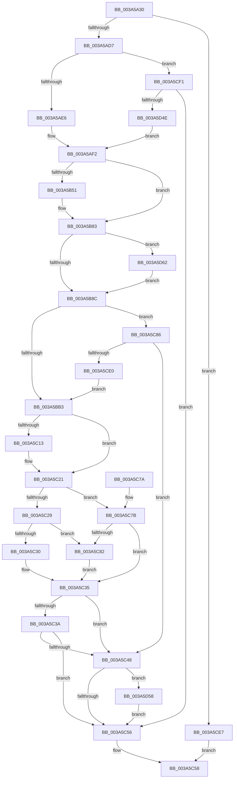

# RtlCheckTokenMembershipEx

- RVA: `0x003A5A30`–`0x003A5D98` (길이 `872` bytes)
- VA: `0x00000001403A5A30`
- 실행 섹션: `.text`
- PDB 이름 있음: `예`; PDB Function 태그: `아니요`
- unwind 정보 RVA: `0x00089AB4`
- 디코드: `212`개 명령, `872/872` bytes 표시
- 미해석 바이트: `0` (있으면 어셈블리에 `.byte`로 보존)

> 이 문서는 커널 이미지의 기계어와 PDB 기호를 분석해 생성했습니다. 4번과 5번은 함수 원형과 자료형을 바이너리 사용 방식에서 추정한 C 해석이며 원본 소스 복구 결과는 아닙니다.

## 1. Dependencies

- 직접 호출 지점: **20**; 고유 호출 대상: **16**
- 직접 호출자로 확인된 함수: **5**
- RIP 상대 이미지 참조: **4**

### Outgoing calls
- `0x003A5A7C` → [memset](../6C/memset_function_006C6C40.md) (function, `0x006C6C40`)
- `0x003A5A8D` → [memset](../6C/memset_function_006C6C40.md) (function, `0x006C6C40`)
- `0x003A5AEA` → [SeCaptureSubjectContext](../../page/86/SeCaptureSubjectContext_function_0086B820.md) (function, `0x0086B820`)
- `0x003A5AFB` → [RtlCreateSecurityDescriptor](../../page/9F/RtlCreateSecurityDescriptor_function_009F1DF0.md) (function, `0x009F1DF0`)
- `0x003A5B0A` → [RtlSetOwnerSecurityDescriptor](../../page/91/RtlSetOwnerSecurityDescriptor_function_00916F90.md) (function, `0x00916F90`)
- `0x003A5B19` → [RtlSetGroupSecurityDescriptor](../../page/A2/RtlSetGroupSecurityDescriptor_function_00A2EB10.md) (function, `0x00A2EB10`)
- `0x003A5B2D` → [RtlCreateAcl](../../page/91/RtlCreateAcl_function_00916F00.md) (function, `0x00916F00`)
- `0x003A5B46` → [RtlAddAccessAllowedAce](../../page/92/RtlAddAccessAllowedAce_function_009298C0.md) (function, `0x009298C0`)
- `0x003A5B6A` → [RtlInitializeSidEx](RtlInitializeSidEx_function_003A5320.md) (function, `0x003A5320`)
- `0x003A5B7E` → [RtlAddAccessAllowedAce](../../page/92/RtlAddAccessAllowedAce_function_009298C0.md) (function, `0x009298C0`)
- `0x003A5B99` → [RtlSetDaclSecurityDescriptor](../../page/9E/RtlSetDaclSecurityDescriptor_function_009EC210.md) (function, `0x009EC210`)
- `0x003A5C09` → [SeAccessCheckWithHint](SeAccessCheckWithHint_function_003A6C30.md) (function, `0x003A6C30`)
- `0x003A5C1C` → [ObfDereferenceObjectWithTag](../2F/ObfDereferenceObjectWithTag_function_002F78E0.md) (function, `0x002F78E0`)
- `0x003A5C3E` → [SeReleaseSubjectContext](../../page/86/SeReleaseSubjectContext_function_0086B710.md) (function, `0x0086B710`)
- `0x003A5C62` → [_security_check_cookie](../6A/_security_check_cookie_function_006AC640.md) (function, `0x006AC640`)
- `0x003A5CC8` → [ObReferenceObjectByHandle](../../page/86/ObReferenceObjectByHandle_function_00868DB0.md) (function, `0x00868DB0`)
- `0x003A5D3F` → [ZwDuplicateToken](../6A/ZwDuplicateToken_function_006AD910.md) (function, `0x006AD910`)
- `0x003A5D58` → [ZwClose](../6A/ZwClose_function_006AD2B0.md) (function, `0x006AD2B0`)
- `0x003A5D78` → [RtlInitializeSidEx](RtlInitializeSidEx_function_003A5320.md) (function, `0x003A5320`)
- `0x003A5D8E` → [RtlAddAccessAllowedAce](../../page/92/RtlAddAccessAllowedAce_function_009298C0.md) (function, `0x009298C0`)

### Direct callers
- [RtlCheckTokenMembership](RtlCheckTokenMembership_function_003A5A10.md) at `0x003A5A1A`
- [RtlCapabilityCheck](../../page/A2/RtlCapabilityCheck_function_00A20340.md) at `0x00A204A2`
- [RtlCapabilityCheck](../../page/A2/RtlCapabilityCheck_function_00A20340.md) at `0x00A2058B`
- [ExpFirmwareAccessAppContainerCheck](../../page/AB/ExpFirmwareAccessAppContainerCheck_function_00AB7AFC.md) at `0x00AB7D15`
- [sub_00B26286](../../page/B2/Unknown_function_00B26286.md) at `0x00B262AB`
- [sub_00B37784](../../page/B3/Unknown_function_00B37784.md) at `0x00B37843`

### Static image references
- `0x003A5A4B` → RVA `0x00E0A740` (`.data`; read)
- `0x003A5B5F` → RVA `0x0001A798` (`.rdata`; read)
- `0x003A5BE7` → RVA `0x000118F0` (`.rdata`; read)
- `0x003A5C92` → RVA `0x00FD8020` (`PAGEDATA`; read)

## 2. Other-region calls and transfers

- 다른 실행 섹션으로 향하는 call: **11**
  - `0x003A5AEA` → [SeCaptureSubjectContext](../../page/86/SeCaptureSubjectContext_function_0086B820.md) (`.text` → `PAGE`)
  - `0x003A5AFB` → [RtlCreateSecurityDescriptor](../../page/9F/RtlCreateSecurityDescriptor_function_009F1DF0.md) (`.text` → `PAGE`)
  - `0x003A5B0A` → [RtlSetOwnerSecurityDescriptor](../../page/91/RtlSetOwnerSecurityDescriptor_function_00916F90.md) (`.text` → `PAGE`)
  - `0x003A5B19` → [RtlSetGroupSecurityDescriptor](../../page/A2/RtlSetGroupSecurityDescriptor_function_00A2EB10.md) (`.text` → `PAGE`)
  - `0x003A5B2D` → [RtlCreateAcl](../../page/91/RtlCreateAcl_function_00916F00.md) (`.text` → `PAGE`)
  - `0x003A5B46` → [RtlAddAccessAllowedAce](../../page/92/RtlAddAccessAllowedAce_function_009298C0.md) (`.text` → `PAGE`)
  - `0x003A5B7E` → [RtlAddAccessAllowedAce](../../page/92/RtlAddAccessAllowedAce_function_009298C0.md) (`.text` → `PAGE`)
  - `0x003A5B99` → [RtlSetDaclSecurityDescriptor](../../page/9E/RtlSetDaclSecurityDescriptor_function_009EC210.md) (`.text` → `PAGE`)
  - `0x003A5C3E` → [SeReleaseSubjectContext](../../page/86/SeReleaseSubjectContext_function_0086B710.md) (`.text` → `PAGE`)
  - `0x003A5CC8` → [ObReferenceObjectByHandle](../../page/86/ObReferenceObjectByHandle_function_00868DB0.md) (`.text` → `PAGE`)
  - `0x003A5D8E` → [RtlAddAccessAllowedAce](../../page/92/RtlAddAccessAllowedAce_function_009298C0.md) (`.text` → `PAGE`)
- 별도 외부 분기/꼬리 이동을 확인하지 못했습니다.

## 3. Assembly (complete function range)

```asm
003A5A30  40 55                           push rbp
003A5A32  53                              push rbx
003A5A33  56                              push rsi
003A5A34  41 54                           push r12
003A5A36  41 55                           push r13
003A5A38  41 56                           push r14
003A5A3A  41 57                           push r15
003A5A3C  48 8D AC 24 70 FE FF FF         lea rbp, [rsp - 0x190]
003A5A44  48 81 EC 90 02 00 00            sub rsp, 0x290
003A5A4B  48 8B 05 EE 4C A6 00            mov rax, qword ptr [rip + 0xa64cee]
003A5A52  48 33 C4                        xor rax, rsp
003A5A55  48 89 85 88 01 00 00            mov qword ptr [rbp + 0x188], rax
003A5A5C  33 DB                           xor ebx, ebx
003A5A5E  45 8B F8                        mov r15d, r8d
003A5A61  4C 8B EA                        mov r13, rdx
003A5A64  89 5C 24 64                     mov dword ptr [rsp + 0x64], ebx
003A5A68  4C 8B F1                        mov r14, rcx
003A5A6B  89 5C 24 60                     mov dword ptr [rsp + 0x60], ebx
003A5A6F  33 D2                           xor edx, edx
003A5A71  48 8D 4D 10                     lea rcx, [rbp + 0x10]
003A5A75  44 8D 43 44                     lea r8d, [rbx + 0x44]
003A5A79  4D 8B E1                        mov r12, r9
003A5A7C  E8 BF 11 32 00                  call 0x1406c6c40
003A5A81  33 D2                           xor edx, edx
003A5A83  48 8D 4D 60                     lea rcx, [rbp + 0x60]
003A5A87  41 B8 EC 00 00 00               mov r8d, 0xec
003A5A8D  E8 AE 11 32 00                  call 0x1406c6c40
003A5A92  33 C0                           xor eax, eax
003A5A94  48 89 5C 24 70                  mov qword ptr [rsp + 0x70], rbx
003A5A99  48 89 45 C0                     mov qword ptr [rbp - 0x40], rax
003A5A9D  0F 57 C0                        xorps xmm0, xmm0
003A5AA0  89 45 C8                        mov dword ptr [rbp - 0x38], eax
003A5AA3  48 89 45 F8                     mov qword ptr [rbp - 8], rax
003A5AA7  89 45 00                        mov dword ptr [rbp], eax
003A5AAA  48 89 45 F0                     mov qword ptr [rbp - 0x10], rax
003A5AAE  41 88 1C 24                     mov byte ptr [r12], bl
003A5AB2  0F 11 45 A0                     movups xmmword ptr [rbp - 0x60], xmm0
003A5AB6  0F 11 45 B0                     movups xmmword ptr [rbp - 0x50], xmm0
003A5ABA  0F 11 45 D0                     movups xmmword ptr [rbp - 0x30], xmm0
003A5ABE  0F 11 45 E0                     movups xmmword ptr [rbp - 0x20], xmm0
003A5AC2  0F 11 45 80                     movups xmmword ptr [rbp - 0x80], xmm0
003A5AC6  0F 11 45 90                     movups xmmword ptr [rbp - 0x70], xmm0
003A5ACA  41 F7 C7 FC FF FF FF            test r15d, 0xfffffffc
003A5AD1  0F 85 10 02 00 00               jne 0x1403a5ce7
003A5AD7  8D 4B 02                        lea ecx, [rbx + 2]
003A5ADA  40 8A F3                        mov sil, bl
003A5ADD  4D 85 F6                        test r14, r14
003A5AE0  0F 85 0B 02 00 00               jne 0x1403a5cf1
003A5AE6  48 8D 4D 80                     lea rcx, [rbp - 0x80]
003A5AEA  E8 31 5D 4C 00                  call 0x14086b820
003A5AEF  40 B6 01                        mov sil, 1
003A5AF2  BA 01 00 00 00                  mov edx, 1
003A5AF7  48 8D 4D D0                     lea rcx, [rbp - 0x30]
003A5AFB  E8 F0 C2 64 00                  call 0x1409f1df0
003A5B00  45 33 C0                        xor r8d, r8d
003A5B03  48 8D 4D D0                     lea rcx, [rbp - 0x30]
003A5B07  49 8B D5                        mov rdx, r13
003A5B0A  E8 81 14 57 00                  call 0x140916f90
003A5B0F  45 33 C0                        xor r8d, r8d
003A5B12  48 8D 4D D0                     lea rcx, [rbp - 0x30]
003A5B16  49 8B D5                        mov rdx, r13
003A5B19  E8 F2 8F 68 00                  call 0x140a2eb10
003A5B1E  BA EC 00 00 00                  mov edx, 0xec
003A5B23  48 8D 4D 60                     lea rcx, [rbp + 0x60]
003A5B27  41 B8 02 00 00 00               mov r8d, 2
003A5B2D  E8 CE 13 57 00                  call 0x140916f00
003A5B32  41 B8 01 00 00 00               mov r8d, 1
003A5B38  48 8D 4D 60                     lea rcx, [rbp + 0x60]
003A5B3C  4D 8B CD                        mov r9, r13
003A5B3F  45 8D 68 01                     lea r13d, [r8 + 1]
003A5B43  41 8B D5                        mov edx, r13d
003A5B46  E8 75 3D 58 00                  call 0x1409298c0
003A5B4B  41 F6 C7 03                     test r15b, 3
003A5B4F  74 32                           je 0x1403a5b83
003A5B51  45 8B CD                        mov r9d, r13d
003A5B54  C7 44 24 20 01 00 00 00         mov dword ptr [rsp + 0x20], 1
003A5B5C  45 8B C5                        mov r8d, r13d
003A5B5F  48 8D 15 32 4C C7 FF            lea rdx, [rip - 0x38b3ce]
003A5B66  48 8D 4D 10                     lea rcx, [rbp + 0x10]
003A5B6A  E8 B1 F7 FF FF                  call 0x1403a5320
003A5B6F  4C 8D 4D 10                     lea r9, [rbp + 0x10]
003A5B73  41 8B D5                        mov edx, r13d
003A5B76  45 8D 45 FF                     lea r8d, [r13 - 1]
003A5B7A  48 8D 4D 60                     lea rcx, [rbp + 0x60]
003A5B7E  E8 3D 3D 58 00                  call 0x1409298c0
003A5B83  45 84 FD                        test r13b, r15b
003A5B86  0F 85 D6 01 00 00               jne 0x1403a5d62
003A5B8C  45 33 C9                        xor r9d, r9d
003A5B8F  4C 8D 45 60                     lea r8, [rbp + 0x60]
003A5B93  B2 01                           mov dl, 1
003A5B95  48 8D 4D D0                     lea rcx, [rbp - 0x30]
003A5B99  E8 72 66 64 00                  call 0x1409ec210
003A5B9E  48 8D 85 50 01 00 00            lea rax, [rbp + 0x150]
003A5BA5  48 89 44 24 78                  mov qword ptr [rsp + 0x78], rax
003A5BAA  40 84 F6                        test sil, sil
003A5BAD  0F 84 D3 00 00 00               je 0x1403a5c86
003A5BB3  65 48 8B 04 25 88 01 00 00      mov rax, qword ptr gs:[0x188]
003A5BBC  48 8D 4C 24 60                  lea rcx, [rsp + 0x60]
003A5BC1  48 89 4C 24 50                  mov qword ptr [rsp + 0x50], rcx
003A5BC6  4C 8D 45 80                     lea r8, [rbp - 0x80]
003A5BCA  48 8D 4C 24 64                  lea rcx, [rsp + 0x64]
003A5BCF  45 33 C9                        xor r9d, r9d
003A5BD2  48 89 4C 24 48                  mov qword ptr [rsp + 0x48], rcx
003A5BD7  33 D2                           xor edx, edx
003A5BD9  8A 80 32 02 00 00               mov al, byte ptr [rax + 0x232]
003A5BDF  48 8D 4D D0                     lea rcx, [rbp - 0x30]
003A5BE3  88 44 24 40                     mov byte ptr [rsp + 0x40], al
003A5BE7  48 8D 05 02 BD C6 FF            lea rax, [rip - 0x3942fe]
003A5BEE  48 89 44 24 38                  mov qword ptr [rsp + 0x38], rax
003A5BF3  48 8D 44 24 78                  lea rax, [rsp + 0x78]
003A5BF8  48 89 44 24 30                  mov qword ptr [rsp + 0x30], rax
003A5BFD  89 5C 24 28                     mov dword ptr [rsp + 0x28], ebx
003A5C01  C7 44 24 20 01 00 00 00         mov dword ptr [rsp + 0x20], 1
003A5C09  E8 22 10 00 00                  call 0x1403a6c30
003A5C0E  40 84 F6                        test sil, sil
003A5C11  75 0E                           jne 0x1403a5c21
003A5C13  48 8B 4D 90                     mov rcx, qword ptr [rbp - 0x70]
003A5C17  BA 44 66 6C 74                  mov edx, 0x746c6644
003A5C1C  E8 BF 1C F5 FF                  call 0x1402f78e0
003A5C21  8B 44 24 60                     mov eax, dword ptr [rsp + 0x60]
003A5C25  85 C0                           test eax, eax
003A5C27  75 52                           jne 0x1403a5c7b
003A5C29  83 7C 24 64 01                  cmp dword ptr [rsp + 0x64], 1
003A5C2E  75 52                           jne 0x1403a5c82
003A5C30  41 C6 04 24 01                  mov byte ptr [r12], 1
003A5C35  40 84 F6                        test sil, sil
003A5C38  74 0E                           je 0x1403a5c48
003A5C3A  48 8D 4D 80                     lea rcx, [rbp - 0x80]
003A5C3E  E8 CD 5A 4C 00                  call 0x14086b710
003A5C43  4D 85 F6                        test r14, r14
003A5C46  75 0E                           jne 0x1403a5c56
003A5C48  48 8B 4C 24 70                  mov rcx, qword ptr [rsp + 0x70]
003A5C4D  48 85 C9                        test rcx, rcx
003A5C50  0F 85 02 01 00 00               jne 0x1403a5d58
003A5C56  8B C3                           mov eax, ebx
003A5C58  48 8B 8D 88 01 00 00            mov rcx, qword ptr [rbp + 0x188]
003A5C5F  48 33 CC                        xor rcx, rsp
003A5C62  E8 D9 69 30 00                  call 0x1406ac640
003A5C67  48 81 C4 90 02 00 00            add rsp, 0x290
003A5C6E  41 5F                           pop r15
003A5C70  41 5E                           pop r14
003A5C72  41 5D                           pop r13
003A5C74  41 5C                           pop r12
003A5C76  5E                              pop rsi
003A5C77  5B                              pop rbx
003A5C78  5D                              pop rbp
003A5C79  C3                              ret
003A5C7A  CC                              int3
003A5C7B  3D 22 00 00 C0                  cmp eax, 0xc0000022
003A5C80  74 B3                           je 0x1403a5c35
003A5C82  8B D8                           mov ebx, eax
003A5C84  EB AF                           jmp 0x1403a5c35
003A5C86  65 48 8B 04 25 88 01 00 00      mov rax, qword ptr gs:[0x188]
003A5C8F  45 33 C9                        xor r9d, r9d
003A5C92  4C 8B 05 87 23 C3 00            mov r8, qword ptr [rip + 0xc32387]
003A5C99  48 89 5C 24 28                  mov qword ptr [rsp + 0x28], rbx
003A5C9E  48 89 5C 24 68                  mov qword ptr [rsp + 0x68], rbx
003A5CA3  48 8B 88 B8 00 00 00            mov rcx, qword ptr [rax + 0xb8]
003A5CAA  41 8D 51 08                     lea edx, [r9 + 8]
003A5CAE  48 8B 81 D0 01 00 00            mov rax, qword ptr [rcx + 0x1d0]
003A5CB5  48 8B 4C 24 70                  mov rcx, qword ptr [rsp + 0x70]
003A5CBA  48 89 45 98                     mov qword ptr [rbp - 0x68], rax
003A5CBE  48 8D 44 24 68                  lea rax, [rsp + 0x68]
003A5CC3  48 89 44 24 20                  mov qword ptr [rsp + 0x20], rax
003A5CC8  E8 E3 30 4C 00                  call 0x140868db0
003A5CCD  8B D8                           mov ebx, eax
003A5CCF  48 8B 44 24 68                  mov rax, qword ptr [rsp + 0x68]
003A5CD4  48 89 45 90                     mov qword ptr [rbp - 0x70], rax
003A5CD8  85 DB                           test ebx, ebx
003A5CDA  0F 88 68 FF FF FF               js 0x1403a5c48
003A5CE0  33 DB                           xor ebx, ebx
003A5CE2  E9 CC FE FF FF                  jmp 0x1403a5bb3
003A5CE7  B8 0D 00 00 C0                  mov eax, 0xc000000d
003A5CEC  E9 67 FF FF FF                  jmp 0x1403a5c58
003A5CF1  48 8D 45 F8                     lea rax, [rbp - 8]
003A5CF5  89 4D FC                        mov dword ptr [rbp - 4], ecx
003A5CF8  48 89 45 C8                     mov qword ptr [rbp - 0x38], rax
003A5CFC  4C 8D 45 A0                     lea r8, [rbp - 0x60]
003A5D00  45 33 C9                        xor r9d, r9d
003A5D03  C7 45 A0 30 00 00 00            mov dword ptr [rbp - 0x60], 0x30
003A5D0A  48 8D 44 24 70                  lea rax, [rsp + 0x70]
003A5D0F  48 89 5D A8                     mov qword ptr [rbp - 0x58], rbx
003A5D13  48 89 44 24 28                  mov qword ptr [rsp + 0x28], rax
003A5D18  89 4C 24 20                     mov dword ptr [rsp + 0x20], ecx
003A5D1C  49 8B CE                        mov rcx, r14
003A5D1F  41 8D 51 08                     lea edx, [r9 + 8]
003A5D23  C7 45 B8 00 02 00 00            mov dword ptr [rbp - 0x48], 0x200
003A5D2A  48 89 5D B0                     mov qword ptr [rbp - 0x50], rbx
003A5D2E  48 89 5D C0                     mov qword ptr [rbp - 0x40], rbx
003A5D32  C7 45 F8 0C 00 00 00            mov dword ptr [rbp - 8], 0xc
003A5D39  66 C7 45 00 01 00               mov word ptr [rbp], 1
003A5D3F  E8 CC 7B 30 00                  call 0x1406ad910
003A5D44  8B D8                           mov ebx, eax
003A5D46  85 C0                           test eax, eax
003A5D48  0F 88 08 FF FF FF               js 0x1403a5c56
003A5D4E  33 DB                           xor ebx, ebx
003A5D50  44 8B F3                        mov r14d, ebx
003A5D53  E9 9A FD FF FF                  jmp 0x1403a5af2
003A5D58  E8 53 75 30 00                  call 0x1406ad2b0
003A5D5D  E9 F4 FE FF FF                  jmp 0x1403a5c56
003A5D62  45 8B CD                        mov r9d, r13d
003A5D65  44 89 6C 24 20                  mov dword ptr [rsp + 0x20], r13d
003A5D6A  45 8B C5                        mov r8d, r13d
003A5D6D  48 8D 15 24 4A C7 FF            lea rdx, [rip - 0x38b5dc]
003A5D74  48 8D 4D 10                     lea rcx, [rbp + 0x10]
003A5D78  E8 A3 F5 FF FF                  call 0x1403a5320
003A5D7D  4C 8D 4D 10                     lea r9, [rbp + 0x10]
003A5D81  41 B8 01 00 00 00               mov r8d, 1
003A5D87  41 8B D5                        mov edx, r13d
003A5D8A  48 8D 4D 60                     lea rcx, [rbp + 0x60]
003A5D8E  E8 2D 3B 58 00                  call 0x1409298c0
003A5D93  E9 F4 FD FF FF                  jmp 0x1403a5b8c
```

## 4. C-style interpretation (structured pseudocode)

```c
__int64 __fastcall RtlCheckTokenMembershipEx(__int64 a1, __int64 a2, int a3, __int64 a4)
{
    __int64 result;
    __int64 v_rbx;
    __int64 v_rsp;
    unsigned __int64 v_stack_m168;
    unsigned __int64 v_stack_m1B8;
    unsigned __int64 v_stack_m1C8;
    unsigned int v_stack_m1CC;
    unsigned __int64 v_stack_m1D0;
    unsigned __int64 v_stack_m1D8;
    unsigned __int64 v_stack_m1E8;
    unsigned __int64 v_stack_m1F8;
    unsigned int v_stack_m200;
    unsigned __int64 v_stack_m208;
    unsigned int v_stack_m210;
    unsigned __int64 v_stack_m218;
    unsigned __int64 v_stack_m220;
    unsigned __int64 v_stack_m228;
    unsigned __int64 v_stack_m230;
    unsigned __int64 v_stack_m238;
    unsigned __int64 v_stack_m248;
    unsigned __int64 v_stack_m250;
    unsigned __int64 v_stack_m258;
    unsigned int v_stack_m264;
    unsigned int v_stack_m268;
    unsigned __int64 v_stack_m278;
    unsigned __int64 v_stack_m280;
    unsigned __int8 v_stack_m288;
    unsigned __int64 v_stack_m290;
    unsigned __int64 v_stack_m298;
    unsigned int v_stack_m2A0;
    unsigned int v_stack_m2A8;
    unsigned __int64 v_stack_m40;
    unsigned __int64 v_stack_m78;
    unsigned __int64 v_stack_p20;
    unsigned __int64 v_stack_p28;
    unsigned __int64 v_stack_p68;
    unsigned __int64 v_stack_p70;

    v_rsp = (v_rsp) - (656);
    result = (*(unsigned __int64 *)(v_rip + 10898670)) ^ (v_rsp);
    v_stack_m40 = result;
    v_rbx = 0;
    v_stack_m264 = 0;
    v_stack_m268 = 0;
    a2 = 0;
    result = memset(v_stack_m1B8, a2, v_rbx + 68, a4);
    a2 = 0;
    result = memset(v_stack_m168, a2, 236, a4);
    result = 0;
    v_stack_m258 = 0;
    v_stack_m208 = 0;
    v_stack_m200 = 0;
    v_stack_m1D0 = 0;
    v_stack_m1C8 = 0;
    v_stack_m1D8 = 0;
    *(unsigned __int8 *)(a4) = 0;
    v_stack_m228 = v_xmm0;
    v_stack_m218 = v_xmm0;
    v_stack_m1F8 = v_xmm0;
    v_stack_m1E8 = v_xmm0;
    v_stack_m248 = v_xmm0;
    v_stack_m238 = v_xmm0;
    if ((((unsigned int)((unsigned int)(a3))) & (0xFFFFFFFCULL)) != 0) goto loc_003A5CE7;
    if (a1 != 0) goto loc_003A5CF1;
    result = SeCaptureSubjectContext(v_stack_m248, a2, 236, a4);
loc_003A5AF2:
    result = RtlCreateSecurityDescriptor(v_stack_m1F8, 1, 236, a4);
    a3 = 0;
    result = RtlSetOwnerSecurityDescriptor(v_stack_m1F8, 0, a3, a4);
    a3 = 0;
    result = RtlSetGroupSecurityDescriptor(v_stack_m1F8, 0, a3, a4);
    result = RtlCreateAcl(v_stack_m168, 236, 2, a4);
    result = RtlAddAccessAllowedAce(v_stack_m168, (unsigned int)((unsigned int)(1 + 1)), 1, 0);
    if ((((unsigned __int8)((unsigned int)(a3))) & (3)) != 0) {
        a4 = (unsigned int)(1 + 1);
        v_stack_m2A8 = 1;
        a3 = (unsigned int)(1 + 1);
        a2 = v_rip - 3716046;
        a1 = v_stack_m1B8;
        result = RtlInitializeSidEx(a1, a2, a3, a4);
        a4 = v_stack_m1B8;
        a2 = (unsigned int)(1 + 1);
        a3 = 1 + 1 - 1;
        a1 = v_stack_m168;
        result = RtlAddAccessAllowedAce(a1, a2, a3, a4);
    }
    if ((((unsigned __int8)(1 + 1)) & ((unsigned __int8)((unsigned int)(a3)))) != 0) goto loc_003A5D62;
loc_003A5B8C:
    a4 = 0;
    result = RtlSetDaclSecurityDescriptor(v_stack_m1F8, 1, v_stack_m168, a4);
    v_stack_m250 = v_stack_m78;
    if (1 == 0) goto loc_003A5C86;
loc_003A5BB3:
    v_stack_m278 = v_stack_m268;
    a4 = 0;
    v_stack_m280 = v_stack_m264;
    a2 = 0;
    v_stack_m288 = (unsigned __int8)(*(unsigned __int8 *)(*(unsigned __int64 *)(gs_base + (0 + 392)) + 562));
    v_stack_m290 = v_rip - 3752702;
    v_stack_m298 = v_stack_m250;
    v_stack_m2A0 = 0;
    v_stack_m2A8 = 1;
    result = SeAccessCheckWithHint(v_stack_m1F8, a2, v_stack_m248, a4);
    if (1 == 0) {
        a1 = v_stack_m238;
        a2 = 0x746C6644ULL;
        result = ObfDereferenceObjectWithTag(a1, a2, v_stack_m248, a4);
    }
    if ((unsigned int)((unsigned int)(v_stack_m268)) != 0) goto loc_003A5C7B;
    if (v_stack_m264 != 1) goto loc_003A5C82;
    *(unsigned __int8 *)(a4) = 1;
loc_003A5C35:
    if (1 == 0) goto loc_003A5C48;
    result = SeReleaseSubjectContext(v_stack_m248, a2, v_stack_m248, a4);
    if (a1 != 0) goto loc_003A5C56;
loc_003A5C48:
    if (v_stack_m258 != 0) goto loc_003A5D58;
loc_003A5C56:
loc_003A5C58:
    a1 = (v_stack_m40) ^ (v_rsp);
    result = _security_check_cookie(a1, a2, v_stack_m248, a4);
    v_rsp = (v_rsp) + (656);
    return result;
loc_003A5C7B:
    if (((unsigned int)(result)) == 0xC0000022ULL) goto loc_003A5C35;
loc_003A5C82:
    goto loc_003A5C35;
loc_003A5C86:
    a4 = 0;
    v_stack_p28 = (unsigned int)((unsigned int)(result));
    v_stack_p68 = (unsigned int)((unsigned int)(result));
    v_stack_m230 = *(unsigned __int64 *)(*(unsigned __int64 *)(*(unsigned __int64 *)(gs_base + (0 + 392)) + 184) + 464);
    v_stack_p20 = v_stack_p68;
    result = ObReferenceObjectByHandle(v_stack_p70, a4 + 8, *(unsigned __int64 *)(v_rip + 12788615), a4);
    v_stack_m238 = v_stack_p68;
    if (sign_flag) goto loc_003A5C48;
    v_rbx = 0;
    goto loc_003A5BB3;
loc_003A5CE7:
    goto loc_003A5C58;
loc_003A5CF1:
    v_stack_m1CC = (unsigned int)(v_stack_p70);
    v_stack_m200 = v_stack_m1D0;
    a4 = 0;
    v_stack_m228 = 48;
    v_stack_m220 = 0;
    v_stack_p28 = v_stack_p70;
    v_stack_p20 = (unsigned int)(v_stack_p70);
    v_stack_m210 = 512;
    v_stack_m218 = 0;
    v_stack_m208 = 0;
    v_stack_m1D0 = 12;
    v_stack_m1C8 = 1;
    result = ZwDuplicateToken(a1, a4 + 8, v_stack_m228, a4);
    if (sign_flag) goto loc_003A5C56;
    v_rbx = 0;
    goto loc_003A5AF2;
loc_003A5D58:
    result = ZwClose(a1, a4 + 8, v_stack_m228, a4);
    goto loc_003A5C56;
loc_003A5D62:
    v_stack_p20 = (unsigned int)(1 + 1);
    result = RtlInitializeSidEx(v_stack_m1B8, v_rip - 3716572, (unsigned int)((unsigned int)(1 + 1)), (unsigned int)((unsigned int)(1 + 1)));
    result = RtlAddAccessAllowedAce(v_stack_m168, (unsigned int)((unsigned int)(1 + 1)), 1, v_stack_m1B8);
    goto loc_003A5B8C;
}
```

## 5. (Beta) C Style

```c
int64_t RtlCheckTokenMembershipEx(int64_t Arg1, int64_t Arg2, int32_t Arg3, void *Arg4)
{
    uint8_t *arg4 = (uint8_t *)Arg4;

    int64_t result;
    int64_t local_rbx;
    int64_t local_rsp;
    uint64_t v_stack_m168;
    uint64_t v_stack_m1B8;
    uint64_t v_stack_m1C8;
    uint32_t v_stack_m1CC;
    uint64_t v_stack_m1D0;
    uint64_t v_stack_m1D8;
    uint64_t v_stack_m1E8;
    uint64_t v_stack_m1F8;
    uint32_t v_stack_m200;
    uint64_t v_stack_m208;
    uint32_t v_stack_m210;
    uint64_t v_stack_m218;
    uint64_t v_stack_m220;
    uint64_t v_stack_m228;
    uint64_t v_stack_m230;
    uint64_t v_stack_m238;
    uint64_t v_stack_m248;
    uint64_t v_stack_m250;
    uint64_t v_stack_m258;
    uint32_t v_stack_m264;
    uint32_t v_stack_m268;
    uint64_t v_stack_m278;
    uint64_t v_stack_m280;
    uint8_t v_stack_m288;
    uint64_t v_stack_m290;
    uint64_t v_stack_m298;
    uint32_t v_stack_m2A0;
    uint32_t v_stack_m2A8;
    uint64_t v_stack_m40;
    uint64_t v_stack_m78;
    uint64_t v_stack_p20;
    uint64_t v_stack_p28;
    uint64_t v_stack_p68;
    uint64_t v_stack_p70;

    local_rsp = (local_rsp) - (656);
    result = (*(uint64_t *)(v_rip + 0xA64CEE)) ^ (local_rsp);
    v_stack_m40 = result;
    local_rbx = 0;
    v_stack_m264 = 0;
    v_stack_m268 = 0;
    Arg2 = 0;
    result = memset(v_stack_m1B8, Arg2, local_rbx + 68, Arg4);
    Arg2 = 0;
    result = memset(v_stack_m168, Arg2, 236, Arg4);
    result = 0;
    v_stack_m258 = 0;
    v_stack_m208 = 0;
    v_stack_m200 = 0;
    v_stack_m1D0 = 0;
    v_stack_m1C8 = 0;
    v_stack_m1D8 = 0;
    *(uint8_t *)(arg4) = 0;
    v_stack_m228 = v_xmm0;
    v_stack_m218 = v_xmm0;
    v_stack_m1F8 = v_xmm0;
    v_stack_m1E8 = v_xmm0;
    v_stack_m248 = v_xmm0;
    v_stack_m238 = v_xmm0;
    if ((((uint32_t)((uint32_t)(Arg3))) & (0xFFFFFFFCULL)) != 0) goto loc_003A5CE7;
    if (Arg1 != 0) goto loc_003A5CF1;
    result = SeCaptureSubjectContext(v_stack_m248, Arg2, 236, Arg4);
loc_003A5AF2:
    result = RtlCreateSecurityDescriptor(v_stack_m1F8, 1, 236, Arg4);
    Arg3 = 0;
    result = RtlSetOwnerSecurityDescriptor(v_stack_m1F8, 0, Arg3, Arg4);
    Arg3 = 0;
    result = RtlSetGroupSecurityDescriptor(v_stack_m1F8, 0, Arg3, Arg4);
    result = RtlCreateAcl(v_stack_m168, 236, 2, Arg4);
    result = RtlAddAccessAllowedAce(v_stack_m168, (uint32_t)((uint32_t)(1 + 1)), 1, 0);
    if ((((uint8_t)((uint32_t)(Arg3))) & (3)) != 0) {
        Arg4 = (uint32_t)(1 + 1);
        v_stack_m2A8 = 1;
        Arg3 = (uint32_t)(1 + 1);
        Arg2 = v_rip - 3716046;
        Arg1 = v_stack_m1B8;
        result = RtlInitializeSidEx(Arg1, Arg2, Arg3, Arg4);
        Arg4 = v_stack_m1B8;
        Arg2 = (uint32_t)(1 + 1);
        Arg3 = 1 + 1 - 1;
        Arg1 = v_stack_m168;
        result = RtlAddAccessAllowedAce(Arg1, Arg2, Arg3, Arg4);
    }
    if ((((uint8_t)(1 + 1)) & ((uint8_t)((uint32_t)(Arg3)))) != 0) goto loc_003A5D62;
loc_003A5B8C:
    Arg4 = 0;
    result = RtlSetDaclSecurityDescriptor(v_stack_m1F8, 1, v_stack_m168, Arg4);
    v_stack_m250 = v_stack_m78;
    if (1 == 0) goto loc_003A5C86;
loc_003A5BB3:
    v_stack_m278 = v_stack_m268;
    Arg4 = 0;
    v_stack_m280 = v_stack_m264;
    Arg2 = 0;
    v_stack_m288 = (uint8_t)(*(uint8_t *)(*(uint64_t *)(gs_base + (0 + 0x188)) + 0x232));
    v_stack_m290 = v_rip - 3752702;
    v_stack_m298 = v_stack_m250;
    v_stack_m2A0 = 0;
    v_stack_m2A8 = 1;
    result = SeAccessCheckWithHint(v_stack_m1F8, Arg2, v_stack_m248, Arg4);
    if (1 == 0) {
        Arg1 = v_stack_m238;
        Arg2 = 0x746C6644ULL;
        result = ObfDereferenceObjectWithTag(Arg1, Arg2, v_stack_m248, Arg4);
    }
    if ((uint32_t)((uint32_t)(v_stack_m268)) != 0) goto loc_003A5C7B;
    if (v_stack_m264 != 1) goto loc_003A5C82;
    *(uint8_t *)(arg4) = 1;
loc_003A5C35:
    if (1 == 0) goto loc_003A5C48;
    result = SeReleaseSubjectContext(v_stack_m248, Arg2, v_stack_m248, Arg4);
    if (Arg1 != 0) goto loc_003A5C56;
loc_003A5C48:
    if (v_stack_m258 != 0) goto loc_003A5D58;
loc_003A5C56:
loc_003A5C58:
    Arg1 = (v_stack_m40) ^ (local_rsp);
    result = _security_check_cookie(Arg1, Arg2, v_stack_m248, Arg4);
    local_rsp = (local_rsp) + (656);
    return result;
loc_003A5C7B:
    if (((uint32_t)(result)) == 0xC0000022ULL) goto loc_003A5C35;
loc_003A5C82:
    goto loc_003A5C35;
loc_003A5C86:
    Arg4 = 0;
    v_stack_p28 = (uint32_t)((uint32_t)(result));
    v_stack_p68 = (uint32_t)((uint32_t)(result));
    v_stack_m230 = *(uint64_t *)(*(uint64_t *)(*(uint64_t *)(gs_base + (0 + 0x188)) + 0xB8) + 0x1D0);
    v_stack_p20 = v_stack_p68;
    result = ObReferenceObjectByHandle(v_stack_p70, Arg4 + 8, *(uint64_t *)(v_rip + 0xC32387), Arg4);
    v_stack_m238 = v_stack_p68;
    if (sign_flag) goto loc_003A5C48;
    local_rbx = 0;
    goto loc_003A5BB3;
loc_003A5CE7:
    goto loc_003A5C58;
loc_003A5CF1:
    v_stack_m1CC = (uint32_t)(v_stack_p70);
    v_stack_m200 = v_stack_m1D0;
    Arg4 = 0;
    v_stack_m228 = 48;
    v_stack_m220 = 0;
    v_stack_p28 = v_stack_p70;
    v_stack_p20 = (uint32_t)(v_stack_p70);
    v_stack_m210 = 512;
    v_stack_m218 = 0;
    v_stack_m208 = 0;
    v_stack_m1D0 = 12;
    v_stack_m1C8 = 1;
    result = ZwDuplicateToken(Arg1, Arg4 + 8, v_stack_m228, Arg4);
    if (sign_flag) goto loc_003A5C56;
    local_rbx = 0;
    goto loc_003A5AF2;
loc_003A5D58:
    result = ZwClose(Arg1, Arg4 + 8, v_stack_m228, Arg4);
    goto loc_003A5C56;
loc_003A5D62:
    v_stack_p20 = (uint32_t)(1 + 1);
    result = RtlInitializeSidEx(v_stack_m1B8, v_rip - 3716572, (uint32_t)((uint32_t)(1 + 1)), (uint32_t)((uint32_t)(1 + 1)));
    result = RtlAddAccessAllowedAce(v_stack_m168, (uint32_t)((uint32_t)(1 + 1)), 1, v_stack_m1B8);
    goto loc_003A5B8C;
}
```

### 관측된 메모리 오프셋

구조체 형식이 확인되지 않은 접근은 인자 기준의 오프셋으로만 기록했습니다.

| 기준 인자 | 오프셋 표현 | 폭 (bit) | 접근 |
|---|---:|---:|---|
| `Arg4` | `+ 0x0` | `8` | `W` |

## 6. Execution-region graph

[열기: 2D/3D 그래프와 함수 탐색 컨트롤 패널](../../../control-panel.html?section=text&rva=0x003A5A30&view=graph)

- 2D 그래프는 위에서 아래로 흐르고, 3D 그래프는 빈 공간을 드래그해 회전합니다. Shift+드래그는 이동, 휠은 확대·축소, 함수 노드 선택은 대상 보고서 이동입니다.

### Static fallback


