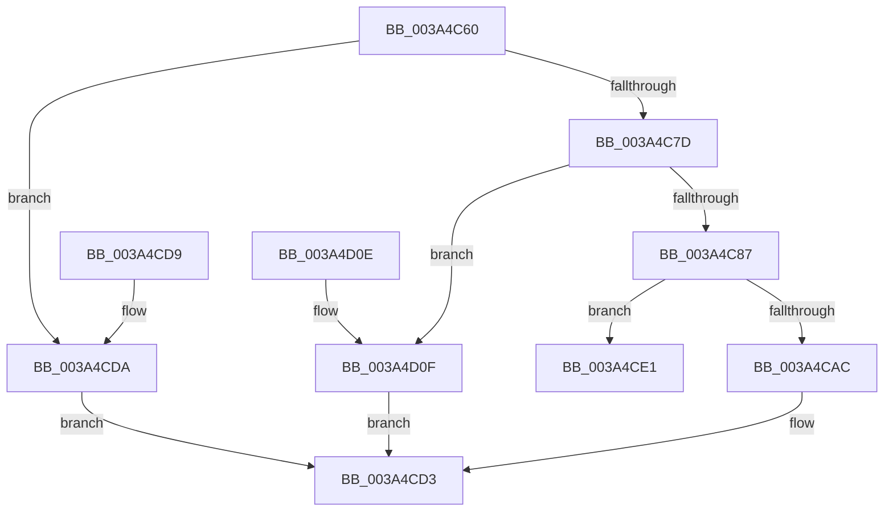

# RtlDecompressBufferEx

- RVA: `0x003A4C60`–`0x003A4D16` (길이 `182` bytes)
- VA: `0x00000001403A4C60`
- 실행 섹션: `.text`
- PDB 이름 있음: `예`; PDB Function 태그: `아니요`
- unwind 정보 RVA: `0x00089A14`
- 디코드: `46`개 명령, `182/182` bytes 표시
- 미해석 바이트: `0` (있으면 어셈블리에 `.byte`로 보존)

> 이 문서는 커널 이미지의 기계어와 PDB 기호를 분석해 생성했습니다. 4번과 5번은 함수 원형과 자료형을 바이너리 사용 방식에서 추정한 C 해석이며 원본 소스 복구 결과는 아닙니다.

## 1. Dependencies

- 직접 호출 지점: **2**; 고유 호출 대상: **2**
- 직접 호출자로 확인된 함수: **4**
- RIP 상대 이미지 참조: **2**

### Outgoing calls
- `0x003A4CCE` → [RtlDecompressBufferLz4](RtlDecompressBufferLz4_function_003A4D20.md) (function, `0x003A4D20`)
- `0x003A4D03` → [guard_dispatch_icall](../6B/guard_dispatch_icall_function_006BAAD0.md) (function, `0x006BAAD0`)

### Direct callers
- [SmDecompressBuffer](SmDecompressBuffer_function_003A4978.md) at `0x003A4A9C`
- [sub_006E6668](../6E/Unknown_function_006E6668.md) at `0x006E68F5`
- [sub_006E6668](../6E/Unknown_function_006E6668.md) at `0x006E6A4B`
- [PopDecompressHiberBlocks](../../pagelk/B6/PopDecompressHiberBlocks_function_00B6D074.md) at `0x00B6D429`
- [sub_00BF16D0](../../init/BF/Unknown_function_00BF16D0.md) at `0x00BF1EC6`

### Static image references
- `0x003A4C95` → RVA `0x00001FB0` (`.rdata`; read)
- `0x003A4CA0` → RVA `0x003A4D20` (`RtlDecompressBufferLz4`; read)

## 2. Other-region calls and transfers

- 다른 실행 섹션으로 향하는 call: **0**
- 별도 외부 분기/꼬리 이동을 확인하지 못했습니다.

## 3. Assembly (complete function range)

```asm
003A4C60  40 53                           push rbx
003A4C62  48 83 EC 40                     sub rsp, 0x40
003A4C66  B8 FF 00 00 00                  mov eax, 0xff
003A4C6B  4D 8B D1                        mov r10, r9
003A4C6E  66 23 C8                        and cx, ax
003A4C71  45 8B D8                        mov r11d, r8d
003A4C74  48 8B DA                        mov rbx, rdx
003A4C77  66 83 F9 02                     cmp cx, 2
003A4C7B  72 5D                           jb 0x1403a4cda
003A4C7D  66 83 F9 08                     cmp cx, 8
003A4C81  0F 87 88 00 00 00               ja 0x1403a4d0f
003A4C87  44 8B 4C 24 70                  mov r9d, dword ptr [rsp + 0x70]
003A4C8C  4D 8B C2                        mov r8, r10
003A4C8F  0F B7 C1                        movzx eax, cx
003A4C92  41 8B D3                        mov edx, r11d
003A4C95  48 8D 0D 14 D3 C5 FF            lea rcx, [rip - 0x3a2cec]
003A4C9C  48 8B 04 C1                     mov rax, qword ptr [rcx + rax*8]
003A4CA0  48 8D 0D 79 00 00 00            lea rcx, [rip + 0x79]
003A4CA7  48 3B C1                        cmp rax, rcx
003A4CAA  75 35                           jne 0x1403a4ce1
003A4CAC  48 8B 84 24 80 00 00 00         mov rax, qword ptr [rsp + 0x80]
003A4CB4  48 8B CB                        mov rcx, rbx
003A4CB7  48 89 44 24 30                  mov qword ptr [rsp + 0x30], rax
003A4CBC  48 8B 44 24 78                  mov rax, qword ptr [rsp + 0x78]
003A4CC1  48 89 44 24 28                  mov qword ptr [rsp + 0x28], rax
003A4CC6  C7 44 24 20 00 00 00 00         mov dword ptr [rsp + 0x20], 0
003A4CCE  E8 4D 00 00 00                  call 0x1403a4d20
003A4CD3  48 83 C4 40                     add rsp, 0x40
003A4CD7  5B                              pop rbx
003A4CD8  C3                              ret
003A4CD9  CC                              int3
003A4CDA  B8 0D 00 00 C0                  mov eax, 0xc000000d
003A4CDF  EB F2                           jmp 0x1403a4cd3
003A4CE1  48 8B 8C 24 80 00 00 00         mov rcx, qword ptr [rsp + 0x80]
003A4CE9  48 89 4C 24 30                  mov qword ptr [rsp + 0x30], rcx
003A4CEE  48 8B 4C 24 78                  mov rcx, qword ptr [rsp + 0x78]
003A4CF3  48 89 4C 24 28                  mov qword ptr [rsp + 0x28], rcx
003A4CF8  48 8B CB                        mov rcx, rbx
003A4CFB  C7 44 24 20 00 00 00 00         mov dword ptr [rsp + 0x20], 0
003A4D03  E8 C8 5D 31 00                  call 0x1406baad0
003A4D08  48 83 C4 40                     add rsp, 0x40
003A4D0C  5B                              pop rbx
003A4D0D  C3                              ret
003A4D0E  CC                              int3
003A4D0F  B8 5F 02 00 C0                  mov eax, 0xc000025f
003A4D14  EB BD                           jmp 0x1403a4cd3
```

## 4. C-style interpretation (structured pseudocode)

```c
__int64 __fastcall RtlDecompressBufferEx(unsigned __int16 a1, __int64 a2, int a3, __int64 a4, unsigned int a5, __int64 a6, __int64 a7)
{
    __int64 result;
    __int64 v_rsp;
    unsigned __int64 v_stack_m18;
    unsigned __int64 v_stack_m20;
    unsigned int v_stack_m28;
    unsigned int v_stack_p20;
    unsigned __int64 v_stack_p28;
    unsigned __int64 v_stack_p30;

    v_rsp = (v_rsp) - (64);
    a1 = (unsigned __int16)((a1) & (255));
    if (a1 < 2) goto loc_003A4CDA;
    if (a1 > 8) goto loc_003A4D0F;
    if ((*(unsigned __int64 *)(v_rip - 3812588 + a1 * 8)) != (v_rip + 121)) goto loc_003A4CE1;
    v_stack_m18 = a7;
    v_stack_m20 = a6;
    v_stack_m28 = 0;
    result = RtlDecompressBufferLz4(a2, (unsigned int)((unsigned int)((unsigned int)(a3))), a4, (unsigned int)(a5));
loc_003A4CD3:
    v_rsp = (v_rsp) + (64);
    return result;
loc_003A4CDA:
    goto loc_003A4CD3;
loc_003A4CE1:
    v_stack_p30 = a7;
    v_stack_p28 = a6;
    v_stack_p20 = 0;
    result = guard_dispatch_icall(a2, (unsigned int)((unsigned int)((unsigned int)(a3))), a4, (unsigned int)(a5));
    v_rsp = (v_rsp) + (64);
    return result;
loc_003A4D0F:
    goto loc_003A4CD3;
}
```

## 5. (Beta) C Style

```c
int64_t RtlDecompressBufferEx(uint16_t Arg1, int64_t Arg2, int32_t Arg3, int64_t Arg4, uint32_t Arg5, int64_t Arg6, int64_t Arg7)
{
    int64_t result;
    int64_t local_rsp;
    uint64_t v_stack_m18;
    uint64_t v_stack_m20;
    uint32_t v_stack_m28;
    uint32_t v_stack_p20;
    uint64_t v_stack_p28;
    uint64_t v_stack_p30;

    local_rsp = (local_rsp) - (64);
    Arg1 = (uint16_t)((Arg1) & (255));
    if (Arg1 < 2) goto loc_003A4CDA;
    if (Arg1 > 8) goto loc_003A4D0F;
    if ((*(uint64_t *)(v_rip - 0x3A2CEC + Arg1 * 8)) != (v_rip + 121)) goto loc_003A4CE1;
    v_stack_m18 = Arg7;
    v_stack_m20 = Arg6;
    v_stack_m28 = 0;
    result = RtlDecompressBufferLz4(Arg2, (uint32_t)((uint32_t)((uint32_t)(Arg3))), Arg4, (uint32_t)(Arg5));
loc_003A4CD3:
    local_rsp = (local_rsp) + (64);
    return result;
loc_003A4CDA:
    goto loc_003A4CD3;
loc_003A4CE1:
    v_stack_p30 = Arg7;
    v_stack_p28 = Arg6;
    v_stack_p20 = 0;
    result = guard_dispatch_icall(Arg2, (uint32_t)((uint32_t)((uint32_t)(Arg3))), Arg4, (uint32_t)(Arg5));
    local_rsp = (local_rsp) + (64);
    return result;
loc_003A4D0F:
    goto loc_003A4CD3;
}
```

## 6. Execution-region graph

[열기: 2D/3D 그래프와 함수 탐색 컨트롤 패널](../../../control-panel.html?section=text&rva=0x003A4C60&view=graph)

- 2D 그래프는 위에서 아래로 흐르고, 3D 그래프는 빈 공간을 드래그해 회전합니다. Shift+드래그는 이동, 휠은 확대·축소, 함수 노드 선택은 대상 보고서 이동입니다.

### Static fallback


