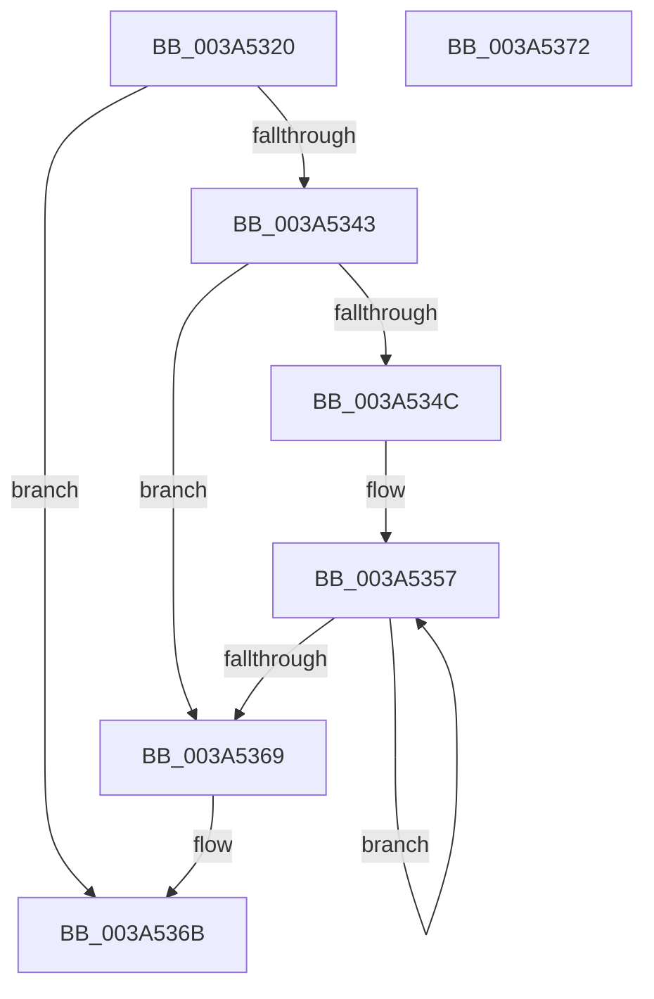

# RtlInitializeSidEx

- RVA: `0x003A5320`–`0x003A5373` (길이 `83` bytes)
- VA: `0x00000001403A5320`
- 실행 섹션: `.text`
- PDB 이름 있음: `예`; PDB Function 태그: `아니요`
- unwind 정보 RVA: `0x00089A54`
- 디코드: `29`개 명령, `83/83` bytes 표시
- 미해석 바이트: `0` (있으면 어셈블리에 `.byte`로 보존)

> 이 문서는 커널 이미지의 기계어와 PDB 기호를 분석해 생성했습니다. 4번과 5번은 함수 원형과 자료형을 바이너리 사용 방식에서 추정한 C 해석이며 원본 소스 복구 결과는 아닙니다.

## 1. Dependencies

- 직접 호출 지점: **1**; 고유 호출 대상: **1**
- 직접 호출자로 확인된 함수: **1**
- RIP 상대 이미지 참조: **0**

### Outgoing calls
- `0x003A533A` → [RtlInitializeSid](../../page/9E/RtlInitializeSid_function_009EB720.md) (function, `0x009EB720`)

### Direct callers
- [RtlCheckTokenMembershipEx](RtlCheckTokenMembershipEx_function_003A5A30.md) at `0x003A5B6A`
- [RtlCheckTokenMembershipEx](RtlCheckTokenMembershipEx_function_003A5A30.md) at `0x003A5D78`

### Static image references
- 디코드된 RIP-relative 메모리 참조가 없습니다.

## 2. Other-region calls and transfers

- 다른 실행 섹션으로 향하는 call: **1**
  - `0x003A533A` → [RtlInitializeSid](../../page/9E/RtlInitializeSid_function_009EB720.md) (`.text` → `PAGE`)
- 별도 외부 분기/꼬리 이동을 확인하지 못했습니다.

## 3. Assembly (complete function range)

```asm
003A5320  44 88 44 24 18                  mov byte ptr [rsp + 0x18], r8b
003A5325  4C 89 4C 24 20                  mov qword ptr [rsp + 0x20], r9
003A532A  53                              push rbx
003A532B  57                              push rdi
003A532C  48 83 EC 38                     sub rsp, 0x38
003A5330  41 0F B6 D8                     movzx ebx, r8b
003A5334  48 8B F9                        mov rdi, rcx
003A5337  44 8A C3                        mov r8b, bl
003A533A  E8 E1 63 64 00                  call 0x1409eb720
003A533F  85 C0                           test eax, eax
003A5341  78 28                           js 0x1403a536b
003A5343  48 8D 4C 24 68                  lea rcx, [rsp + 0x68]
003A5348  84 DB                           test bl, bl
003A534A  74 1D                           je 0x1403a5369
003A534C  48 83 C1 F8                     add rcx, -8
003A5350  48 8D 57 08                     lea rdx, [rdi + 8]
003A5354  44 8B C3                        mov r8d, ebx
003A5357  48 8D 49 08                     lea rcx, [rcx + 8]
003A535B  8B 01                           mov eax, dword ptr [rcx]
003A535D  89 02                           mov dword ptr [rdx], eax
003A535F  48 8D 52 04                     lea rdx, [rdx + 4]
003A5363  49 83 E8 01                     sub r8, 1
003A5367  75 EE                           jne 0x1403a5357
003A5369  33 C0                           xor eax, eax
003A536B  48 83 C4 38                     add rsp, 0x38
003A536F  5F                              pop rdi
003A5370  5B                              pop rbx
003A5371  C3                              ret
003A5372  CC                              int3
```

## 4. C-style interpretation (structured pseudocode)

```c
__int64 __fastcall RtlInitializeSidEx(__int64 a1, __int64 a2, unsigned __int8 a3, __int64 a4)
{
    __int64 result;
    __int64 v_rsp;
    unsigned __int8 v_stack_p18;
    unsigned __int64 v_stack_p20;

    v_stack_p18 = a3;
    v_stack_p20 = a4;
    v_rsp = (v_rsp) - (56);
    result = RtlInitializeSid(a1, a2, a3, a4);
    if (sign_flag) goto loc_003A536B;
    if (a3 == 0) goto loc_003A5369;
    a1 = (v_stack_p20) + (-8);
loc_003A5357:
    *(unsigned int *)(a1 + 8) = (unsigned int)((unsigned int)(*(unsigned int *)(a1 + 8)));
    a3 = ((unsigned int)(a3)) - (1);
    if (condition_is_not_equal) goto loc_003A5357;
loc_003A5369:
    result = 0;
loc_003A536B:
    v_rsp = (v_rsp) + (56);
    return result;
}
```

## 5. (Beta) C Style

```c
int64_t RtlInitializeSidEx(void *Sid, int64_t Arg2, uint8_t Arg3, int64_t Arg4)
{
    uint8_t *sid = (uint8_t *)Sid;

    int64_t result;
    int64_t local_rsp;
    uint8_t v_stack_p18;
    uint64_t v_stack_p20;

    v_stack_p18 = Arg3;
    v_stack_p20 = Arg4;
    local_rsp = (local_rsp) - (56);
    result = RtlInitializeSid(Sid, Arg2, Arg3, Arg4);
    if (sign_flag) goto loc_003A536B;
    if (Arg3 == 0) goto loc_003A5369;
    Sid = (v_stack_p20) + (-8);
loc_003A5357:
    *(uint32_t *)(sid + 0x8) = (uint32_t)((uint32_t)(*(uint32_t *)(sid + 0x8)));
    Arg3 = ((uint32_t)(Arg3)) - (1);
    if (condition_is_not_equal) goto loc_003A5357;
loc_003A5369:
    result = 0;
loc_003A536B:
    local_rsp = (local_rsp) + (56);
    return result;
}
```

### 관측된 메모리 오프셋

구조체 형식이 확인되지 않은 접근은 인자 기준의 오프셋으로만 기록했습니다.

| 기준 인자 | 오프셋 표현 | 폭 (bit) | 접근 |
|---|---:|---:|---|
| `Sid` | `+ 0x0` | `32` | `W` |
| `Sid` | `+ 0x4` | `64` | `R` |
| `Sid` | `+ 0x8` | `64` | `R` |

## 6. Execution-region graph

[열기: 2D/3D 그래프와 함수 탐색 컨트롤 패널](../../../control-panel.html?section=text&rva=0x003A5320&view=graph)

- 2D 그래프는 위에서 아래로 흐르고, 3D 그래프는 빈 공간을 드래그해 회전합니다. Shift+드래그는 이동, 휠은 확대·축소, 함수 노드 선택은 대상 보고서 이동입니다.

### Static fallback


